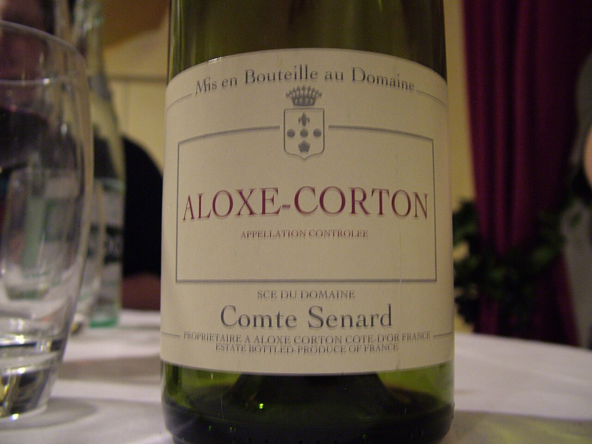

# 科尔通

科尔通是法国勃艮第伯恩丘科尔通山上的特级园法定产区，可产[黑皮诺](ref:pinot-noir)[红葡萄酒](ref:red-wine)与[霞多丽](ref:chardonnay)[白葡萄酒](ref:white-wine)。它是伯恩丘唯一的红葡萄酒特级园，常见 750 mL，[酒精度](ref:abv)约 12.5%–13.5% vol。

图：科尔通。摄影：Domaine bottled Aloxe-Corton Bourgogne。署名：tara hunt，CC BY-SA 2.0，来自 Wikimedia Commons（[来源](https://commons.wikimedia.org/w/index.php?curid=6331154)）。

## 定义与定位

先分层：红葡萄酒与白葡萄酒是大类，黑皮诺与霞多丽是品种，科尔通是特级园（grand cru）法定产区，具体地块与酒庄是更小的层级。特级园是勃艮第分级中的最高一级，酒标上会直接标注“Corton”与地块名。

科尔通与科尔通-查理曼是两个独立的特级园产区：科尔通可产红葡萄酒与少量白葡萄酒，科尔通-查理曼只产白葡萄酒。科尔通山的地块分布在阿洛克斯-科尔通、佩尔南-韦尔热莱斯与拉多瓦-塞里尼等市镇。

## 生产者与品牌

科尔通山的地块由多家酒庄分散持有，既有本地家族酒庄，也有来自伯恩丘其他村庄与酒商的生产者。同一块特级园常由不同酒庄分别装瓶，酒标上的酒庄名与地块名组合，才是具体酒款的标识。

生产者、产区与产品是三个层级：产区回答法规与地理范围，生产者回答谁种植、谁酿造、谁装瓶，产品回答年份与地块。特级园名号不保证每一瓶的水平，酒庄与年份差异仍然明显。

## 「科尔通」的产地与原料
科尔通山位于[法国](ref:france)[勃艮第](ref:burgundy)伯恩丘北部，是一座孤立的山丘，坡向与海拔在不同地块差异明显。土壤以黏土-石灰岩与泥灰岩为主，山坡上部土层较薄、排水好，下部土层更厚。

原料是[葡萄](ref:grape)：红葡萄酒以[黑皮诺](ref:pinot-noir)酿造，白葡萄酒以[霞多丽](ref:chardonnay)酿造。同一座山丘上，红白两种风格的差异主要来自坡位、土壤与品种，而不是同一种工艺的简单变化。

## 「科尔通」怎么做出来
红葡萄酒以[发酵](ref:fermentation)为基础，浸渍时间与温度决定颜色、单宁与香气；白葡萄酒则注重低温发酵与酒泥接触，以保留酸度与质地。两类酒都可能使用[橡木桶陈年](ref:oak-ageing)，新桶比例因酒庄与等级而异。

科尔通的红白两类酒在浸渍、压榨与桶陈上走不同路线；同一酒庄的不同地块也可能用不同新桶比例，具体参数应以酒庄资料与瓶标为准。科尔通红酒通常需要比村庄级更长的陈年来柔化单宁，白酒则更早进入适饮期。

## 「科尔通」的瓶型与标签
常见容量为 750 mL，[酒精度](ref:abv)约 12.5%–13.5% vol。标签应核对特级园名、颜色、地块名（如有）、年份、装瓶者与进口商信息；科尔通-查理曼是独立的白葡萄酒特级园名。

科尔通在不同市场的标签语言不同，以瓶身实际标注为准。特级园名号不等于质量等级，同一特级园内的地块与酒庄差异很大，购买时应结合具体信息判断。

## 「科尔通」的闻与喝
科尔通红酒以红樱桃、黑莓、泥土、皮革与香料气息为主，酸度中等偏高，单宁结构较强，酒体中等偏上。随着陈年，香气会发展出松露、落叶与干花气息。

科尔通白葡萄酒与科尔通-查理曼以柑橘、白花、榛子、蜂蜜与矿物感为主，酸度较高、质地饱满。品鉴红酒建议温度约 16–18 摄氏度，白酒约 11–13 摄氏度；结构较强的酒款可短暂醒酒。

## 「科尔通」的饮用与搭配
科尔通红酒适合搭配红肉、烤肉、野味与菌菇；白葡萄酒适合海鲜、禽类、奶油类菜肴与硬质奶酪。配餐时以酸度与单宁为准，不必强求固定搭配。

红酒多数适合在 5–10 年内进入适饮期，顶级年份可以更久；白酒适饮期通常更早。具体窗口因年份、地块与酒庄而异。开瓶后剩余酒液应密封冷藏并尽快饮用。本页关于科尔通的内容涉及酒精饮料；过量饮酒有害健康，未成年人不应饮酒。

## 「科尔通」的购买与保存
购买时优先选择正规渠道，核对特级园名、地块名、年份与装瓶者信息。科尔通与科尔通-查理曼的价格跨度较大，本页不给出具体数字。特级园名号不能替代对地块与酒庄的了解。

科尔通同时产黑皮诺红葡萄酒与霞多丽白葡萄酒，红白都应避光、平放于 12–15°C 的稳定环境。软木塞保持湿润；开瓶后密封冷藏，红葡萄酒两三天内喝完，白葡萄酒可稍长，但都不宜反复回温。

## 「科尔通」容易被读错的地方
第一，认为科尔通只产红葡萄酒。科尔通也产白葡萄酒，科尔通-查理曼则只产白葡萄酒。
第二，把科尔通与科尔通-查理曼当成同一产区。两者是独立特级园，品种与颜色规则不同。
第三，认为伯恩丘没有红葡萄酒特级园。科尔通是伯恩丘唯一的红葡萄酒特级园。
第四，把特级园名号当成质量保证。同一特级园内的地块与酒庄差异明显。
第五，用价格判断真伪。渠道、背标与装瓶者信息更可靠。

对照阅读：[红葡萄酒](ref:red-wine)、[法国](ref:france)。

**关键事实。**

| 项目 | 内容 |
| --- | --- |
| 一句话定位 | 法国勃艮第伯恩丘科尔通山上的特级园法定产区，可产黑皮诺红葡萄酒与霞多丽白葡萄酒，是伯恩丘唯一的红葡萄酒特级园；红葡萄酒以结构感、泥土与红果气息著称，白葡萄酒与科尔通-查理曼特级园以坚果、蜂蜜与矿物感著称，常见 750 mL、酒精度约 12.5%–13.5% vol |
| 酒种/风格 | 红葡萄酒、白葡萄酒 |
| 产区 | 法国、勃艮第 |
| 酒精度 | 12.5–13.5% vol |

## 参考资料
- [红葡萄酒](ref:red-wine)：科尔通红葡萄酒所属的大类。
- [白葡萄酒](ref:white-wine)：科尔通与科尔通-查理曼白葡萄酒所属的大类。
- [黑皮诺](ref:pinot-noir)：科尔通红葡萄酒的品种。
- [霞多丽](ref:chardonnay)：科尔通白葡萄酒与科尔通-查理曼的品种。
- [法国](ref:france)：法国葡萄酒法规与产区体系。
- [勃艮第](ref:burgundy)：村庄、一级园与特级园的分级框架。
- [葡萄](ref:grape)：科尔通所用葡萄的成熟度、酸度与单宁判断。
- [发酵](ref:fermentation)：浸渍与萃取的基本逻辑。
- [橡木桶陈年](ref:oak-ageing)：科尔通的香料、质地与桶陈来源。
- [酒精度](ref:abv)：12.5%–13.5% vol 在标签上的含义。
- [波玛](ref:pommard)：伯恩丘以结构感著称的红葡萄酒村庄，可与科尔通对照。
- [默尔索](ref:meursault)：伯恩丘以质地饱满著称的白葡萄酒村庄。
