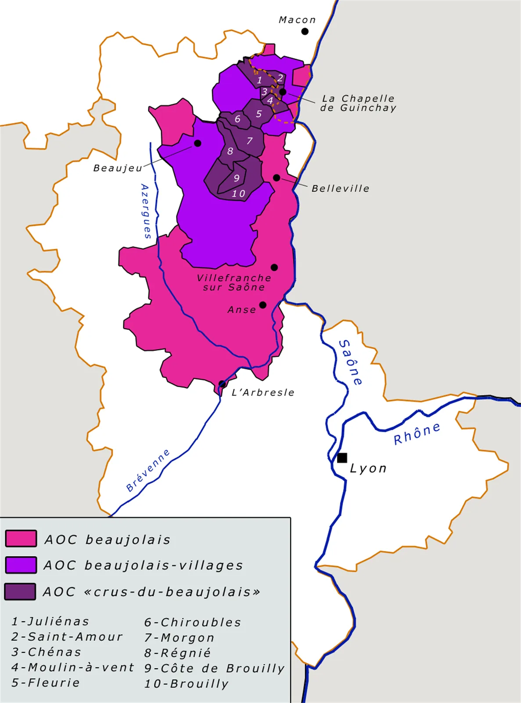

# 布鲁伊丘

酒标上，布鲁伊丘比相邻的[布鲁伊](ref:brouilly)只多了一个词：Côte。这个“坡”字不是装饰——它把范围从山脚收缩到山坡，也把酒从轻盈果味推向更紧的骨架。选购时先分清这两个名字，比记住任何形容词都管用。常见 750 mL，[酒精度](ref:abv)约 12.5%–13.5% vol。

图：布鲁伊丘。图片：Cyril5555，CC BY-SA 3.0，via Wikimedia Commons（[原图页面](https://commons.wikimedia.org/wiki/File:Carte_vignoble_beaujolais.png)）。

## 多出来的一个“Côte”

Côte de Brouilly 与 Brouilly 是两个独立的 cru，不是一个产区的两种写法。前者只覆盖布鲁伊山的山坡，后者则环绕山脚与周围的平缓地带，面积大得多。酒标上是否出现“Côte”这三个字母，直接决定瓶中酒的法定来源。

这一划分并非文字游戏。山坡与山脚在海拔、土层厚度和排水条件上不同，成熟节奏也不同，风格差异因此有地质基础。买酒时若把两者混为一谈，很容易用山脚的预期去评价一瓶山坡的酒，得出“太紧、不够讨喜”的错误结论。

## 蓝色斑岩与薄土

布鲁伊山的山坡以蓝色斑岩（pierre bleue）与花岗岩为主。斑岩质地坚硬、风化慢，形成的土层薄，混有碎石，排水极快；花岗岩风化后则提供砂质颗粒。两种母岩叠加，使根系只能在有限的土层里向下寻找水分。

薄土与强排水带来两个结果：产量天然受限，果实成熟时风味更集中；水分胁迫较早出现，酸度不容易掉得太快。这里的矿物感并非玄学，而是土壤排水与成熟节奏在口感上的投影。具体土壤分布与地块归属以官方划界为准。

## 只取山坡：海拔与晚熟

因为只取山坡，葡萄园的海拔整体高于山脚。海拔升高，夜间温度下降，葡萄呼吸消耗少，酸度保留得更好，采收期也通常比山脚晚一些。晚熟意味着更长的成熟窗口，也意味着在冷年里需要更多耐心。

坡度还带来光照与排水的一致性：坡面朝南或朝东南，日照充足，排水顺畅，不同地块的成熟差异比山脚平缓地带更小。于是布鲁伊丘的整体风格比布鲁伊更统一、更紧，酸度轮廓也更清晰。村内同样没有一级园或特级园分级，坡位与地块名才是内部分层的关键。

## 小块地与家族酒庄

布鲁伊丘的面积远小于布鲁伊，葡萄园多由家族酒庄持有的小块地组成，合作社与酒商也参与装瓶。地块小、持有人多，意味着同一山坡上的管理方式差异明显，酒款风格也更依赖具体酒庄。

酒标上的装瓶者信息因此格外重要。酒庄自装通常能追溯到具体坡位，酒商装瓶则可能混合多个来源。由于总产量有限，布鲁伊丘在市场上不如布鲁伊常见，遇到可靠的家族酒庄时，往往比追逐大品牌更有收获。

## 延长浸渍与结构

布鲁伊丘常用整串发酵，部分酒庄采用半二氧化碳浸渍：整串葡萄在充满二氧化碳的容器中先行细胞内发酵，再压榨并完成常规[发酵](ref:fermentation)。与追求轻盈的 cru 相比，这里更常延长浸渍，以增加颜色、单宁与骨架。

部分酒款进入旧[橡木桶](ref:oak-ageing)陈年，新桶比例通常不高，以免烘烤味掩盖矿物感与果味。发酵温度中等，浸渍末期适度萃取，是这里常见的组合。目标不是做出厚重的酒，而是让酸度、单宁与矿物感形成清晰的结构。

## 与山脚布鲁伊、弗勒里的差异

典型香气是黑樱桃、覆盆子、紫罗兰与泥土，部分酒款带胡椒与湿石头的矿物感。入口酸度清晰，单宁中等，酒体中等，收尾比布鲁伊更长、更有骨架。

与山脚的布鲁伊相比，布鲁伊丘更紧、更矿、酸度更挺；布鲁伊更轻、果味更直接、更早适饮。与北边的弗勒里相比，弗勒里更香、更柔，布鲁伊丘则更硬朗、更有咀嚼感。三者没有高下，只有风格分工：要花香选弗勒里，要轻快选布鲁伊，要结构选布鲁伊丘。

## 山坡在暖年与冷年的两种表情

暖年山坡日照充足，成熟更完整，果味更黑、更甜熟，酒精度靠近区间上端，单宁也更明显；冷年酸度突出，酒体偏瘦，矿物感与胡椒气息更强，但若成熟不足，单宁会显得干涩。

侍酒可以按年份调整：暖年醒酒约 30 分钟即可，冷年则应缩短醒酒、延长与空气接触前的等待。这里只做定性判断，不给出年份评分；具体表现仍取决于坡位、采收时间与酒庄。

## 布鲁伊丘的相对价位与验标方法

布鲁伊丘在博若莱 cru 中属于中等偏上价位，通常高于相邻的布鲁伊，低于穆兰-阿旺的头部酒款；山坡面积小、产量有限，酒庄自装且标注坡位的酒款会再上一档。这里只谈相对档位，不写具体价格。

判断方法有三条：一看酒标是否写全“Côte de Brouilly”，避免与布鲁伊混淆；二看装瓶者，酒庄自装更能反映坡位差异；三看年份与酒精度，暖年偏高、冷年偏低，是风格选择而非等级。渠道正规、背标完整更可靠。未开瓶应避光平放，理想温度 12–15 摄氏度。

## 关于“丘”与“布鲁伊”的误会

第一，把布鲁伊丘当成布鲁伊的别名。两者是相邻但独立的 cru，范围与风格都不同。
第二，认为带“Côte”就一定更轻。山坡的布鲁伊丘通常比山脚的布鲁伊更有结构，而不是更淡。
第三，以为山坡酒都该早喝。布鲁伊丘的适饮窗口通常比布鲁伊更长，部分酒款可达数年。
第四，把布鲁伊丘当成博若莱新酒。它是独立的 cru，强调酸度与结构，不是当年果味酒。
第五，用价格或包装判断真伪。酒标全名、装瓶者与背标信息更可靠。

## 延伸阅读

- [红葡萄酒](ref:red-wine)：本页所属的葡萄酒大类。
- [佳美](ref:gamay)：布鲁伊丘唯一的葡萄品种。
- [法国](ref:france)：法国葡萄酒法规与产区体系。
- [博若莱](ref:beaujolais)：十个 cru 的框架与南部产区。
- [葡萄](ref:grape)：酿酒葡萄的结构与成熟指标。
- [发酵](ref:fermentation)：整串发酵与半二氧化碳浸渍。
- [橡木桶陈年](ref:oak-ageing)：旧桶陈年与结构整合。
- [酒精度](ref:abv)：12.5%–13.5% vol 的标签含义。
- [布鲁伊](ref:brouilly)：同一座山体上范围更大的相邻 cru。

**关键事实。**

| 项目 | 内容 |
| --- | --- |
| 一句话定位 | 法国博若莱南部布鲁伊山山坡上的 cru 级红葡萄酒，以佳美酿造；只取山坡、不取山脚，蓝色斑岩与花岗岩带来更清晰的酸度与矿物感，面积远小于相邻的布鲁伊，常见 750 mL、酒精度约 12.5%–13.5% vol |
| 酒种/风格 | 红葡萄酒 |
| 产区 | 法国、博若莱 |
| 酒精度 | 12.5–13.5% vol |
