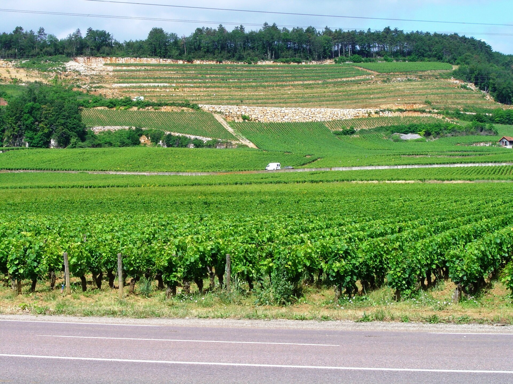

# 夜丘村庄级

夜丘村庄级（Côte de Nuits-Villages）是法国勃艮第夜丘南部的村庄级法定产区，葡萄园分布在 Brochon、Comblanchien、Corgoloin 与 Prémeaux-Prissey 等村庄。产区以[黑皮诺](ref:pinot-noir)酿造的[红葡萄酒](ref:red-wine)为主，也产少量以[霞多丽](ref:chardonnay)酿造的[白葡萄酒](ref:white-wine)。常见 750 mL，[酒精度](ref:abv)约 12.5%–13.5% vol。

图：夜丘村庄级相关实景照片。图片：Ile-de-re at German Wikipedia，Public domain，via Wikimedia Commons（[原图页面](https://commons.wikimedia.org/wiki/File:Cote-de-Nuits_01.JPG)）。

## 定义与定位

先分层：[红葡萄酒](ref:red-wine)与[白葡萄酒](ref:white-wine)是大类，黑皮诺与霞多丽是品种，夜丘村庄级是法定产区（AOC），具体酒庄与酒款是生产者层面。与单一村庄命名的产区不同，夜丘村庄级是一个跨村庄的集合名称，酒标上通常只写产区名，而不写某一个村名。

该产区内没有特级园，也没有以本产区名义标注的一级园，酒款统一为村庄级。相邻的[夜圣乔治](ref:nuits-saint-georges)等村另有自己的村庄级与一级园体系，两者不能混用。具体范围与村庄名单以产区官方划界为准。

## 生产者与品牌

产区内的酒庄规模差异较大，既有家族酒庄，也有酒商与合作社。由于跨多个村庄，同一酒商可能从不同村庄收购葡萄或酒液，再以夜丘村庄级装瓶。夜丘村庄级的酒标上，装瓶者信息是判断酒庄酒与酒商酒的关键。

生产者、产区与产品是三个层级：产区回答法规与地块范围，生产者回答谁种植、谁酿造、谁装瓶，产品回答年份、村庄来源与红白类型。同为夜丘村庄级，不同村庄与酒庄的风格仍可能有明显差异。

## 「夜丘村庄级」的产地与原料
夜丘村庄级位于[法国](ref:france)[勃艮第](ref:burgundy)夜丘南段。Brochon 紧邻热夫雷-香贝丹，Comblanchien 与 Corgoloin 在夜丘最南端，Prémeaux-Prissey 则与夜圣乔治相连。Fixin 另有独立的村庄级产区，不应与本页混为一谈。

这一带的坡地多为东向或东南向，海拔与坡度低于夜丘北段的名村；土壤以石灰岩与泥灰岩为主，Comblanchien 一带以坚硬的石灰岩著称。较温和的地形与较南的位置使葡萄成熟相对稳定，酒体通常不如夜圣乔治紧实。

原料是[葡萄](ref:grape)。红葡萄酒用[黑皮诺](ref:pinot-noir)，白葡萄酒用[霞多丽](ref:chardonnay)。黑皮诺在这里常表现出较直接的红果味与泥土气息，霞多丽则偏向清爽的柑橘与矿物风格。

## 「夜丘村庄级」怎么做出来
红葡萄酒采收后多进行分拣，部分生产者保留一定比例整串发酵，以增加香气复杂度。发酵在控温容器中进行，浸渍时间与温度影响颜色、单宁与香气；追求早饮的酒款通常浸渍较短、萃取较轻。白葡萄酒多经压榨后发酵，部分酒款进行酒泥搅拌以增加质地。

发酵完成后进入[橡木桶陈年](ref:oak-ageing)，新桶比例通常低于夜丘名村，以保留果味与较早适饮的特点。橡木桶用于整合香气与柔化单宁，不应掩盖品种本身的细腻。夜丘村庄级装瓶前是否澄清过滤，取决于生产者取向。

## 「夜丘村庄级」的瓶型与标签
常见容量为 750 mL，[酒精度](ref:abv)约 12.5%–13.5% vol，具体随年份与红白类型变化。标签应核对产区名、红白类型、年份、装瓶者与进口商信息；部分酒款会在背标注明葡萄来源村庄，但这不属于法定产区名称的一部分。

夜丘村庄级没有特级园或一级园标注，若酒标出现 "Premier Cru" 或 "Grand Cru" 字样，应核对是否实际属于其他产区。中文背标、进口商与防伪信息是核对身份的依据。

## 「夜丘村庄级」的闻与喝
红葡萄酒的典型香气是红樱桃、覆盆子、草莓与泥土，部分酒款带香料与淡淡烟熏；入口酸度清晰，单宁较细，酒体中等偏轻，通常比夜圣乔治更早适饮。陈年后可发展出落叶、蘑菇与皮革气息。

白葡萄酒常见柠檬、青苹果、白花与燧石矿物感，酸度较高、质地清爽。品鉴温度上，红葡萄酒约 15–17 摄氏度，白葡萄酒约 10–12 摄氏度；年轻红酒可短时间醒酒，老酒则应缩短。

## 「夜丘村庄级」的饮用与搭配
红酒适合禽肉、烤猪肉、菌菇、香肠与中等强度奶酪；白酒适合清蒸鱼、贝类、禽肉与软质奶酪。避免与重辣或强酸菜肴同饮，容易掩盖果味与细腻香气。

多数红葡萄酒适合在 3–8 年内饮用，白葡萄酒的适饮窗口更短。开瓶后应冷藏并在数日内喝完。本页关于夜丘村庄级的内容涉及酒精饮料；过量饮酒有害健康，未成年人不应饮酒。

## 「夜丘村庄级」的购买与保存
购买时优先选择正规渠道，核对产区名、红白类型、年份与装瓶者信息。夜丘村庄级通常定位为夜丘的入门到中端选择，价格随村庄来源、酒庄与年份差异明显，本页不给出具体数字。

夜丘村庄级以黑皮诺为主，酒体较轻、果香较早展现。未开瓶应平放于 12–15°C、避光的环境，避免温度大起大落；软木塞保持湿润即可。开瓶后抽真空或充惰性气体冷藏，最好两天内喝完，以免红果香转成酸味。

## 「夜丘村庄级」容易被读错的地方
第一，把夜丘村庄级当成一个具体村庄。它覆盖多个村庄，是跨村的村庄级产区。
第二，认为它和夜圣乔治是同一个产区。夜圣乔治有自己的村庄级与一级园体系。
第三，把 Fixin 也算进本产区。Fixin 有独立的村庄级法定产区。
第四，认为村庄级就没有好酒。村庄级只说明法规层级，不代表质量上限。
第五，用价格或包装判断真伪。渠道、标签与装瓶者信息更可靠。

对照阅读：[红葡萄酒](ref:red-wine)、[法国](ref:france)。

**关键事实。**

| 项目 | 内容 |
| --- | --- |
| 一句话定位 | 法国勃艮第夜丘南部的村庄级法定产区，葡萄园分布在 Brochon、Comblanchien、Corgoloin 与 Prémeaux-Prissey 等村庄；以黑皮诺红葡萄酒为主，也产少量霞多丽白葡萄酒，风格以红果、泥土与较早适饮著称，常见 750 mL、酒精度约 12.5%–13.5% vol |
| 酒种/风格 | 红葡萄酒、白葡萄酒 |
| 产区 | 法国、勃艮第 |
| 酒精度 | 12.5–13.5% vol |

## 参考资料
- [红葡萄酒](ref:red-wine)：本页红酒所属的葡萄酒大类。
- [红葡萄酒](ref:red-wine)：夜丘村庄级所属的静止红葡萄酒大类。
- [黑皮诺](ref:pinot-noir)：红葡萄酒使用的葡萄品种。
- [霞多丽](ref:chardonnay)：白葡萄酒使用的葡萄品种。
- [法国](ref:france)：法国葡萄酒法规与产区体系。
- [勃艮第](ref:burgundy)：本页所属产区的分级框架。
- [葡萄](ref:grape)：夜丘村庄级所用葡萄的成熟度、酸度与单宁判断。
- [发酵](ref:fermentation)：浸渍与发酵的基本逻辑。
- [橡木桶陈年](ref:oak-ageing)：夜丘村庄级的桶陈时长、香气整合与结构变化。
- [酒精度](ref:abv)：12.5%–13.5% vol 在标签上的含义。
- [夜圣乔治](ref:nuits-saint-georges)：本产区南侧相邻的村庄级产区。
