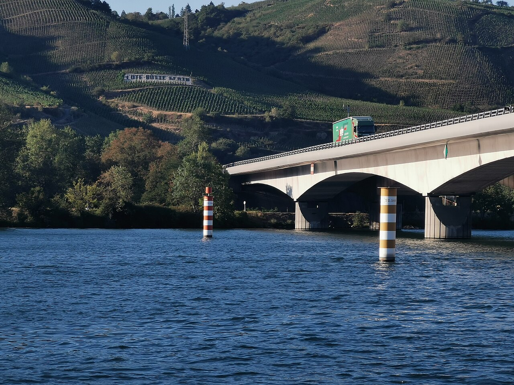

# 罗第丘

罗第丘是法国罗讷河谷最北端的红酒法定产区，位于罗讷河右岸、里昂以南的阿姆皮斯一带，以[席拉](ref:syrah)为主体、可混入少量维欧尼。葡萄园挂在陡峭的梯田上，酒以黑胡椒、紫罗兰、橄榄与烟熏气息著称。常见 750 mL，[酒精度](ref:abv)约 12.5%–14% vol。

图：罗第丘。图片：SashiRolls，CC BY-SA 4.0，via Wikimedia Commons（[原图页面](https://commons.wikimedia.org/wiki/File:Autoroute_du_soleil_pr%C3%A8s_d%27Ampuis.jpg)）。

## 定义与定位

先分层：[红葡萄酒](ref:red-wine)是大类，席拉是品种，罗第丘是法定产区（AOC），具体酒庄与酒款是生产者层面。三层分开看，才不会把“罗第丘”当成一个品牌或一个葡萄品种。

罗第丘是地理名称与法定产区标识，不是商标。只有在划定范围内、按产区规则种植与酿造的酒，才能标注 Côte-Rôtie。市面上以“罗第丘风格”描述的其他产品，不等于法定产区酒。产区内有多个村镇可以标注这一名称，其中阿姆皮斯是最核心的一处。

## 生产者与品牌

罗第丘的梯田地块狭小，生产者以家族酒庄为主，也有酒商收购葡萄或酒液。酒庄自有梯田并自行装瓶，风格更贴近地块；酒商酒则可能混合多个坡面。看酒标上的装瓶者，比看“罗第丘”更能判断来源。

生产者、产区与产品是三个层级：产区回答法规与地理范围，生产者回答谁种植、谁酿造、谁装瓶，产品回答年份与规格。名庄与普通酒庄可以同在罗第丘，不能用一款酒概括整个产区的风格。

## 「罗第丘」的产地与原料
产区位于[法国](ref:france)罗讷河谷北部，罗讷河右岸。气候受地中海与大陆性影响，夏季温暖、秋季有著名的北风，葡萄需要足够的热量与日照才能在陡坡上成熟。土壤以片岩、云母片岩与片麻岩为主，排水性好，贫瘠的土壤限制了产量。

最著名的两片坡面常被称为金丘与棕丘：前者土壤偏浅色、酒风更柔美，后者含铁、颜色偏深、酒体更紧致。梯田坡度陡，机械难以进入，耕作与采收多依赖人工，这也是产量有限、成本偏高的原因。

原料是[葡萄](ref:grape)，主体品种为[席拉](ref:syrah)。产区规则允许少量维欧尼与席拉共同发酵，具体比例与是否使用以法规与瓶标为准。维欧尼能增加花香与柔化结构，但并非每款酒都使用。

## 「罗第丘」怎么做出来
采收后通常去梗，部分生产者保留一定比例的整串，以增加香料感与结构。发酵在控温容器中进行，浸渍时间长短影响颜色、单宁与香气；温度过高会损失细腻香气，过低则萃取不足。

发酵完成后进入[橡木桶陈年](ref:oak-ageing)，新桶比例因生产者而异。罗第丘的单宁并不算特别厚重，但酸度与结构感明显，橡木桶的作用是整合香气与柔化口感，而不是掩盖果味。装瓶前是否澄清过滤，同样取决于生产者的取向。

## 「罗第丘」的瓶型与标签
常见容量为 750 mL，[酒精度](ref:abv)约 12.5%–14% vol，具体随年份与生产者变化。标签应核对产区名、年份、酒精度、净含量、装瓶者与进口商信息；部分酒庄会标注具体园地或地块。

法定产区名称的拼写带有 circumflex（Côte-Rôtie），中文背标常音译为“罗第丘”。核对身份时，产区名、装瓶者与年份三项比包装设计更可靠；罗第丘在不同市场的标签语言不同，以瓶身实际标注为准。

## 「罗第丘」的闻与喝
典型香气是黑莓、黑樱桃、黑胡椒、紫罗兰、橄榄与烟熏肉，陈年后会出现皮革、松露与落叶。入口酸度清晰，单宁中等偏上但质地细，酒体中等，余味带香料与矿物感。与南部罗讷的饱满风格相比，罗第丘更偏紧致与香气层次。

品鉴时建议温度约 16–18 摄氏度，用较大的酒杯聚香。年轻酒款可醒酒 1 小时左右，让还原味与单宁展开；老酒则应缩短醒酒时间。闻香时注意黑胡椒与花香的清晰度，过度橡木或过熟果味会削弱产区特征。

## 「罗第丘」的饮用与搭配
适合搭配烤肉、炖肉、野味与硬质奶酪；蛋白质与油脂能缓冲单宁，让酒体更圆润。黑胡椒与香草调味的菜式与酒中的香料感相呼应。避免与过甜或强酸的菜肴同饮，容易破坏平衡。

多数罗第丘适合在 5–10 年内饮用，优质年份与名庄酒可以更久；具体适饮窗口因年份与生产者而异。开瓶后应冷藏并尽量在数日内喝完。本页关于罗第丘的内容涉及酒精饮料；过量饮酒有害健康，未成年人不应饮酒。

## 「罗第丘」的购买与保存
购买时优先选择正规渠道，核对产区名、年份、装瓶者与进口商信息。价格随生产者声誉、年份与地块差异明显，本页不给出具体数字；同一产区内不同酒庄的风格差异，不能靠价格高低简单判断。

罗第丘以席拉为主体，常带黑胡椒与烟熏气息，结构紧实。未开瓶可平放在 12–15°C 的避光处，长期存放要保持温度稳定；软木塞需要湿度。开瓶后抽真空或充惰性气体冷藏，两三天内喝完，避免香气在反复回温中散失。

## 「罗第丘」容易被读错的地方
第一，把罗第丘当成品牌。它是法定产区名称。
第二，认为罗第丘一定混维欧尼。允许混入不等于每款都混。
第三，把金丘与棕丘当成质量等级。它们是坡面与土壤的区分，不是分级。
第四，认为陡坡梯田只影响风景。坡度直接限制了机械化与产量。
第五，用价格判断真伪与品质。渠道、标签与装瓶者信息更可靠。

**关键事实。**

| 项目 | 内容 |
| --- | --- |
| 一句话定位 | 法国罗讷河谷北部罗第丘法定产区的红葡萄酒，以席拉为主体、可混入少量维欧尼，产自阿姆皮斯一带的陡坡梯田，以黑胡椒、紫罗兰、橄榄与烟熏气息著称；常见 750 mL、酒精度约 12.5%–14% vol |
| 酒种/风格 | 红葡萄酒 |
| 产区 | 法国、罗讷河谷 |
| 酒精度 | 12.5–14% vol |

## 参考资料
- [红葡萄酒](ref:red-wine)：罗第丘所属的葡萄酒大类。
- [席拉](ref:syrah)：罗第丘的主体品种与风格来源。
- [法国](ref:france)：法国葡萄酒法规与产区体系。
- [罗讷河谷](ref:rhone)：南北罗讷的产区框架、品种与法规。
- [葡萄](ref:grape)：罗第丘所用葡萄的成熟度、酸度与单宁判断。
- [发酵](ref:fermentation)：浸渍与控温发酵的基本逻辑。
- [橡木桶陈年](ref:oak-ageing)：罗第丘的桶陈时长、香气整合与结构变化。
- [酒精度](ref:abv)：12.5%–14% vol 在标签上的含义。
