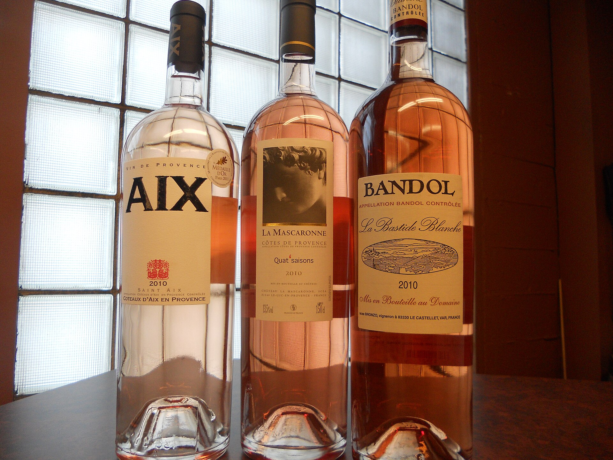

# 普罗旺斯桃红

普罗旺斯桃红（Côtes de Provence Rosé）是[法国](ref:france)[普罗旺斯](ref:provence)丘法定产区的[桃红葡萄酒](ref:rose-wine)，是普罗旺斯产量与知名度最高的酒种。它以歌海娜、神索、西拉与慕合怀特等品种混酿，浸皮时间短、颜色浅。常见 750 mL，[酒精度](ref:abv)约 12.5%–13.5% vol。

图：普罗旺斯桃红相关实景照片。图片：Jameson Fink，CC BY 2.0，via Wikimedia Commons（[原图页面](https://commons.wikimedia.org/wiki/File:Magnums_of_Provence_rose.jpg)）。

## 定义与定位

先分层：[桃红葡萄酒](ref:rose-wine)是类型，歌海娜与西拉等是品种，普罗旺斯丘是法定产区，具体酒庄与酒款是生产者层面。“普罗旺斯桃红”既可以指一种风格，也可以指普罗旺斯丘产区的桃红。

普罗旺斯丘同时生产[红葡萄酒](ref:red-wine)与少量[白葡萄酒](ref:white-wine)，但桃红占绝对多数。把“普罗旺斯”等同于“桃红”会忽略产区内的红白葡萄酒，也容易把其他产区的桃红误认成普罗旺斯丘。

## 生产者与品牌

产区范围大，生产者类型多样：家族酒庄、合作社与大型酒商都有。桃红周转快、市场需求大，不少酒商以收购葡萄或基酒的方式参与生产。

生产者、产区与产品是三个层级：产区回答法规与地块范围，生产者回答谁种植、谁酿造、谁装瓶，产品回答年份、颜色与规格。同为普罗旺斯丘桃红，不同酒庄的颜色深浅、品种比例与甜度设定会有差别。

## 「普罗旺斯桃红」的产地与原料
普罗旺斯丘位于法国东南部地中海沿岸，葡萄园分布在沿海丘陵、谷地与内陆高地，海拔从接近海平面延伸到约 400 米。气候属地中海型，夏季炎热干燥，密史脱拉风影响明显。土壤以石灰岩、片岩与砾石为主，排水好、肥力低。

原料是[葡萄](ref:grape)。桃红常用[歌海娜](ref:grenache)、神索、[西拉](ref:syrah)与慕合怀特混酿，部分酒款使用本地品种蒂布伦。产区内部还有圣维克多、弗雷瑞斯、拉隆德、皮埃尔弗等地理命名。

## 「普罗旺斯桃红」怎么做出来
桃红的颜色来自浸皮。常见做法是直接压榨，葡萄破碎后短时间内压榨，只让少量色素进入酒液；另一种是短时间浸渍，浸皮约 2–12 小时后分离自流汁。

发酵通常在低温下进行，以保留红果与花香；部分酒款阻断苹果酸乳酸发酵，以维持清爽酸度。发酵的基本逻辑可参见[发酵](ref:fermentation)。与需要长时间浸渍的红葡萄酒相比，桃红的工艺重点是“少提取、快分离”。

## 「普罗旺斯桃红」的瓶型与标签
常见容量为 750 mL，[酒精度](ref:abv)约 12.5%–13.5% vol，具体随年份与酒庄变化。标签应核对“Côtes de Provence”产区名、颜色、年份、装瓶者与进口商信息。

部分酒款会标注圣维克多等地理命名，或标注具体酒庄与酒款名。核对普罗旺斯桃红时，中文背标与进口商信息是身份依据，以瓶身实际标注为准。

## 「普罗旺斯桃红」的闻与喝
典型香气是红醋栗、草莓、柑橘、白花与咸鲜，部分酒款带桃与甜瓜气息；入口酸度清晰、酒体轻到中等，余味干净。颜色从浅鲑鱼粉到较深的粉红都有可能，颜色深浅主要反映浸皮时间与品种，不直接等于质量。

品鉴建议温度约 8–10 摄氏度，用郁金香形杯或专用桃红杯。温度过低会掩盖香气，过高则显得松散；先闻果香与花香，再判断酸度与咸鲜感的平衡。

## 「普罗旺斯桃红」的饮用与搭配
适合作为开胃酒，也可搭配海鲜、沙拉、地中海蔬菜、禽肉与软质奶酪。酸度清晰、酒体轻盈，不适合搭配重口味红肉或浓酱菜肴。

多数桃红适合在 1–2 年内饮用，少数结构型酒款可以稍久存放。开瓶后应冷藏并在数日内喝完；本页关于普罗旺斯桃红的内容涉及酒精饮料；过量饮酒有害健康，未成年人不应饮酒。

## 「普罗旺斯桃红」的购买与保存
购买时核对产区名、颜色、年份与装瓶者。普罗旺斯丘桃红产量大、价格跨度宽，从日常餐酒到高价酒款都有，本页不给出具体数字。

未开瓶应避光、平放或直立放置于阴凉处，理想温度为 12–15 摄氏度，避免高温与剧烈温差。桃红对光和热较敏感，长期存放应保持温度稳定。开瓶后抽真空并冷藏，尽快喝完。

## 「普罗旺斯桃红」容易被读错的地方
第一，认为颜色越浅质量越好。颜色反映浸皮时间与品种，不直接等于质量。
第二，把普罗旺斯等同于桃红。产区也生产红葡萄酒与少量白葡萄酒。
第三，认为桃红都是甜的。普罗旺斯丘桃红以干型为主。
第四，认为桃红不能陈年。多数宜早饮，但少数结构型酒款可以短期存放。
第五，把普罗旺斯丘与邦多勒混为一谈。两者相邻，但法定产区与风格重心不同。

对照阅读：[法国](ref:france)、[桃红葡萄酒](ref:rose-wine)。

**关键事实。**

| 项目 | 内容 |
| --- | --- |
| 一句话定位 | 法国普罗旺斯丘法定产区的桃红葡萄酒，是普罗旺斯产量与知名度最高的酒种；以歌海娜、神索、西拉与慕合怀特等品种混酿，浸皮时间短、颜色浅，风格以红果、柑橘、白花与咸鲜为主，常见 750 mL、酒精度约 12.5%–13.5% vol |
| 酒种/风格 | 桃红葡萄酒 |
| 产区 | 法国、普罗旺斯 |
| 酒精度 | 12.5–13.5% vol |

**来源与边界。** 本页关于「普罗旺斯桃红」的关键事实，主要由以下来源交叉核对：INAO（普罗旺斯丘法定产区的范围、品种与地理命名；由原条目末尾参考资料迁移，未逐条复核访问日期）、European Union（欧盟葡萄酒类别、地理标志与标签规则）、Oxford University Press（提供关于普罗旺斯丘、普罗旺斯与桃红的条目；由原条目末尾参考资料迁移，未逐条复核访问日期）。价格、批次与状态会变，涉及这些字段时以页面所列来源的最新版本为准。正文为项目自写，来源只作核验，不复制原文。

## 参考资料
- [普罗旺斯](ref:provence)：普罗旺斯桃红所属产区的整体框架。
- [桃红葡萄酒](ref:rose-wine)：桃红的类型与酿造路线。
- [红葡萄酒](ref:red-wine)与[白葡萄酒](ref:white-wine)：普罗旺斯丘的另外两个类型。
- [歌海娜](ref:grenache)与[西拉](ref:syrah)：桃红混酿的主要品种。
- [邦多勒](ref:bandol)：普罗旺斯以红葡萄酒著称的法定产区。
- [葡萄](ref:grape)：普罗旺斯桃红所用葡萄的成熟度、酸度与单宁判断。
- [发酵](ref:fermentation)：桃红酿造的基础工艺环节。
- [酒精度](ref:abv)：12.5%–13.5% vol 在标签上的含义。
