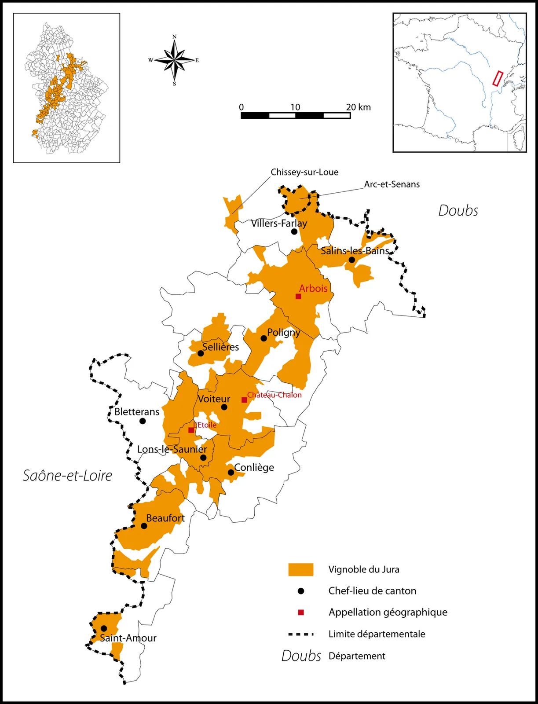

# 汝拉坡

汝拉坡（Côtes du Jura）是[法国](ref:france)[汝拉](ref:jura)覆盖范围最广的法定产区：从北到南铺开 105 个市镇，却只有约 551 公顷葡萄园。它以[白葡萄酒](ref:white-wine)和起泡酒为主，同时生产[红葡萄酒](ref:red-wine)、[黄酒](ref:yellow-wine)、稻草酒，并为 Macvin du Jura 提供葡萄。常见 750 mL，[酒精度](ref:abv)约 12.5%–14.5% vol。

图：汝拉坡。图片：DalGobboM ¿!i?，CC BY-SA 3.0，via Wikimedia Commons（[原图页面](https://commons.wikimedia.org/wiki/File:Vignobles_jura.png)）。

## 1937 年 7 月 31 日：汝拉最"宽"的 AOC

汝拉坡的 AOC 由 1937 年 7 月 31 日法令确立，比[阿尔布瓦](ref:arbois)晚一年。它的定位从一开始就不是"某个村"，而是"整个汝拉山麓的公共框架"：只要在划定市镇内、按品种与产量规则种植，就可以使用这个名字。也正因为它宽，它常被误读成"大区餐酒"；实际上它和阿尔布瓦、[莱图瓦尔](ref:letoile)、[夏隆堡](ref:chateau-chalon)是平级的 AOC，只是地理尺度不同。

## 从 60 到 105 个市镇，却只有 551 公顷

1937 年时，产区名单上只有约 60 个市镇；今天扩展到 105 个，面积却只有约 551 公顷，产量在汝拉排第二。这个"广而稀"的结构很关键：市镇数量多，意味着气候与土壤差异大；面积小，意味着每个市镇平均只有几公顷葡萄。Arlay、Beaufort、Buvilly、Gevingey、Lavigny、Mantry、Passenans、Poligny、Rotalier、Saint-Lothain、Voiteur 等是面积较大的名字。买酒时看到这些村子，往往比只写 "Côtes du Jura" 更有信息量。

## 200–400 米：南向坡上的成熟度

汝拉坡的葡萄园大多位于海拔 200–400 米的南或西南向坡地。气候是半大陆性：冬季寒冷，夏季温暖，年均温约 11–13 °C，年降雨约 1,150 毫米，日照约 1,700–1,900 小时。坡向在这里比纬度更重要：南向坡能多拿到几个小时日照，帮助 Poulsard 与 Trousseau 这类晚熟品种完成成熟；谷底与北向地块则常常酸度过高。霜冻是实际风险，尤其在春季，选坡向就是选风险。

## 白多红少：霞多丽与萨瓦涅的主场

法规把白葡萄的主品种定为[霞多丽](ref:chardonnay)与 Savagnin，红葡萄的主品种定为[黑皮诺](ref:pinot-noir)、Poulsard 与 Trousseau；跨组品种只能作辅助。实际种植上，白酒与起泡酒占主导，红酒更集中在少数村子。霞多丽在 ouillé 路线里给出榛子、黄苹果与奶油质地；Savagnin 则在 sous voile 路线里走向核桃、咖喱与咸鲜。无论哪一路，[葡萄](ref:grape)都经控温[发酵](ref:fermentation)，需要质地的酒款再进入[橡木桶陈年](ref:oak-ageing)。红酒通常比阿尔布瓦更轻、更直接，Poulsard 的颜色浅得像桃红。

## Vin de Paille：20 hl/ha 与六周风干

稻草酒是汝拉坡的"甜酒名片"，但工艺不是加糖也不是加烈：葡萄采下后在稻草或架子上风干至少六周，水分蒸发、糖与酸同时浓缩，再压榨发酵。出汁率极低，法规把产量限制在 20 hl/ha。成品有杏干、蜂蜜、橙皮与坚果，甜度高但酸度也高，喝起来不腻。它和[黄酒](ref:yellow-wine)是两套工艺：前者靠风干浓缩，后者靠酒膜与长期氧化。

## Macvin du Jura：1991 年的"未发酵"甜酒

Macvin du Jura 是独立的 AOC，1991 年 11 月 14 日获法令承认，地理范围覆盖汝拉所有 AOC 产区，产量约占汝拉 AOC 总产量的 5%。做法是把未发酵的葡萄醪与当地葡萄渣蒸馏酒混合（约三分之二醪、三分之一酒），阻止发酵，再在橡木桶中至少陈酿 10 个月。成品酒精度 16–22 度，残留糖高，呈琥珀色，有葡萄干、橙皮与香料。它属于法国 AOC 里很少见的 mistelle（甜酒）类别。汝拉坡的五个品种都可以用于 Macvin 的醪。

## 与 Arbois 的分工：一个宽，一个深

[阿尔布瓦](ref:arbois)是"深"的产区：12 个村、766 公顷，红葡萄强势，黄酒与稻草酒有明确村庄身份。汝拉坡是"宽"的产区：105 个市镇、551 公顷，白酒与起泡酒为主，风格跨度更大但单村辨识度更低。两者不是高低关系，而是尺度的差异。想要稳定风格，选阿尔布瓦的知名村子；想要探索汝拉不同土壤的横截面，汝拉坡反而更有意思。价格上，汝拉坡通常也更亲民。

## 酒庄与酒款：Rotalier、Voiteur 与 Poligny

Domaine Ganevat 在 Rotalier，以老藤、低产量和自然派酿造闻名，是汝拉坡价格与话题度的顶点；Domaine Jean Bourdy 在 Château-Chalon，但汝拉坡产品线同样完整；Fruitière Vinicole de Voiteur 是合作社代表，产量大、风格稳定；Domaine de la Pinte 在 Pupillin，以 Savagnin 与 Poulsard 见长。合作社在这类"广域 AOC"里尤其重要，它把分散的小地块聚合起来，也让入门价格得以维持。

## 价格带：€14 到 €150

以法国零售市场 2026 年的常见挂牌价看（随年份、渠道与评分波动）：普通红/白约 €14–20，村庄级或单一园 €22–32，黄酒与稻草酒多在 €35–55，Ganevat 等名庄可到 €60–150。汝拉坡的入门价低于阿尔布瓦，原因是品牌溢价较低、合作社供应稳定；但顶端酒款的价格并不便宜，因为老藤与低产量是硬成本。

## 误解：Côtes du Jura 不是"山麓餐酒"

最常见的误解是把 "Côtes du Jura" 当成汝拉的山麓普通餐酒，甚至与 Jura IGP 混为一谈。它不是 IGP，而是 1937 年就确立的 AOC，有品种、产量、酒精度与陈酿的完整规则；它也不是"次一级的阿尔布瓦"，两者是并列的法定产区。第二个误解是"汝拉坡只有黄酒"；实际上白酒与起泡酒才是产量主体。第三个误解是"Poulsard 就是薄酒"，好年份的 Poulsard 可以有惊人的香气复杂度，只是颜色浅。

## 配餐：奶油蘑菇鸡与蓝纹奶酪

汝拉坡的白葡萄酒适合奶油蘑菇鸡、烤河鱼、蜗牛与软质奶酪；Savagnin 的 sous voile 版本则适合孔泰、核桃与咖喱类菜肴。红酒配烤猪肉、香肠与炖牛肉；稻草酒配蓝纹奶酪、杏子塔或鹅肝。起泡酒（[Crémant du Jura](ref:cremant)）是当地最实用的开胃酒，酸度高、气泡细，配炸物与咸点都稳。若把同一款白酒分别配奶油酱与清蒸鱼，会发现前者放大质地、后者放大酸度——这正是汝拉坡"宽"的另一层含义。侍酒温度：白酒 10–12 °C，红酒 15–16 °C，黄酒 13–15 °C。

汝拉坡的价值在于"横截面"：同一品种在 105 个市镇里能给出不同答案。把它当作一张地图，而不是一个品牌，才不会辜负这 551 公顷。

对照阅读：[法国](ref:france)、[红葡萄酒](ref:red-wine)。

**关键事实。**

| 项目 | 内容 |
| --- | --- |
| 一句话定位 | 法国汝拉覆盖范围最广的法定产区，1937 年 7 月 31 日获 AOC，跨越 105 个市镇但仅约 551 公顷；白酒与起泡酒为主，红白与 Vin Jaune、Vin de Paille 并存，并覆盖 Macvin du Jura 的葡萄来源 |
| 酒种/风格 | 红葡萄酒、白葡萄酒、黄酒 |
| 产区 | 法国、汝拉 |
| 酒精度 | 12.5–14.5% vol |

**来源与边界。** 本页关于「汝拉坡」的关键事实，主要由以下来源交叉核对：CIVJ（1937 年 7 月 31 日法令、1937 年约 60 个市镇与今天 105 个市镇、551 公顷及以白酒/起泡酒为主；Macvin 1991 年 11 月 14 日法令、占汝拉 AOC 总产量 5%、三分之一葡萄渣蒸馏酒、最低 10 个月橡木桶与 16–22 度）、INAO / CIVJ（Vin Jaune 陈酿至第 6 年 12 月 15 日、至少 60 个月酒膜下与第 7 年 1 月 1 日上市）、Oxford University Press（提供关于汝拉坡与汝拉的条目）。价格、批次与状态会变，涉及这些字段时以页面所列来源的最新版本为准。正文为项目自写，来源只作核验，不复制原文。
