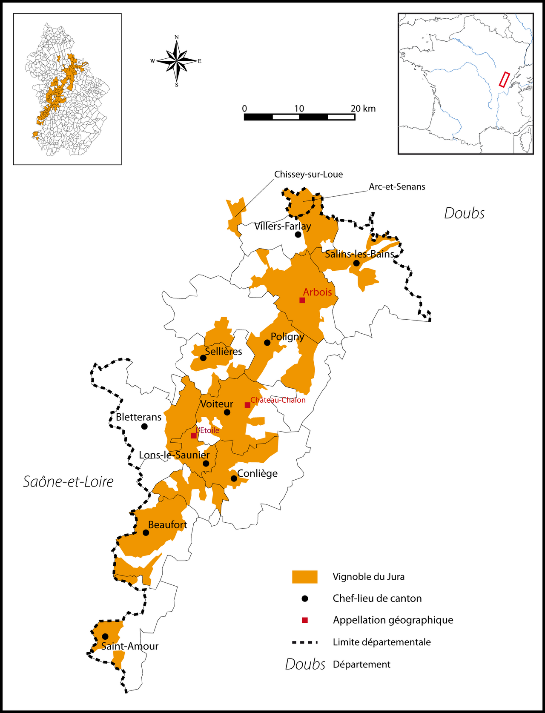

# 汝拉起泡酒

汝拉起泡酒（Crémant du Jura）是[法国](ref:france)[汝拉](ref:jura)的传统法[起泡酒](ref:sparkling-wine)法定产区。它以霞多丽、萨瓦涅、黑皮诺、普尔萨与特鲁索等品种酿造，二次发酵在瓶中进行，带酒泥陈年不少于 9 个月。常见 750 mL，[酒精度](ref:abv)约 12.0%–12.5% vol。

图：汝拉起泡酒。图片：DalGobboM ¿!i?，CC BY-SA 3.0，via Wikimedia Commons（[原图页面](https://commons.wikimedia.org/wiki/File:Vignobles_jura.png)）。

## 定义与定位

先分层：[起泡酒](ref:sparkling-wine)是大类，霞多丽等是品种，汝拉起泡酒是法定产区，具体酒庄与酒款是生产者层面。“Crémant”是法国对传统法起泡酒的一类法定命名，不是一个品牌。

汝拉起泡酒与[汝拉坡](ref:cotes-du-jura)的关系是“起泡与静态”：汝拉坡生产静态红白与黄酒，汝拉起泡酒专门生产起泡酒。两者使用同一片葡萄园，但采收时间、酿造路线与法规要求不同。

## 生产者与品牌

产区以家族酒庄与合作社为主，也有酒商。起泡酒需要瓶陈与转瓶、除渣等工序，设备与时间投入较高，因此生产者规模通常不大。

生产者、产区与产品是三个层级：产区回答法规与范围，生产者回答种植、酿造与装瓶，产品回答年份、类型与规格。同为汝拉起泡酒，不同酒庄的基酒比例、酒泥陈年长度与甜度设定会有差别。

## 「汝拉起泡酒」的产地与原料
汝拉起泡酒的葡萄园与汝拉静态酒产区重叠，分布在汝拉省西部的丘陵坡地上，海拔约 250–450 米。土壤以石灰岩、泥灰岩与碎石为主，排水好、肥力低。

原料是[葡萄](ref:grape)。品种包括[霞多丽](ref:chardonnay)、萨瓦涅、[黑皮诺](ref:pinot-noir)、普尔萨与特鲁索。基酒通常较早采收，以保留较高酸度与较低酒精度，为二次发酵留出空间。

## 「汝拉起泡酒」怎么做出来
基酒先在不锈钢罐或旧桶中完成第一次[发酵](ref:fermentation)，再装入瓶中加入糖与酵母进行第二次发酵，产生气泡。酒液在瓶中带酒泥陈年不少于 9 个月，使气泡更细腻、风味更完整。

陈年结束后进行转瓶与除渣，再按需添加调味液，决定成酒的甜度。白起泡酒以白葡萄为主，桃红起泡酒通过短时间浸皮获得颜色。基酒的酸度与结构决定成酒的骨架。

## 「汝拉起泡酒」的瓶型与标签
常见容量为 750 mL，[酒精度](ref:abv)约 12.0%–12.5% vol。标签应核对“Crémant du Jura”产区名、类型、甜度标示、装瓶者与进口商信息。

法国起泡酒通常以干型为主，甜度用语有 brut、extra brut 等差别。核对汝拉起泡酒时，中文背标与进口商信息是身份依据，以瓶身实际标注为准。

## 「汝拉起泡酒」的闻与喝
白起泡酒以青苹果、柠檬、白花与矿物感为主，酸度高、气泡细腻；桃红起泡酒增加红果与柑橘气息。带酒泥陈年较长的酒款会出现面包、奶油与坚果风味。

品鉴建议温度约 8–10 摄氏度，用郁金香形或笛形杯。先观察气泡的细密度与持续性，再闻香气，最后判断酸度与甜度的平衡。避免过度冰镇，低温会掩盖香气。

## 「汝拉起泡酒」的饮用与搭配
适合作为开胃酒，也可搭配海鲜、沙拉、禽肉与软质奶酪。干型适合清淡菜肴，甜度稍高的酒款可搭配水果甜点。

开瓶后气泡会逐渐流失，应冷藏并在数日内喝完，使用专用塞可延缓失气。本页关于汝拉起泡酒的内容涉及酒精饮料；过量饮酒有害健康，未成年人不应饮酒。

## 「汝拉起泡酒」的购买与保存
购买时核对产区名、甜度标示、年份与装瓶者。汝拉起泡酒产量有限，价格通常高于普通起泡酒，本页不给出具体数字。

未开瓶应避光、平放于阴凉处，理想温度为 12–15 摄氏度，避免高温与剧烈温差。长期存放应保持温度稳定；开瓶后冷藏并尽快饮用。

## 「汝拉起泡酒」容易被读错的地方
第一，把汝拉起泡酒与香槟混为一谈。两者产区、品种与法规不同。
第二，认为“Crémant”是品牌名。它是法国传统法起泡酒的一类法定命名。
第三，认为起泡酒都是甜的。干型是主流，甜度由调味液决定。
第四，认为气泡越多质量越好。气泡的细腻与持续比数量更重要。
第五，只用价格判断质量。产区、甜度与装瓶者信息更具体。

汝拉起泡酒的辨识点是“汝拉品种 + 传统法 + 带酒泥陈年”，不是“汝拉的香槟”。霞多丽、萨瓦涅、黑皮诺、普尔萨与特鲁索给酒体不同层次的酸度与果香；瓶中二次发酵和酒泥接触带来气泡与面包气息，最低陈年时间只是法定门槛，不代表所有酒都同一风格。汝拉起泡酒的品种组合可以因酒款而变，萨瓦涅与普尔萨带来本地酸度，霞多丽与黑皮诺补充结构；酒泥陈年时间只是法定下限。把它当成“汝拉版香槟”，会忽略品种与陈年选择的差异。

**关键事实。**

| 项目 | 内容 |
| --- | --- |
| 一句话定位 | 法国汝拉的传统法起泡酒法定产区，以霞多丽、萨瓦涅、黑皮诺、普尔萨与特鲁索等品种酿造，二次发酵在瓶中进行，带酒泥陈年不少于 9 个月；风格清爽、酸度高、气泡细腻，有白与桃红两类，常见 750 mL、酒精度约 12.0%–12.5% vol |
| 酒种/风格 | 起泡酒 |
| 产区 | 法国、汝拉 |
| 酒精度 | 12–12.5% vol |

**来源与边界。** 本页关于「汝拉起泡酒」的关键事实，主要由以下来源交叉核对：INAO（汝拉起泡酒法定产区的范围、品种与带酒泥陈年规则；由原条目末尾参考资料迁移，未逐条复核访问日期）、Légifrance（带酒泥瓶陈不少于 9 个月等规则；由原条目末尾参考资料迁移，未逐条复核访问日期）、Oxford University Press（提供关于汝拉起泡酒与汝拉的条目；由原条目末尾参考资料迁移，未逐条复核访问日期）。价格、批次与状态会变，涉及这些字段时以页面所列来源的最新版本为准。正文为项目自写，来源只作核验，不复制原文。

## 参考资料
- [起泡酒](ref:sparkling-wine)：传统法起泡酒的工艺与风格框架。
- [汝拉](ref:jura)：汝拉起泡酒所属产区的整体框架。
- [汝拉坡](ref:cotes-du-jura)：同一片葡萄园的静态酒产区。
- [霞多丽](ref:chardonnay)与[黑皮诺](ref:pinot-noir)：起泡酒基酒的两个主要品种。
- [葡萄](ref:grape)：汝拉起泡酒所用葡萄的成熟度、酸度与单宁判断。
- [发酵](ref:fermentation)：第一次发酵与瓶中二次发酵的基本逻辑。
- [酒精度](ref:abv)：12.0%–12.5% vol 在标签上的含义。
