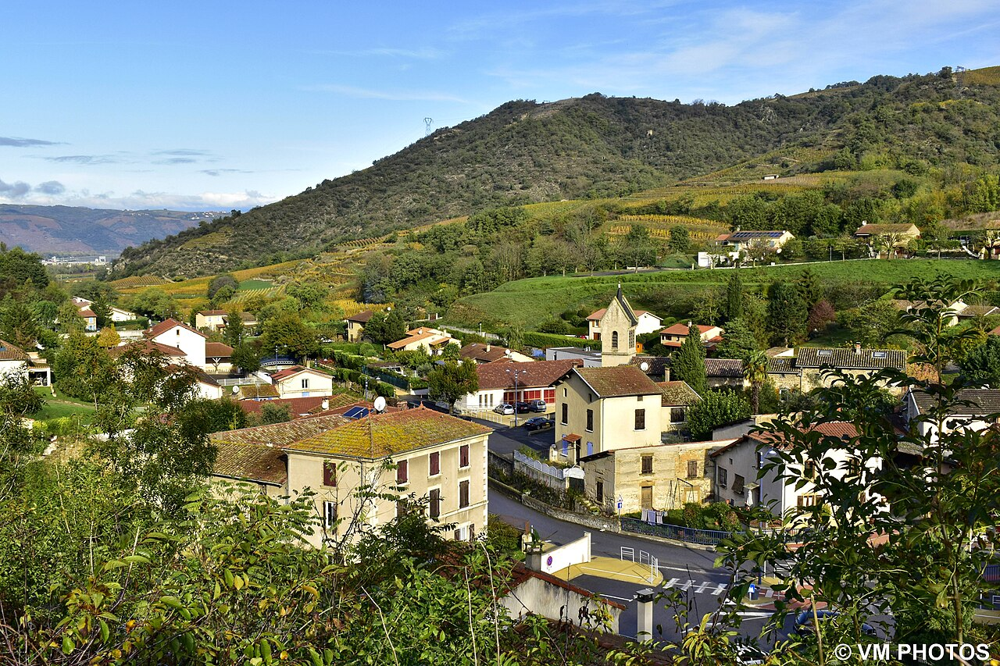

# 克罗兹-埃米塔日

克罗兹-埃米塔日是法国北罗讷河谷的[红葡萄酒](ref:red-wine)法定产区，位于罗讷河东岸，围绕坦恩-埃米塔日（Tain-l'Hermitage）与埃米塔日丘分布，是北罗讷面积最大的法定产区。红葡萄酒以[叙拉](ref:syrah)酿造，也产少量白葡萄酒，常见 750 mL，[酒精度](ref:abv)约 12.5%–14% vol。

图：克罗兹-埃米塔日。图片：VM PHOTOS FRANCE，CC BY-SA 4.0，via Wikimedia Commons（[原图页面](https://commons.wikimedia.org/wiki/File:VM_PHOTOS_CROZES_PLACE_DE_LA_MAIRIE.jpg)）。

## 定义与定位

先分层：[红葡萄酒](ref:red-wine)是大类，叙拉是品种，克罗兹-埃米塔日是法定产区（AOC），具体酒庄与酒款是生产者层面。产区名来自克罗兹-埃米塔日村，与埃米塔日丘上的埃米塔日产区是两个不同名称。

克罗兹-埃米塔日于 1937 年获得法定产区地位。它的范围围绕埃米塔日丘展开，但埃米塔日丘本身属于面积很小的埃米塔日产区；两者可以相邻，却不能互相替代。在北罗讷，它常与[圣约瑟夫](ref:saint-joseph)与[科尔纳斯](ref:cornas)一起被拿来比较。

## 生产者与品牌

产区内以家族酒庄与合作社为主，酒庄规模差异较大。北部靠近坦恩的地块多为坡地，南部延伸到大片冲积平原，机械化程度比埃米塔日高。酒标上的装瓶者信息是区分酒庄酒与酒商酒的关键。

克罗兹-埃米塔日是北罗讷面积最大的法定产区，生产者包括独立酒庄、合作社与酒商。产区名只说明地理范围，酒的风格还取决于葡萄园位置、产量与陈年；同一酒商不同系列也可能来自不同地块。

## 「克罗兹-埃米塔日」的产地与原料
克罗兹-埃米塔日位于[法国](ref:france)北罗讷河谷，罗讷河东岸，行政上属于德龙省。气候为大陆性，夏季炎热，密史脱拉风带来干燥与降温，生长季末的降雨会影响采收决策。

土壤分成两类：北部靠近埃米塔日丘的地块以花岗岩与坡地为主，排水性好；南部是较平坦的冲积台地与黏土-石灰岩，土层更厚。原料是[葡萄](ref:grape)，红葡萄酒以[叙拉](ref:syrah)酿造；白葡萄酒以玛珊（Marsanne）与胡珊（Roussanne）为主，产量占比小。

## 「克罗兹-埃米塔日」怎么做出来
红葡萄酒以[发酵](ref:fermentation)为基础，浸渍时间与温度决定颜色、单宁与果味。部分酒庄采用带梗发酵，增加香料与草本层次；之后多使用[橡木桶陈年](ref:oak-ageing)，新桶比例通常低于埃米塔日的顶级酒款，以保留果味。

白葡萄酒多在桶中发酵并带酒泥搅拌，增加质地与坚果气息。克罗兹的红白工艺分歧很大：红酒可能带梗，白酒可能桶中发酵并搅泥；新桶比例通常低于埃米塔日顶级款，具体以酒庄资料与瓶标为准。

## 「克罗兹-埃米塔日」的瓶型与标签
常见容量为 750 mL，[酒精度](ref:abv)约 12.5%–14% vol。标签应核对产区名、颜色（红或白）、年份、装瓶者与进口商信息，部分酒款会标注村庄或地块。

克罗兹-埃米塔日酒标可标产区名，也可能标“Crozes-Hermitage”加酒庄名；同一产区有红白两类，买时先确认颜色与年份。法国酒标通常不标品种，叙拉比例要看背标或酒庄资料。

## 「克罗兹-埃米塔日」的闻与喝
年轻红酒以黑莓、黑胡椒、紫罗兰与黑橄榄气息为主，酸度中等偏高，单宁中等，风格比埃米塔日更开放、更易饮。成熟后会出现皮革、烟草与松露气息；南部平原的酒款通常果味更足、结构更柔。

白葡萄酒以白花、杏子、蜂蜜与榛子气息为主，酸度中等，质地较圆润。品鉴红酒建议温度约 16–18 摄氏度，白酒约 10–12 摄氏度；红酒可短暂醒酒，白酒不宜过度冰镇。

## 「克罗兹-埃米塔日」的饮用与搭配
红酒适合搭配红肉、烤肉、禽类与菌菇；酒体较轻的年份也可以搭配带香料的炖菜。白酒适合海鲜、白肉与奶油类菜肴。饮用克罗兹-埃米塔日时，配餐以酸度与单宁强度为准，不必强求固定搭配。

多数红酒适合在 3–8 年内饮用，结构较强的年份可以更久；具体适饮窗口因年份与酒庄而异。开瓶后剩余酒液应密封冷藏并尽快饮用。本页关于克罗兹-埃米塔日的内容涉及酒精饮料；过量饮酒有害健康，未成年人不应饮酒。

## 「克罗兹-埃米塔日」的购买与保存
购买时优先选择正规渠道，核对产区名、年份与装瓶者信息。同一产区内的价格跨度较大，本页不给出具体数字。克罗兹-埃米塔日的产区名与包装只能证明法定范围，不能替代对具体酒庄、年份与装瓶者的核对。

克罗兹-埃米塔日以叙拉为主，酒体比罗第丘更宽、果味更直接。未开瓶应平放于 12–15°C、避光处，软木塞保持湿润；开瓶后密封冷藏，两三天内喝完，避免黑莓与胡椒香气在敞放中变钝。

## 「克罗兹-埃米塔日」容易被读错的地方
第一，把克罗兹-埃米塔日与埃米塔日当成同一产区。两者名称相邻，但范围与产量差别很大。
第二，认为克罗兹-埃米塔日只产红葡萄酒。它也产少量白葡萄酒，以玛珊与胡珊为主。
第三，认为整个产区都是花岗岩坡地。南部有大片冲积台地与黏土-石灰岩。
第四，把黑胡椒气息当成缺陷。它是叙拉与北罗讷的典型特征。
第五，认为所有酒款都必须长期陈年。不同酒庄与年份的适饮窗口差异明显。

**关键事实。**

| 项目 | 内容 |
| --- | --- |
| 一句话定位 | 法国北罗讷河谷罗讷河东岸的叙拉红葡萄酒法定产区，围绕坦恩-埃米塔日与埃米塔日丘分布，是北罗讷面积最大的法定产区；红葡萄酒以叙拉酿造，也产少量以玛珊与胡珊酿造的白葡萄酒，以黑莓、黑胡椒与紫罗兰气息著称，常见 750 mL、酒精度约 12.5%–14% vol |
| 酒种/风格 | 红葡萄酒 |
| 产区 | 法国、罗讷河谷 |
| 酒精度 | 12.5–14% vol |

## 参考资料
- [红葡萄酒](ref:red-wine)：克罗兹-埃米塔日所属的葡萄酒大类。
- [叙拉](ref:syrah)：克罗兹-埃米塔日红葡萄酒的核心品种。
- [法国](ref:france)：法国葡萄酒法规与产区体系。
- [罗讷河谷](ref:rhone)：南北罗讷的产区框架、品种与法规。
- [葡萄](ref:grape)：克罗兹-埃米塔日所用葡萄的成熟度、酸度与单宁判断。
- [发酵](ref:fermentation)：浸渍与萃取的基本逻辑。
- [橡木桶陈年](ref:oak-ageing)：克罗兹-埃米塔日的香料、质地与桶陈来源。
- [酒精度](ref:abv)：12.5%–14% vol 在标签上的含义。
- [圣约瑟夫](ref:saint-joseph)：北罗讷对岸的叙拉产区，可与本页对照。
- [科尔纳斯](ref:cornas)：北罗讷面积更小、风格更紧实的叙拉产区。
