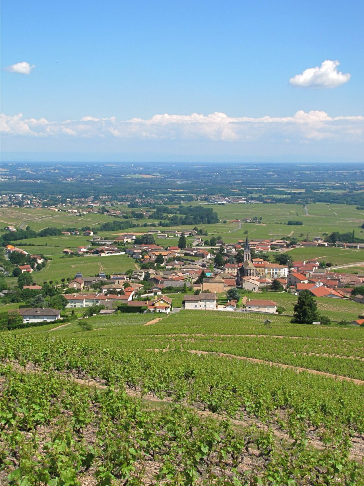

# 弗勒里

在博若莱北部的山坡上，弗勒里的葡萄园踩着一层粉红色的风化花岗岩。这里的酒以花香闻名，但真正决定一瓶酒性格的，常常是它来自哪一片坡地：拉马多讷（La Madone）、格里耶-米迪（Grille-Midi）这些写在酒标上的小地名，比“Fleurie”本身更能说明风味走向。常见 750 mL，[酒精度](ref:abv)约 12.5%–13.5% vol。

图：弗勒里。图片：Nicolas Baldeck，CC BY-SA 3.0，via Wikimedia Commons（[原图页面](https://commons.wikimedia.org/wiki/File:Fleurie_Rhone_France_28_May_2012.jpg)）。

## 花村之名与拉马多讷坡地

Fleurie 是村名，也是法定产区名；中文里“花村”的叫法是后来者给的绰号，来自酒评中反复出现的花香印象，而不是酿酒时加了什么。村名本身来自地名，与花卉工艺无关。

村域内的坡地并不齐整：靠近村子的坡面较缓，往高处走则坡度变陡、土层变薄。拉马多讷位于被单独标注的坡地之列，常被生产者当作一块招牌园来经营。它并不构成一个法定等级，只是同一个 cru 内部的地块名称。理解这一点，就能明白为什么两瓶都写着 Fleurie 的酒，价格与风格可以差得很远。

## 粉红花岗岩与地块分层

这一带以粉红色花岗岩的风化砂为主，混有石英颗粒与少量片岩。砂质土层薄、排水快、肥力低，葡萄根系必须往下扎，产量因此受到自然限制。粉红色来自长石的风化，这种母岩在博若莱北部并不罕见，但在弗勒里的分布尤其集中。

坡向与海拔接着做第二层筛选：朝南、朝东南的坡面日照充足，成熟度更完整；高处的块地夜间更凉，酸度保留得更好。于是同一个村内会出现两路风格——低处更圆润、果味更足，高处更清瘦、花香更突出。村内没有一级园或特级园分级，具体边界与地块归属以官方划界为准。

## 酒标上的地块名与装瓶者

除了 La Madone 与 Grille-Midi，弗勒里的酒标上还可能只写村名，或加上“Clos”一类的小地块称呼。地块名不是法定分级，但它提示了生产者的自信程度：愿意标出地块的酒，通常来自自有园，产量更少，风格也更集中。

装瓶信息同样重要。“Mis en bouteille au domaine”说明酒庄自行装瓶；“par un négociant”则是酒商装瓶。弗勒里以家族酒庄为主，也有合作社与酒商参与，同一片地块的葡萄可能被不同主体收购。核对装瓶者，比看包装更能判断这瓶酒属于哪一类生产者。

## 整串发酵与轻萃取

弗勒里常用整串发酵，不少酒庄采用半二氧化碳浸渍：整串葡萄在充满二氧化碳的容器里先进行细胞内发酵，再压榨、完成常规[发酵](ref:fermentation)。这套做法带来直接的红果香与较轻的单宁，正好配合花香型的定位。

浸渍时间通常偏短，萃取偏轻，以免把细腻的香气压住。部分追求结构的酒庄会延长浸渍，或让一小部分酒液进入旧[橡木桶](ref:oak-ageing)陈年；新桶比例一般很低，因为新橡木的甜香会盖过鸢尾与牡丹。发酵温度控制在中等偏低，也有助于保留香气。

## 香气口感与邻村差异

典型香气是红樱桃、覆盆子、草莓，叠加紫罗兰、鸢尾与牡丹，部分酒款带白胡椒或湿石头的矿物感。入口酸度清晰，单宁细，酒体轻到中等，收尾柔顺。

与邻村比，差别不在“有没有花香”，而在厚度与骨架。谢纳（Chénas）比弗勒里更紧，单宁更有抓力；穆兰-阿旺（Moulin-à-Vent）明显更厚，颜色更深，陈年潜力也更强；再往南的[莫尔贡](ref:morgon)更扎实、更偏黑色果味。若问谁最香，弗勒里通常排在前列；若问谁最厚，则轮不到它。

## 从暖年到冷年的香气变化

暖年成熟度高，酒精度容易靠近区间上端，果味更甜熟，酸度不如冷年鲜明，花香有时被果味盖住；冷年成熟偏慢，酒体更轻，酸度更清晰，鸢尾与牡丹的香气反而更突出，但若成熟不足，会出现青梗与生青的痕迹。

对饮用者来说，暖年的弗勒里更适合搭配油脂稍重的菜，冷年则更适合清蒸与白肉。这里只做定性判断，不给出年份评分；某一年具体表现如何，还要看酒庄的采收时间与地块位置。

## 佐餐与侍酒

饮用温度约 14–16 摄氏度，用郁金香形或勃艮第形酒杯。年轻酒款可轻微冰镇，不必长时间醒酒；老酒醒酒时间应缩短，以免香气散掉。

适合禽肉、烤猪肉、熟食、菌菇与软质奶酪，也能配沙拉与清淡海鲜。多数酒款适合在 3–8 年内饮用，拉马多讷一类核心地块可以适当延长。开瓶后冷藏，并在数日内喝完。本页关于弗勒里的内容涉及酒精饮料；过量饮酒有害健康，未成年人不应饮酒。

## 花村的价格台阶与判断顺序

弗勒里在博若莱 cru 中属于中上价位，通常高于大区级博若莱，低于穆兰-阿旺的头部酒款；只标村名的酒多在入门到中档，标出 La Madone 等核心地块、且由酒庄自装的酒会再上一档。这里只谈相对档位，不写具体价格。

判断方法有三条：一看装瓶者，酒庄自装通常更贵也更稳定；二看地块名，有地块标注的酒一般产量更少；三看年份与酒精度，暖年酒精度偏高、冷年偏低，二者是风格差异而非高低之分。渠道正规、背标完整，比包装华丽更可靠。未开瓶时应避光平放，理想温度 12–15 摄氏度。

## 关于“花村”的常见误会

第一，认为 Fleurie 意味着酿酒时加了花。村名来自地名，花香来自佳美与花岗岩，与工艺添加无关。
第二，把 La Madone 当成一级园。弗勒里没有一级园或特级园分级，地块名只是生产者的标注习惯。
第三，以为弗勒里都轻、都不能放。核心地块的酒可以有数年陈年潜力，轻是常态而非上限。
第四，把弗勒里与穆兰-阿旺混为一谈。两村相邻，但后者更厚、更耐放。
第五，用价格或包装判断真伪。装瓶者、地块名与背标信息更可靠。

## 延伸阅读

- [红葡萄酒](ref:red-wine)：本页所属的葡萄酒大类。
- [佳美](ref:gamay)：弗勒里唯一的葡萄品种。
- [法国](ref:france)：法国葡萄酒法规与产区体系。
- [博若莱](ref:beaujolais)：十个 cru 的框架与北部产区。
- [葡萄](ref:grape)：酿酒葡萄的结构与成熟指标。
- [发酵](ref:fermentation)：整串发酵与半二氧化碳浸渍。
- [橡木桶陈年](ref:oak-ageing)：旧桶陈年与香气整合。
- [酒精度](ref:abv)：12.5%–13.5% vol 的标签含义。
- [莫尔贡](ref:morgon)：风格更厚实的南部 cru。
