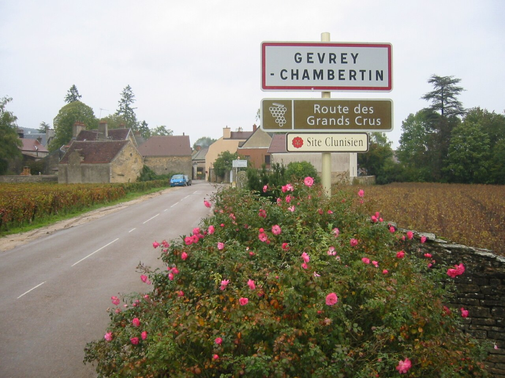

# 热夫雷-香贝丹

热夫雷-香贝丹（Gevrey-Chambertin）是法国勃艮第夜丘的著名红酒村，酒款全部以[黑皮诺](ref:pinot-noir)酿造。村内拥有九个特级园，其中香贝丹（Chambertin）与香贝丹-贝兹园（Chambertin-Clos de Bèze）最为知名；风格以结构感、深色果味与陈年潜力著称。常见 750 mL，[酒精度](ref:abv)约 12.5%–13.5% vol。

图：热夫雷-香贝丹。图片：Arnaud 25，CC BY-SA 3.0，via Wikimedia Commons（[原图页面](https://commons.wikimedia.org/wiki/File:Panneau_Gevrey_Chambertin.JPG)）。

## 定义与定位

先分层：[红葡萄酒](ref:red-wine)是大类，黑皮诺是品种，热夫雷-香贝丹是法定产区（AOC），具体酒庄与酒款是生产者层面。热夫雷-香贝丹既是村名，也是可以标注在酒标上的产区名。

村内酒款分为村级、一级园与特级园三个层级。特级园名称独立标注，例如香贝丹、香贝丹-贝兹、沙尔姆-香贝丹与格里奥特-香贝丹等；村级酒通常只写村名，一级园则标注具体园地名。层级不同，产量、价格与风格都不同。

## 生产者与品牌

村内酒庄数量多，既有历史悠久的家族酒庄，也有酒商与合作社。酒庄可能自有特级园地块，酒商则可能收购葡萄或酒液装瓶。热夫雷-香贝丹的酒标上，装瓶者信息是判断酒庄酒与酒商酒的关键。

生产者、产区与产品是三个层级：产区回答法规与地块范围，生产者回答谁种植、谁酿造、谁装瓶，产品回答年份、层级与规格。同一个特级园由不同酒庄酿造，风格可能差别很大，不能只看园地名。

## 「热夫雷-香贝丹」的产地与原料
热夫雷-香贝丹位于[法国](ref:france)[勃艮第](ref:burgundy)的夜丘，是夜丘最靠北的红酒名村之一。坡向多为东向，日照温和，葡萄成熟期较长；土壤以石灰岩与泥灰岩为主，坡上土层较薄、排水性好，坡下黏土比例更高。

村内葡萄园从坡顶延伸到坡脚，不同海拔与土层的组合造成成熟度与结构差异。特级园多位于坡面中段，一级园分布于其周边，村级园则更靠坡脚与平地。具体边界以产区官方划界为准。

原料是[葡萄](ref:grape)，品种为[黑皮诺](ref:pinot-noir)。黑皮诺皮薄、色浅、酸度高，对气候与栽培极为敏感，在勃艮第的石灰岩土壤上能表现出细致的香气与结构。热夫雷-香贝丹的风格通常比邻近村落更结实，果味更深。

## 「热夫雷-香贝丹」怎么做出来
采收后多进行分拣，部分生产者保留一定比例的整串发酵，以增加香气复杂度与结构。发酵在控温容器中进行，浸渍时间与温度影响颜色、单宁与香气；温度过高会损失细腻香气。

发酵完成后进入[橡木桶陈年](ref:oak-ageing)，新桶比例因酒庄与层级而异。特级园通常使用较高比例的新桶，村级酒则更克制。橡木桶的作用是整合香气与柔化单宁，而不是掩盖黑皮诺本身的细腻。热夫雷-香贝丹装瓶前是否澄清过滤，取决于生产者取向。

## 「热夫雷-香贝丹」的瓶型与标签
常见容量为 750 mL，[酒精度](ref:abv)约 12.5%–13.5% vol，具体随年份与层级变化。标签应核对村名、层级（村级、一级园、特级园）、园地名、年份、装瓶者与进口商信息。

特级园名称必须与官方名单一致，一级园标注具体的 climat。中文背标、进口商与防伪信息是核对身份的依据；热夫雷-香贝丹在不同市场的标签语言不同，以瓶身实际标注为准。

## 「热夫雷-香贝丹」的闻与喝
典型香气是红樱桃、黑樱桃、覆盆子、玫瑰与泥土，陈年后发展出皮革、蘑菇与落叶；入口酸度清晰，单宁细密，酒体中等偏上，结构感明显。与香波-慕西尼的柔美相比，热夫雷-香贝丹通常更结实、更偏深色果味。

品鉴时建议温度约 15–17 摄氏度，用勃艮第形酒杯。年轻酒款可醒酒 1 小时左右，老酒则应缩短时间。闻香时注意果味与泥土气息的层次，过度橡木会掩盖黑皮诺的细腻。

## 「热夫雷-香贝丹」的饮用与搭配
适合搭配禽肉、烤小牛肉、菌菇菜肴与中等强度的奶酪；酒的结构能承接油脂与鲜味。避免与重辣或强酸菜肴同饮，容易掩盖细腻香气。

村级酒多数适合在 5–10 年内饮用，一级园与特级园可以更久；具体适饮窗口因年份、层级与酒庄而异。开瓶后应冷藏并在数日内喝完。本页关于热夫雷-香贝丹的内容涉及酒精饮料；过量饮酒有害健康，未成年人不应饮酒。

## 「热夫雷-香贝丹」的购买与保存
购买时优先选择正规渠道，核对村名、层级、园地名、年份与装瓶者信息。价格随层级、园地与酒庄声誉差异明显，本页不给出具体数字。特级园不等于每一年都出色，年份适配同样重要。

热夫雷-香贝丹以黑皮诺酿造，结构感与陈年潜力较强。未开瓶应平放于 12–15°C、避光且震动少的位置，软木塞保持湿润；长期存放不要频繁移动。开瓶后抽真空或充惰性气体冷藏，尽量两天内喝完，老酒更应缩短与空气接触的时间。

## 「热夫雷-香贝丹」容易被读错的地方
第一，把热夫雷-香贝丹当成一个品牌。它是法定产区名称。
第二，认为村内所有酒都是特级园。特级园只占很小一部分。
第三，把香贝丹与香贝丹-贝兹混为一谈。它们是两个独立的特级园。
第四，认为黑皮诺颜色浅就等于酒体轻。颜色与结构不是同一件事。
第五，用价格或包装判断真伪。渠道、标签与装瓶者信息更可靠。

**关键事实。**

| 项目 | 内容 |
| --- | --- |
| 一句话定位 | 法国勃艮第夜丘热夫雷-香贝丹村的红葡萄酒，全部以黑皮诺酿造；村内拥有九个特级园，包括香贝丹与香贝丹-贝兹园，风格以结构感、深色果味与陈年潜力著称，常见 750 mL、酒精度约 12.5%–13.5% vol |
| 酒种/风格 | 红葡萄酒 |
| 产区 | 法国、勃艮第 |
| 酒精度 | 12.5–13.5% vol |

## 参考资料
- [红葡萄酒](ref:red-wine)：热夫雷-香贝丹所属的葡萄酒大类。
- [黑皮诺](ref:pinot-noir)：本页唯一的葡萄品种。
- [法国](ref:france)：法国葡萄酒法规与产区体系。
- [勃艮第](ref:burgundy)：热夫雷-香贝丹所属产区的分级框架。
- [葡萄](ref:grape)：热夫雷-香贝丹所用葡萄的成熟度、酸度与单宁判断。
- [发酵](ref:fermentation)：整串发酵与浸渍的基本逻辑。
- [橡木桶陈年](ref:oak-ageing)：热夫雷-香贝丹的桶陈时长、香气整合与结构变化。
- [酒精度](ref:abv)：12.5%–13.5% vol 在标签上的含义。
