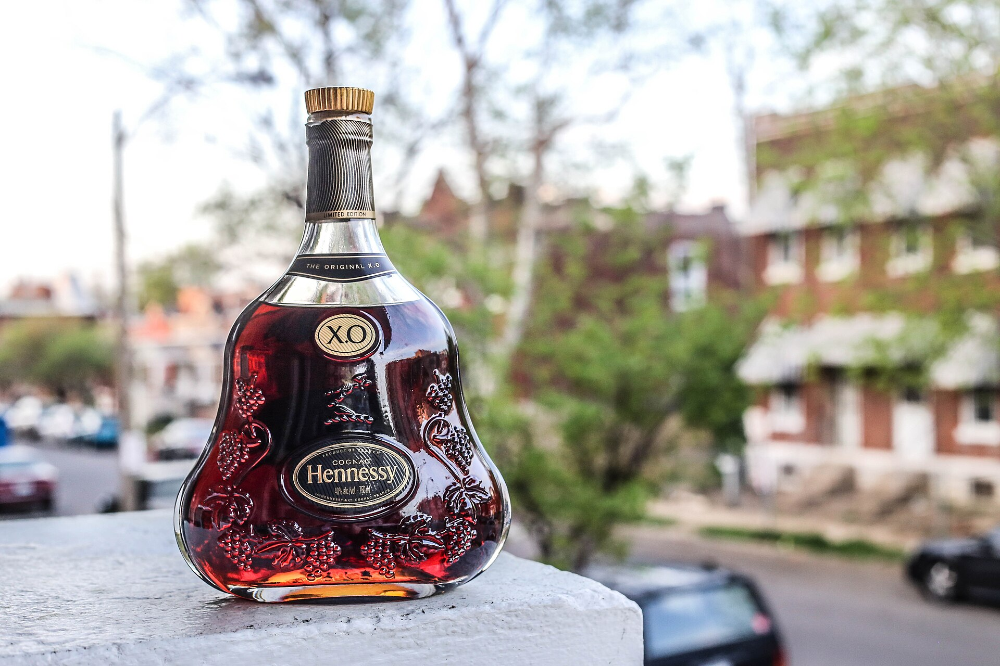

# 轩尼诗XO

轩尼诗 XO（Hennessy X.O）是法国干邑（Cognac）产区的白兰地，由轩尼诗酒庄（Maison Hennessy）生产。它由百余种“生命之水”（eaux-de-vie）调配而成，常见酒精度为 40% vol。XO 在干邑法规中表示一个最低陈年等级，而不是某一固定年份或单一葡萄园。

图：轩尼诗XO相关实景照片。图片：Paul Sableman，CC BY 2.0，via Wikimedia Commons（[原图页面](https://commons.wikimedia.org/wiki/File:Hennessy_XO_(34071154281).jpg)）。

## 定义与身份

干邑是法国干邑产区出产的葡萄蒸馏酒，属于[白兰地](ref:brandy)的一种。它必须以葡萄为原料，经过发酵、蒸馏并在法国橡木桶中陈年；产区、品种、蒸馏与陈年规则由法国国家干邑行业管理局（BNIC）监管。轩尼诗 XO 是这一体系内的一个具体产品，不是“所有干邑”的代名词，也不是“所有 XO”的代名词。

“XO”是 Extra Old 的缩写。历史上不同市场的用法并不统一，2018 年起 BNIC 规则把 XO 的最低橡木桶陈年要求提高到 10 年。标签上的 XO 说明调配中最年轻的生命之水达到该等级要求，不说明整瓶酒的平均年龄，更不说明某一个年份。

## 「轩尼诗XO」的时间线
轩尼诗酒庄由爱尔兰裔军官理查德·轩尼诗（Richard Hennessy）于 1765 年创立，此后逐步成为干邑最主要的酒庄之一。1870 年，莫里斯·轩尼诗（Maurice Hennessy）与调配师埃米尔·费利乌（Émile Fillioux）创制了 X.O：它最初是为主人家族与朋友保留的“extra old”调配，后来才进入市场。酒厂公开资料把它称为最早以 XO 命名的干邑之一。

1947 年，设计师热拉尔·德·若弗尔（Gérald de Geoffre）为轩尼诗 XO 设计了第一代酒瓶，曲线与轮廓成为该产品长期使用的视觉符号。需要区分的是：品牌创始年份、XO 产品创制年份与某一瓶酒的实际陈年，是三个不同层面的时间信息。

## 「轩尼诗XO」的产地与原料
干邑产区位于法国西南部，围绕夏朗德河与夏朗德滨海省分布，法定种植区按土壤与气候划分。主要品种包括白玉霓（Ugni Blanc），以及白福尔、哥伦巴尔等。葡萄经压榨、发酵得到低酒精度基酒，再进入[蒸馏](ref:distillation)环节；干邑通常采用铜制夏朗德壶式蒸馏器进行两次蒸馏，得到高酒精度的“生命之水”。

原料与产区的差异会进入最终风味：白玉霓酸度高、香气中性，适合蒸馏；不同土层的石灰岩、黏土与砂质会影响葡萄成熟与酸度。轩尼诗 XO 的具体调配比例与各批次用酒并不公开，因此无法从标签反推某一园块或某一年份。

## 工艺与陈年

蒸馏得到的生命之水进入法国橡木桶进行[橡木桶陈年](ref:oak-ageing)。橡木桶的树种、烘烤程度、桶龄与仓库湿度都会影响氧气交换、单宁与香气物质的演化。轩尼诗 XO 的公开描述强调使用较年轻的桶，使酒液保持较强力量与能量，同时通过长期陈年获得圆润感。

调配是干邑的核心工艺：不同产区、不同年份、不同桶龄的生命之水被组合，目标是获得稳定而复杂的风格。XO 的“extra old”含义正来自这一过程——它不是把单一年份装瓶，而是用多批老酒构建层次。具体配方属于商业机密，外界只能通过官方品鉴描述与法规等级来理解。

## 「轩尼诗XO」的闻与喝
酒厂对轩尼诗 XO 的官方品鉴描述包括：糖渍水果的甜香、逐渐上升的辛香热度、胡椒与巧克力的边缘、饱满的酒体、深色巧克力、橡木与香草，以及悠长的回响。这些描述是感官引导，不是化学分析结果；不同批次与饮用温度会带来差异。

品鉴时可以先纯饮，用郁金香杯或薄壁小杯，室温即可；用手掌微温杯壁有助于释放香气，但不要加热酒液。入口后注意前三秒的甜感与辛香，再感受中段的木质与可可，最后看余味是否干净、是否有苦尾。加冰会降低香气强度，却能让高酒精度变得更易入口，适合炎热天气或较年轻的批次。

## 「轩尼诗XO」的饮用与搭配
纯饮是 XO 最典型的消费方式；加一块大冰或少量水可以改变香气释放节奏。它也可以用于调酒，但 XO 的复杂度容易被大量果汁、糖浆掩盖，因此更适合用量小、以酒体为主的配方。餐后搭配黑巧克力、坚果、雪茄（若不吸烟则不必）或香料类甜点较常见；与清淡海鲜、酸味突出的菜肴搭配时，酒精与木质调容易压过食材。

保存方面，开瓶后的干邑不会像葡萄酒那样迅速氧化变质，但香气仍会随时间衰减。应避免阳光直射与高温，瓶口密封、尽量满瓶保存。若长期存放，重新饮用前先小杯试味，确认没有明显的纸板味或霉味。

## 「轩尼诗XO」容易被读错的地方
第一，把 XO 当成“年份酒”。XO 是最低陈年等级，瓶身通常不标单一保证年份。
第二，把“百余种生命之水”理解为精确配方。公开说法只描述调配规模，不公开比例。
第三，认为酒精度越高越好。40% vol 是常见规格，风味复杂度与陈年、原料和调配有关，不由酒精度单独决定。
第四，把品牌知名度当成具体批次的质量结论。不同市场、不同批次的标签与版本需要分别核对。
第五，忽视“干邑”与“白兰地”的层级关系。所有干邑都是白兰地，但并非所有白兰地都是干邑。

**关键事实。**

| 项目 | 内容 |
| --- | --- |
| 一句话定位 | 法国干邑白兰地，由轩尼诗调配百余种生命之水；XO 等级自 2018 年起要求最少 10 年橡木桶陈年，常见酒精度 40% vol |
| 酒种/风格 | 白兰地 |
| 产区 | 法国 |
| 酒精度 | 40–40% vol |

**来源与边界。** 本页关于「轩尼诗XO」的关键事实，主要由以下来源交叉核对：Hennessy（1870 年创制、调配风格、品鉴描述与 1947 年瓶型设计；交叉核对莫里斯·轩尼诗与调配师埃米尔·费利乌在 1870 年创制 XO 的叙述）、Bureau National Interprofessionnel du Cognac（干邑产区、双重蒸馏与 XO 等级的最低陈年要求）、Oxford University Press（提供关于干邑、XO 等级与调配的条目）。价格、批次与状态会变，涉及这些字段时以页面所列来源的最新版本为准。正文为项目自写，来源只作核验，不复制原文。

## 参考资料
- [白兰地](ref:brandy)：干邑所属的蒸馏酒大类。
- [葡萄](ref:grape)：干邑原料与发酵的基础。
- [蒸馏](ref:distillation)：从基酒到生命之水的关键步骤。
- [橡木桶陈年](ref:oak-ageing)：风味与结构形成的主要环节。
- [法国](ref:france)：产区、法规与酒类体系的总览。
