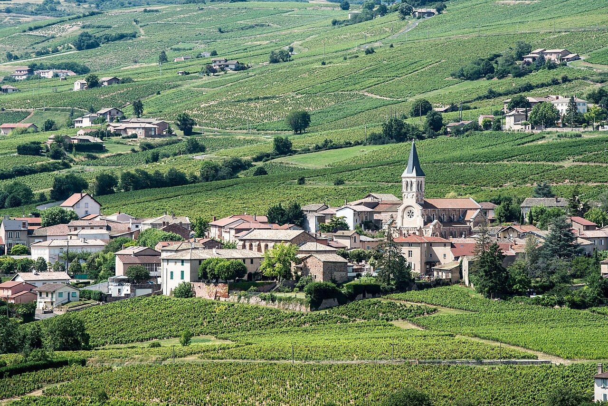

# 朱利耶纳

在朱利耶纳（Juliénas）的酒标上，最先抓住视线的往往不是“Beaujolais”三个字，而是单独印着的村名。对博若莱北部这条狭长的 cru 地带而言，这是一种身份声明：酒来自朱利耶纳村周围的坡地，而不是大区调配。瓶身另一侧一般写着 750 mL 与约 12.5%–14% 的[酒精度](ref:abv)，这两项信息比任何形容词都更接近酒的真实轮廓。

图：朱利耶纳。图片：Sunappu-shashin，CC BY-SA 4.0，via Wikimedia Commons（[原图页面](https://commons.wikimedia.org/wiki/File:Juli%C3%A9nas_-_zoom.jpg)）。

## 酒标上的“Juliénas”意味着什么

按层级拆开看：[红葡萄酒](ref:red-wine)是大类，[佳美](ref:gamay)是品种，朱利耶纳是[博若莱](ref:beaujolais)十个村庄级 cru 之一，具体酒庄与酒款才是生产者层面。村名既可以指村子，也可以指可以单独标注的法定产区名；酒标上通常不再同时出现“博若莱”大区名，这正是它区别于普通博若莱酒的第一道线索。

村内没有一级园或特级园式的分级，所有地块都在同一个村庄级 AOC 框架里。因此判断一瓶酒，靠的不是“园名”，而是坡位、酒庄与年份；具体边界以产区官方划界为准。

## 朱利耶纳与尤利乌斯·凯撒的传说

当地流传的说法把村名与尤利乌斯·凯撒联系在一起，认为这位罗马将领曾在附近的坡地驻扎或经过。传说无法逐条考证，但它确实解释了为什么这个村名在博若莱北部常被讲成一个“有来历”的名字。对读者更实际的意义是：朱利耶纳的名字来自地方与历史叙事，而不是某家酒庄或某个商标。

也正因为这层叙事，市场上偶尔会把朱利耶纳包装成“帝王之酒”。这类说法只能当作故事听，酒的好坏仍要回到地块与酿造。

## 花岗岩与片岩交错的山坡

朱利耶纳位于[法国](ref:france)的博若莱北部，葡萄园沿村周围的坡地展开。这里的地质不是单一的花岗岩，而是花岗岩风化砂与片岩交错：前者排水快、肥力低，后者更容易保留水分，二者交错让同一村庄内部的成熟节奏出现差别。

坡向与坡度进一步放大差异：朝南、坡度适中的地块日照充足，成熟度更高；背阴或坡顶地块则保留更多酸度。原料仍是[葡萄](ref:grape)，品种为佳美，皮薄、酸度高，在贫瘠的花岗岩上通常表现出红樱桃、黑樱桃与香料气息。

## 与谢纳、穆兰-阿旺的邻里关系

朱利耶纳与[谢纳](ref:chenas)、穆兰-阿旺相邻，三者常被放在同一张北博若莱地图上比较。谢纳整体更轻盈、更偏花香，穆兰-阿旺则以更深的颜色与更强的结构著称；朱利耶纳夹在两者之间，通常比谢纳更有骨架，又不像穆兰-阿旺那样需要较长陈年才能舒展。

这种“中间位置”不是含糊，而是可感知的：同一冷年或暖年里，朱利耶纳的酒往往在果味浓度与单宁支撑之间取得平衡，既不像希鲁布勒那样飘，也不像穆兰-阿旺那样沉。

## 佳美在这里如何被酿造

朱利耶纳常用整串发酵，部分酒庄采用半二氧化碳浸渍：整串葡萄在充满二氧化碳的容器中先进行细胞内发酵，再进入压榨与常规[发酵](ref:fermentation)。与追求极致轻盈的村子相比，这里更常延长浸渍，让颜色、单宁与结构都更完整。

发酵温度与浸渍时间决定最终风格。想做得厚一些的酒款会提高萃取强度；部分酒款进入[橡木桶陈年](ref:oak-ageing)，但新桶比例通常克制，以免橡木味压过佳美的果香。装瓶者信息也值得看：酒庄酒与酒商酒在同样的村名下，浓度与稳定性可能完全不同。

## 杯中的骨架：与弗勒里、希鲁布勒的差别

典型香气是红樱桃、黑樱桃、覆盆子、紫罗兰与香料，部分酒款带泥土与矿物感。入口酸度清晰，单宁中等，酒体中等偏饱满，收尾比许多博若莱更长。

与弗勒里相比，朱利耶纳通常更厚、更“有肉”，花香不占主导；与希鲁布勒相比，它的结构明显更硬，果味也更靠后。用一句话概括：弗勒里更香，希鲁布勒更轻，朱利耶纳更结实。

## 典型年份与年份差异

暖年（成熟度高、采收早的年份）里，朱利耶纳的果味更黑、酒精感更明显，单宁也更厚，年轻时容易显得紧；冷年（成熟慢、酸度保留多的年份）里，酒体收窄，红果与花香更突出，结构显得更线性。判断年份不必依赖评分：看酒精度、看果味是偏红还是偏黑、看单宁是包起来还是露出来，比记分数更实用。

同一村庄不同坡位在冷暖年里的表现也不同：朝南地块在冷年更容易追回成熟度，坡顶地块在暖年更容易保持清爽。这也是为什么同一款村名酒，年份之间的差异有时比酒庄之间还大。

## 饮用温度、配餐与适饮期

建议温度约 15–17 摄氏度，用郁金香形或勃艮第形酒杯。年轻酒款可以醒酒 30 分钟左右，老酒则应缩短时间，避免香气散掉。

配餐上适合禽肉、烤猪肉、烤小牛肉、野味与菌菇菜肴，也可搭配中等强度奶酪。多数酒款适合在 4–10 年内饮用，核心地块可以更久；开瓶后应冷藏，并在数日内喝完。本页关于朱利耶纳的内容涉及酒精饮料；过量饮酒有害健康，未成年人不应饮酒。

## 选购与价格带

在博若莱 cru 的市场分层里，朱利耶纳通常处于中等偏上的档位：比普通博若莱与多数轻量 cru 贵，但一般低于穆兰-阿旺等以陈年潜力著称的村子。价格主要取决于地块、酒庄与年份，本页不写具体数字。

判断方法比价格标签更可靠：先看是否单独标注 cru 名，再看装瓶者是否为酒庄本身，最后看年份与酒精度是否与酒庄一贯风格一致。未开瓶应避光、平放于 12–15 摄氏度的阴凉处，避免高温与剧烈温差；开瓶后抽真空或充惰性气体并冷藏。

## 常见误区

第一，把朱利耶纳当成博若莱新酒。它是独立的村庄级 cru，强调结构与果味，不是当年即饮的轻松型。

第二，认为村名一定来自某家酒庄。它来自地名与历史传说，与酒庄品牌无关。

第三，认为朱利耶纳一律厚重。坡位与萃取差异很大，同一村名下的酒可以从中等走到偏厚。

第四，把朱利耶纳与谢纳混为一谈。两村相邻，但朱利耶纳通常更有骨架，谢纳更轻盈。

朱利耶纳的酒标应出现“Juliénas”与酒庄名；同名酒商酒可能收购多村葡萄。买时看装瓶者、年份与进口商，不要只看“cru”字样或价格。
