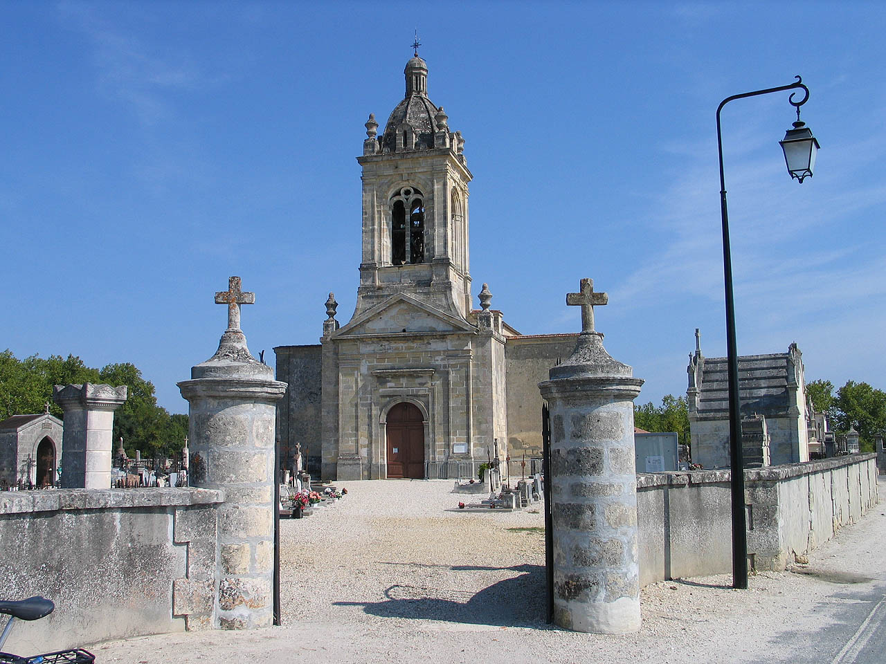

# 玛歌产区

玛歌（Margaux）是[法国](ref:france)[波尔多](ref:bordeaux)梅多克最南端、面积也最大的村级法定产区，只产[红葡萄酒](ref:red-wine)：葡萄园分布在 Arsac、Labarde、Margaux-Cantenac 与 Soussans 四个市镇，合计略超 1,500 公顷；62 家酒庄年出约 5.6 万千升，折合 700 万瓶上下，约占波尔多总产量的 1%。它直到 1954 年 8 月 10 日才获得 AOC 地位，比波亚克与圣朱利安晚了 18 年，却拥有 1855 年 61 家列级庄中的 21 家。这个组合——立法晚、范围大、列级庄密——是理解玛歌的起点。

图：玛歌产区。图片：No machine-readable author provided. Luidger assumed (based on copyright claims).，CC BY-SA 3.0，via Wikimedia Commons（[原图页面](https://commons.wikimedia.org/wiki/File:Margaux_Eglise.jpg)）。

## 四个市镇拼出的最大村级产区

玛歌村在波尔多市以北约 25 公里，吉伦特河左岸。与许多"一村一产区"的梅多克 AOC 不同，玛歌的法定范围跨四个市镇：Margaux-Cantenac（2017 年由 Margaux 与 Cantenac 合并）、Soussans、Arsac 与 Labarde。这解释了一个常被忽略的事实：一瓶标着 Margaux 的酒，酒庄未必坐落在名叫 Margaux 的村子里。按官方 cahier des charges 的表述，它是梅多克面积最大的村级 AOC，这一点常被"最南端"的地理印象掩盖。

四镇的地块并不连成一片，而是沿砾石丘群分布，中间夹着林地、草场与河岸低地。产区协会登记的 62 家生产者，最小的只有 0.2 公顷，最大的在 AOC 范围内拥有略超 120 公顷。面积大、地块碎，直接造成了村内风格的巨大离散度。

## 1954 年：一场打了三十年的边界官司

玛歌的边界不是行政命令一次画定的。1923 年 12 月 3 日，波尔多民事法庭首次确认"玛歌地区"包括 Margaux、Cantenac、Soussans、Arsac、Labarde 五镇；1954 年 8 月 10 日的法令才把这片地理范围正式写进 AOC。今天五镇并为四镇，法定范围不变。理解这段历史，就能理解为什么 Soussans 或 Arsac 的地块也能正当地标 Margaux：产区名描述的是历史形成的砾石丘群，而不是某个村的行政界线。

## 6–33 米的砾石阶地

玛歌的地形是一组海拔 6 至 33 米的砾石阶地。法规把阶地分成两级：南部 Arsac 的高阶地属 Villafranchian 期，砾石粒径通常不超过 35 毫米，当地叫"graves dragées"（糖衣砾石）；中低阶地的冲积物更粗，粒径超过 80 毫米的卵石很常见。再往东靠近河口，是海拔不足 5 米的 palus，以粉砂和黏土为主。同一个产区里，这三种母质决定了完全不同的成熟节奏。

Decanter 刊载的梅多克地质观察提供了一个尺度：整个梅多克最高点也不过 35 米上下，多数葡萄园在 10 至 20 米之间；向下挖一米就能见到砾石，再往下是石灰岩与含牡蛎壳的泥灰岩，玛歌境内还有零星的老石灰岩露头。玛歌的"高"与"厚"都有限，真正起作用的是砾石与细土的比例。

## 砾石台地 vs 黏土洼地

砾石丘（croupes）排水快、白天吸热、夜里放热，[赤霞珠](ref:cabernet-sauvignon)在这里最容易达到结构成熟；黏土与 palus 保水、升温慢，更适合[梅洛](ref:merlot)，也更容易在干旱年份保住产量。玛歌的葡萄园因此比波亚克更"碎"：既有顶部的厚砾石，也有夹砂、夹黏土的坡脚。土壤的异质性直接写进酒里——同一村内，来自不同地块的酒可以有完全不同的单宁量。原料仍是[葡萄](ref:grape)，但"哪块地的葡萄"决定了酒的骨架。

## 1855 年分级里的 21 席

1855 年分级给玛歌留下了 21 家列级庄，是梅多克村级产区中最多的：一级庄 [Château Margaux](ref:chateau-margaux)；二级庄 Rauzan-Ségla、Rauzan-Gassies、Durfort-Vivens、Lascombes、Brane-Cantenac；三级庄 Palmer、Giscours、d'Issan、Kirwan、Malescot St-Exupéry、Cantenac-Brown、Desmirail、Ferrière、Marquis d'Alesme、Boyd-Cantenac；四级庄 Pouget、Prieuré-Lichine、Marquis de Terme；五级庄 Dauzac 与 du Tertre。必须强调：分级针对的是酒庄，不是"玛歌"这个产区名，村内仍有大量未列级酒庄。

## 62 家酒庄的规模光谱

62 家生产者里，既有自有地块、自酿自装的家族酒庄，也有收购葡萄或酒液再调配的酒商。酒标上的"mis en bouteille"（装瓶者）信息，比"Margaux"三个字更能说明你买到了什么：酒庄装瓶通常意味着更稳定的地块来源，酒商装瓶则可能混合多个来源。产区、生产者与产品是三个层级，不能用一个名字互相替代。

## 57 hl/ha 的基准与 63 hl/ha 的上限

法规把产量分成两层：57 hl/ha 是基准，63 hl/ha 是但书上限（行距 1.40–1.50 米且叶幕高度介于行距 0.6–0.7 倍时降为 60 hl/ha）。种植密度最低 7,000 株/公顷，行距不超过 1.50 米，单株占地不超过 1.43 平方米；每公顷最大负载 9,500 公斤。最低天然[酒精度](ref:abv) 11%，梅洛的最低含糖量 189 克/升、其他品种 180 克/升。酒必须陈年至采收次年 6 月 1 日，9 月 1 日起才能上市，装瓶最迟不得晚于采收后第三年年底。列级庄的实际产量通常远低于上限——这正是"上限不等于目标"的最好注脚。

## 发酵、浸渍与新桶比例

玛歌红酒以[发酵](ref:fermentation)为基础，温度与浸渍时间决定萃取程度：温和萃取保留花香与细单宁，较长浸渍换取更多结构。赤霞珠的单宁与酸度都高，混酿比例和采收日期对最终风格的影响，往往大过某一个工艺参数；少量[品丽珠](ref:cabernet-franc)与小维多用于补充香气与结构。之后进入[橡木桶陈年](ref:oak-ageing)，新桶比例因酒庄与等级而异，从部分新桶到全新建材都有；新桶带来香草、烟熏与更紧的质地，但对玛歌这种以香气见长的产区，过度用桶会直接盖掉紫罗兰与黑醋栗。

## 为什么玛歌的单宁更"丝"

比波亚克的单宁更细、更早打开，原因不在"风水"，而在品种与母质的配比。波亚克的砾石丘更厚、更均匀，赤霞珠比例通常更高，单宁的骨架更硬；玛歌的土壤夹带更多黏土、砂质与河岸粉砂，梅洛比例往往更高，成熟也更均匀。加上前述"砾石不厚、排水却快"的组合，赤霞珠得以保持香气与酸度，却不必积累过量的粗单宁。这是因果链，不是一句"玛歌柔美"能概括的。

## 价格带：几十欧元到近千美元

Wine-Searcher 在 2026 年 11 月给出的 750 ml 国际均价可以作为量级参照：Château Giscours 约 92 美元，Brane-Cantenac 约 95 美元，Rauzan-Ségla 约 129 美元，Palmer 约 402 美元，Château Margaux 约 884 美元。村内非列级庄的日常款常见于 30–60 欧元。价格随年份、评分、渠道与汇率明显波动，任何单一数字都只能当量级看。

## 纠正"玛歌只有柔美酒"

这是最常见的误解。玛歌确实以紫罗兰、黑醋栗与丝滑单宁著称，但 21 家列级庄里既有结构宏大的 Château Margaux，也有单宁紧实、需要十年以上才展开的酒款。"柔美"描述的是典型风格，不是质量上限；反过来，把花香当成"香水味"或缺陷，也错过了玛歌最重要的辨识特征。另一个常见混淆是把产区与 Château Margaux 画等号——前者是地理范围，后者只是其中一家生产者。

## 适饮温度与配餐

多数酒款在 16–18 摄氏度饮用，年轻、结构紧的年份提前醒酒 1–2 小时。红肉、禽类、蘑菇与中等浓度炖菜都合适；单宁较细的酒款也可以配硬质奶酪。配餐看酸度与单宁，不必背固定清单。开瓶后密封冷藏，尽量在数日内喝完；本页关于玛歌产区的内容涉及酒精饮料；过量饮酒有害健康，未成年人不应饮酒。

对照阅读：[红葡萄酒](ref:red-wine)、[波尔多](ref:bordeaux)。
