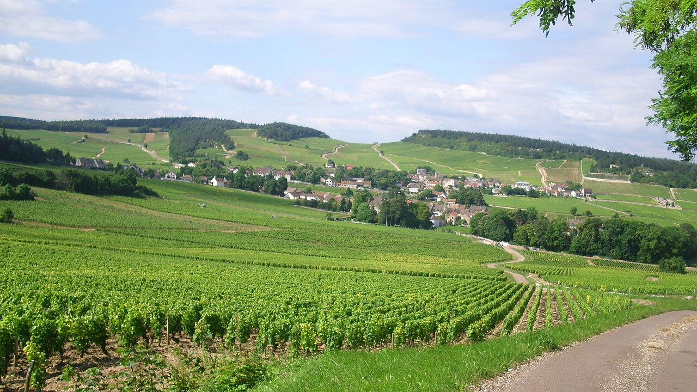

# 梅尔居雷

在餐饮渠道的酒单上，梅尔居雷常被安排在勃艮第红酒的入门到中档位置：它不像夜丘名村那样需要提前预订，也不像一些夏隆内丘小村那样少见。这种「容易买到」的印象，既是它的优势，也是它长期被低估的原因。梅尔居雷是夏隆内丘面积较大的村庄级产区，红白都产，红酒以结构感与直接的红果风味见长。常见 750 mL，[酒精度](ref:abv)约 12.5%–13.5% vol，[红葡萄酒](ref:red-wine)以[黑皮诺](ref:pinot-noir)酿造，[白葡萄酒](ref:white-wine)以[霞多丽](ref:chardonnay)酿造。

图：梅尔居雷。图片：Mpmpmp，CC BY-SA 3.0，via Wikimedia Commons（[原图页面](https://commons.wikimedia.org/wiki/File:IMG_Vignoble_de_Mercurey_12.JPG)）。

## 夏隆内丘最大的村庄级产区

梅尔居雷位于[法国](ref:france)[勃艮第](ref:burgundy)夏隆内丘北部，东侧靠近沙隆-索恩河畔的平原，北面隔着一片丘陵与[桑特奈](ref:santenay)所在的伯恩丘南段相望。村庄的葡萄园分布在村庄周围以及山谷两侧的坡面上，范围比多数夏隆内丘村庄更广。

「面积大」带来的直接结果是产品线宽：从村庄级到一级园，从红酒到白酒，从轻盈的早饮型到需要几年瓶陈的结构型，都能在同一个村名里找到。这也意味着不能用一个标签概括梅尔居雷；买酒时要看具体园地、坡位与酒庄，而不是只看村名。具体边界以产区官方划界为准。

## 黏土-石灰岩与山谷两侧的坡面

这一带的气候比夜丘更温暖，成熟度通常更高；土壤以黏土与石灰岩为主，夹杂碎石，坡上排水较好，坡脚保水更强。山谷两侧的坡向不同，朝南或朝东南的地块成熟更快，朝北或通风更好的地块则保留更多酸度。不同坡向、海拔与土层厚度造成成熟度与酒体的差异，这是同村酒款风格分化的重要原因。

较温暖的位置使黑皮诺更容易达到成熟，红酒通常比伯恩丘北段更饱满、单宁更明显；霞多丽则表现出较圆润的柑橘与白花香气。与夜丘相比，梅尔居雷的酒少了些纤细的花香，多了些直接的果味与骨架，这也解释了它在餐饮渠道的定位。

## 一级园多，但没有特级园

村内酒款分为村庄级与一级园两个层级，没有特级园。村庄级通常只写村名；一级园标注具体园地，如 Clos des Myglands、Clos du Roy、Les Montaigus 与 Les Naugues 等。一级园数量多，分布在山谷两侧的不同坡面，风格差异不小：有的更偏红果与花香，有的更厚、更需要时间。一级园名称必须与官方名单一致。

没有特级园并不等于没有好地块。梅尔居雷的一级园体系承担了村内最高层级的角色，酒庄也常把最好的地块放在一级园标签下。对消费者来说，与其寻找不存在的特级园，不如研究一级园的名称、坡向与业主。

## 酒商、合作社与家族酒庄并存

村内以家族酒庄为主，也有酒商与合作社参与。夏隆内丘的酒商体系较为活跃，同一酒商可能从多个村庄收购葡萄或酒液装瓶；合作社则把许多小业主的果实集中起来。梅尔居雷的酒标上，装瓶者信息是判断酒庄酒与酒商酒的关键。

生产者、产区与产品是三个层级：产区回答法规与地块范围，生产者回答谁种植、谁酿造、谁装瓶，产品回答年份、层级与红白类型。同为梅尔居雷，不同坡位与酒庄的风格可以有明显差别；同一片一级园，合作社装瓶与酒庄装瓶也可能呈现不同的成熟度与萃取强度。

## 酿造：更长浸渍与更明显的单宁

红葡萄酒采收后多进行分拣，部分生产者保留一定比例整串，以增加香气复杂度；[发酵](ref:fermentation)在控温容器中进行，浸渍时间与温度影响颜色、单宁与香气。追求结构的酒款通常浸渍较长、萃取较重，这与梅尔居雷「更有骨架」的市场印象一致；追求早饮的酒款则会缩短浸渍、降低萃取。白葡萄酒多经压榨后发酵，部分酒款进行酒泥搅拌以增加质地。

发酵完成后进入[橡木桶陈年](ref:oak-ageing)，新桶比例因酒庄与层级而异。一级园可能使用较高比例的新桶，村庄级更克制。橡木桶用于整合香气与柔化单宁，不应掩盖品种本身的果味；梅尔居雷的单宁本来就较明显，过重的新桶容易让酒显得干燥。梅尔居雷装瓶前是否澄清过滤，取决于生产者取向。

## 与桑特奈及邻村的对照

梅尔居雷红酒的典型香气是红樱桃、黑樱桃、覆盆子与泥土，部分酒款带香料与烟熏；入口酸度清晰，单宁中等偏上，酒体中等偏饱满。与北面的[桑特奈](ref:santenay)相比，梅尔居雷更厚、单宁更明显，桑特奈通常更轻、更偏花香与酸度；与夏隆内丘的吕利（Rully）相比，梅尔居雷红酒更有骨架，吕利的红酒更轻、白酒更以细腻见长；与日夫里（Givry）相比，梅尔居雷更硬、更需要配餐，日夫里通常更圆润、更早适饮。

白葡萄酒常见柠檬、白花、榛子与矿物感，酸度中等、质地较圆润。品鉴温度上，红葡萄酒约 15–17 摄氏度，白葡萄酒约 10–12 摄氏度。梅尔居雷的单宁在温度过低时会显得更硬，搭配油脂丰富的菜肴更容易平衡。

## 暖年与冷年：成熟度与单宁

暖年通常带来更成熟的黑色果味、更高的酒精度倾向与更饱满的酒体，单宁更容易显得圆润，但酸度可能偏低；冷年则保留更高的酸度，红果更突出，单宁线条更硬，酒体更瘦。梅尔居雷本身比夜丘温暖，冷年反而可能让酒更有活力；暖年则要留意过度成熟带来的沉闷感。

雨水多的年份，坡脚黏土保水的地块容易稀释，坡上排水快的地块表现更稳定。对买家来说，暖年的梅尔居雷适合较早饮用，冷年的酒可以多放几年；同一酒庄的暖年与冷年放在一起比较，比跨酒庄比较更能看出年份的作用。这里只谈方向，不给年份打分。

## 餐饮渠道里的价格定位

梅尔居雷的村庄级红酒通常处在勃艮第红酒的入门到中间档，一级园往上走一档；白酒价格通常低于同级红酒。它常被餐饮渠道选作日常饮用与配餐酒，这也是其价格相对克制的原因之一。判断时应看园名、装瓶者、年份与背标信息，而不是只看村名或包装。

价格低不等于质量差，梅尔居雷的价值在于用较少的预算获得清晰的勃艮第结构与红果风味；但若追求细腻花香与轻盈质地，桑特奈或夜丘村庄可能更合适。本页不给出具体价格。未开瓶应避光、平放于 12–15 摄氏度的阴凉处，避免高温与剧烈温差；多数红酒适合在 4–10 年内饮用，一级园可以更久。

## 夏隆内丘定位的五个误区

第一，把梅尔居雷当成伯恩丘的一部分。它属于夏隆内丘，与桑特奈隔着一片丘陵相望。
第二，认为村内只有红酒。村庄级产区红白都产，白酒也占一定比例。
第三，认为没有特级园就没有好酒。层级不等于质量，一级园中也有风格突出的地块。
第四，把夏隆内丘的红酒都当成轻酒体。梅尔居雷相对更有骨架、单宁更明显，不能一概而论。
第五，用价格或包装判断真伪。渠道、标签与装瓶者信息更可靠。

## 延伸阅读

- [红葡萄酒](ref:red-wine)：本页红酒所属的葡萄酒大类。
- [红葡萄酒](ref:red-wine)：梅尔居雷所属的静止红葡萄酒大类。
- [黑皮诺](ref:pinot-noir)：红葡萄酒使用的葡萄品种。
- [霞多丽](ref:chardonnay)：白葡萄酒使用的葡萄品种。
- [法国](ref:france)：法国葡萄酒法规与产区体系。
- [勃艮第](ref:burgundy)：本页所属产区的分级框架。
- [葡萄](ref:grape)：梅尔居雷所用葡萄的成熟度、酸度与单宁判断。
- [发酵](ref:fermentation)：浸渍与发酵的基本逻辑。
- [橡木桶陈年](ref:oak-ageing)：梅尔居雷的桶陈时长、香气整合与结构变化。
- [酒精度](ref:abv)：12.5%–13.5% vol 在标签上的含义。
- [桑特奈](ref:santenay)：北侧伯恩丘南段的村庄级产区。
