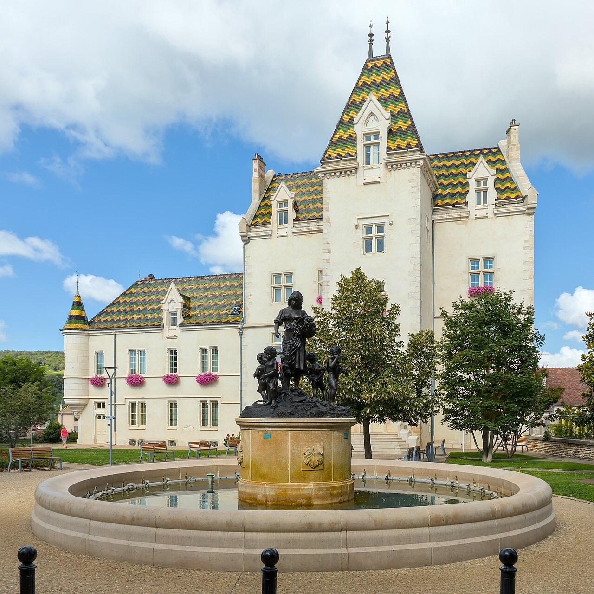

# 默尔索

默尔索是法国勃艮第伯恩丘的著名白葡萄酒村，酒款以[霞多丽](ref:chardonnay)酿造，一级园如佩里耶（Les Perrières）、热内弗里耶（Les Genevrières）与沙尔姆（Les Charmes）最受关注。与夏布利的清瘦风格相比，默尔索通常更饱满，带榛子、黄油、柑橘与矿物感。常见 750 mL，[酒精度](ref:abv)约 12.5%–13.5% vol。

图：默尔索。图片：Benjamin Smith，CC BY-SA 4.0，via Wikimedia Commons（[原图页面](https://commons.wikimedia.org/wiki/File:Meursault_-_Ch%C3%A2teau-fort_-_1.jpg)）。

## 定义与定位

先分层：[白葡萄酒](ref:white-wine)是大类，霞多丽是品种，默尔索是法定产区（AOC），具体酒庄与酒款是生产者层面。默尔索既是一个村名，也是可以标注在酒标上的产区名，两者不能混同于某个品牌。

默尔索以白葡萄酒为主，但同一村镇范围内也允许少量红葡萄酒以黑皮诺酿造。看到“Meursault”时，应先确认是白还是红、是村级还是一级园，再判断风格与价格层级。

## 生产者与品牌

默尔索村内酒庄数量多，从家族小庄到拥有多块一级园的名庄都有，也有酒商收购葡萄或酒液后装瓶。酒庄酒与酒商酒的差别，往往体现在地块控制、采收标准与陈年方式上。

生产者、产区与产品是三个层级：产区回答法规与地块范围，生产者回答谁种植、谁酿造、谁装瓶，产品回答年份、等级与规格。同一块一级园由不同酒庄酿出的酒，风格可能差别很大，不能只看园地名。

## 「默尔索」的产地与原料
默尔索位于[法国](ref:france)[勃艮第](ref:burgundy)的伯恩丘，坡向以东向与东南向为主，日照温和，葡萄成熟期较长。土壤以石灰岩与泥灰岩为主，排水性好，不同地块的黏土比例差异，直接影响酒体的厚薄与矿物感的强弱。

村内没有特级园，最高等级是一级园，这是它与相邻的普里尼-蒙哈榭在分级上的重要差别。默尔索的一级园多集中在村南与村北的坡面，部分地块与相邻村镇接壤，边界以产区官方划界为准。

原料是[葡萄](ref:grape)，白葡萄酒品种为[霞多丽](ref:chardonnay)。[水](ref:water)不进入成品，但降水与土壤保水性影响果实成熟与稀释程度。同一产区内，坡位、土层厚度与朝向造成的差异，往往比年份差异更稳定。

## 「默尔索」怎么做出来
采收后压榨取汁，静置澄清，再由酵母进行[发酵](ref:fermentation)。默尔索的传统风格常使用[橡木桶](ref:oak-ageing)发酵或陈年，新桶比例因酒庄与等级而异，带来榛子、黄油与烘烤气息，同时通过缓慢氧化增加质地。

是否进行苹果酸乳酸发酵，会明显改变酸度与奶油感。近年也有酒庄减少新桶比例、强调果味与矿物感的做法。这些属于生产者风格选择，本页不给出统一参数，具体以酒庄资料与瓶标为准。

## 「默尔索」的瓶型与标签
常见容量为 750 mL，[酒精度](ref:abv)约 12.5%–13.5% vol，具体随年份、等级与酒庄变化。标签应核对村名、等级（村级或一级园）、园地名、年份、装瓶者与进口商信息。

一级园会标注具体的 climat 名称，村级酒通常只写 Meursault。中文背标、进口商与防伪信息是核对身份的依据；不同市场的标签语言不同，以瓶身实际标注为准，不能只凭酒标设计判断真伪。

## 「默尔索」的闻与喝
典型香气是柠檬、白花、榛子、黄油与烤面包，部分酒款带蜂蜜与湿石矿物感；入口酸度中等偏上，酒体中等至饱满，质地圆润，余味带坚果与柑橘皮。村级酒通常更直接，一级园的结构与层次更明显。

品鉴时建议温度约 10–12 摄氏度，用勃艮第形或较大的白葡萄酒杯。温度过低会压抑榛子与烘烤香气，过高则酒精感突出。闻香时注意橡木是否盖过果味，过度新桶会让酒显得厚重而失去细节。

## 「默尔索」的饮用与搭配
适合搭配禽肉、奶油酱汁菜肴、龙虾、贝类与软质奶酪；酒体的圆润与酸度能承接黄油与鲜味。避免与强辣或重醋菜肴同饮，容易让酒显得平淡或酸涩。

多数村级默尔索适合在 3–8 年内饮用，优质一级园可以更久；具体适饮窗口因年份与酒庄而异。开瓶后应冷藏并在数日内喝完。本页关于默尔索的内容涉及酒精饮料；过量饮酒有害健康，未成年人不应饮酒。

## 「默尔索」的购买与保存
购买时优先选择正规渠道，核对村名、等级、园地名、年份与装瓶者信息。价格随等级、园地与酒庄声誉差异明显，本页不给出具体数字。一级园不等于一定更好，风格与年份适配度同样重要。

未开瓶应避光、平放于阴凉处，理想温度为 10–13 摄氏度，避免高温与剧烈温差。软木塞封瓶需保持湿度；长期存放可平放。开瓶后冷藏并尽快饮用，不宜反复取出回温。

## 「默尔索」容易被读错的地方
第一，把默尔索当成一个品牌。它是法定产区名称。
第二，认为默尔索一定有特级园。村内最高等级是一级园。
第三，把一级园等同于必然更好。园地、年份与酒庄风格都影响结果。
第四，认为白葡萄酒不应有橡木味。适度橡木是默尔索传统风格的一部分。
第五，用价格或酒标设计判断真伪。渠道、背标与装瓶者信息更可靠。

**关键事实。**

| 项目 | 内容 |
| --- | --- |
| 一句话定位 | 法国勃艮第伯恩丘默尔索村的干白葡萄酒，以霞多丽酿造，一级园如佩里耶、热内弗里耶与沙尔姆著称；风格比夏布利更饱满，常见榛子、黄油、柑橘与矿物感，常见 750 mL、酒精度约 12.5%–13.5% vol |
| 酒种/风格 | 白葡萄酒 |
| 产区 | 法国、勃艮第 |
| 酒精度 | 12.5–13.5% vol |

**来源与边界。** 本页关于「默尔索」的关键事实，主要由以下来源交叉核对：Bureau Interprofessionnel des Vins de Bourgogne（默尔索村的产区范围、一级园与品种构成）、INAO（默尔索法定产区的分级与标签规则；由原条目末尾参考资料迁移，未逐条复核访问日期）、Oxford University Press（提供关于默尔索、伯恩丘与霞多丽的条目；由原条目末尾参考资料迁移，未逐条复核访问日期）等 6 条来源。价格、批次与状态会变，涉及这些字段时以页面所列来源的最新版本为准。正文为项目自写，来源只作核验，不复制原文。

## 参考资料
- [白葡萄酒](ref:white-wine)：默尔索所属的葡萄酒大类。
- [霞多丽](ref:chardonnay)：默尔索白葡萄酒的唯一主体品种。
- [法国](ref:france)：法国葡萄酒法规与产区体系。
- [勃艮第](ref:burgundy)：默尔索所属产区的分级框架。
- [葡萄](ref:grape)：默尔索所用葡萄的成熟度、酸度与单宁判断。
- [水](ref:water)：降水与土壤水分对成熟的影响。
- [发酵](ref:fermentation)：发酵与苹果酸乳酸发酵的基本逻辑。
- [橡木桶陈年](ref:oak-ageing)：榛子与烘烤气息的来源之一。
- [酒精度](ref:abv)：12.5%–13.5% vol 在标签上的含义。
