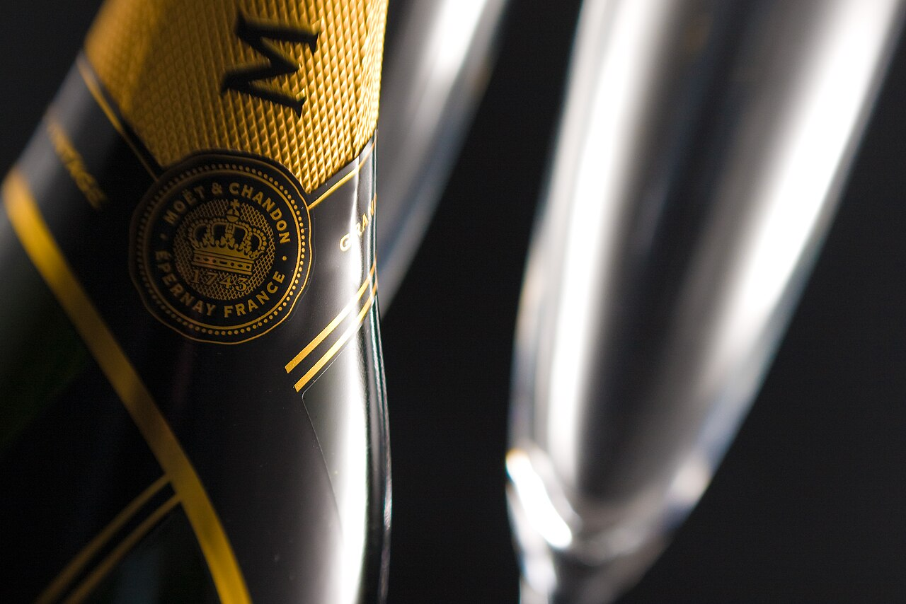

# 酩悦香槟

酩悦香槟（Moët & Chandon）是法国香槟区埃佩尔奈的酒庄，1743 年由克劳德·酩悦创立，现由[路威酩轩](ref:lvmh)旗下酩悦轩尼诗经营。它属于[起泡酒](ref:sparkling-wine)中的香槟，最常见的是无年份 Brut Impérial，750 mL 装、酒精度约 12% vol。同门还有年份香槟 Grand Vintage，以及只做年份酒的 Dom Pérignon。

图：酩悦香槟。图片：Andreas Levers from Potsdam, Germany，CC BY 2.0，via Wikimedia Commons（[原图页面](https://commons.wikimedia.org/wiki/File:Mo%C3%ABt_et_Chandon.jpg)）。

## 1743 年的埃佩尔奈商行

1743 年，克劳德·酩悦在[法国](ref:france)香槟区的埃佩尔奈创立酒庄，地址就在今天的香槟大道。他的孙子让-雷米·酩悦把酒卖到欧洲宫廷与海外市场，酩悦由此从地方商行变成国际品牌。它与同属路威酩轩的[库克](ref:krug)代表两种路线：库克偏小批量、单园与长陈年，酩悦偏大规模、稳定调配与全球宴席。把集团规模当成单瓶品质保证，是常见的层级混淆。

## 1,300 公顷与 28 公里地下酒窖

路威酩轩官方资料显示，酩悦拥有约 1,300 公顷葡萄园，其中约 50% 属特级园、25% 属一级园，是[香槟](ref:champagne)区最大的葡萄园持有者之一。酒窖总长超过 28 公里，位于埃佩尔奈的白垩岩下；酒庄参观页明确把这里称为联合国教科文组织世界遗产的一部分——2015 年列入的“香槟山丘、酒庄与酒窖”整体遗产。

不同资料对面积的口径并不完全一致：也有评论按 1,190 公顷计算。差异可能来自自有、租赁与长期合同葡萄园的不同统计方式，引用时应说明口径。

## Brut Impérial：1869 年定型的旗舰

Brut Impérial 自 1869 年起成为酒庄的旗舰无年份香槟。它由 200 多个 cru 的基酒调配而成，部分资料按村庄计为 288 个；[黑皮诺](ref:pinot-noir)约占 30%–40%，其余为莫尼耶与比例更小的[霞多丽](ref:chardonnay)。为抹平年份差异，酒庄会加入约 30%–50% 的储备酒。

这款酒的补液量为 7 g/L，属于干型 Brut，而非甜型。酒泥陈酿至少 24 个月，高于法定底线。霞多丽提供柑橘与花香，黑皮诺提供骨架，莫尼耶提供更早的成熟度与圆润感，三者共同构成“稳定、易饮”的底层逻辑。

## 香槟法的底线：15 个月与 7 克补液

香槟的瓶内[二次发酵](ref:fermentation)完成后，酒液要带酒泥水平存放。法国竞争、消费与反欺诈总局（DGCCRF）说明，无年份香槟至少陈酿 15 个月；年份香槟要求更长。二次发酵本身约 6–8 周，之后才进入除渣、[补液](ref:dosage)与封瓶。

补液量决定甜度类型：Brut 通常不超过 12 g/L，酩悦的 7 g/L 落在干型区间；Extra Brut 更低，Demi-Sec 更高。把“Brut”读成“甜”是标签阅读中最常见的错误之一。[酒精度](ref:abv)约 12% vol，也要与容量、产地一起核对。

## Grand Vintage 与 Dom Pérignon 的分工

酩悦自己的年份线叫 Grand Vintage，只在酒庄认为够格的年份生产。2015 年是该系列第 76 个年份，[调配](ref:blending)为黑皮诺 44%、霞多丽 32%、莫尼耶 24%，酒泥陈酿 6 年，补液 5 g/L，属 Extra Brut 风格。

Dom Pérignon 则是同门的高端年份品牌，只做年份酒，拥有独立的品牌叙事与更长的陈年定位。它由酩悦轩尼诗体系生产，但不能与 Grand Vintage 混为一谈：一个是酩悦的年份表达，一个是独立的高端线。

## 2015：一个被称作“紧张”的年份

酩悦把 2015 年描述为“紧张”的一年：夏季高温、成熟节奏不均，但红葡萄品种表现突出，黑皮诺因此占到 44%。酒庄在调配中保留较高的霞多丽比例，用酸度拉回平衡，并把补液压到 5 g/L，让果味与矿物感更清晰。

这也是理解年份香槟的入口：年份差异不是“好/坏”二分，而是酒庄如何用品种比例、陈年时长与补液量回应当年的气候。无年份款则相反，它用储备酒把差异抹平，追求每年喝起来都差不多。

## 为什么它比凯歌更“宴会型”

与凯歌黄标相比，酩悦 Brut Impérial 的黑皮诺比例更低（约 30%–40%，凯歌为 50%），调配基数更大（200 多个 cru，凯歌为 50–60 个），补液量也更低（7 g/L 对 9 g/L）。结果是它更柔和、更中性、更容易在宴会与配餐中“不出错”，但骨架与力度不如凯歌。

这不是优劣判断，而是产品任务不同：酩悦要服务全球最大规模的宴会与礼赠场景，凯歌更强调黑皮诺带来的结构感与品牌个性。理解这一点，比记住“哪瓶更高级”有用。

## 价格带：从 Brut Impérial 到 Dom Pérignon

按 2026 年 11 月主要市场零售价参考，Brut Impérial 常见约 50–80 美元；Grand Vintage 通常高于无年份款；Dom Pérignon 常见约 180–300 美元。价格随年份、渠道、礼盒与汇率波动，不能把某一标价当作固定价值。

同一条产品线内部也有差异：普通装、礼盒装、限量版与不同容量（半瓶、Magnum）价格不同，但酒液未必不同。购买时应先确认产品名、年份与容量，再看包装。

## 侍酒温度与餐桌位置

充分冰镇到 8–10°C，用郁金香杯或白葡萄酒杯，气泡更集中，香气也不易被低温压住。开瓶时缓慢旋出软木塞，避免温度过高导致泡沫溢出。

Brut Impérial 适合开胃酒、生蚝、炸物、白肉与咸味小食；Grand Vintage 更适合搭配有奶油质感的海鲜或禽类。甜度类型不同，搭配方向也不同：Extra Brut 更适合清淡前菜，Demi-Sec 才适合甜点。

## 误解一：酩悦不等于唐培里侬

最常见的误解是把“酩悦”与“Dom Pérignon”当成同一款酒，或者认为买了酩悦就等于买了唐培里侬。两者同属酩悦轩尼诗体系，但 Dom Pérignon 是独立的年份品牌，只做年份酒，陈年与价格都不同；酩悦的旗舰则是无年份 Brut Impérial。

第二个常见误解是把 Brut 当成甜香槟。Brut 的补液量通常很低，酩悦为 7 g/L，口感是干型。真正的甜型是 Demi-Sec 或 Doux，标签上会写明。

## 怎样核对一瓶酩悦

先看正标：酒庄名、产品名（Brut Impérial / Grand Vintage / Rosé）、年份（如有）、甜度类型、产地、净含量与酒精度。再看背标与瓶身编码：NM 代表 négociant manipulant，是大型香槟酒庄常见的注册类别；批次与除渣日期能帮助判断新鲜度。

最后看渠道。香槟是高频仿冒品类，价格明显低于市场、标签印刷粗糙、缺少进口背标或防伪信息的产品，应谨慎购买。礼盒与包装不能作为等级依据。

## 延伸阅读

- [起泡酒](ref:sparkling-wine)：香槟所属的大类。
- [路威酩轩](ref:lvmh)：酒庄所属集团与酒类业务结构。
- [法国](ref:france)：香槟产区的国家背景。
- [香槟](ref:champagne)：香槟产区的法定范围与工艺。
- [霞多丽](ref:chardonnay)：香槟的主要品种之一。
- [黑皮诺](ref:pinot-noir)：香槟的骨架来源。
- [发酵](ref:fermentation)：瓶内二次发酵的基本逻辑。
- [调配](ref:blending)：无年份香槟的稳定风格手段。
- [补液](ref:dosage)：甜度类型与 g/L 的关系。
- [酒精度](ref:abv)：约 12% vol 的指标含义。
- [库克](ref:krug)：同一集团下的另一家香槟酒庄。
