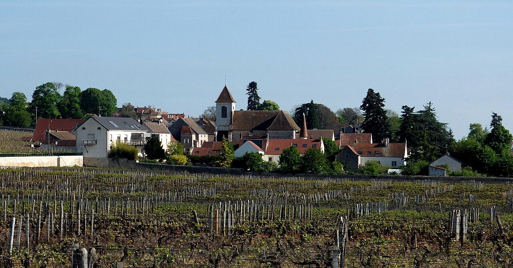

# 莫雷-圣但尼

在酒标上，Morey-Saint-Denis 是一个由两个名字拼起来的村名：前半是村庄本名莫雷，后半借自村里的圣但尼园。这个细节本身就说明了这个村的处境——它夹在[热夫雷-香贝丹](ref:gevrey)与[香波-米西尼](ref:chambolle)之间，名气常被两侧遮蔽，却在一条不长的坡面上集中了四座完整的特级园，还与邻村分享另外两块。常见 750 mL，[酒精度](ref:abv)约 12.5%–13.5% vol，[红葡萄酒](ref:red-wine)以[黑皮诺](ref:pinot-noir)酿造，[白葡萄酒](ref:white-wine)以[霞多丽](ref:chardonnay)酿造且产量很小。

图：莫雷-圣但尼。图片：Palauenc05，CC BY-SA 4.0，via Wikimedia Commons（[原图页面](https://commons.wikimedia.org/wiki/File:Morey-Saint-Denis_general_view.jpg)）。

## 从「莫雷」到「莫雷-圣但尼」

村庄原本只叫莫雷（Morey）。20 世纪 20 年代末，村名正式加上 Clos Saint-Denis 的名字，成为莫雷-圣但尼；这与当时勃艮第许多村庄把名园写进村名的做法一致。改名的动机并不难理解：在夜丘，村名本身就是广告，把最响亮的园名放进村名，能让村庄在酒单上更容易被记住。

但对喝酒的人来说，这个村名容易造成两层误解。其一，以为村内只有圣但尼园；实际上村里有四座完整特级园，圣但尼园只是其中之一。其二，以为村名与园名可以互相替代；酒标上的村庄级、一级园与特级园仍是三套不同的法规身份。看清层级，比记住这个长村名更重要。

## 石灰岩、泥灰岩与四座完整特级园

莫雷-圣但尼位于[法国](ref:france)[勃艮第](ref:burgundy)夜丘中段，北接热夫雷-香贝丹，南接香波-米西尼。葡萄园多分布在村庄上方的东坡与东南坡，海拔与坡度适中。土壤以石灰岩与泥灰岩为底，坡面夹杂碎石与黏土；不同特级园的土层厚度与排水性差异明显，这正是同一村庄内风格分化的重要原因。具体边界以产区官方划界为准。

四座完整位于本村的特级园是 Clos de la Roche、Clos Saint-Denis、Clos des Lambrays 与 Clos de Tart。此外，村庄还分享 Bonnes-Mares 与 Charmes-Chambertin 的一部分。Clos de la Roche 的土壤以浅层碎石与石灰岩为主，名字里的「roche」正是岩石之意；Clos Saint-Denis 的地块相对更规整，土层中黏土比例略高；Clos des Lambrays 与 Clos de Tart 也各自拥有独立的坡位与土壤组合。四座园地并不存在统一的「莫雷风格」，它们只是共享一个村名。

## 与热夫雷共享的边界

Bonnes-Mares 的主体在香波-米西尼，莫雷只占其中一小部分；Charmes-Chambertin 的主体在热夫雷-香贝丹，莫雷同样只切到一条窄边。这种跨村共享在勃艮第并不罕见，但它对买酒有实际影响：同一特级园名称下，来自不同村庄的地块在土层、坡度与成熟节奏上并不相同，酒标上的村名有时比园名更能说明风味的来源。

因此，看到 Bonnes-Mares 或 Charmes-Chambertin 时，除了园名，还应留意酒标上的村庄信息与装瓶者。莫雷一侧的地块通常更靠近村庄上方的坡面，风格上更接近莫雷本身的骨架；香波或热夫雷一侧的地块则各自带着本村的性格。把共享特级园当成同质产品，是最容易犯的错。

## 家族酒庄与差异极大的所有权

村内以家族酒庄为主，也有酒商与合作社参与。几个特级园的归属结构差异很大：Clos de la Roche 与 Clos Saint-Denis 由多家酒庄分块持有；Clos des Lambrays 几乎为单一酒庄所有；Clos de Tart 长期为单一所有权，近年才易主。莫雷-圣但尼的酒标上，装瓶者信息是判断酒庄酒与酒商酒的关键。

生产者、产区与产品是三个层级：产区回答法规与地块范围，生产者回答谁种植、谁酿造、谁装瓶，产品回答年份、层级与红白类型。同一个特级园由不同酒庄酿造，风格可能差别很大；同一位业主在不同年份的取舍，也会改变酒的走向。先看装瓶者，再谈园名，是更稳妥的顺序。

## 酿造：在力量与细腻之间

红葡萄采收后通常经过分拣，部分生产者保留一定比例的整串，以增加香气复杂度与结构；[发酵](ref:fermentation)在控温容器中进行，浸渍时间与温度影响颜色、单宁与香气。莫雷的酒既不能像热夫雷那样一味追求萃取，也不能像香波那样只求轻盈，多数酒庄会在中等偏上的萃取强度上寻找平衡。白葡萄酒多经压榨后发酵，部分酒款进行酒泥搅拌以增加质地。

[橡木桶陈年](ref:oak-ageing)的新桶比例因酒庄与层级而异，特级园通常更高，村庄级更克制。橡木桶用于整合香气与柔化单宁，不应掩盖品种本身的细腻。装瓶前是否澄清过滤，取决于生产者取向；这一选择对香气透明度的影响，在莫雷这种以结构见长的村庄尤其明显。

## 与热夫雷-香贝丹、香波-米西尼的三方对照

莫雷红酒的典型香气是红樱桃、黑樱桃、覆盆子与泥土，部分酒款带香料与烟熏；入口酸度清晰，单宁中等偏上，酒体中等。与北侧的[热夫雷-香贝丹](ref:gevrey)相比，莫雷更收敛、更偏红果与花香，热夫雷则更厚重、单宁更硬、黑色果味更浓；与南侧的[香波-米西尼](ref:chambolle)相比，莫雷更结实、更有骨架，香波更纤细、花香更盛、质地更丝滑。用一句话概括：热夫雷更壮，香波更香，莫雷在两者之间偏硬一点。

四座特级园之间也有差别：Clos de la Roche 通常更饱满、更具骨架；Clos Saint-Denis 更细腻、更偏花香；Clos des Lambrays 香气复杂、质地柔滑；Clos de Tart 结构紧实、陈年潜力长。品鉴温度红葡萄酒约 15–17 摄氏度，白葡萄酒约 10–12 摄氏度。

## 暖年与冷年：骨架与花香的消长

暖年通常带来更深的颜色、更成熟的黑色果味与更饱满的酒体，酸度偏低，单宁更容易显得圆润；冷年则保留更高的酸度，红果与花香更突出，单宁线条更硬，酒体更瘦。莫雷的坡面排水性不一：碎石多的地块在湿年不易积水，黏土比例高的地块则可能成熟偏慢，因此同一村庄在雨水多的年份也会出现明显的质量分化。

对买家来说，暖年的莫雷更容易在年轻时展现结构，冷年则需要更长时间的瓶中陈放；同一酒庄的暖年与冷年放在一起比较，比跨酒庄比较更能看出年份的作用。这里只谈方向，不给年份打分。

## 四座特级园的价格梯度

村庄级莫雷通常处在夜丘村庄级的中间档；一级园往上走一档；四座完整特级园与共享特级园再高一档，其中朗布莱园与塔尔园因所有权结构特殊，市场定位通常更高，罗什园与圣但尼园则因业主众多而价格带宽更大。判断时应看装瓶者、园地位置、年份与背标信息，而不是只看特级园四个字。

同一特级园在不同酒庄手里的价格可能相差很多，这并不必然代表质量差距，更多反映地块位置、产量与市场认知。预算有限时，村庄级或一级园往往比追高特级园更能体现莫雷的本色。本页不给出具体价格。未开瓶应避光、平放于 12–15 摄氏度的阴凉处，避免高温与剧烈温差。

## 共享特级园与所有权的五个误区

第一，把莫雷-圣但尼当作热夫雷或香波的附属。它是独立村庄级产区，且拥有四座完整特级园。
第二，认为村内只有红酒。村庄级产区也产少量白葡萄酒，只是市场上不常见。
第三，把 Bonnes-Mares 全部算给莫雷。该特级园的主体在香波，莫雷只占一小部分。
第四，把 Clos de Tart 与 Clos des Lambrays 当成同一类。两者面积、所有权结构与风格都不同。
第五，以为四个特级园名称下的酒质量整齐划一。业主、坡位与年份造成的差异，往往比园名本身更大。

## 延伸阅读

- [红葡萄酒](ref:red-wine)：本页红酒所属的葡萄酒大类。
- [红葡萄酒](ref:red-wine)：莫雷-圣但尼所属的静止红葡萄酒大类。
- [黑皮诺](ref:pinot-noir)：红葡萄酒使用的葡萄品种。
- [霞多丽](ref:chardonnay)：白葡萄酒使用的葡萄品种。
- [法国](ref:france)：法国葡萄酒法规与产区体系。
- [勃艮第](ref:burgundy)：本页所属产区的分级框架。
- [葡萄](ref:grape)：莫雷-圣但尼所用葡萄的成熟度、酸度与单宁判断。
- [发酵](ref:fermentation)：浸渍与发酵的基本逻辑。
- [橡木桶陈年](ref:oak-ageing)：莫雷-圣但尼的桶陈时长、香气整合与结构变化。
- [酒精度](ref:abv)：12.5%–13.5% vol 在标签上的含义。
- [热夫雷-香贝丹](ref:gevrey)：北侧相邻的村庄级产区。
- [香波-米西尼](ref:chambolle)：南侧相邻的村庄级产区。
