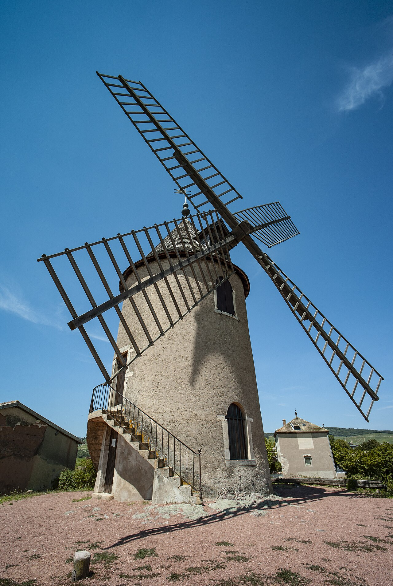

# 穆兰-阿旺

穆兰-阿旺（Moulin-à-Vent）是法国[博若莱](ref:beaujolais)北部的村庄级 cru，以[佳美](ref:gamay)酿造[红葡萄酒](ref:red-wine)。葡萄园分布在罗曼内什-托兰（Romanèche-Thorins）一带的花岗岩坡地，名字来自坡上一座老风车。常见 750 mL，[酒精度](ref:abv)约 12.5%–14% vol。

图：穆兰-阿旺。图片：Xbrindavoine，CC BY-SA 4.0，via Wikimedia Commons（[原图页面](https://commons.wikimedia.org/wiki/File:Moulin_%C3%A0_Vent_de_Roman%C3%A8che-Thorins.jpg)）。

## 定义与定位

先分层：[红葡萄酒](ref:red-wine)是大类，佳美是品种，穆兰-阿旺是博若莱十个村庄级 cru 之一，具体酒庄与酒款是生产者层面。穆兰-阿旺既是地名，也是可以单独标注在酒标上的法定产区名，酒标上通常不再出现“博若莱”大区名。

村内没有一级园或特级园分级，但地块差异被生产者重视。托兰（Thorins）、拉罗谢尔（La Rochelle）等命名地块常被单独标注，用来区分坡向、土壤与结构。

## 生产者与品牌

村内以家族酒庄为主，也有酒商与合作社参与。部分酒庄自有核心地块，另一些收购葡萄或酒液装瓶；穆兰-阿旺的酒标上，装瓶者信息是判断酒庄酒与酒商酒的关键。

生产者、产区与产品是三个层级：产区回答法规与地块范围，生产者回答谁种植、谁酿造、谁装瓶，产品回答年份、地块与规格。同为穆兰-阿旺，不同坡位与酒庄的风格可以有明显差别。

## 「穆兰-阿旺」的产地与原料
穆兰-阿旺位于[法国](ref:france)[博若莱](ref:beaujolais)北部，与[弗勒里](ref:fleurie)和谢纳相邻，葡萄园分布在罗曼内什-托兰村周围的山坡上。这一带以粉红色花岗岩风化砂为主，含锰与铁氧化物，排水好、肥力低。

坡向与海拔造成成熟度差异：朝南的坡面日照更充分，成熟度较高；高海拔地块酸度保留更好。整体成熟度在博若莱 cru 中偏高，因此酒体更厚、单宁更明显。具体边界以产区官方划界为准。

原料是[葡萄](ref:grape)，品种为佳美。佳美皮薄、酸度高，在含锰的花岗岩土壤上表现出较深的颜色、黑色果味与更紧的结构。

## 「穆兰-阿旺」怎么做出来
穆兰-阿旺常用整串发酵，部分酒庄采用半二氧化碳浸渍：整串葡萄在充满二氧化碳的容器中先行细胞内发酵，再进入压榨与常规发酵。与追求轻盈的 cru 相比，这里更常延长浸渍以增加结构。

发酵温度与浸渍时间影响颜色、单宁与香气。追求陈年潜力的酒款会延长浸渍、增加萃取；部分酒款进入[橡木桶陈年](ref:oak-ageing)，新桶比例通常不高，以免掩盖佳美的果味。

## 「穆兰-阿旺」的瓶型与标签
常见容量为 750 mL，[酒精度](ref:abv)约 12.5%–14% vol，具体随年份与酒庄变化。标签应核对 cru 名称、地块名、年份、装瓶者与进口商信息。

穆兰-阿旺是独立 cru 名称，不必与“Beaujolais”同时出现。中文背标、进口商与防伪信息是核对身份的依据，以瓶身实际标注为准。

## 「穆兰-阿旺」的闻与喝
典型香气是黑樱桃、李子、覆盆子、紫罗兰与泥土，部分酒款带香料与矿物感；入口酸度清晰，单宁中等偏上，酒体中等偏饱满。它常被形容为博若莱中最接近勃艮第红酒的一支，与[弗勒里](ref:fleurie)的轻盈花香形成对比。

品鉴时建议温度约 15–17 摄氏度，用郁金香形或勃艮第形酒杯。年轻酒款可醒酒 30 分钟至 1 小时，老酒则应缩短时间。闻香时注意果味与泥土气息的层次，过度橡木会掩盖花香。

## 「穆兰-阿旺」的饮用与搭配
适合禽肉、烤猪肉、烤小牛肉、野味与菌菇菜肴，也可搭配中等强度奶酪。避免与重辣或强酸菜肴同饮，容易掩盖果味与结构。

多数酒款适合在 4–12 年内饮用，核心地块可以更久；具体适饮窗口因年份、地块与酒庄而异。开瓶后应冷藏并在数日内喝完。本页关于穆兰-阿旺的内容涉及酒精饮料；过量饮酒有害健康，未成年人不应饮酒。

## 「穆兰-阿旺」的购买与保存
购买时优先选择正规渠道，核对 cru 名称、地块名、年份与装瓶者信息。穆兰-阿旺在博若莱 cru 中以结构与陈年潜力著称，价格随地块、酒庄与年份差异明显，本页不给出具体数字。

穆兰-阿旺在博若莱 cru 中酒体偏厚、单宁更明显，陈年潜力较强。未开瓶应平放于 12–15°C、避光且温差小的位置；软木塞保持湿润。开瓶后抽真空或充惰性气体冷藏，尽量两三天内喝完，避免花果香被氧化压过。

## 「穆兰-阿旺」容易被读错的地方
第一，把穆兰-阿旺当成博若莱新酒。它是独立的村庄级 cru，强调结构与陈年，而不是当年果味。
第二，认为佳美不能陈年。穆兰-阿旺的核心地块可以有明显陈年潜力。
第三，认为名字里的“风车”是酒庄品牌。它来自坡上的地标建筑，不是商标。
第四，把穆兰-阿旺与弗勒里混为一谈。两者相邻，但结构与酒体不同。
第五，用价格或包装判断真伪。渠道、标签与装瓶者信息更可靠。

对照阅读：[红葡萄酒](ref:red-wine)、[博若莱](ref:beaujolais)。

**关键事实。**

| 项目 | 内容 |
| --- | --- |
| 一句话定位 | 法国博若莱北部村庄级 cru 的红葡萄酒，以佳美酿造；葡萄园分布在罗曼内什-托兰一带的花岗岩坡地，名字来自坡上的老风车，酒体在博若莱 cru 中偏厚、单宁更明显、陈年潜力较强，常见 750 mL、酒精度约 12.5%–14% vol |
| 酒种/风格 | 红葡萄酒 |
| 产区 | 法国、博若莱 |
| 酒精度 | 12.5–14% vol |

**来源与边界。** 本页关于「穆兰-阿旺」的关键事实，主要由以下来源交叉核对：Inter Beaujolais（穆兰-阿旺的 cru 范围、主要地块与风格框架；由原条目末尾参考资料迁移，未逐条复核访问日期）、INAO（法定产区范围与 cru 规则；由原条目末尾参考资料迁移，未逐条复核访问日期）、Oxford University Press（提供关于穆兰-阿旺、风车地标与佳美的条目；由原条目末尾参考资料迁移，未逐条复核访问日期）。价格、批次与状态会变，涉及这些字段时以页面所列来源的最新版本为准。正文为项目自写，来源只作核验，不复制原文。

## 参考资料
- [红葡萄酒](ref:red-wine)：穆兰-阿旺所属的葡萄酒大类。
- [佳美](ref:gamay)：本页唯一的葡萄品种。
- [法国](ref:france)：法国葡萄酒法规与产区体系。
- [博若莱](ref:beaujolais)：穆兰-阿旺所属产区与十个 cru 的框架。
- [葡萄](ref:grape)：穆兰-阿旺所用葡萄的成熟度、酸度与单宁判断。
- [发酵](ref:fermentation)：整串发酵与半二氧化碳浸渍的基本逻辑。
- [橡木桶陈年](ref:oak-ageing)：穆兰-阿旺的桶陈时长、香气整合与结构变化。
- [酒精度](ref:abv)：12.5%–14% vol 在标签上的含义。
- [弗勒里](ref:fleurie)：相邻且风格更轻盈的博若莱 cru。
