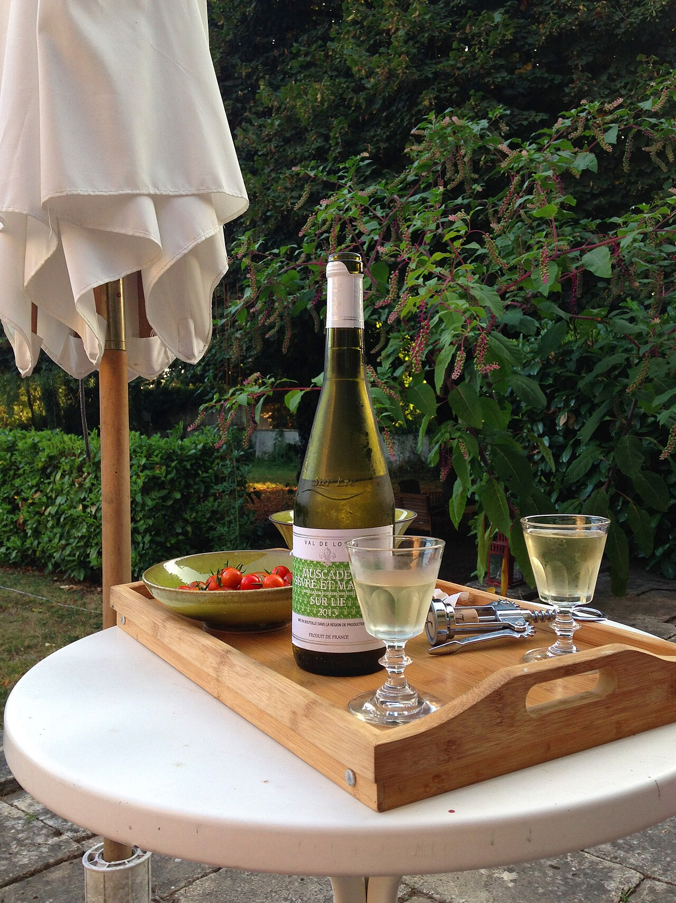

# 密斯卡岱

密斯卡岱是法国[卢瓦尔河谷](ref:loire)南特地区的一类白葡萄酒法定产区统称，以[勃艮第甜瓜](ref:melon-de-bourgogne)酿造。它以高酸度、中性香气与酒泥陈酿带来的圆润质地为特征，常见 750 mL，[酒精度](ref:abv)约 11%–12.5% vol。

图：密斯卡岱。图片：Julien.scavini，CC BY-SA 4.0，via Wikimedia Commons（[原图页面](https://commons.wikimedia.org/wiki/File:Muscadet_wine_bottle.jpg)）。

## 定义与定位

先分层：[白葡萄酒](ref:white-wine)是大类，勃艮第甜瓜是品种，密斯卡岱是法定产区统称，具体酒庄与酒款是生产者层面。密斯卡岱既是酒名，也出现在多个产区名称中，不能与某个品牌混同。

密斯卡岱包含多个法定产区，例如密斯卡岱、密斯卡岱-塞夫尔-曼恩等。不同产区的范围与规则略有差异，但品种相同；看到酒标时应核对完整的产区名，而不只看“Muscadet”一词。

## 生产者与品牌

产区内以家族酒庄与合作社为主，也有酒商。酒庄规模差异较大，有的自有地块并自行装瓶，有的收购葡萄或酒液再调配。密斯卡岱的酒标上，装瓶者信息是区分酒庄酒与酒商酒的关键。

慕斯卡德的生产者结构比产区名复杂：独立酒庄、合作社与酒商都可能装瓶，酒标上的“sur lie”说明酒泥陈酿方式，不等于质量等级。购买时要看装瓶者、产地范围与酒泥接触时间，而不是只看产区名。

## 「密斯卡岱」的产地与原料
密斯卡岱位于[法国](ref:france)卢瓦尔河谷南特地区，靠近卢瓦尔河入海口。气候为海洋性，温和湿润，秋季较长，有利于保持酸度。

土壤以片岩、花岗岩、砂质与砾石为主，排水性与蓄热能力不同，影响成熟节奏与矿物感。原料是[葡萄](ref:grape)，白葡萄酒以[勃艮第甜瓜](ref:melon-de-bourgogne)酿造，通常为单一品种。

## 「密斯卡岱」怎么做出来
密斯卡岱以[发酵](ref:fermentation)为基础，通常在低温下发酵以保留酸度与果味。典型工艺是酒泥陈酿（sur lie）：发酵结束后不立即倒罐，让酒液与酵母酒泥接触一段时间，增加奶油、面包与圆润质地。

部分酒款使用[橡木桶陈年](ref:oak-ageing)，但并非主流；多数密斯卡岱以不锈钢罐为主，强调清爽与纯净。密斯卡岱的 sur lie 时长、搅泥频率与是否过桶由酒庄决定；这些细节会改变面包香与质地，具体以酒庄资料与瓶标为准。

## 「密斯卡岱」的瓶型与标签
常见容量为 750 mL，[酒精度](ref:abv)约 11%–12.5% vol。标签应核对完整产区名、年份、是否标注“sur lie”、装瓶者与进口商信息。

慕斯卡德酒标常出现“Muscadet”“sur lie”与产区子名，酒精度与酒泥接触时间会标在背标或酒庄资料。产区名不等于质量等级，同一酒庄不同地块与年份差异明显，购买时应看装瓶者与具体标注。

## 「密斯卡岱」的闻与喝
密斯卡岱以青苹果、柠檬、白花与轻微咸鲜感为主，酸度高、酒体轻盈到中等。经酒泥陈酿的酒款会增加奶油、面包与坚果气息，质地更圆润，但仍保持清晰酸度。

品鉴时建议温度约 8–10 摄氏度。闻香时注意果味与酒泥气息的平衡，过度酒泥会让酒显得沉闷。年轻酒款以清爽为主，优质酒款可在数年里发展出更多层次。

## 「密斯卡岱」的饮用与搭配
密斯卡岱是海鲜的经典搭配，尤其适合生蚝、贝类、清蒸鱼与带咸鲜味的菜肴；高酸度也能平衡油炸食物与奶油酱汁。配餐时以酸度为准，不必强求固定搭配。

多数酒款适合在 2–5 年内饮用，优质酒款可以更久；具体适饮窗口因年份与酒庄而异。开瓶后应冷藏并尽快饮用。本页关于密斯卡岱的内容涉及酒精饮料；过量饮酒有害健康，未成年人不应饮酒。

## 「密斯卡岱」的购买与保存
购买时优先选择正规渠道，核对完整产区名、年份与装瓶者信息。价格随产区、年份与酒庄差异明显，本页不给出具体数字。密斯卡岱的产区名与包装只能证明法定范围，不能替代对具体酒庄、年份与装瓶者的核对。

未开瓶应避光、平放于阴凉处，理想温度为 8–12 摄氏度，避免高温与剧烈温差。软木塞封瓶需保持湿度；长期存放可平放。开瓶后冷藏，并在数日内饮用。

## 「密斯卡岱」容易被读错的地方
第一，把密斯卡岱与麝香葡萄混为一谈。名称相近，但品种是勃艮第甜瓜。
第二，认为密斯卡岱只是廉价海鲜酒。优质酒泥陈酿酒款具有质地与陈年潜力。
第三，把“sur lie”当成营销词。它描述酒泥陈酿工艺，有实际风味影响。
第四，认为密斯卡岱必须加橡木。多数酒款以不锈钢罐为主。
第五，用价格或包装判断真伪。渠道、背标与装瓶者信息更可靠。

密斯卡岱的品种是勃艮第甜瓜，不是麝香葡萄；它产自卢瓦尔河谷南特一带，酸度高、香气偏中性，常靠酒泥陈酿增加质感与咸鲜感。酒标上的“sur lie”说明与酒泥接触，不等于所有密斯卡岱都经过同样处理；它适合配海鲜，但不是“越便宜越要冰镇”的简单饮料。

**关键事实。**

| 项目 | 内容 |
| --- | --- |
| 一句话定位 | 法国卢瓦尔河谷南特地区的白葡萄酒法定产区统称，以勃艮第甜瓜（Melon de Bourgogne）酿造；酸度高、香气中性，常经酒泥陈酿，以青苹果、柠檬、白花与咸鲜感著称，常见 750 mL、酒精度约 11%–12.5% vol |
| 酒种/风格 | 白葡萄酒 |
| 产区 | 法国、卢瓦尔河谷 |
| 酒精度 | 11–12.5% vol |

**来源与边界。** 本页关于「密斯卡岱」的关键事实，主要由以下来源交叉核对：INAO（密斯卡岱各法定产区的范围、品种与酒泥陈酿规则；由原条目末尾参考资料迁移，未逐条复核访问日期）、InterLoire（南特产区的土壤、风格与海鲜搭配传统；由原条目末尾参考资料迁移，未逐条复核访问日期）、Oxford University Press（提供关于密斯卡岱与勃艮第甜瓜的条目；由原条目末尾参考资料迁移，未逐条复核访问日期）。价格、批次与状态会变，涉及这些字段时以页面所列来源的最新版本为准。正文为项目自写，来源只作核验，不复制原文。

## 参考资料
- [白葡萄酒](ref:white-wine)：密斯卡岱所属的葡萄酒大类。
- [勃艮第甜瓜](ref:melon-de-bourgogne)：密斯卡岱的唯一品种。
- [法国](ref:france)：法国葡萄酒法规与产区体系。
- [卢瓦尔河谷](ref:loire)：密斯卡岱所在的产区带与子产区框架。
- [葡萄](ref:grape)：密斯卡岱所用葡萄的成熟度、酸度与单宁判断。
- [发酵](ref:fermentation)：酒泥陈酿与酸度保留的基本逻辑。
- [橡木桶陈年](ref:oak-ageing)：少数酒款使用的质地来源。
- [酒精度](ref:abv)：11%–12.5% vol 在标签上的含义。
