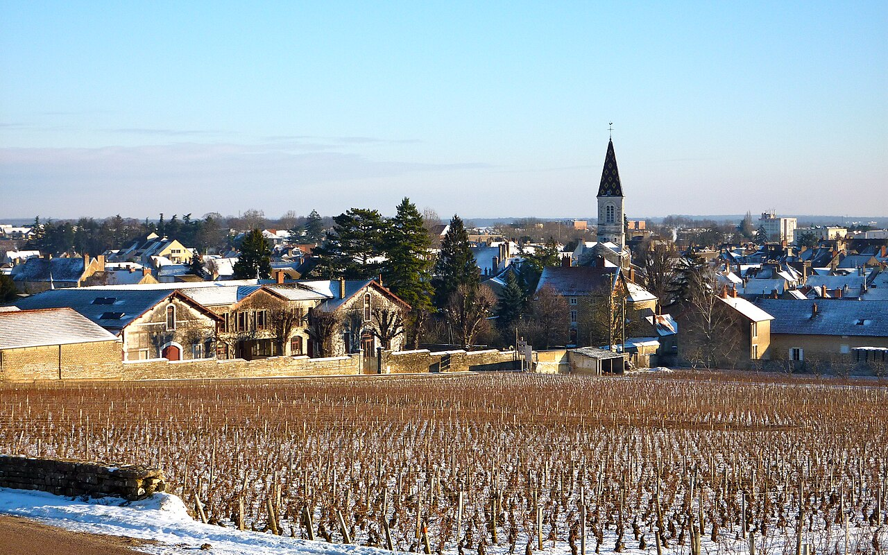

# 夜圣乔治

夜圣乔治是法国[勃艮第](ref:burgundy)夜丘（Côte de Nuits）产区的村庄级红葡萄酒法定产区，位于第戎以南、博讷以北。它以[黑皮诺](ref:pinot-noir)酿造[红葡萄酒](ref:red-wine)，酒体较为坚实，村内有多处一级园但没有特级园。常见 750 mL，[酒精度](ref:abv)约 12.5%–13.5% vol。

图：夜圣乔治。图片：Leroy remy，CC BY-SA 3.0，via Wikimedia Commons（[原图页面](https://commons.wikimedia.org/wiki/File:Nuits-Saint-Georges_France_December2010.jpg)）。

## 定义与定位

先分层：[红葡萄酒](ref:red-wine)是大类，黑皮诺是品种，夜圣乔治是村庄级法定产区（AOC），具体酒庄、园地与酒款是生产者层面。夜圣乔治既是地名，也是酒标上的产区名，不能与某个品牌混同。

勃艮第的分级是村庄、一级园与特级园三层。夜圣乔治本身没有特级园，村内有多处一级园；酒标上标注“Nuits-Saint-Georges Premier Cru”或具体一级园名称，属于更高层级。

## 生产者与品牌

夜圣乔治的生产者包括家族酒庄与酒商，村内一级园分散。自有地块并自行装瓶的酒庄，风格更贴近具体园地；酒商酒可能收购多个地块。酒标上的“domaine”与装瓶者信息，是区分两者的关键。

生产者、产区与产品是三个层级：产区回答法规与地理范围，生产者回答谁种植、谁酿造、谁装瓶，产品回答年份与规格。同一村内不同酒庄与园地的风格差异明显，不能用一款酒概括整个村庄。

## 「夜圣乔治」的产地与原料
夜圣乔治位于[法国](ref:france)勃艮第的夜丘，第戎以南、博讷以北。气候偏大陆性，生长季较短，昼夜温差有助于保留酸度与香气。土壤以石灰岩与泥灰岩为主，坡向与排水条件影响成熟节奏。

原料是[葡萄](ref:grape)，品种为[黑皮诺](ref:pinot-noir)。勃艮第的红葡萄酒几乎都以黑皮诺酿造，白葡萄酒以霞多丽为主；具体品种与园地规则以法定产区文件为准。

## 「夜圣乔治」怎么做出来
夜圣乔治红酒以[发酵](ref:fermentation)为基础，发酵温度与浸渍时间决定颜色、单宁与香气。勃艮第传统上使用开放式发酵槽或温控罐，部分酒庄保留整串发酵，增加香料与结构感。

[橡木桶陈年](ref:oak-ageing)是风格的重要变量：新桶比例影响香草、烘烤与单宁质地，旧桶更利于保留果味。夜圣乔治的整串比例、发酵容器与新桶比例没有统一数值；这些选择直接改变香料感与单宁质地，具体以酒庄资料与瓶标为准。

## 「夜圣乔治」的瓶型与标签
常见容量为 750 mL，[酒精度](ref:abv)约 12.5%–13.5% vol。标签应核对村庄名、年份、一级园名称、装瓶者与进口商信息；勃艮第酒标常同时标注酒庄名与园地名。

夜圣乔治在不同市场的标签语言不同，以瓶身实际标注为准。村庄名与一级园名称是不同层级的命名，不等于质量排名；同一园地不同酒庄的风格差异明显。

## 「夜圣乔治」的闻与喝
年轻夜圣乔治以黑樱桃、黑醋栗、甘草与泥土气息为主，单宁较坚实、酸度清晰；与邻近村庄相比，风格更偏结构感。随陈年发展出皮革、松露与干花气息，口感更柔顺。

品鉴时建议温度约 15–17 摄氏度。闻香时注意果味、香料与泥土气息的层次，过度橡木会掩盖黑皮诺的细腻度。陈年潜力因年份、园地与酒庄而异。

## 「夜圣乔治」的饮用与搭配
夜圣乔治适合搭配红肉、禽类、蘑菇与中等硬质奶酪；结构紧实的酒款适合炖肉与野味。饮用夜圣乔治时，配餐以酸度与单宁强度为准，不必强求固定搭配。

多数村庄级酒款适合在 5–12 年内饮用，一级园与优质年份可以更久；具体适饮窗口因年份、园地与酒庄而异。开瓶后可短暂醒酒，剩余酒液应密封冷藏并尽快饮用。本页关于夜圣乔治的内容涉及酒精饮料；过量饮酒有害健康，未成年人不应饮酒。

## 「夜圣乔治」的购买与保存
购买时优先选择正规渠道，核对村庄名、年份、园地与装瓶者信息。价格随园地、酒庄声誉与年份差异明显，本页不给出具体数字。夜圣乔治的产区名与包装只能证明法定范围，不能替代对具体酒庄、园地与装瓶者的核对。

夜圣乔治以黑皮诺酿造，酒体较坚实，黑樱桃与泥土气息明显。未开瓶可平放在 12–15°C 的避光处，长期存放保持温度稳定；软木塞需要湿度。开瓶后密封冷藏，两天内喝完，老酒更应减少与空气接触。

## 「夜圣乔治」容易被读错的地方
第一，把夜圣乔治当成特级园产区。村内有多处一级园，但没有特级园。
第二，把村庄级与一级园当成同一层级。它们是勃艮第分级中的不同层级。
第三，认为黑皮诺只能做轻盈酒。夜圣乔治的结构感在勃艮第红葡萄酒中相对突出。
第四，把泥土气息一律当成缺陷。适度的泥土与菌菇气息是陈年黑皮诺的特征。
第五，用价格或包装判断真伪。渠道、背标与装瓶者信息更可靠。

对照阅读：[红葡萄酒](ref:red-wine)、[勃艮第](ref:burgundy)。

**关键事实。**

| 项目 | 内容 |
| --- | --- |
| 一句话定位 | 法国勃艮第夜丘产区的黑皮诺红葡萄酒村庄级法定产区，位于第戎以南、博讷以北；以黑樱桃、甘草与泥土气息著称，酒体较坚实，村内有多处一级园但没有特级园，常见 750 mL、酒精度约 12.5%–13.5% vol |
| 酒种/风格 | 红葡萄酒 |
| 产区 | 法国、勃艮第 |
| 酒精度 | 12.5–13.5% vol |

**来源与边界。** 本页关于「夜圣乔治」的关键事实，主要由以下来源交叉核对：INAO（夜圣乔治法定产区的村庄级与一级园规则；由原条目末尾参考资料迁移，未逐条复核访问日期）、BIVB（夜圣乔治的村庄、一级园与风格；由原条目末尾参考资料迁移，未逐条复核访问日期）、Oxford University Press（提供关于夜圣乔治与黑皮诺的条目；由原条目末尾参考资料迁移，未逐条复核访问日期）。价格、批次与状态会变，涉及这些字段时以页面所列来源的最新版本为准。正文为项目自写，来源只作核验，不复制原文。

## 参考资料
- [红葡萄酒](ref:red-wine)：夜圣乔治所属的葡萄酒大类。
- [黑皮诺](ref:pinot-noir)：夜圣乔治的唯一红葡萄品种。
- [法国](ref:france)：法国葡萄酒法规与产区体系。
- [勃艮第](ref:burgundy)：夜圣乔治所在的产区与分级框架。
- [葡萄](ref:grape)：夜圣乔治所用葡萄的成熟度、酸度与单宁判断。
- [发酵](ref:fermentation)：浸渍与萃取的基本逻辑。
- [橡木桶陈年](ref:oak-ageing)：夜圣乔治的香料、质地与桶陈来源。
- [酒精度](ref:abv)：12.5%–13.5% vol 在标签上的含义。
