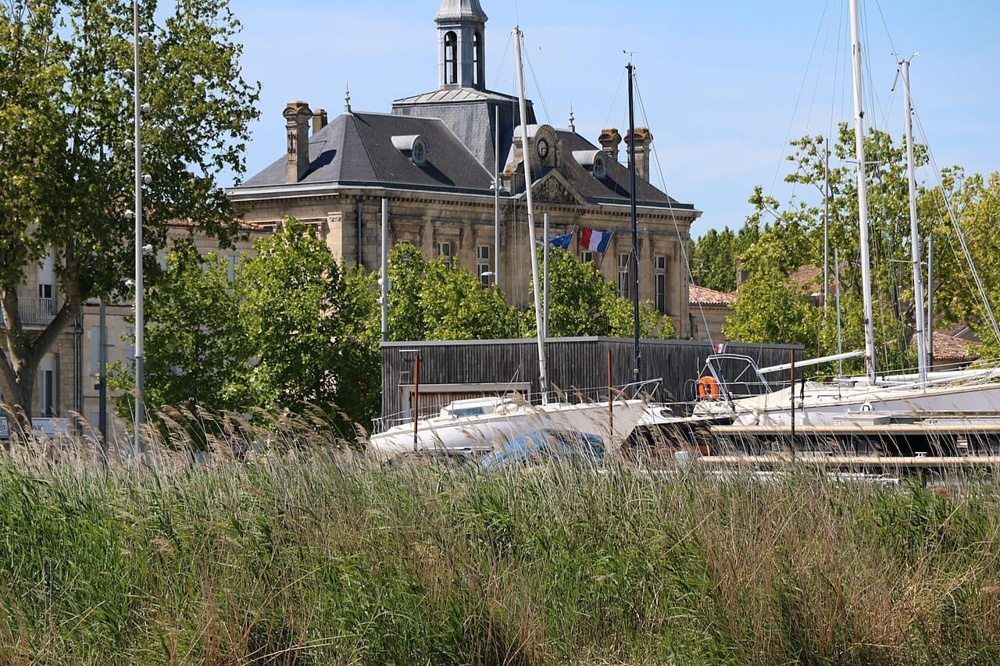

# 波亚克产区

波亚克（Pauillac）只有约 1,200 公顷葡萄园，却在 1855 年分级的五家一级庄里占了三席——拉菲、拉图与木桐。18 家列级庄挤在吉伦特河左岸这一段砾石丘上，使它成为梅多克权力最集中的村级产区。它属于[法国](ref:france)[波尔多](ref:bordeaux)，1936 年 11 月 14 日获得 AOC，产出以[赤霞珠](ref:cabernet-sauvignon)为绝对主体的[红葡萄酒](ref:red-wine)，原料是[葡萄](ref:grape)；常见 750 mL，[酒精度](ref:abv)多在 12.5%–13.5% vol。

图：波亚克产区。图片：Anthony Baratier，CC BY-SA 4.0，via Wikimedia Commons（[原图页面](https://commons.wikimedia.org/wiki/File:La_mairie_de_Pauillac_vue_depuis_le_port_de_plaisance.jpg)）。

## 三家一级庄与 18 席列级庄

波亚克的列级庄结构在梅多克独一无二：3 家一级庄、2 家二级庄、0 家三级庄、1 家四级庄、12 家五级庄，合计 18 家。拉菲（Lafite Rothschild）、拉图（[Latour](ref:latour)）与木桐（[Mouton Rothschild](ref:mouton)）三家一级庄，加上碧尚男爵（Pichon Baron）与碧尚女爵（Pichon Comtesse）两家二级庄，构成了村子的上层。1855 年名单只覆盖酒庄，不覆盖产区；18 家之外，波亚克仍有大量未列级生产者。

## 1936 年 11 月 14 日：一条沿河岸划下的边界

波亚克 AOC 由 1936 年 11 月 14 日的法令确立，此后边界多次修订。产区北接圣埃斯泰夫，南邻圣朱利安，东临吉伦特河口，葡萄园集中在一条长约数公里的砾石带上。AOC 边界是历史与地籍的产物，不是一条简单的中线。

## 卡吕阿德台地：产区的最高点

拉菲位于产区最北端，紧贴圣埃斯泰夫边界；它最好的地块是城堡以西的卡吕阿德台地（plateau des Carruades），约 50 公顷，被酒庄称为波亚克产区的最高点。台地土壤为黏土-砾石，排水良好、朝向理想，赤霞珠在这里能达到充分成熟。拉菲还有一块 4.5 公顷的葡萄园落在圣埃斯泰夫境内，其果实仍用于正牌酒——这说明"酒庄"与"产区"在波尔多的关系远比标签复杂。

木桐则在产区中部偏北，自有葡萄园约 90 公顷。"Mouton"并非来自法语里的"羊"，而是古法语 motte，意为小丘；"Lafite"则来自"山脊"。地名本身就是地形说明书。

## 深砾石、泥灰岩与"铁拳裹天鹅绒"

波亚克的砾石丘比玛歌更厚、更连续，混酿以赤霞珠为主，辅以[梅洛](ref:merlot)与少量[品丽珠](ref:cabernet-franc)。木桐官网的描述是：贫瘠的砾石层向下延伸数米，下面是泥灰岩；地形由一系列小圆丘组成，丘顶通常低于海拔 40 米，丘间低地负责排水。Decanter 的记录补充了一个反直觉的细节：整个梅多克最高点也不过 35 米上下，多数葡萄园在 10 至 20 米，拉图甚至是海拔最低的一级庄，只有 13 米。波亚克的力量不来自高度，而来自砾石的厚度、排水与蓄热。

## 木桐的 1973：分级史上唯一一次晋升

1855 年分级之后，名单几乎冻结。唯一的例外是木桐：在菲利普男爵近二十年的游说之后，1973 年时任农业部长雅克·希拉克签署法令，把木桐从二级庄提升为一级庄。这也是 1855 年名单至今唯一一次等级变动。今天说"波亚克有三家一级庄"，严格说是 1973 年以后才成立的说法；在此之前，村子里只有拉菲与拉图两家。

## 从碧尚到林奇-巴日：18 席的分布

除三家一级庄与两家碧尚，波亚克的列级庄还包括四级庄杜哈米隆（Duhart-Milon），以及 12 家五级庄：巴特利（Batailley）、克莱蒙（Clerc Milon）、克罗泽-巴日（Croizet-Bages）、达马雅克（d'Armailhac）、大普伊-杜卡斯（Grand-Puy-Ducasse）、大普伊-拉科斯特（Grand-Puy-Lacoste）、上巴日-利贝拉尔（Haut-Bages-Libéral）、上巴特利（Haut-Batailley）、林奇-巴日（Lynch-Bages）、林奇-穆斯加（Lynch-Moussas）、佩德斯科（Pédesclaux）与庞特-卡内（Pontet-Canet）。这份名单解释了为什么波亚克的"中级"酒款也有很强的结构：五级庄里不乏被市场当作二级庄定价的名字。

## 57 hl/ha 与 9,500 kg/ha 的双重闸门

波亚克的产量规则与梅多克其他村级 AOC 同构：57 hl/ha 为基准，63 hl/ha 为但书上限（部分行距配置下降为 60 hl/ha）。种植密度最低 7,000 株/公顷，行距不超过 1.50 米，单株占地不超过 1.43 平方米；每公顷最大负载 9,500 公斤。最低天然酒精度 11%，梅洛最低含糖量 189 克/升、其他品种 180 克/升。酒须陈年至采收次年 6 月 1 日，9 月 1 日起上市，装瓶不得晚于采收后第三年年底。对波亚克而言，这些数字是底线而非风格说明书：一级庄的实际产量通常远低于法定上限。

## 发酵温度、浸渍与 15 个月新桶

波亚克红酒以[发酵](ref:fermentation)为核心，温度控制与浸渍时长决定萃取。以拉菲为例，酒精发酵在控温下进行并定期淋皮，浸渍约 22 天，随后进入法国橡木桶，新桶陈年约 15 个月；酒庄甚至在波亚克自设制桶厂。这类参数属于个体酒庄，不能推广为产区法规。赤霞珠的高单宁与高酸度意味着：混酿比例、采收日期和[橡木桶陈年](ref:oak-ageing)的新桶比例，任何一项偏差都会改变酒的骨架。

## 比玛歌更硬，比圣朱利安更满

与玛歌相比，波亚克的单宁更实、更晚打开，原因是砾石层更厚更连续、赤霞珠比例更高；玛歌的土壤夹更多黏土、砂与河岸粉砂，梅洛比例更高，单宁因此更细。与圣朱利安相比，波亚克的酒体更饱满、铅笔芯与雪松气息更突出；圣朱利安的砾石分布被 Decanter 形容为"最均匀、最有秩序"，只有入口处一条黏土带，因此酒体略收、轮廓更顺。三者不是三个形容词，而是三套土壤与品种配比的结果。

## 价格带：$160 到 $989

Wine-Searcher 在 2026 年 11 月给出的 750 ml 国际均价：Château Pontet-Canet 约 160 美元，Lynch-Bages 约 184 美元，Pichon Comtesse 约 244 美元，Mouton Rothschild 约 786 美元，Latour 约 945 美元，Lafite 约 989 美元。村内非列级庄常见于 40–80 美元。价格随年份、评分、渠道与汇率波动，上述数字只用于判断量级。

## 纠正"波亚克只有力量"

波亚克常被简化为"强劲、单宁重"，但 18 家列级庄的内部差异极大：拉菲以细腻与香气见长，拉图以深度与陈年潜力著称，木桐在 1973 年后风格更外向，五级庄中的林奇-巴日则以相对亲民的价格提供典型波亚克结构。把"力量"当作唯一标准，会错过同一产区内从紧致到丰腴的完整光谱。另一个误解是把波亚克等同于三家一级庄——产区是地理范围，一级庄只是其中三个生产者。

## 温度、醒酒与配餐

波亚克适合 16–18 摄氏度饮用；年轻、单宁重的年份建议醒酒 1–2 小时，老酒则缩短醒酒时间以免香气散失。红肉、烤肉、野味与硬质奶酪是稳妥搭配，脂肪能缓冲单宁。开瓶后密封冷藏，尽量在数日内喝完；本页关于波亚克产区的内容涉及酒精饮料；过量饮酒有害健康，未成年人不应饮酒。

对照阅读：[红葡萄酒](ref:red-wine)、[波尔多](ref:bordeaux)。
