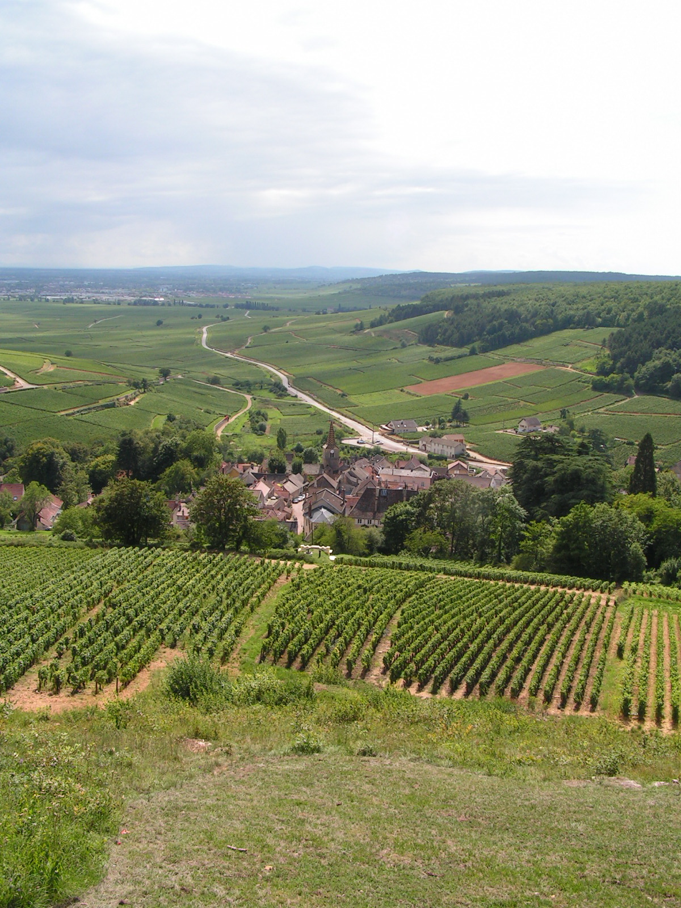

# 佩尔南-韦尔热莱斯

佩尔南-韦尔热莱斯（Pernand-Vergelesses）藏在科尔通山西侧两条小谷的交汇处，村舍沿陡街向上，葡萄园从屋顶背后一直铺到山肩。它常被写成“科尔通山三村之一”，但这个说法遮住了真正有意思的部分：这是一个白葡萄酒占到近一半、一级园个性清晰、且拥有自己特级园地块的完整产区。村内以[黑皮诺](ref:pinot-noir)酿[红葡萄酒](ref:red-wine)，以[霞多丽](ref:chardonnay)酿[白葡萄酒](ref:white-wine)；常见 750 mL，[酒精度](ref:abv)约 12.5%–13.5% vol。

图：佩尔南-韦尔热莱斯。图片：Olivier Vanpé，CC BY-SA 2.5，via Wikimedia Commons（[原图页面](https://commons.wikimedia.org/wiki/File:Pernand-Vergelesses.jpg)）。

## 两条谷地交汇处的村庄

从阿洛斯翻过山脊向西，地形突然收窄：两条 combes（小谷）在村口汇合，葡萄园被挤在谷壁与山肩之间。这种“口袋”地形带来两个后果：一是可用地块零碎，同一块一级园里常有不同坡度与土层；二是冷空气夜里沿谷下沉，最低处比中坡更容易受霜与晚熟困扰。村内 8 个一级园，多数就分布在这些谷壁的中段与上段。

## 朝东为主，为什么仍比阿洛斯晚熟

BIVB 的表述很具体：大部分葡萄园朝东或朝南，少数朝东北；海拔 250–300 米。也就是说，它并非整村“背阴”，但确实存在一批朝东北的地块。与阿洛斯几乎全坡正东、海拔 200–300 米相比，佩尔南整体更高、谷地更封闭，成熟窗口更晚。晚熟在这里不是缺点：酸度保得住，白葡萄酒的矿物骨架更清楚，红葡萄酒的单宁也更细。

## 白色占到近一半

2022 年数据：红 76.62 公顷（一级园 41.29 公顷），白 69.70 公顷（一级园 20.98 公顷）。折算下来白占 47.6%，年均产红 3,054 hl、白 3,040 hl，几乎对半。这个比例在伯恩丘红白兼产的村庄里非常突出——阿洛斯的村庄级白只有 1.36 公顷，萨维尼白占约 14%，桑特奈约 22%。佩尔南的“白”不是边角料，而是与红并列的主业。

## 八个一级园：名字与地形

八个一级园气候是：Clos Berthet、Creux de la Net、En Caradeux、Île des Vergelesses、Les Fichots、Sous Frétille、Vergelesses、Village de Pernand。其中 Sous Frétille、Clos Berthet 与 Village de Pernand 只允许白葡萄酒——这在勃艮第并不常见，等于用法规承认了“某些地块天生适合霞多丽”。Les Fichots 与 Vergelesses 则红白兼有，具体看地块位置与成熟度。

## Île des Vergelesses：一块被围起来的“园中之岛”

Île des Vergelesses 直译是“韦尔热莱斯之岛”，名字来自它被周围地块围住、像一块孤岛。它位于中坡、朝东，黏土-石灰岩比例均衡，底土是科尔通山那一侧的石灰岩。香东-德-布里亚伊（Chandon de Briailles）在这里持有 2.10 公顷，分布在 1949、1953、1976、1982 与 1990 年种植的地块上；酒庄将其称为“超级一级园”，90% 用旧桶、10% 新桶，陈年 14–18 个月，并在酿造中避免淋皮与添加亚硫酸盐。这些做法让酒更轻、更透明，也更能反映这块“岛”的石灰岩底色。

## 科尔通-查理曼的 En Charlemagne 在本村

科尔通-查理曼共 57.70 公顷，由阿洛斯、拉多瓦、佩尔南三村共享，1937 年 7 月 31 日获 AOC。佩尔南对应的气候叫 En Charlemagne，位于 280–330 米、坡度 20%–23%、以西南向为主的坡面上，土壤是黄褐泥灰岩与交替石灰岩。也就是说，佩尔南不仅“挨着”科尔通-查理曼，它本身就贡献了这个特级园的一部分。买一瓶标着佩尔南出产的科尔通-查理曼，并不是“沾光”，而是正牌。

## 法规数字：57 与 50 的差别

村庄级产量上限：白 57 hl/ha、红 50 hl/ha；一级园白 55、红 48；butoir 分别为 64/58 与 62/56。最低天然酒精度：村庄级白 11%、红 10.5%；一级园白 11.5%、红 11%。种植密度不得低于 9,000 株/公顷。作为参照，科尔通特级园红的上限是 42 hl/ha、白 48 hl/ha——层级越往上，产量压得越低。法规数字会随 cahier des charges 修订微调，以最新文本与 BIVB 数据为准。

## 香东-德-布里亚伊的 2.10 公顷

这家以萨维尼为基地的酒庄，12 个 cru 横跨萨维尼、佩尔南与阿洛斯，2005 年起转为生物动力。它在 Île des Vergelesses 的 2.10 公顷是观察佩尔南红的标尺：整串比例高、萃取轻、硫用得少，年轻时有草莓、覆盆子与紫罗兰，陈年后转向林下与香料。与阿洛斯那些更深、更厚的红相比，它更像“用丝绸包着的骨头”。

## 风格：白花、矿物与更轻的单宁

红：深宝石红，香气从草莓、覆盆子、紫罗兰起步，老后出现灌木与香料；入口不凶，单宁细而有力，酒体中等到中上。白：白金色，白花（山楂、金合欢）、柑橘，老后出现琥珀与蜂蜜；口感矿物、协调，酸度是骨架而不是刺。与阿洛斯白的榛子、蜂蜜、厚质感相比，佩尔南白更线形、更咸鲜；与萨维尼白的黄油、 Brioche 相比，它更克制。

## 价格带：村庄级与一级园

2026 年欧洲零售的常见区间：村庄级红 28–40 欧元，村庄级白 30–45 欧元；一级园红 45–70 欧元，一级园白 48–75 欧元；Île des Vergelesses 多在 55–85 欧元；佩尔南出产的科尔通-查理曼约 90–150 欧元。价格随年份、酒庄声誉与渠道波动，以上仅作量级参考。

## 佐餐：寿司为什么成立

BIVB 给佩尔南白的建议里，第一项是寿司——这不是猎奇，而是酸度与矿物感能切开生鱼的油脂与醋饭的甜。红的建议是烤小牛肉、炖羊肉、带汁禽肉与烤猪肉；单宁细，所以不需要重酱汁。与阿洛斯红配牛排、野味的逻辑相反：佩尔南红更适合“有味道但不油腻”的菜。

## 误解纠正：不是科尔通的“后花园”

常见说法是“佩尔南只是科尔通的配角，买不起科尔通就买它”。这忽略了三件事：它有独立的 AOC 与 8 个一级园；它的白占近一半，结构完全不同；它自己在科尔通-查理曼里拥有 En Charlemagne。更准确的理解是：佩尔南与阿洛斯是同一座山的两面，一个更早熟厚重，一个更晚熟清透，价格差反映的是市场叙事，不是品质等级。

## 年份、保存与核对

村庄级红多数在 5–10 年内适饮，一级园可到 12–15 年；白村庄级 4–8 年，一级园 8–12 年。未开瓶避光平放，12–15 摄氏度；开瓶后冷藏并在 2–3 日内喝完。购买时核对：村名、premier cru、气候名、红白、年份与装瓶者。特别留意“Village de Pernand”这个一级园只产白，看到红酒标它，先怀疑标签。

对照阅读：[红葡萄酒](ref:red-wine)、[法国](ref:france)。

## 延伸阅读

- [红葡萄酒](ref:red-wine)、[白葡萄酒](ref:white-wine)：两个大类。
- [黑皮诺](ref:pinot-noir)、[霞多丽](ref:chardonnay)：红白品种。
- [葡萄](ref:grape)、[发酵](ref:fermentation)、[橡木桶陈年](ref:oak-ageing)：原料与工艺。
- [法国](ref:france)、[勃艮第](ref:burgundy)：产区框架。
- [酒精度](ref:abv)：标签标识。
- [科尔通](ref:corton)：与本村共享山丘的特级园。
- [阿洛斯-科尔通](ref:aloxe-corton)：山另一侧的对照片区。

**关键事实。**

| 项目 | 内容 |
| --- | --- |
| 一句话定位 | 法国勃艮第伯恩丘科尔通山西侧谷地的村庄级法定产区，2022 年白葡萄 69.7 公顷、红 76.6 公顷，白占近一半；拥有 8 个一级园，Île des Vergelesses 为标志性气候，村内还有科尔通-查理曼的 En Charlemagne 地块 |
| 酒种/风格 | 红葡萄酒、白葡萄酒 |
| 产区 | 法国、勃艮第 |
| 酒精度 | 12.5–13.5% vol |
