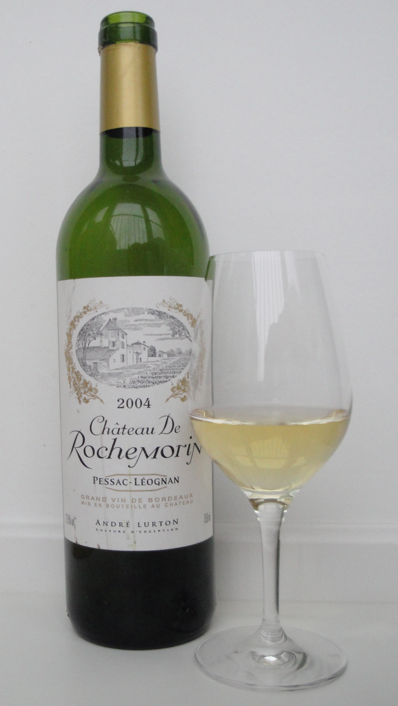

# 佩萨克-雷奥良

佩萨克-雷奥良是法国[波尔多](ref:bordeaux)格拉夫北部、波尔多市以南的红白葡萄酒法定产区，1987 年从格拉夫独立。红葡萄酒以[赤霞珠](ref:cabernet-sauvignon)与[梅洛](ref:merlot)混酿，白葡萄酒以长相思与赛美蓉酿造，常见 750 mL，[酒精度](ref:abv)约 12.5%–13.5% vol。

图：佩萨克-雷奥良。图片：Tomas er，CC BY-SA 3.0，via Wikimedia Commons（[原图页面](https://commons.wikimedia.org/wiki/File:Ch%C3%A2teau_de_Rochemorin_Blanc_2004.jpg)）。

## 定义与定位

先分层：[红葡萄酒](ref:red-wine)是大类，赤霞珠与梅洛是品种，佩萨克-雷奥良是法定产区（AOC），具体酒庄与酒款是生产者层面。它既是地名，也是酒标上的产区名，不能与某个酒庄或品牌混同。

佩萨克-雷奥良原属格拉夫产区，1987 年获得独立的法定产区地位，只覆盖格拉夫北部。它与格拉夫其他部分在规则与风格上有所区别，看到酒标时应核对完整产区名。

## 生产者与品牌

产区内以家族酒庄与列级庄并存，也有酒商。酒庄规模差异较大，有的自有地块并自行装瓶，有的收购葡萄或酒液再调配。佩萨克-雷奥良的酒标上，装瓶者信息是区分酒庄酒与酒商酒的关键。

佩萨克-雷奥良既有列级庄与独立酒庄，也有酒商收购葡萄或酒液。产区名覆盖红白两类酒，酒标上的酒庄、年份与装瓶者信息比“格拉夫”或“佩萨克”几个字更能说明身份。

## 「佩萨克-雷奥良」的产地与原料
佩萨克-雷奥良位于[法国](ref:france)波尔多格拉夫北部、波尔多市以南，吉伦特河左岸。气候受海洋调节，温和湿润，城市周边的微气候也影响成熟节奏。

土壤以砾石为主，部分地块含黏土与砂质，砾石层厚度不一；排水性与蓄热能力影响成熟度与酒体。原料是[葡萄](ref:grape)，红葡萄酒以[赤霞珠](ref:cabernet-sauvignon)与[梅洛](ref:merlot)混酿；白葡萄酒以长相思与赛美蓉酿造。

## 「佩萨克-雷奥良」怎么做出来
红酒以[发酵](ref:fermentation)为基础，发酵温度与浸渍时间决定萃取程度；白酒则在较低温度下发酵，以保留香气与酸度。部分酒款使用[橡木桶陈年](ref:oak-ageing)，红酒增加香料与结构，白酒增加质地与坚果气息。

佩萨克-雷奥良的红白工艺分开走：红酒重浸渍，白酒重低温发酵与酒泥；同一酒庄的两类酒也可能用不同桶比例，具体以酒庄资料与瓶标为准。红白两类酒在同一产区内并行生产，选购时应先确认酒的类型，再看品种与工艺描述。

## 「佩萨克-雷奥良」的瓶型与标签
常见容量为 750 mL，[酒精度](ref:abv)约 12.5%–13.5% vol。标签应核对产区名、年份、红白类型、酒庄名、分级信息、装瓶者与进口商信息。

佩萨克-雷奥良酒标会标产区名、酒庄名与年份，红白两类都可能出现；列级庄还会标“grand cru classé”等分级。中文背标应核对进口商、酒精度与容量，不能只看“Pessac”判断风格。

## 「佩萨克-雷奥良」的闻与喝
红酒以黑醋栗、雪松、烟草与烟熏矿物感为主，单宁清晰、酸度中等偏高；白酒以柑橘、白花、蜂蜡与燧石气息为主，质地较饱满。红白都带有格拉夫典型的烟熏与矿物底色。

品鉴红酒建议温度约 16–18 摄氏度，白酒约 10–12 摄氏度。闻香时注意果味与矿物感的层次，过度橡木会掩盖细腻香气。

## 「佩萨克-雷奥良」的饮用与搭配
红酒适合搭配红肉、禽类、蘑菇与中等浓度的炖菜；白酒适合搭配海鲜、白肉与带奶油质地的菜肴。饮用佩萨克-雷奥良时，配餐以酸度与单宁强度为准，不必强求固定搭配。

多数红酒适合在 5–15 年内饮用，白酒多在 3–8 年内；具体适饮窗口因年份与酒庄而异。开瓶后应密封冷藏并尽快饮用。本页关于佩萨克-雷奥良的内容涉及酒精饮料；过量饮酒有害健康，未成年人不应饮酒。

## 「佩萨克-雷奥良」的购买与保存
购买时优先选择正规渠道，核对产区名、年份、红白类型与装瓶者信息。价格随酒庄分级、年份与声誉差异明显，本页不给出具体数字。佩萨克-雷奥良的产区名与包装只能证明法定范围，不能替代对具体酒庄、年份与装瓶者的核对。

佩萨克-雷奥良红白都产，红葡萄酒以赤霞珠与梅洛混酿，白葡萄酒以长相思与赛美蓉为主。未开瓶应平放于 12–15°C、避光处，软木塞保持湿润；开瓶后密封冷藏，红葡萄酒两三天内喝完，白葡萄酒也不宜超过三四天。

## 「佩萨克-雷奥良」容易被读错的地方
第一，把佩萨克-雷奥良与整个格拉夫当成同一产区。前者 1987 年独立，只覆盖格拉夫北部。
第二，认为该产区只产红葡萄酒。白葡萄酒同样重要，且以长相思与赛美蓉为主。
第三，把烟熏与矿物气息当成缺陷。它们是格拉夫砾石土壤的典型特征。
第四，认为只有梅多克才有 1855 年一级庄。[奥比昂古堡](ref:haut-brion)位于格拉夫，是 1855 年分级中的一级庄。
第五，用价格或包装判断真伪。渠道、背标与装瓶者信息更可靠。

对照阅读：[红葡萄酒](ref:red-wine)、[波尔多](ref:bordeaux)。

**关键事实。**

| 项目 | 内容 |
| --- | --- |
| 一句话定位 | 法国波尔多格拉夫北部、波尔多市以南的红白葡萄酒法定产区，1987 年从格拉夫独立；红葡萄酒以赤霞珠与梅洛混酿，白葡萄酒以长相思与赛美蓉酿造，红白都以烟熏、矿物与结构感著称，常见 750 mL、酒精度约 12.5%–13.5% vol |
| 酒种/风格 | 红葡萄酒 |
| 产区 | 法国、波尔多 |
| 酒精度 | 12.5–13.5% vol |

**来源与边界。** 本页关于「佩萨克-雷奥良」的关键事实，主要由以下来源交叉核对：INAO（佩萨克-雷奥良法定产区的范围、红白葡萄酒品种与规则；由原条目末尾参考资料迁移，未逐条复核访问日期）、CIVB（佩萨克-雷奥良的土壤、红白风格与 1987 年独立背景；由原条目末尾参考资料迁移，未逐条复核访问日期）、Oxford University Press（提供关于佩萨克-雷奥良与格拉夫的条目；由原条目末尾参考资料迁移，未逐条复核访问日期）。价格、批次与状态会变，涉及这些字段时以页面所列来源的最新版本为准。正文为项目自写，来源只作核验，不复制原文。

## 参考资料
- [红葡萄酒](ref:red-wine)：佩萨克-雷奥良红酒所属的葡萄酒大类。
- [赤霞珠](ref:cabernet-sauvignon)：该产区红葡萄酒的主体品种之一。
- [梅洛](ref:merlot)：该产区红葡萄酒的另一主体品种。
- [奥比昂古堡](ref:haut-brion)：位于格拉夫的一级庄，酒庄页而非产区页。
- [波尔多](ref:bordeaux)：佩萨克-雷奥良所在的产区与分级框架。
- [法国](ref:france)：法国葡萄酒法规与产区体系。
- [葡萄](ref:grape)：佩萨克-雷奥良所用葡萄的成熟度、酸度与单宁判断。
- [发酵](ref:fermentation)：红白葡萄酒发酵差异的基本逻辑。
- [橡木桶陈年](ref:oak-ageing)：佩萨克-雷奥良的香料、质地与桶陈来源。
- [酒精度](ref:abv)：12.5%–13.5% vol 在标签上的含义。
