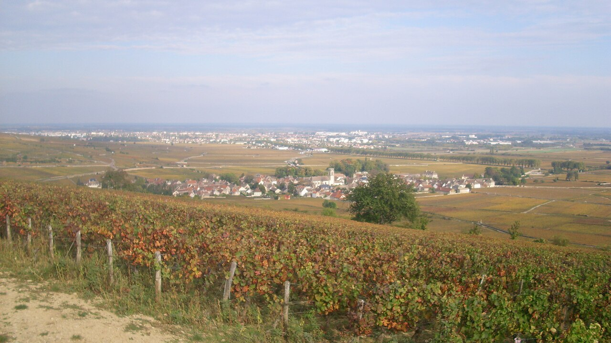

# 波玛

波玛在勃艮第的分级表上留着一个显眼的空白：它没有特级园。这个空白并不等于低人一等，反而让村庄的注意力集中在几块一级园上。作为伯恩丘的村庄级[红葡萄酒](ref:red-wine)法定产区，波玛全部以[黑皮诺](ref:pinot-noir)酿造，以红果、泥土气息与较硬的单宁、较强的结构著称。常见容量 750 mL，[酒精度](ref:abv)约 12.5%–13.5% vol。

图：波玛。图片：Mpmpmp，CC BY-SA 3.0，via Wikimedia Commons（[原图页面](https://commons.wikimedia.org/wiki/File:IMG_Pommard_et_Beaune.JPG)）。

## 没有特级园的波玛：等级表之外

在[勃艮第](ref:burgundy)的分级框架里，波玛只有村庄级与一级园两个层级，酒标上不会出现 Grand Cru。这不代表它缺少顶级地块，而是说明当年划定等级时，村内没有地块被列入特级园。结果是：最好的酒集中在吕吉安（Les Rugiens）与埃佩诺（Les Épenots）等一级园，价格与名声也随之集中。

对饮者来说，这一结构很实用。没有特级园的“天花板”，一级园就是村内的顶点；选酒时把一级园的地块名、坡位与酒庄看清，比笼统地记“波玛”有用得多。

## 吕吉安与埃佩诺：两块一级园的性格

吕吉安常被分为上坡与下坡两部分（Les Rugiens-Hauts 与 Les Rugiens-Bas），含铁黏土多、土层偏薄，酒体紧、单宁硬、陈年潜力长，是村内最像“骨架型”的酒。埃佩诺面积更大，位置更靠近村庄与博讷方向，酒风相对圆润，果味更外放，打开得更早。

Clos des Épeneaux 是埃佩诺中的单一所有园，由一家酒庄完整持有，常被当作观察波玛“另一面”的样本：它证明波玛并不只有硬，也可以有圆润与细腻。两块一级园的对比，比“波玛很硬”这句概括更有信息量。

## 铁质黏土与石灰岩：硬单宁的来处

波玛的土壤以石灰岩与黏土为主，部分地块含铁量高，呈现偏红的土色，黏土比例高使保水性强，石灰岩碎屑则保证排水。这样的[法国](ref:france)坡地让[葡萄](ref:grape)成熟偏慢，果皮厚，单宁量高，萃取稍重就会显得硬。坡面多在中等海拔，朝东或东南，日照充足而不过热；坡顶土层更薄，坡脚更深，酒体也随之从紧到圆。

土壤差异也解释村内分化：含铁黏土多的地块更紧、更耐放；土层厚、砾石多的地块更圆、更早熟。把“波玛”当成一个统一风格，会漏掉这些地块差异。

## 与沃尔奈相邻，风格却相反

波玛与沃尔奈接壤，风格却常被描述为相反的两极：波玛更厚、单宁更硬、颜色更深，红果与泥土感更重；沃尔奈更轻、单宁更细、花香更突出。同一面坡上的两个村，给出的酒几乎像两种性格。

这并不是说波玛粗糙。它的硬是结构，是陈年所需；只是年轻时更需要配餐与时间。与沃尔奈对比时，最好拿同一年份、相近等级的村庄级或一级园来比，才能看出真正的差别。

## 与夜圣乔治、伯恩的比较

往北的夜圣乔治同样以结构见长，单宁明显、黑果与泥土感强，但它的硬更偏“肌肉”，波玛的硬更偏“干与紧”。往南的伯恩村整体更圆润，果味更讨喜，单宁更柔和。波玛在这条南北线上，位置偏“紧实”的一端。

这个坐标会影响配餐与饮用时机。想要立即可饮的柔顺红酒，伯恩更合适；想要结构感与陈年变化，波玛更对路；想要更厚重的肌肉感，可以看夜圣乔治。这种“紧”并不是粗糙，而是单宁的质地偏干、收尾偏直；配餐时用油脂与蛋白质去柔化它，比单独饮用更容易体会结构。

## 萃取强度与带梗：工艺如何放大结构

波玛红酒以[发酵](ref:fermentation)为基础，浸渍温度、时长与萃取强度决定单宁的“硬”到什么程度。部分酒庄带梗发酵，增加香料与骨架；之后是[橡木桶陈年](ref:oak-ageing)，新桶比例与烘烤程度会影响香草、烟熏与质地。工艺能把土壤给的骨架放大，也能把它磨圆。

具体参数属于酒庄，本页不给统一数值。判断一款波玛是否做得平衡，可以看单宁是否细、果味是否还在、收尾是否干涩；只看“够不够硬”容易误判。

## 波玛的年份：单宁何时变软

暖年通常带来更熟的果味与更低的酸度，单宁变得更圆，酒体更厚，但也可能显得重；冷年保留更高的酸度与更硬的单宁，酒需要更长时间软化。多雨年份成熟不均，容易带来生青与干涩的单宁。

同一村内，含铁黏土多的地块在冷年更紧，土层厚的埃佩诺一带在暖年更容易显得丰腴。这里只谈方向，不列年份评分。

## 波玛的档位与挑选顺序

按相对档位看：村庄级是入口，一级园最高，村内没有特级园这一层。一级园内部，吕吉安与埃佩诺通常站在价格与名声的前列，Clos des Épeneaux 这类单一所有园又有额外溢价。本页不写具体价格。

判断方法：确认酒标写的是 Pommard 还是 Pommard Premier Cru，再看地块名、装瓶者与瓶况。村庄级不等于差，一级园也不等于一定好；年份、地块与酒庄三者要一起看。低价的老酒要特别留意储存史与液面。

## 波玛常见的误判

第一，认为波玛有特级园。村内只有村庄级与一级园，没有特级园。
第二，以为波玛都粗犷、都必须长期陈年。埃佩诺一带可以更圆润，村庄级也能在中短期饮用。
第三，把吕吉安当成一块园。它常分上坡与下坡两部分，风格并不相同。
第四，以为 Clos des Épeneaux 是特级园。它是一级园中的单一所有园，不是特级园。
第五，把泥土气息当成缺陷。适度的泥土与林地气息是勃艮第红酒的典型特征。

对照阅读：[红葡萄酒](ref:red-wine)、[勃艮第](ref:burgundy)。

波玛没有特级园，不代表它比有特级园的村庄低一头；一级园与村庄级的分层要看具体地块，酒标上的 Pommard 1er Cru 也不能互相替代。

**关键事实。**

| 项目 | 内容 |
| --- | --- |
| 一句话定位 | 法国勃艮第伯恩丘波玛村的村庄级法定产区，位于博讷以南；村内有多处一级园但没有特级园，风格以红果、泥土气息与较硬的单宁、较强的结构著称，常见 750 mL、酒精度约 12.5%–13.5% vol |
| 酒种/风格 | 红葡萄酒 |
| 产区 | 法国、勃艮第 |
| 酒精度 | 12.5–13.5% vol |

**来源与边界。** 本页关于「波玛」的关键事实，主要由以下来源交叉核对：INAO（波玛法定产区的范围、等级与品种规则；由原条目末尾参考资料迁移，未逐条复核访问日期）、BIVB（波玛的一级园、土壤与风格特征；由原条目末尾参考资料迁移，未逐条复核访问日期）、Oxford University Press（提供关于波玛与黑皮诺的条目；由原条目末尾参考资料迁移，未逐条复核访问日期）。价格、批次与状态会变，涉及这些字段时以页面所列来源的最新版本为准。正文为项目自写，来源只作核验，不复制原文。
