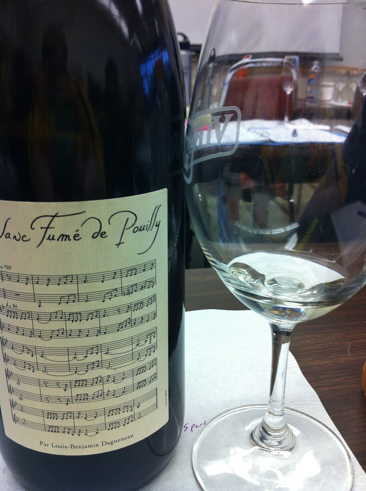

# 普伊-富美

普伊-富美是[法国](ref:france)[卢瓦尔河](ref:loire)中央-卢瓦尔地区的[长相思](ref:sauvignon-blanc)干型[白葡萄酒](ref:white-wine)法定产区，位于卢瓦尔河右岸，与[桑塞尔](ref:sancerre)隔河相望。它以柑橘、青草与"打火石"气息著称，常见 750 mL，[酒精度](ref:abv)约 12%–13.5% vol。

图：普伊-富美。图片：Agne27，CC BY-SA 3.0，via Wikimedia Commons（[原图页面](https://commons.wikimedia.org/wiki/File:Dageneau_Pouilly_Fume.JPG)）。

## 7 个村庄与 1,424 公顷：右岸的长条

普伊-富美的法定范围只有 7 个市镇：Garchy、Mesves-sur-Loire、Pouilly-sur-Loire、Saint-Andelain、Saint-Laurent-l'Abbaye、Saint-Martin-sur-Nohain 与 Tracy-sur-Loire。近五年平均种植面积约 1,424 公顷，131 家生产者，年均产量 76,219 hl，约合 980 万瓶。它是一条沿河铺开的长条，而不是一个圆形产区；村子之间的土壤差异，比"普伊-富美"这四个字本身更能解释酒的风格。

## 1929 年划界，1937 年拿到 AOC

产区的现代史分两步：1929 年完成法定边界划定，1937 年正式获得 AOC。二次大战前的这次划界，把"Pouilly"与河对岸的桑塞尔彻底分开，也把 Chasselas 主导的 Pouilly-sur-Loire 与 Sauvignon 主导的 Pouilly-Fumé 分成两个 AOC。今天酒标上若只写 "Pouilly"，在法律上并不存在；必须写全 Pouilly-Fumé 或 Pouilly-sur-Loire。

## silex 燧石：打火石气息的物理来源

"Fumé"常被翻译成"烟熏"，但它的本义不是橡木烟熏，而是成熟葡萄表面那层淡淡的灰白色果霜（bloom），远看像一层薄烟。真正让酒带"打火石"气息的，是 silex：一种二氧化硅含量极高的燧石，混杂在黏土里，分布在 Saint-Andelain、Saint-Laurent 与 Tracy 的高点。silex 在白天迅速升温、夜晚快速放热，让葡萄早熟；土壤贫瘠、酸性、几乎不含钙，迫使根系深扎。酒因此更锐利、更矿物，香气里有湿石头与火药味。

## Kimmeridgian 泥灰岩与"白土"

与 silex 相对的是 Kimmeridgian 泥灰岩，当地叫 "terres blanches"（白土）。这是一种含大量牡蛎化石的深海沉积，质地紧实、保水、偏冷，成熟期比 silex 晚。它给出的酒更圆、更宽，柑橘与白花更突出，矿物感偏"咸"而不是"火石"。产区里还有两类石灰岩：东侧的 calcaires de Villiers（当地称 caillottes，碎石多、排水好）与西侧的 calcaires du Barrois（石块更大）。四种土壤拼在一起，才是普伊-富美的完整拼图。

## 西向坡与卢瓦尔河的调温器

葡萄园大多朝西，下午的日照时间更长，成熟更慢、更均匀；卢瓦尔河则像一台调温器，缓和春季霜冻与夏季极端高温。中央-卢瓦尔整体是温带大陆性气候，降水 600–800 毫米，海拔 100–380 米，冬季可到 -1 °C、夏季可到 26 °C。西向坡的代价是秋季雨水风险更高，所以采收窗口的判断，往往比酿造技术更决定年份质量。

## 长相思的两种表达：不锈钢与旧桶

普伊-富美的长相思可以走两条路。第一条是不锈钢罐低温发酵，保留青草、柚子、黑加仑芽与打火石，酒体轻、酸度高，适合装瓶后 2–4 年喝。第二条是旧橡木桶或大桶发酵与带酒泥陈酿，增加质地与宽度，香气从柑橘转向黄桃、蜂蜡与咸黄油，适饮期延长到 8–10 年。无论哪条路，[葡萄](ref:grape)都经低温[发酵](ref:fermentation)，第二条路还会进入[橡木桶陈年](ref:oak-ageing)。新小橡木桶在普伊-富美并不主流，因为会盖住 silex 的矿物感；这正是它和"烟熏味"误解的分界线。

## 与 Sancerre 的一河之隔

[桑塞尔](ref:sancerre)在河左岸，以 caillottes 石灰岩为主，酒更紧、更香、更偏柑橘与白花；普伊-富美在右岸，silex 比例更高，酒更矿物、更"火石"，口感也更宽。两者都用长相思，价格区间也接近，但普伊-富美的产量只有桑塞尔的三分之一左右，单一园文化更强。盲品时，桑塞尔常先给香气，普伊-富美常先给石头与咸感。

## 与 Pouilly-Fuissé 的混淆：霞多丽还是长相思

这是酒单上最常见的错误之一。Pouilly-Fuissé 在勃艮第马贡（Mâconnais），用[霞多丽](ref:chardonnay)，酒体饱满、带榛子与奶油；Pouilly-Fumé 在卢瓦尔河，用长相思，酒体轻、酸度高、带燧石。两者只差几个字母，产区却相隔数百公里。另一个易混的是 Pouilly-sur-Loire：同在普伊村，但用 Chasselas，清淡易饮，价格更低。

## 酒庄与酒款：Dagueneau 与 Ladoucette

Domaine Didier Dagueneau 是产区神话，Les Monts Damnés 与 "Silex" 两款酒把燧石与低产量推到极致，也把价格推高；Domaine de Ladoucette 的 Château du Nozet 是历史名庄，风格更经典、更圆；Michel Redde et Fils 的 La Moynerie 是稳定的中坚；Henri Bourgeois 的 La Bourgeoisie 与 Alain Cailbourdin 的 Les Cris 也常被当作标杆。大酒商与合作社在普伊-富美同样存在，装瓶者信息值得留意。

## 价格带：€16 到 €150

法国零售市场 2026 年的常见区间（随年份、渠道与评分波动）：入门级约 €16–25，村庄级或单一园 €28–45，Dagueneau 一类名庄多在 €80–150。价格上涨的主要推力不是面积，而是低产量与收藏需求；普通酒款近十年涨幅其实温和。若只想体验 silex，€20 上下已能找到清晰的打火石气息。

## 配餐：生蚝、山羊奶酪与芦笋

普伊-富美的高酸与矿物感，最适合生蚝、蛤蜊、清蒸鱼与山羊奶酪（尤其是 Crottin de Chavignol）。芦笋是经典搭配，酒的青草味与芦笋的甲硫化合物同频；但芦笋若配奶油酱，则应选橡木桶版本。它和桑塞尔的配餐逻辑几乎一致，差别在于普伊-富美更宽的质地能接住带黄油的白肉鱼。避免重辣、重糖与大量香料的菜，它们会把酒的矿物感压成"酸水"。侍酒温度 10–12 °C，过冷会锁住香气。

## 误解："fumé" 不是橡木烟熏

最常见的误解，是把 "Fumé" 当成"橡木烟熏风味"，于是以为所有普伊-富美都该有烤面包与香草。事实相反：fumé 指的是葡萄皮上的果霜，酒里的烟熏矿物感来自 silex 土壤，而不是新桶。第二个误解是"普伊-富美就是桑塞尔的翻版"；两者土壤与产量结构不同。第三个误解是"必须陈年才好吃"；多数酒在装瓶后 3–5 年正处于最佳状态。

买普伊-富美，先看村子与土壤，再看是否过桶，最后才看年份评分。它不是"卢瓦尔版的霞多丽"，而是一块会发火的石头。

燧石与泥灰岩并存，Pouilly-Fumé 不是单一土壤风格；酒标上的产区名比“打火石”香气更能说明位置。

**关键事实。**

| 项目 | 内容 |
| --- | --- |
| 一句话定位 | 法国卢瓦尔河谷中央-卢瓦尔地区的长相思干白法定产区，1937 年获 AOC，覆盖卢瓦尔河右岸 7 个村庄约 1,424 公顷；silex 燧石与 Kimmeridgian 泥灰岩并存，以柑橘、青草与"打火石"气息著称 |
| 酒种/风格 | 白葡萄酒 |
| 产区 | 法国、卢瓦尔河谷 |
| 酒精度 | 12–13.5% vol |

**来源与边界。** 本页关于「普伊-富美」的关键事实，主要由以下来源交叉核对：BIVC（7 个村庄、1,424 公顷、131 家生产者、76,219 hl、1929 年划界与 1937 年 AOC；年均 980 万瓶、法国 54%/出口 46%、126 个出口市场与环保认证比例）、Oxford University Press（提供关于普伊-富美与长相思的条目）。价格、批次与状态会变，涉及这些字段时以页面所列来源的最新版本为准。正文为项目自写，来源只作核验，不复制原文。
