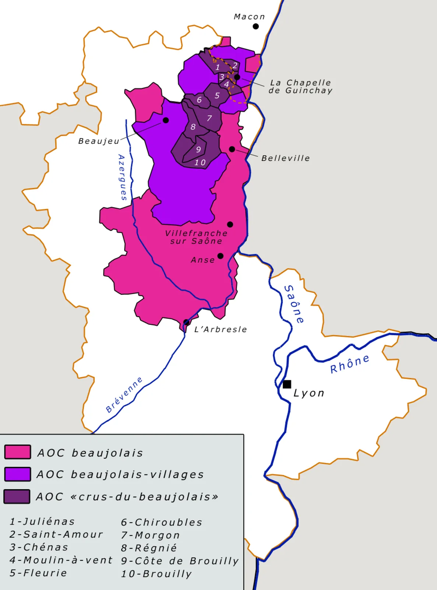

# 雷尼耶

在博若莱十个 cru 的名单上，雷尼耶（Régnié）常常被念在最后。它直到 1988 年才获得村庄级 cru 地位，是名单里最年轻的一个；也正因为资历浅，它长期被酒单放在价格较低、曝光较少的位置。但“年轻”只说明制度史，不说明酒的质量。

图：雷尼耶。图片：Cyril5555，CC BY-SA 3.0，via Wikimedia Commons（[原图页面](https://commons.wikimedia.org/wiki/File:Carte_vignoble_beaujolais.png)）。

## 1988 年：名单上最年轻的一个

1988 年之前，雷尼耶的酒只能以更宽泛的博若莱名义出售；获批之后，它才拥有自己的村庄级 AOC。村内没有一级园或特级园分级，所有地块都在同一个村庄级框架里，判断酒质仍要看坡位、酒庄与年份。

这段历史带来的现实后果是市场认知：同一品质水平下，雷尼耶的知名度通常低于[莫尔贡](ref:morgon)等老牌 cru，价格也更平易。对买家来说，这是机会；对只看名气的买家来说，则容易错过。具体边界以产区官方划界为准。

## 雷尼耶-迪雷特的花岗岩坡地

雷尼耶位于[法国](ref:france)的博若莱北部，葡萄园分布在雷尼耶-迪雷特（Régnié-Durette）一带的坡地上。土壤以花岗岩风化砂为主，部分地块夹有片岩，排水好、肥力低，葡萄根系被迫深扎，果串通常不大。

坡向与海拔继续细分：朝南坡面日照足、成熟更充分；坡顶与背阴地块保留更多酸度。原料是[葡萄](ref:grape)，品种为[佳美](ref:gamay)，皮薄、酸度高，在花岗岩上常呈现红樱桃、覆盆子与花香，单宁细，酒体偏轻到中等。

## 与莫尔贡共享的山脊线

雷尼耶紧邻莫尔贡，两村在地理上共享同一片山体，只是坡位与地块归属不同。莫尔贡的著名地块以更厚、更深、更需要陈年的风格著称；雷尼耶则更多分布在山脚与中坡，酒体通常更轻、果味更直接。

这种“同山不同酒”的关系，常被用来解释雷尼耶的性价比：它离莫尔贡很近，却没有莫尔贡的名气与价格。喝的时候不要用莫尔贡的厚度标准去要求它，而要看它是否果味干净、酸度挺立、收尾利落。

## 介于布鲁伊与莫尔贡之间

在博若莱的风格光谱上，雷尼耶常被放在布鲁伊的直给与莫尔贡的厚度之间：比布鲁伊多一点结构，比莫尔贡少一点重量。它不是“小莫尔贡”，也不是“另一个布鲁伊”，而是两者之间的一条中间路线。

与[博若莱](ref:beaujolais)其他 cru 相比，雷尼耶的辨识度不在强度，而在比例：果味、酸度与单宁都比较均衡，没有哪一项特别抢眼。这种均衡让它容易配餐，也让它在大赛与酒单上不够“抓人”。

## 轻萃取路线怎样保留果味

雷尼耶常用整串发酵，部分酒庄采用半二氧化碳浸渍：整串葡萄在充满二氧化碳的容器中先行细胞内发酵，再进入压榨与常规[发酵](ref:fermentation)。这种路线带来直接的果香与较轻的单宁，符合村子偏轻的骨架。

想做得更有结构的酒庄会延长浸渍、增加萃取；但多数酒款仍以中等浸渍为主，避免把果味压成单宁。部分酒款进入[橡木桶陈年](ref:oak-ageing)，新桶比例通常很低。装瓶者信息值得核对：同一村名下，酒庄酒与酒商酒的浓度可能相差明显。

## 杯中：红果、花香与细单宁

典型香气是红樱桃、覆盆子、草莓、紫罗兰与牡丹，部分酒款带矿物感。入口酸度清晰，单宁细，酒体轻到中等，风格柔顺，收尾以红果为主。

[红葡萄酒](ref:red-wine)的结构在这里靠酸度与果味支撑，而不是靠厚重单宁。品鉴时建议温度约 14–16 摄氏度，用郁金香形或勃艮第形酒杯；年轻酒款可轻微冰镇，不必长时间醒酒。闻香时先找果味，再找花香，过度橡木会掩盖它的轻盈。

## 冷年与暖年：两种酒

冷年里，雷尼耶的酸度更突出，红果偏酸樱桃，酒体更薄，适合早饮；暖年里，果味转向草莓与熟覆盆子，酒精感略高，单宁也更明显，但仍不至于变成厚重型。

判断年份不必依赖评分：看酒精度、看果味是清亮还是偏熟、看收尾是否干净。同一个村名在冷年与暖年可以是两种酒，坡位差异又会在此基础上再放大一次。

## 温度、配餐与适饮

建议温度约 14–16 摄氏度。适合禽肉、烤猪肉、熟食、菌菇与软质奶酪；轻快酒体也能搭配沙拉与清淡海鲜。避免重辣或强酸菜肴，它们会盖住果味。

多数酒款适合在 3–8 年内饮用，具体窗口因年份、坡位与酒庄而异。开瓶后应冷藏并在数日内喝完。本页关于雷尼耶的内容涉及酒精饮料；过量饮酒有害健康，未成年人不应饮酒。

## 价格带与选购：最年轻 cru 的定价

雷尼耶通常处在博若莱 cru 的中低价位：比普通博若莱贵，但一般低于莫尔贡、弗勒里等名气更响的村子。价格主要看地块、酒庄与年份，本页不写具体数字。常见容量为 750 mL，[酒精度](ref:abv)约 12.5%–13.5% vol，具体随年份与酒庄变化。

选购时先确认酒标单独标注 cru 名，再看装瓶者是否为酒庄本身；如果酒标同时强调“接近莫尔贡”之类的说法，只当作位置说明，不要当作品质承诺。未开瓶应避光、平放于 12–15 摄氏度的阴凉处；开瓶后抽真空或充惰性气体并冷藏。

## 四个容易被误读的地方

第一，认为新 cru 就等于低品质。雷尼耶在 1988 年才获得 cru 地位，但风格与邻近的老牌 cru 相近，差的往往只是名气。

第二，把雷尼耶当成博若莱新酒。它是独立的村庄级 cru，不是当年即饮的轻松型。

第三，认为轻盈就不能陈年。部分地块的酒款可以存放数年，但整体仍以早饮为主。

第四，把雷尼耶与莫尔贡混为一谈。两村相邻、共享山体，但雷尼耶通常更轻、果味更直接，莫尔贡更厚、更需要陈年。

雷尼耶 1988 年才成为 cru，知名度较低，市场上用“Beaujolais Villages”冒充的机会更多；认准“Régnié”拼写、酒庄名与装瓶者，价格过低要警惕。

**关键事实。**

| 项目 | 内容 |
| --- | --- |
| 一句话定位 | 1988 年才获批成为村庄级 cru 的博若莱红葡萄酒，是十个 cru 中最年轻的一个；雷尼耶-迪雷特一带的花岗岩坡地给出红果与细单宁，价格通常比莫尔贡亲民，常见 750 mL、酒精度约 12.5%–13.5% vol |
| 酒种/风格 | 红葡萄酒 |
| 产区 | 法国、博若莱 |
| 酒精度 | 12.5–13.5% vol |
