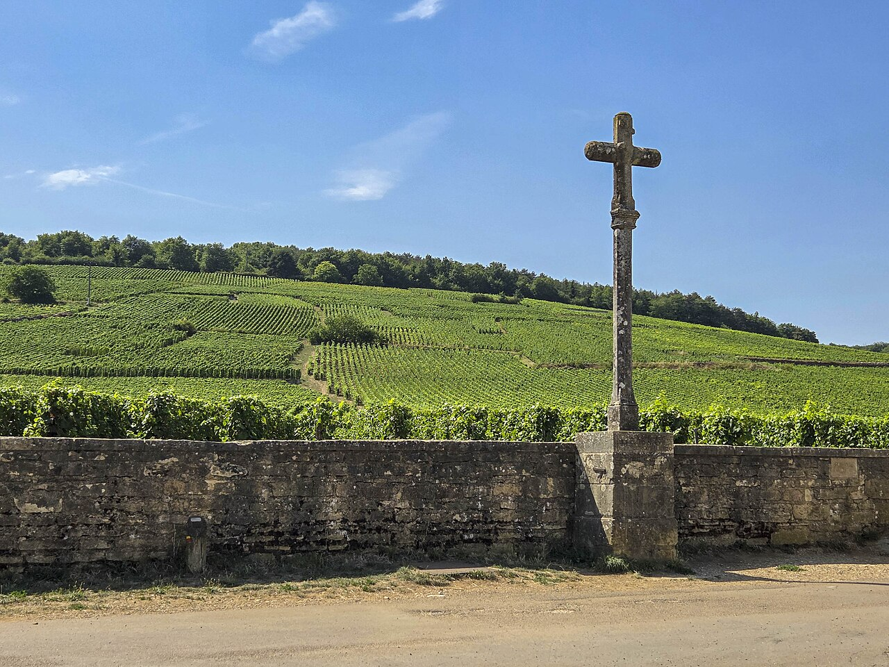

# 罗曼尼·康帝

罗曼尼·康帝（Romanée-Conti）是法国勃艮第夜丘（Côte de Nuits）沃恩-罗曼尼（Vosne-Romanée）村的特级园（Grand Cru），由罗曼尼·康帝酒庄（Domaine de la Romanée-Conti，简称 DRC）独占。葡萄园面积 1.8140 公顷，全部种植黑皮诺（Pinot Noir）。它既是葡萄园的名字，也是酒庄最核心的一款酒，同时还是酒庄本身的简称来源之一。

图：罗曼尼·康帝。图片：Wikipedro，CC BY-SA 4.0，via Wikimedia Commons（[原图页面](https://commons.wikimedia.org/wiki/File:Vosne-Roman%C3%A9e,_le_Domaine_de_la_Roman%C3%A9e-Conti.jpg)）。

## 定义与身份

在勃艮第的分级体系中，特级园位于村庄级、一级园之上，代表法定产区中最高的地块等级。罗曼尼·康帝是“独占园”（monopole）——整块葡萄园由同一所有者持有，因此只有 DRC 能生产以该园名命名的酒。独占园不等于“最好”，但在法律与品牌层面，它排除其他生产者使用同一园名。

需要区分三个概念：葡萄园 Romanée-Conti、酒庄 Domaine de la Romanée-Conti、以及酒庄的其他特级园产品。DRC 还拥有 La Tâche、Richebourg、Romanée-Saint-Vivant、Grands-Échézeaux、Échézeaux 与 Montrachet 等地块；把“康帝”当成酒庄所有酒的统称，是常见的简化。

## 「罗曼尼·康帝」的时间线
罗曼尼·康帝葡萄园在 18 世纪曾与法国孔蒂亲王（Prince de Conti）的名字相连，酒园因此得名。法国大革命后，教会与贵族地产被重新分配，葡萄园产权经历多次变更。19 世纪以来，这片极小的地块逐步集中到今天的持有家族手中；酒庄在 20 世纪中叶完成整合，形成以 DRC 为名的经营主体。

20 世纪后期，DRC 在葡萄栽培与酿造上持续调整：减少化学投入、采用更严格的园块管理、提高整串发酵比例，并在 2000 年代全面转向生物动力法。酒庄的产量极小，长期采用配额与私人客户分配，而不是普通零售铺货。这些制度性因素与风味同样重要，共同塑造了它的市场地位。

## 产区与风土

沃恩-罗曼尼位于夜丘核心地带，坡度平缓、朝向东南，土壤由石灰岩、泥灰岩与黏土混合，排水性与保水性在不同坡段有所差异。黑皮诺对土壤与气候非常敏感：凉爽年份保留更多酸度与红色果香，温暖年份则更饱满、酒精度更高。罗曼尼·康帝园块面积只有 1.8140 公顷，任何细微的朝向、土层与水分差异都会被放大。

勃艮第的“克里马”（climat）概念强调地块的独特性，而不是简单的地理边界。同一村庄内，不同特级园的酒风格可以差异很大；因此不能用“勃艮第黑皮诺”这样一个大标签替代具体园块。理解罗曼尼·康帝，需要同时看产区、园块、年份与酒庄的栽培选择。

## 工艺与陈年

DRC 的红葡萄酒以黑皮诺为主，通常采用较高比例的整串发酵，并对橡木桶与新桶比例进行年度调整。[橡木桶陈年](ref:oak-ageing)带来香料、烘烤与结构，但酒庄的目标是让木质与果味融合，而不是让桶味主导。发酵与浸渍的时间、温度、压帽或淋皮方式，都会影响单宁与香气的提取。

酒庄强调低产量与严格筛选，葡萄在采收与分拣阶段会被多次挑选。生物动力法在 DRC 的语境中不是“完全不干预”，而是一套包含堆肥、田间制剂、月相与土壤管理的体系；它仍然需要常规的病害管理、修剪与采收决策。把生物动力法理解为“自然酒”或“零添加”，并不准确。

## 「罗曼尼·康帝」的闻与喝
年轻的罗曼尼·康帝常表现为红色浆果、玫瑰花瓣、紫罗兰、香料与矿物感，单宁细密，酒体并不厚重，而是以香气层次与质地取胜。随着陈年，果味会向干花、落叶、菌菇、皮革与泥土发展，香料与矿物感更突出。不同年份的差异极大：有些年份紧致、需要更长陈年，有些年份则在较早阶段就展现开放香气。

品鉴温度建议约 15–17°C，使用勃艮第杯或较大的郁金香杯，倒酒量少，便于聚香。老酒通常不建议长时间醒酒，以免脆弱的香气过快消散；年轻酒款可以短时间醒酒，但应频繁试味。若酒中有沉淀，饮用前直立静置并小心滗酒，避免把沉淀倒入杯中。

## 「罗曼尼·康帝」的饮用与搭配
罗曼尼·康帝适合搭配禽类、小牛肉、蘑菇类菜肴与中等浓郁的红肉；勃艮第黑皮诺的单宁细腻，过重的酱汁或过度辛辣会掩盖香气。与清淡的海鲜或强酸菜肴搭配时，酒体可能显得单薄。作为极高单价的酒款，开瓶前应确认来源、储存与年份，并准备合适的杯具与温度。

保存方面，恒温、恒湿、避光与低震动是基本原则。软木塞状态、酒液高度与瓶身标签可以帮助判断保存历史。开瓶后若不能一次喝完，应尽量使用惰性气体或真空塞并冷藏；陈年老酒的风味窗口很短，不适合分多天饮用。

## 「罗曼尼·康帝」容易被读错的地方
第一，把 DRC 的所有酒都叫“康帝”。Romanée-Conti 只是其中一款，酒庄还有其他特级园。
第二，把独占园等同于质量排名。独占是产权与命名结构，不是法定质量等级。
第三，认为面积小就一定更好。1.8140 公顷的稀缺性影响价格，但风味仍取决于年份与栽培。
第四，把生物动力法当成“无干预”。它是一套有明确规程的农法，仍包含主动管理。
第五，忽视来源与真伪。极高单价带来仿冒风险，酒标、瓶身编号与交易记录需要专业核验。

相关条目：[红葡萄酒](ref:red-wine)、[法国](ref:france)、[奔富葛兰许](ref:c-extra-1)。

**关键事实。**

| 项目 | 内容 |
| --- | --- |
| 一句话定位 | 法国勃艮第沃恩-罗曼尼村的特级园，由罗曼尼·康帝酒庄独占，面积 1.8140 公顷，全部种植黑皮诺 |
| 酒种/风格 | 红葡萄酒 |
| 产区 | 法国 |

**来源与边界。** 本页关于「罗曼尼·康帝」的关键事实，主要由以下来源交叉核对：Domaine de la Romanée-Conti（1.8140 公顷面积、独占园身份与酒庄哲学）、INAO（法国原产地命名与勃艮第特级园的制度框架）、Oxford University Press（提供关于罗曼尼·康帝、沃恩-罗曼尼、黑皮诺与勃艮第分级的条目）等 4 条来源。价格、批次与状态会变，涉及这些字段时以页面所列来源的最新版本为准。正文为项目自写，来源只作核验，不复制原文。

## 参考资料
- [红葡萄酒](ref:red-wine)：罗曼尼·康帝所属的葡萄酒大类。
- [橡木桶陈年](ref:oak-ageing)：结构与香气形成的关键工艺。
- [法国](ref:france)：勃艮第产区与法国原产地命名制度的总览。

补充阅读：[奔富葛兰许](ref:c-extra-1)。
