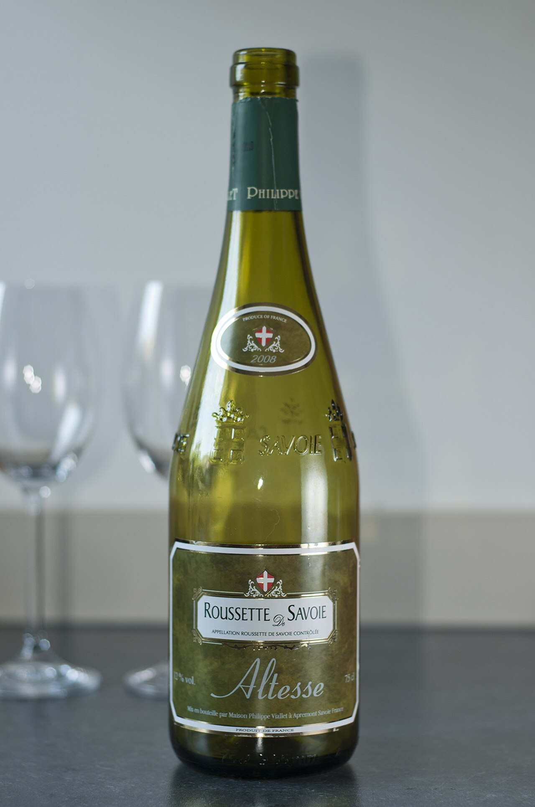

# 萨瓦胡塞特

萨瓦胡塞特（Roussette de Savoie）是[法国](ref:france)[萨瓦](ref:savoie)以阿尔泰斯（当地称胡塞特）酿造的白葡萄酒法定产区。它涵盖马雷斯特尔、蒙图、蒙泰尔米诺与弗朗吉等地理命名。常见 750 mL，[酒精度](ref:abv)约 12.0%–13.5% vol。

图：萨瓦胡塞特。图片：Michal Osmenda，CC BY-SA 2.0，via Wikimedia Commons（[原图页面](https://commons.wikimedia.org/wiki/File:Roussette_De_Savoie,_Altesse,_2008.jpg)）。

## 定义与定位

先分层：[白葡萄酒](ref:white-wine)是类型，阿尔泰斯是品种，萨瓦胡塞特是法定产区，具体地理命名与酒庄是更细的层级。它与[萨瓦葡萄酒](ref:vin-de-savoie)并列，是萨瓦以品种命名的白葡萄酒产区。

“胡塞特”不是独立品种，而是阿尔泰斯在萨瓦当地的叫法。萨瓦胡塞特只允许白葡萄酒，且必须使用阿尔泰斯，因此品种与风格的关系比区域级产区更明确。

## 生产者与品牌

产区以家族酒庄为主，也有合作社与酒商参与。阿尔泰斯产量较低、种植面积有限，不少酒庄同时生产雅克儿、胡珊与阿尔泰斯多条产品线。

生产者、产区与产品是三个层级：产区回答法规与范围，生产者回答种植、酿造与装瓶，产品回答年份与地理命名。同为萨瓦胡塞特，不同村庄与酒庄的风格差别明显。

## 「萨瓦胡塞特」的产地与原料
葡萄园分布在萨瓦与上萨瓦的坡地上，海拔约 250–600 米，涵盖马雷斯特尔、蒙图、蒙泰尔米诺与弗朗吉等命名范围。土壤以石灰岩、泥灰岩与冰川沉积物为主，排水好、肥力低。

原料是[葡萄](ref:grape)，品种只有阿尔泰斯。阿尔泰斯产量较低、成熟中等，香气以白花与蜂蜜为主，酸度比雅克儿略低但仍有骨架，适合短中期陈年。

## 「萨瓦胡塞特」怎么做出来
白葡萄酒通常在不锈钢罐或旧桶中发酵，温度控制以保留香气为主。是否使用[橡木桶](ref:oak-ageing)决定风格走向：不使用桶时更强调白花与矿物感，使用旧桶或带酒泥搅拌时更圆润。

阿尔泰斯的酸度适中，苹果酸乳酸发酵的取舍因酒庄而异。部分酒款会延长酒泥接触以增加质感。发酵的基本逻辑可参见[发酵](ref:fermentation)。

## 「萨瓦胡塞特」的瓶型与标签
常见容量为 750 mL，[酒精度](ref:abv)约 12.0%–13.5% vol，具体随年份、地理命名与酒庄变化。标签应核对“Roussette de Savoie”名称、地理命名、年份与装瓶者。

地理命名通常写在产区名之后，例如马雷斯特尔或弗朗吉；不写地理命名的是产区级常规酒款。以瓶身实际标注为准。

## 「萨瓦胡塞特」的闻与喝
典型香气是白花、蜂蜜、榛子、黄苹果与矿物感，部分酒款带柑橘与蜂蜡气息；入口酒体中等偏饱满，酸度中等，余味较长。与雅克儿的清瘦相比，萨瓦胡塞特更有重量与香气层次。

品鉴建议温度约 10–12 摄氏度，用郁金香形或勃艮第形酒杯。温度过低会掩盖蜂蜜与坚果气息，过高则显得松散。

## 「萨瓦胡塞特」的饮用与搭配
适合海鲜、禽肉、奶油类菜肴、软质奶酪与带坚果的菜式。酒体较饱满，也可搭配口味中等的鱼类与猪肉菜肴。

多数酒款适合在 4–8 年内饮用，具体窗口因年份、地理命名与酒庄而异。开瓶后应冷藏并在数日内喝完；本页关于萨瓦胡塞特的内容涉及酒精饮料；过量饮酒有害健康，未成年人不应饮酒。

## 「萨瓦胡塞特」的购买与保存
购买时核对产区名、地理命名、年份与装瓶者。萨瓦胡塞特产量小，价格通常高于萨瓦产区级白葡萄酒，本页不给出具体数字。

就「萨瓦胡塞特」而言，未开瓶应避光、平放于阴凉处，理想温度为 12–15 摄氏度。开瓶后抽真空或充惰性气体并冷藏，不宜反复回温。

## 「萨瓦胡塞特」容易被读错的地方
第一，把胡塞特当成一个独立品种。它是阿尔泰斯在萨瓦的当地叫法。
第二，把萨瓦胡塞特当成桃红。名称与颜色无关，它只产白葡萄酒。
第三，把萨瓦胡塞特与萨瓦葡萄酒等同。前者是独立的品种型产区。
第四，认为阿尔泰斯只能酿清淡酒。它可以有中等酒体与较长余味。
第五，只用价格判断质量。地理命名、年份与装瓶信息更具体。

萨瓦胡塞特的品种是阿尔泰斯，当地称胡塞特，和罗讷河谷的胡珊不是同一个东西。它覆盖马雷斯特尔、蒙图、蒙泰尔米诺与弗朗吉等地理命名，白花、蜂蜜、榛子与矿物感是常见线索；酒体比雅克儿更饱满，但“胡塞特”在不同语境里可能指品种、酒名或地方叫法。马雷斯特尔等地理命名把地块与品种绑定，但不同命名之间的海拔、坡向与土壤并不相同；同一酒庄也可能同时生产多个层级。读酒标时先确认是区域级还是具体地理命名，再谈饱满度。

对照阅读：[法国](ref:france)、[白葡萄酒](ref:white-wine)。

**关键事实。**

| 项目 | 内容 |
| --- | --- |
| 一句话定位 | 法国萨瓦以阿尔泰斯（当地称胡塞特）酿造的白葡萄酒法定产区，涵盖马雷斯特尔、蒙图、蒙泰尔米诺与弗朗吉等地理命名；风格以白花、蜂蜜、榛子与矿物感为主，酒体比雅克儿更饱满，常见 750 mL、酒精度约 12.0%–13.5% vol |
| 酒种/风格 | 白葡萄酒 |
| 产区 | 法国、萨瓦 |
| 酒精度 | 12–13.5% vol |

**来源与边界。** 本页关于「萨瓦胡塞特」的关键事实，主要由以下来源交叉核对：INAO（萨瓦胡塞特的产区范围、品种与地理命名；由原条目末尾参考资料迁移，未逐条复核访问日期）、European Union（欧盟葡萄酒类别、地理标志与标签规则）、Oxford University Press（提供关于萨瓦胡塞特、阿尔泰斯与萨瓦的条目；由原条目末尾参考资料迁移，未逐条复核访问日期）。价格、批次与状态会变，涉及这些字段时以页面所列来源的最新版本为准。正文为项目自写，来源只作核验，不复制原文。

**并读。** 把「萨瓦胡塞特」与「法国」、「萨瓦」、「白葡萄酒」放在一起读时，先确认它们是同一层级还是上下游关系：先确认酒种与产区，再比较年份、酒精度、价格与饮用场景。本页负责给出酒款的基本坐标，对照条目补上具体案例与差异；读完再回到本页，才能分清哪些差别属于酒款本身，哪些只是产地、批次或品牌选择。

## 参考资料
- [萨瓦](ref:savoie)：萨瓦胡塞特所属产区的整体框架。
- [萨瓦葡萄酒](ref:vin-de-savoie)：覆盖范围更广的萨瓦区域级产区。
- [希尼安-贝热龙](ref:chignin-bergeron)：以胡珊酿造的萨瓦白葡萄酒地理命名。
- [白葡萄酒](ref:white-wine)：萨瓦胡塞特所属的类型。
- [葡萄](ref:grape)：萨瓦胡塞特所用葡萄的成熟度、酸度与单宁判断。
- [发酵](ref:fermentation)与[橡木桶陈年](ref:oak-ageing)：白葡萄酒的基础工艺环节。
- [酒精度](ref:abv)：12.0%–13.5% vol 在标签上的含义。
