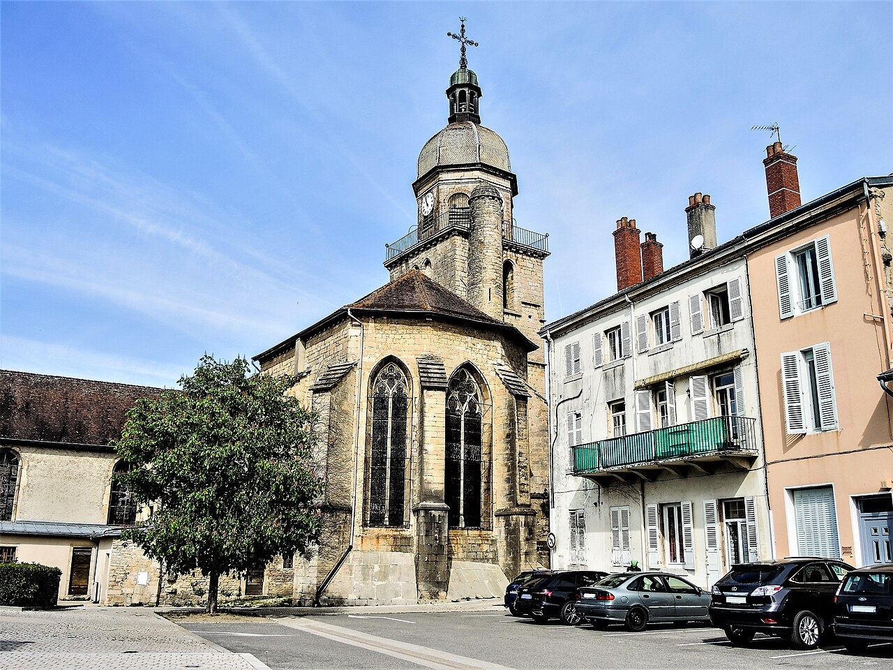

# 圣阿穆尔

“Saint-Amour”印在酒标上时，很容易被当成情人节主题的营销词。事实上，它是[博若莱](ref:beaujolais)最北端的村庄级 cru 名称，来自地名圣阿穆尔-贝尔维尤（Saint-Amour-Bellevue），与任何节日促销都无关。瓶身上的 750 mL 与约 12.5%–13.5% 的[酒精度](ref:abv)，才是它更实际的身份证。

图：圣阿穆尔。图片：Espirat，CC BY-SA 4.0，via Wikimedia Commons（[原图页面](https://commons.wikimedia.org/wiki/File:Eglise_Saint-Amateur_et_saint-_Viateur._Saint-Amour.jpg)）。

## 博若莱最北端的一片坡

圣阿穆尔位于[法国](ref:france)博若莱的 cru 地带最北端，是十个 cru 里最靠北的一个，葡萄园沿圣阿穆尔-贝尔维尤周围的坡地展开，再往北就逐渐离开博若莱的核心区。最北的位置带来更凉的基础气候，成熟期通常偏晚，酸度保留更好，这也是它常被形容为“比南部 cru 更紧”的原因之一。

村内没有一级园或特级园分级，所有地块都在同一个村庄级 AOC 框架下。具体边界以产区官方划界为准，不能凭地图上的一条线自行判断。

## 一纸产区，横跨两个省

圣阿穆尔的法定产区横跨索恩-卢瓦尔与罗讷两个省，这在博若莱 cru 中并不常见。地块分属不同省份，行政归属不同，但酒标上都写同一个 cru 名；对消费者而言，省界不改变酒的风格，只影响地名与行政信息。

这一点也提醒买家：不要用“省份”来判断风格。真正决定酒的是坡向、海拔与土壤，而不是它落在哪一边的省界上。

## 圣阿穆尔-贝尔维尤：地名与酒名

圣阿穆尔-贝尔维尤是村子的正式地名，“Saint-Amour”是它可以单独标注在酒标上的 cru 名。名字里的“圣”来自地方宗教地名传统，和情人节、爱情营销没有关系；把它当成浪漫主题来买，容易买错也容易买贵。

地名与酒名的重合，是博若莱 cru 的常见结构：村名即产区名，产区名可以独立出现，通常不再同时标注“Beaujolais”大区名。

## 与朱利耶纳、谢纳的北端邻里

圣阿穆尔与[朱利耶纳](ref:julienas)、谢纳相邻，三者构成博若莱最北的一组 cru。朱利耶纳通常更厚、更有骨架；谢纳更轻盈、更偏花香；圣阿穆尔则介于两者之间，但香料感更明显、结构更紧一些。

同一片山坡被切成不同的村名，风格差异来自坡位与酿造，而不是行政边界。比较这三村的酒，最好选同一年份、相近价格带，差异才看得清楚。

## 花岗岩与片岩：紧实度的来源

圣阿穆尔的土壤以花岗岩风化砂为主，部分地块夹有片岩与黏土，排水好、肥力低。花岗岩给出酸度与矿物骨架，片岩与黏土则在部分地块保留水分，让成熟度更均匀；两者叠加，形成它比南部 cru 更紧的底层原因。

原料是[葡萄](ref:grape)，品种为[佳美](ref:gamay)，皮薄、酸度高，在花岗岩上常呈现红樱桃、覆盆子、紫罗兰与香料气息。坡向与海拔继续细分：朝南坡面成熟更充分，坡顶地块保留更多酸度。

## 佳美与整串发酵的分寸

圣阿穆尔常用整串发酵，部分酒庄采用半二氧化碳浸渍：整串葡萄在充满二氧化碳的容器中先行细胞内发酵，再进入压榨与常规[发酵](ref:fermentation)。这种方式保留果香、降低单宁，但村子本身的紧实度又要求酒庄不能过度轻萃取。

发酵温度与浸渍时间决定最终轮廓。想要结构时延长浸渍，想要易饮时缩短；部分酒款进入[橡木桶陈年](ref:oak-ageing)，新桶比例通常很低，以免香料感被橡木掩盖。装瓶者信息仍要核对，酒庄酒与酒商酒可能差别很大。

## 比南部 cru 更紧、更香料

典型香气是红樱桃、覆盆子、草莓、紫罗兰与牡丹，部分酒款带胡椒、甘草一类的香料感与矿物感。入口酸度清晰，单宁细，酒体轻到中等，但收尾比许多南部 cru 更紧。饮用温度建议约 14–16 摄氏度；多数酒款适合在 3–8 年内饮用，适合搭配禽肉、烤猪肉与菌菇菜肴。

与朱利耶纳相比，圣阿穆尔更轻、更偏花香，但香料更突出；与希鲁布勒相比，它多一层结构与辛香，不那么“飘”。[红葡萄酒](ref:red-wine)的整体框架在这里靠酸度与细单宁撑起，而不是靠酒精厚度。

## 冷年与暖年：北端的紧与香

冷年里，圣阿穆尔的酸度更锋利，红果偏酸樱桃，香料感更干，酒体显得更紧，适合配餐而不是单喝；暖年里，果味更熟，香料转向甜香料，酒精感略高，但最北端的位置仍能保住一定的清爽。

判断年份不必看评分：看酒精度、看果味是清亮还是偏熟、看香料是干还是甜。同一村名在冷暖年之间可以是两种气质，坡位差异会再放大一次。

## 价格带与选购：北端产区的档位

圣阿穆尔通常处在博若莱 cru 的中等价位：比普通博若莱贵，和朱利耶纳、谢纳接近，但一般低于以陈年潜力著称的村子。价格随地块、酒庄与年份变化，本页不写具体数字。

选购时先确认酒标单独标注 cru 名，再看装瓶者与年份；如果遇到情人节主题包装，把它当作包装而不是品质信号。未开瓶应避光、平放于 12–15 摄氏度的阴凉处，避免高温与剧烈温差；开瓶后抽真空或充惰性气体并冷藏。

## 圣阿穆尔的四个误区

第一，把圣阿穆尔当成情人节限定酒。名字来自地名，与节日营销无关。

第二，认为最北端一定最酸、最单薄。年份与坡位差异很大，暖年与朝南地块可以相当饱满。

第三，把圣阿穆尔当成博若莱新酒。它是独立的村庄级 cru，不是当年即饮型。

第四，把圣阿穆尔与朱利耶纳混为一谈。两村相邻，但圣阿穆尔通常更轻、香料更明显，朱利耶纳更有骨架。

圣阿穆尔横跨两个省，酒标上的 cru 名与行政省名不是一回事；买时认准“Saint-Amour”与装瓶者，别把省名或“Beaujolais”当成同一产区。价格低不代表假，但标签信息必须能对应。

圣阿穆尔横跨两个省，不等于它属于两个产区；酒标上的 cru 名称与行政边界不是同一套划分，不能拿省名替代产区名。

**关键事实。**

| 项目 | 内容 |
| --- | --- |
| 一句话定位 | 博若莱最北端的村庄级 cru 红葡萄酒，产区横跨索恩-卢瓦尔与罗讷两个省；花岗岩与片岩的坡地让它比南部 cru 更紧、香料感更明显，常见 750 mL、酒精度约 12.5%–13.5% vol |
| 酒种/风格 | 红葡萄酒 |
| 产区 | 法国、博若莱 |
| 酒精度 | 12.5–13.5% vol |
