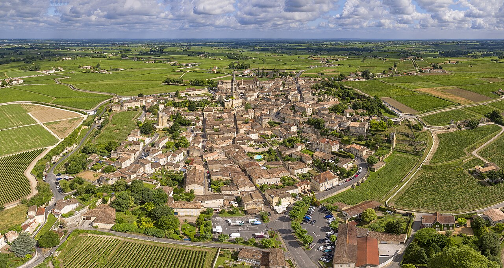

# 圣埃美隆

圣埃美隆是法国[波尔多](ref:bordeaux)右岸圣埃美隆镇及其周边村落的红葡萄酒法定产区，位于多尔多涅河右岸、利布尔讷东北。它以[梅洛](ref:merlot)为主体、常与[品丽珠](ref:cabernet-franc)混酿，风格圆润，常见 750 mL，[酒精度](ref:abv)约 12.5%–13.5% vol。

图：圣埃美隆。图片：Chensiyuan，CC BY-SA 4.0，via Wikimedia Commons（[原图页面](https://commons.wikimedia.org/wiki/File:1_Saint-%C3%89milion_aerial_pano_2016.jpg)）。

## 定义与定位

先分层：[红葡萄酒](ref:red-wine)是大类，梅洛与品丽珠是品种，圣埃美隆是法定产区（AOC），具体酒庄与酒款是生产者层面。圣埃美隆既是镇名，也是酒标上的产区名，不能与某个品牌混同。

圣埃美隆位于波尔多右岸，与波美侯、弗龙萨克相邻，与左岸的梅多克村庄分属不同体系。它拥有独立的酒庄分级，与 1855 年梅多克分级不是同一套规则，比较酒庄时应看清分级来源与年份。

## 生产者与品牌

产区内以家族酒庄与小规模庄园为主，也有酒商与合作社。酒庄规模差异很大，有的自有地块并自行装瓶，有的收购葡萄或酒液再调配。圣埃美隆的酒标上，装瓶者信息是区分酒庄酒与酒商酒的关键。

圣埃美隆的生产者包括家族酒庄、列级庄与酒商，产区有独立分级体系。产区名不等于等级，酒标上的“grand cru classé”与具体年份、装瓶者才是判断依据；同一产区不同酒庄的风格差异很大。

## 「圣埃美隆」的产地与原料
圣埃美隆位于[法国](ref:france)波尔多右岸，多尔多涅河右岸、利布尔讷东北。气候受海洋调节，温和湿润，生长季较长，秋季条件影响成熟度与酸度保留。

土壤以石灰岩台地、黏土-石灰岩坡地与砾石为主，不同地块的排水性与蓄热能力差异明显。原料是[葡萄](ref:grape)，红葡萄酒以[梅洛](ref:merlot)为主体，常与[品丽珠](ref:cabernet-franc)混酿。

## 「圣埃美隆」怎么做出来
圣埃美隆红酒以[发酵](ref:fermentation)为基础，发酵温度与浸渍时间决定萃取程度：温和萃取偏向柔顺果味，较长浸渍得到更多单宁与结构。之后使用[橡木桶陈年](ref:oak-ageing)，新桶比例因酒庄与等级而异，影响香草、烟熏与质地。

圣埃美隆的浸渍强度、压榨酒比例与新桶比例由酒庄与等级决定；梅洛与品丽珠的混酿比例也会改变风格，具体以酒庄资料与瓶标为准。梅洛的单宁中等、成熟较早，品丽珠提供酸度与香气骨架，混酿比例对风格影响很大。

## 「圣埃美隆」的瓶型与标签
常见容量为 750 mL，[酒精度](ref:abv)约 12.5%–13.5% vol。标签应核对产区名、年份、酒庄名、分级信息、装瓶者与进口商信息。

圣埃美隆酒标常见“Saint-Émilion Grand Cru”与“grand cru classé”等字样，前者是产区等级、后者是分级，两者不是一回事。买酒时应同时看酒庄名、年份与装瓶者，避免把产区名当成质量保证。

## 「圣埃美隆」的闻与喝
圣埃美隆以李子、黑樱桃、巧克力、甘草与泥土气息为主，单宁中等偏柔、酸度清晰，酒体中等偏饱满。随着陈年，会出现皮革、烟草与林地气息，结构逐渐柔和。

与左岸梅多克相比，圣埃美隆通常更圆润、果味更突出。品鉴时建议温度约 16–18 摄氏度，结构紧实的年份可提前醒酒。闻香时注意果味与泥土气息的层次。

## 「圣埃美隆」的饮用与搭配
圣埃美隆适合搭配红肉、禽类、蘑菇与中等浓度的炖菜；圆润风格也适合搭配软质奶酪与带香料调味的菜肴。饮用圣埃美隆时，配餐以酸度与单宁强度为准，不必强求固定搭配。

多数酒款适合在 5–15 年内饮用，优质年份可以更久；具体适饮窗口因年份与酒庄而异。开瓶后可醒酒，剩余酒液应密封冷藏并尽快饮用。本页关于圣埃美隆的内容涉及酒精饮料；过量饮酒有害健康，未成年人不应饮酒。

## 「圣埃美隆」的购买与保存
购买时优先选择正规渠道，核对产区名、年份、酒庄名与装瓶者信息。价格随酒庄分级、年份与声誉差异明显，本页不给出具体数字。圣埃美隆的产区名与包装只能证明法定范围，不能替代对具体酒庄、年份与装瓶者的核对。

圣埃美隆以梅洛为主体，常与品丽珠混酿，风格圆润。未开瓶可平放在 12–15°C 的避光处，避免高温与震动；软木塞需要湿度。开瓶后密封冷藏，两三天内喝完，李子与巧克力的香气不耐长时间敞放。

## 「圣埃美隆」容易被读错的地方
第一，把圣埃美隆的分级与 1855 年梅多克分级混为一谈。两者是不同体系。
第二，认为圣埃美隆只以梅洛酿造。品丽珠在混酿中占有重要位置。
第三，把泥土气息当成缺陷。适度的泥土与林地气息是该产区的典型特征。
第四，认为分级一旦确定就永不改变。圣埃美隆分级会定期修订。
第五，用价格或包装判断真伪。渠道、背标与装瓶者信息更可靠。

对照阅读：[红葡萄酒](ref:red-wine)、[波尔多](ref:bordeaux)。

**关键事实。**

| 项目 | 内容 |
| --- | --- |
| 一句话定位 | 法国波尔多右岸圣埃美隆镇及其周边村落的红葡萄酒法定产区，位于多尔多涅河右岸、利布尔讷东北；以梅洛为主体、常与品丽珠混酿，风格圆润，以李子、黑樱桃、巧克力与泥土气息著称，拥有独立的分级体系，常见 750 mL、酒精度约 12.5%–13.5% vol |
| 酒种/风格 | 红葡萄酒 |
| 产区 | 法国、波尔多 |
| 酒精度 | 12.5–13.5% vol |

**来源与边界。** 本页关于「圣埃美隆」的关键事实，主要由以下来源交叉核对：INAO（圣埃美隆法定产区的范围、品种与红葡萄酒规则；由原条目末尾参考资料迁移，未逐条复核访问日期）、CIVB（圣埃美隆的土壤、风格与分级体系；由原条目末尾参考资料迁移，未逐条复核访问日期）、Oxford University Press（提供关于圣埃美隆与梅洛的条目；由原条目末尾参考资料迁移，未逐条复核访问日期）。价格、批次与状态会变，涉及这些字段时以页面所列来源的最新版本为准。正文为项目自写，来源只作核验，不复制原文。

## 参考资料
- [红葡萄酒](ref:red-wine)：圣埃美隆所属的葡萄酒大类。
- [梅洛](ref:merlot)：圣埃美隆混酿的主体品种。
- [品丽珠](ref:cabernet-franc)：圣埃美隆混酿中提供酸度与香气的品种。
- [波尔多](ref:bordeaux)：圣埃美隆所在的产区与分级框架。
- [法国](ref:france)：法国葡萄酒法规与产区体系。
- [葡萄](ref:grape)：圣埃美隆所用葡萄的成熟度、酸度与单宁判断。
- [发酵](ref:fermentation)：浸渍与萃取的基本逻辑。
- [橡木桶陈年](ref:oak-ageing)：圣埃美隆的香料、质地与桶陈来源。
- [酒精度](ref:abv)：12.5%–13.5% vol 在标签上的含义。
