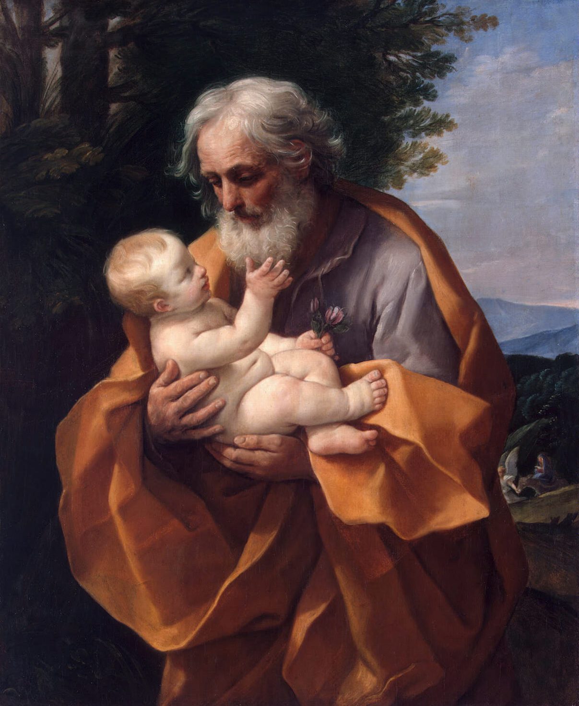

# 圣约瑟夫

圣约瑟夫是法国北罗讷河谷的法定产区，沿罗讷河两岸南北延伸数十公里。它以[叙拉](ref:syrah)酿造[红葡萄酒](ref:red-wine)，风格比罗第丘与埃米塔日更轻盈，也产少量白葡萄酒。常见 750 mL，[酒精度](ref:abv)约 12.5%–14% vol。

图：圣约瑟夫。图片：Guido Reni，Public domain，via Wikimedia Commons（[原图页面](https://commons.wikimedia.org/wiki/File:Saint_Joseph_with_the_Infant_Jesus_by_Guido_Reni,_c_1635.jpg)）。

## 定义与定位

先分层：[红葡萄酒](ref:red-wine)是大类，叙拉是品种，圣约瑟夫是法定产区（AOC），具体酒庄与酒款是生产者层面。圣约瑟夫既是地名，也是酒标上的产区名，不能与某个品牌混同。

圣约瑟夫位于北罗讷，与罗第丘、埃米塔日、克罗兹-埃米塔日同属叙拉红葡萄酒的核心地带，但产区范围更分散、风格更轻盈。看到“Saint-Joseph”时，还应结合年份、酒庄与地块位置判断风格。

## 生产者与品牌

圣约瑟夫产区南北狭长，生产者以家族酒庄为主，也有合作社与酒商。自有地块、自行装瓶的酒庄更能反映具体坡面；酒商酒可能混合不同村庄。购买时看装瓶者与村庄名，不要只看“Saint-Joseph”。

生产者、产区与产品是三个层级：产区回答法规与地理范围，生产者回答谁种植、谁酿造、谁装瓶，产品回答年份与规格。同一产区内不同酒庄与地块的风格差异明显，不能用一款酒概括整个产区。

## 「圣约瑟夫」的产地与原料
圣约瑟夫位于[法国](ref:france)北罗讷河谷，沿罗讷河两岸分布，南北跨度较大。气候受大陆性与地中海影响，北部更凉、南部更暖，坡向与海拔造成园地间的差异。

土壤以花岗岩、片岩与砾石为主，排水性好，蓄热能力不同，影响成熟节奏与酒体。原料是[葡萄](ref:grape)，红葡萄酒以[叙拉](ref:syrah)酿造；产区也允许少量白葡萄酒，以玛珊与瑚珊为主。

## 「圣约瑟夫」怎么做出来
圣约瑟夫红酒以[发酵](ref:fermentation)为基础，发酵温度与浸渍时间决定颜色、单宁与香气。部分酒庄保留整串发酵，增加香料与结构感；也有酒庄去梗后温控发酵，追求纯净果味。

[橡木桶陈年](ref:oak-ageing)是风格的重要变量：新桶比例影响香草、烘烤与单宁质地，旧桶或大桶更利于保留果味。圣约瑟夫的带梗比例、发酵温度与新桶比例没有统一配方；酒庄在果味与结构之间的取舍不同，具体以酒庄资料与瓶标为准。

## 「圣约瑟夫」的瓶型与标签
常见容量为 750 mL，[酒精度](ref:abv)约 12.5%–14% vol。标签应核对产区名、年份、装瓶者与进口商信息，部分酒款会标注地块或村庄名称。

圣约瑟夫在不同市场的标签语言不同，以瓶身实际标注为准。产区名不等于质量等级，同一产区内的酒庄、地块与年份差异明显，购买时应结合具体信息判断。

## 「圣约瑟夫」的闻与喝
年轻圣约瑟夫以黑莓、黑胡椒、紫罗兰与烟熏气息为主，单宁中等、酸度清晰；与罗第丘相比，结构更轻盈、果味更直接。随陈年发展出皮革、橄榄与干花气息，口感更柔顺。

品鉴时建议温度约 15–17 摄氏度。闻香时注意果味、胡椒与烟熏气息的层次，过度橡木会掩盖叙拉的胡椒特征。陈年潜力因年份、地块与酒庄而异。

## 「圣约瑟夫」的饮用与搭配
圣约瑟夫适合搭配红肉、禽类、蘑菇与带胡椒调味的菜肴；结构紧实的酒款适合炖肉与硬质奶酪。饮用圣约瑟夫时，配餐以酸度与单宁强度为准，不必强求固定搭配。

多数酒款适合在 4–10 年内饮用，结构紧实的年份可以更久；具体适饮窗口因年份与酒庄而异。开瓶后可短暂醒酒，剩余酒液应密封冷藏并尽快饮用。本页关于圣约瑟夫的内容涉及酒精饮料；过量饮酒有害健康，未成年人不应饮酒。

## 「圣约瑟夫」的购买与保存
购买时优先选择正规渠道，核对产区名、年份与装瓶者信息。价格随年份、酒庄声誉与地块差异明显，本页不给出具体数字。圣约瑟夫的产区名与包装只能证明法定范围，不能替代对具体酒庄、年份与装瓶者的核对。

圣约瑟夫以叙拉为主，风格比罗第丘与埃米塔日轻盈。未开瓶应平放于 12–15°C、避光处，软木塞保持湿润；开瓶后密封冷藏，两三天内喝完，较轻的酒体更经不起反复回温与氧化。

## 「圣约瑟夫」容易被读错的地方
第一，把圣约瑟夫与罗第丘当成同一风格。两者同属北罗讷、同以叙拉为主，但产区范围与风格不同。
第二，认为圣约瑟夫只能做轻盈酒。结构紧实、适合陈年的地块同样存在。
第三，把黑胡椒气息一律当成缺陷。适度的胡椒与烟熏气息是叙拉的特征。
第四，认为北罗讷只产红葡萄酒。圣约瑟夫也产少量白葡萄酒。
第五，用价格或包装判断真伪。渠道、背标与装瓶者信息更可靠。

**关键事实。**

| 项目 | 内容 |
| --- | --- |
| 一句话定位 | 法国北罗讷河谷的法定产区，沿罗讷河两岸南北延伸数十公里；以叙拉（Syrah）红葡萄酒为主，风格比罗第丘与埃米塔日更轻盈，也产少量白葡萄酒，常见 750 mL、酒精度约 12.5%–14% vol |
| 酒种/风格 | 红葡萄酒 |
| 产区 | 法国、罗讷河谷 |
| 酒精度 | 12.5–14% vol |

**来源与边界。** 本页关于「圣约瑟夫」的关键事实，主要由以下来源交叉核对：INAO（圣约瑟夫法定产区的范围、品种与红白葡萄酒规则；由原条目末尾参考资料迁移，未逐条复核访问日期）、Inter Rhône（北罗讷的品种、风格与产区框架；由原条目末尾参考资料迁移，未逐条复核访问日期）、Oxford University Press（提供关于圣约瑟夫与叙拉的条目；由原条目末尾参考资料迁移，未逐条复核访问日期）。价格、批次与状态会变，涉及这些字段时以页面所列来源的最新版本为准。正文为项目自写，来源只作核验，不复制原文。

## 参考资料
- [红葡萄酒](ref:red-wine)：圣约瑟夫所属的葡萄酒大类。
- [叙拉](ref:syrah)：圣约瑟夫的核心品种。
- [法国](ref:france)：法国葡萄酒法规与产区体系。
- [罗讷河谷](ref:rhone)：南北罗讷的产区框架、品种与法规。
- [葡萄](ref:grape)：圣约瑟夫所用葡萄的成熟度、酸度与单宁判断。
- [发酵](ref:fermentation)：浸渍与萃取的基本逻辑。
- [橡木桶陈年](ref:oak-ageing)：圣约瑟夫的香料、质地与桶陈来源。
- [酒精度](ref:abv)：12.5%–14% vol 在标签上的含义。
