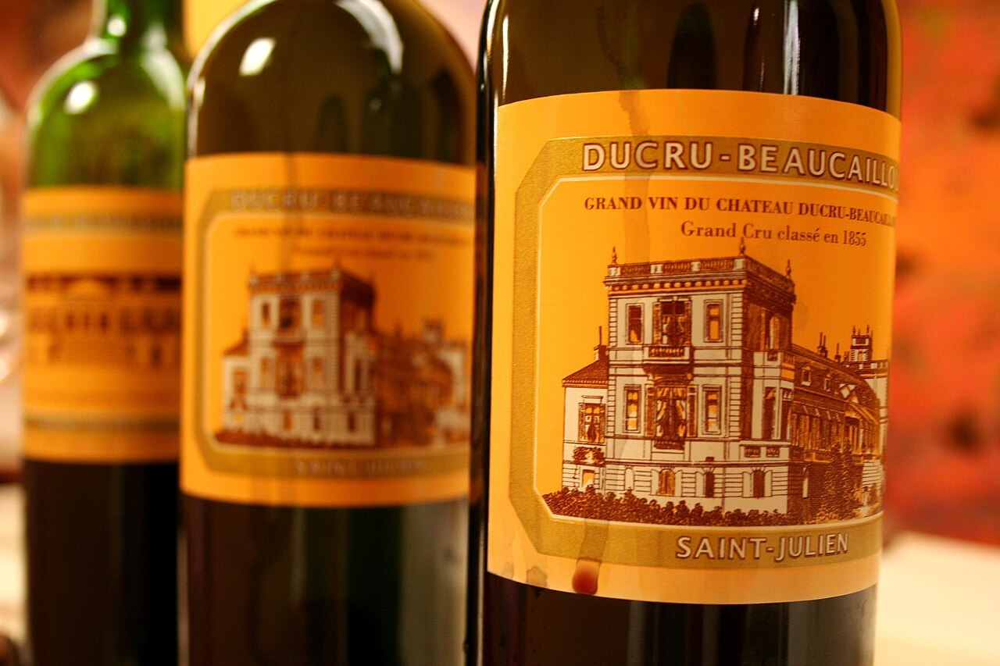

# 圣朱利安产区

圣朱利安（Saint-Julien）的 AOC 葡萄园约 910 公顷，全部落在 16.3 平方公里的圣朱利安-贝舍维尔市镇及其少量飞地内，是梅多克四大名村里最小的一块。它没有一级庄，却在 1855 年名单里留下 11 家列级庄，列级庄产量约占全村的四分之三。这个"小而无一级庄、却高度列级化"的组合，是它与波亚克、玛歌最根本的区别。产区属于[法国](ref:france)[波尔多](ref:bordeaux)，1936 年 11 月 14 日立法，只产[红葡萄酒](ref:red-wine)，以[赤霞珠](ref:cabernet-sauvignon)为主体。

图：圣朱利安产区。摄影：Chateau Ducru Beaucaillou, Saint Julien bottles。署名：Megan Mallen，CC BY 2.0，来自 Wikimedia Commons（[来源](https://commons.wikimedia.org/w/index.php?curid=13268382)）。

## 910 公顷：四大名村里最小的一块

圣朱利安-贝舍维尔市镇总面积 3,017 公顷，其中 100 公顷是沼泽、388 公顷是草场，AOC 葡萄园约 910 公顷；村域海拔从 0 米到 28 米。把这三个数字放在一起看，会发现葡萄园只占市镇面积的三成左右，其余是河口湿地、牧场与林地。Wine-Searcher 给出的另一个数字是约 900 公顷，两者差异来自统计口径与地块更新，量级一致。

## 一条 500 米宽的河岸空白

圣朱利安几乎"每一英亩都种满葡萄"，唯一的例外是东侧吉伦特河口淤积河岸上一条约 500 米宽的空白带。这里不是不能种，而是河岸冲积物太细、太湿，成熟节奏与砾石丘完全不同。葡萄园因此被压在一条南北向的砾石脊上，东边是水，西边是圣洛朗（Saint-Laurent）——后者的酒只能标 Haut-Médoc，不能标 Saint-Julien。一条行政线，隔开了两种价格。

## 1936 年 11 月 14 日与三镇地块

圣朱利安 AOC 由 1936 年 11 月 14 日的法令确立。法定范围以圣朱利安-贝舍维尔为主体，另含 Cussac-Fort-Médoc、Pauillac 与 Saint-Laurent-Médoc 三镇 annexe 1 列明的特定地块。因此，一瓶标圣朱利安的酒，其葡萄未必全部来自同名的村子；看到酒庄不在圣朱利安镇，先别急着判假。

## 穆利内谷把村子分成两道砾石脊

村域被几条小谷切开：南边是贝舍维尔小村的沼泽，东北是 Juillac 谷，西南是 Riou Cla 谷，中部的穆利内谷（vallon de la Mouline）把贝舍维尔砾石脊与圣朱利安砾石脊分开。谷底是colluvions（坡积物）与更细的土壤，脊上是第四纪"faciès à galets"——砂、砾石与常带石英的大卵石混合层，底下是渐新世石灰岩、泥灰岩与黏土。地形把葡萄园分成"脊上"与"坡脚"两类，成熟速度与排水条件随之分叉。

## 11 家列级庄，没有一级庄

1855 年名单在圣朱利安留下 11 家列级庄：5 家二级庄（Léoville-Las Cases、Léoville-Poyferré、Léoville-Barton、Gruaud-Larose、Ducru-Beaucaillou）、2 家三级庄（Lagrange、Langoa-Barton）、4 家四级庄（Beychevelle、Branaire-Druc、Talbot、Saint-Pierre）。没有一级庄，也没有五级庄。三家 Léoville 原本同属一个产业，19 世纪分割后才形成今天的三个名字——这段家史解释了为什么同一村内会出现三个风格相近、价格却分层的"Léoville"。

## 57/63 hl/ha 之外：8,300–10,000 株的密度

法定品种为赤霞珠、[梅洛](ref:merlot)、[品丽珠](ref:cabernet-franc)、佳美娜、马贝克（Cot）与小维多，六者可以任意比例混酿。法定产量同样分两层：57 hl/ha 为基准，63 hl/ha 为但书上限（部分行距配置降为 60 hl/ha）。最低种植密度 7,000 株/公顷，行距不超过 1.50 米，同排株距不小于 0.80 米；每公顷最大负载 9,500 公斤。最低天然[酒精度](ref:abv) 11%，梅洛最低含糖量 189 克/升、其他品种 180 克/升；酒须陈年至采收次年 6 月 1 日，9 月 1 日起上市。法定密度只是下限：贝舍维尔实际种植 8,300 至 10,000 株/公顷，高于法规门槛，这也是它能把果实压得更小、单宁更细的原因之一。

## 贝舍维尔的双台地

贝舍维尔是理解圣朱利安土壤的好样本：产业共 250 公顷，其中 90 公顷种[葡萄](ref:grape)；园中有两块更新世加龙河砾石台地，砾石与砂混合、排水良好；平均树龄 38 年，密度 8,300–10,000 株/公顷；品种结构为 57% 赤霞珠、40% 梅洛、3% 小维多。这个比例说明圣朱利安并非"纯赤霞珠"产区：梅洛占到四成，正是它比波亚克更早柔和、比玛歌更有骨架的物质基础。

## 发酵与用桶：稳定性的另一面

圣朱利安的酒庄普遍采用控温[发酵](ref:fermentation)，浸渍长短决定单宁的提取量；之后进入[橡木桶陈年](ref:oak-ageing)，新桶比例从三成到接近全新不等。由于砾石均匀、果实成熟整齐，这里的工艺选择往往更"保守"：少做激进的萃取，让结构自己说话。过度用桶同样会盖掉黑醋栗与雪松，这一点与玛歌、波亚克没有区别。

## 比波亚克柔、比玛歌硬：中间值的来源

Decanter 的 Jane Anson 记录过一句很准确的描述：圣朱利安的砾石层是梅多克"最均匀、最有秩序"的，只在产区入口处有一条黏土带。均匀的砾石意味着赤霞珠成熟节奏一致，单宁不会一部分过熟、一部分生青；黏土带又提供了少量保水能力，避免干旱年份过度胁迫。相比之下，波亚克的砾石更厚、更连续，赤霞珠比例更高，酒体更满；玛歌的土壤夹更多黏土、砂与河岸粉砂，梅洛比例更高，香气更前置。圣朱利安正好落在两者之间——这不是"中庸"，而是地质均匀性带来的稳定感。

## $97 到 $308：列级庄的价格带

Wine-Searcher 在 2026 年 11 月给出的 750 ml 国际均价：Château Talbot 约 97 美元，Beychevelle 约 123 美元，Léoville-Poyferré 约 130 美元，Léoville-Barton 约 134 美元，Gruaud-Larose 约 144 美元，Ducru-Beaucaillou 约 285 美元，Léoville-Las Cases 约 308 美元。村内非列级庄常见于 35–70 美元。价格随年份、评分、渠道与汇率波动，上述数字只用于判断量级。

## 纠正"没有一级庄所以更便宜"

没有一级庄，不等于没有顶级酒。圣朱利安的 11 家列级庄贡献了全村约四分之三的产量，Léoville-Las Cases 与 Ducru-Beaucaillou 的国际均价已经进入许多二级庄的上沿；"没有一级庄"更多是 1855 年名单的历史结果，而不是质量判决。另一个误解是把圣朱利安当作"波亚克的廉价替代"：它的砾石更均匀、梅洛比例更高，风格本来就更偏柔和与早熟，二者不是同一个东西的贵贱版本。

## 温度、醒酒与配餐

圣朱利安适合 16–18 摄氏度饮用；年轻酒款醒酒 1 小时左右，结构紧的年份可延长，老酒则尽量缩短。红肉、禽类、蘑菇与中等浓度炖菜都合适，结构较强的酒款可以配烤肉与硬质奶酪。开瓶后密封冷藏，尽量在数日内喝完；本页关于圣朱利安产区的内容涉及酒精饮料；过量饮酒有害健康，未成年人不应饮酒。

**关键事实。**

| 项目 | 内容 |
| --- | --- |
| 一句话定位 | 法国波尔多梅多克中部的村级红葡萄酒法定产区，1936 年 11 月 14 日立法，约 910 公顷葡萄园，11 家 1855 列级庄（5 家二级、2 家三级、4 家四级）且没有一级庄；砾石分布为梅多克最均匀，法定基准产量 57 hl/ha、最低天然酒精度 11% |
| 酒种/风格 | 红葡萄酒 |
| 产区 | 法国、波尔多 |
| 酒精度 | 12.5–13.5% vol |
