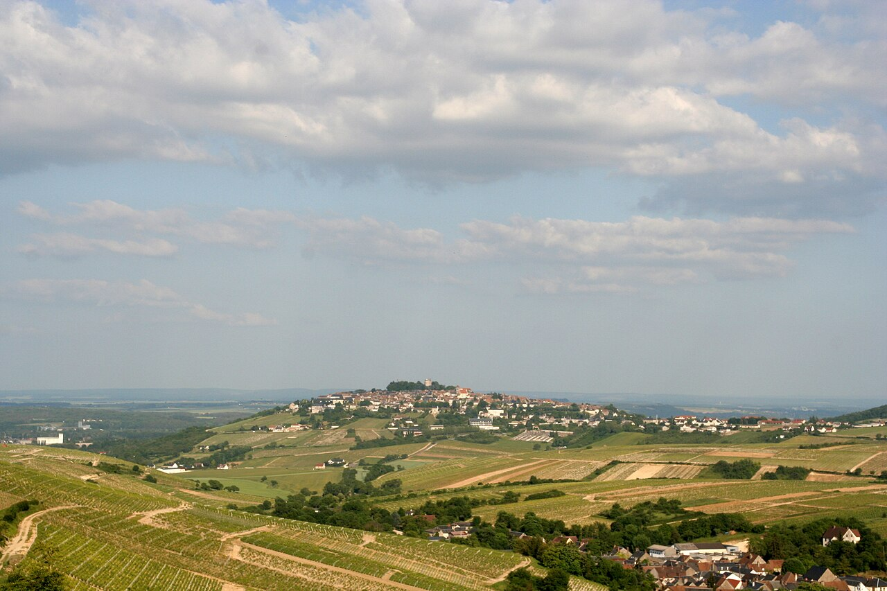

# 桑塞尔

桑塞尔是法国卢瓦尔河谷上游的法定产区，白葡萄酒以长相思酿造，以柑橘、青草、醋栗与燧石矿物感著称；产区也产少量以黑皮诺酿造的红葡萄酒。常见 750 mL、酒精度约 12.5%–13.5% vol。

图：桑塞尔。图片：Wikimedia Commons contributor，CC BY-SA 3.0，via Wikimedia Commons（[原图页面](https://commons.wikimedia.org/wiki/File:Sancerre_france.jpg)）。

## 定义与定位

分层看：[白葡萄酒](ref:white-wine)是大类，长相思是品种，卢瓦尔河谷是产区，桑塞尔是法定产区（AOC），酒庄与具体酒款是生产者层面。桑塞尔不是品牌，也不是品种名。

桑塞尔与邻近的普伊-富美（Pouilly-Fumé）常被并列讨论：两者都以长相思为主，但法定范围与土壤组合不同。桑塞尔同时产红葡萄酒，这一点常被只熟悉其白葡萄酒的消费者忽略。

## 生产者与品牌

产区内有家族酒庄、合作社与酒商，规模差异较大。酒标上的酒庄名、装瓶者与村庄名是判断身份的依据；桑塞尔没有像勃艮第那样复杂的分级，村庄名与地块名更多是风格线索。

常见村庄包括桑塞尔、夏维尼奥尔（Chavignol）、比埃（Bué）、梅内特雷奥尔（Ménétréol）与韦尔迪尼（Verdigny）。同一村庄内不同坡向与土壤的差异，会在香气与矿物感上表现出来。

## 「桑塞尔」的产地与原料
产区位于[法国](ref:france)中部的卢瓦尔河谷上游，谢尔省，桑塞尔镇周边，葡萄园分布在起伏的丘陵坡地上。气候偏凉，受大陆性与大西洋影响，生长季较长，秋季降雨是采收的主要变量。

土壤类型是桑塞尔的风格核心：启莫里阶泥灰岩（当地称 caillottes 与 terres blanches）带来紧致与矿物感，燧石（silex）则带来更明显的火石气息。原料是[葡萄](ref:grape)，白葡萄酒用[长相思](ref:sauvignon-blanc)，红葡萄酒用[黑皮诺](ref:pinot-noir)。

## 「桑塞尔」怎么做出来
白葡萄酒采收后通常直接压榨、低温发酵，多数在不锈钢罐中进行，以保留柑橘与青草香气；部分酒庄使用旧桶或带酒泥陈酿，增加质感与复杂度。是否进行苹果酸乳酸发酵因酒庄而异。

红葡萄酒按黑皮诺的方式酿造，浸皮时间较短，颜色浅、单宁细，目标通常是轻盈易饮而非长期陈年。白葡萄酒的[发酵](ref:fermentation)温度与酒泥接触时间是决定风格的关键变量。

## 「桑塞尔」的瓶型与标签
常见容量为 750 mL，[酒精度](ref:abv)约 12.5%–13.5% vol，随年份与酒庄而异。标签应核对产区名 Sancerre、年份、酒庄名、装瓶者、净含量与进口商信息；红葡萄酒通常会在标签上注明 Rouge 或直接以颜色区分。

中文背标与进口商信息是核对身份的入口。不同市场的标签语言不同，以瓶身实际标注为准；以“桑塞尔风格”描述的非产区酒，不属于法定产区产品。

## 「桑塞尔」的闻与喝
白葡萄酒的典型香气是柠檬、柚子、青草、醋栗芽与燧石，酸度高、酒体偏轻到中等，余味带矿物感。红葡萄酒则是红樱桃、覆盆子与草本，酒体轻、单宁细，适合稍凉饮用。

与[云雾之湾](ref:cloudy-bay)这类新西兰长相思相比，桑塞尔通常更内敛、酸度更锐利、果香更偏柑橘而非百香果。品鉴温度建议：白葡萄酒 8–11 摄氏度，红葡萄酒 14–16 摄氏度。

## 「桑塞尔」的饮用与搭配
白葡萄酒适合搭配山羊奶酪、清蒸鱼、贝类、芦笋与柠檬黄油类菜肴；高酸度能切开油脂与乳制品的厚重感。红葡萄酒适合禽类、猪肉与冷盘，不宜搭配重酱汁或长时间炖煮的菜。

开瓶后冷藏保存并尽量在两三日内饮用完毕。桑塞尔多数酒款适合在年轻时饮用，但优质年份与酒庄的酒款可以短期存放。本页关于桑塞尔的内容涉及酒精饮料；过量饮酒有害健康，未成年人不应饮酒。

## 「桑塞尔」的购买与保存
购买时优先选择正规渠道，核对年份、酒庄名、装瓶者与进口商信息。价格随年份、酒庄声誉与渠道波动，本页不给出具体数字；普通款与名庄名园属于不同层级。

就「桑塞尔」而言，未开瓶应避光平放或直立存放于阴凉处，理想温度为 10–13 摄氏度，避免高温与剧烈温差。开瓶后冷藏并尽快饮用，不宜反复取出回温。

## 「桑塞尔」容易被读错的地方
第一，认为桑塞尔只产白葡萄酒。它也产以黑皮诺酿造的红葡萄酒。
第二，把桑塞尔与普伊-富美当成同一产区。法定范围与土壤不同。
第三，认为长相思都必须带浓烈热带果香。桑塞尔的风格更内敛、更矿物。
第四，把高酸度当成缺点。这是产区气候与品种的共同结果。
第五，只看“桑塞尔”三个字，不看年份、酒庄与装瓶信息。

对照阅读：[白葡萄酒](ref:white-wine)、[法国](ref:france)。

**关键事实。**

| 项目 | 内容 |
| --- | --- |
| 一句话定位 | 法国卢瓦尔河谷上游的桑塞尔法定产区，白葡萄酒以长相思酿造，以柑橘、青草、醋栗与燧石矿物感著称；也产少量以黑皮诺酿造的红葡萄酒 |
| 酒种/风格 | 白葡萄酒、红葡萄酒 |
| 产区 | 法国、卢瓦尔河谷 |
| 酒精度 | 12.5–13.5% vol |

**来源与边界。** 本页关于「桑塞尔」的关键事实，主要由以下来源交叉核对：Syndicat des Vins de Sancerre（桑塞尔的产区范围、品种构成与土壤类型）、INAO（桑塞尔法定产区的生产规范与标签要求）、Oxford University Press（提供关于桑塞尔、长相思与卢瓦尔河谷的条目；由原条目末尾参考资料迁移，未逐条复核访问日期）等 6 条来源。价格、批次与状态会变，涉及这些字段时以页面所列来源的最新版本为准。正文为项目自写，来源只作核验，不复制原文。

**并读。** 把「桑塞尔」与「白葡萄酒」、「红葡萄酒」、「法国」放在一起读时，先确认它们是同一层级还是上下游关系：先确认酒种与产区，再比较年份、酒精度、价格与饮用场景。本页负责给出酒款的基本坐标，对照条目补上具体案例与差异；读完再回到本页，才能分清哪些差别属于酒款本身，哪些只是产地、批次或品牌选择。

## 参考资料
- [白葡萄酒](ref:white-wine)：桑塞尔的品种、酸度与酿造工艺。
- [红葡萄酒](ref:red-wine)：桑塞尔红葡萄酒所属的大类。
- [法国](ref:france)：法国葡萄酒版图与 AOC/AOP 制度。
- [卢瓦尔河谷](ref:loire)：桑塞尔所在的产区带与子产区框架。
- [长相思](ref:sauvignon-blanc)：桑塞尔白葡萄酒的核心品种。
- [黑皮诺](ref:pinot-noir)：桑塞尔红葡萄酒使用的品种。
- [云雾之湾](ref:cloudy-bay)：新西兰长相思，与桑塞尔形成对照。
- [葡萄](ref:grape)：桑塞尔所用葡萄的成熟度、酸度与单宁判断。
- [发酵](ref:fermentation)：低温发酵与酒泥接触的作用。
- [酒精度](ref:abv)：12.5%–13.5% vol 在标签上的含义。
