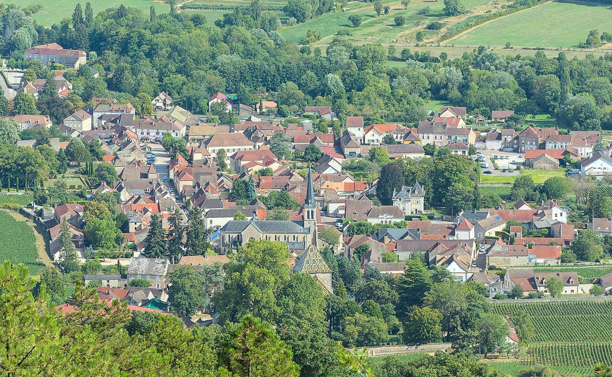

# 桑特奈

桑特奈（Santenay）是[勃艮第](ref:burgundy)[伯恩丘](ref:france)的最后一个村庄：再往南，葡萄园就滑向夏隆内丘。村口立着一座风车，坡上是温泉镇的老房子，酒农与疗养客共用同一条街。这里以[黑皮诺](ref:pinot-noir)酿[红葡萄酒](ref:red-wine)，以[霞多丽](ref:chardonnay)酿[白葡萄酒](ref:white-wine)；常见 750 mL，[酒精度](ref:abv)约 12.5%–13.5% vol。

图：桑特奈。图片：Benjamin Smith，CC BY-SA 4.0，via Wikimedia Commons（[原图页面](https://commons.wikimedia.org/wiki/File:Santenay_-_View_from_Mont_de_S%C3%A8ne_-_1.jpg)）。

## 南端边界：从桑特奈到雷米尼

桑特奈 AOC 于 1936 年 12 月 8 日设立；BIVB 的英文介绍同时写作 1937 年，属于“法令年份”与“实施年份”的口径差异。桑特奈的葡萄园并不止于村界。AOC 的产区分属两村：科多尔省的桑特奈，以及索恩-卢瓦尔省的雷米尼（Remigny）。一条行政边界从葡萄园中间穿过，酒却可以同标 Santenay——这在勃艮第并不常见。雷米尼的地块与桑特奈南坡相连，土壤连续，因此法规按“风土连续”而非“省界”划区。

## 一条 AOC 跨两个省

这件事的实际意义在酒标与价格上：同一款 Santenay，葡萄可能来自两个省，但 AOC 身份完全一致。对消费者而言，省界不构成品质分层；对酒农而言，雷米尼的地价与税制不同，却共享同一个产区名。理解这一点，就不会把“Remigny”误认成另一个独立产区。

## 铁质土与石灰岩的垂直分层

桑特奈的坡面从谷底一直升到 450 米以上。高处是灰色石灰岩，往下依次出现鲕状石灰岩、白鲕粒、泥灰岩、肾状石灰岩，再往下是下鲕粒层压在泥灰岩上。葡萄园大多分布在 250–400 米，坡向从东到南，日照条件在伯恩丘属于中上。

“铁质与石灰岩混合”是常见概括，但需要拆开：可核实的是石灰岩-泥灰岩的垂直序列；铁质更多出现在局部红棕色黏土与砂岩交界处，呈斑块状，而不是整村统一的红土。把它说成“到处是铁”，会高估它对风格的解释力。真正稳定的差异来自海拔与坡向：高处更冷、更酸，低处更暖、更圆。

## 没有特级园，分级靠什么

桑特奈没有特级园。村级之上只有一级园，共 11 个气候（BIVB 法语页；英文页列 12 个名称，差异来自 Les Gravières 与 Clos de Tavannes 的合并标注 Les Gravières-Clos de Tavannes）。没有特级园并不意味着“低一档”：一级园内部的地块差异很大，Les Gravières 的砾石与 Clos de Tavannes 的黏土-石灰岩就给出两种完全不同的骨架。

## 一级园：Les Gravières 与 Clos de Tavannes

Les Gravières 意为“砾石地”，表层多砾石、排水快，酒通常更香、更柔，单宁细；Clos de Tavannes 位于村南的封闭地块，土层更厚，酒更有结构，陈年潜力更长。其余如 La Comme、Beauregard、Grand Clos Rousseau、Clos Rousseau、Clos Faubard、Clos des Mouches、Beaurepaire、Passetemps、La Maladière 各有朝向与土层差异。买一级园时，气候名比“Premier Cru”四个字更有信息量。

## 法规数字：50 与 57

村庄级产量上限：红 50 hl/ha、白 57 hl/ha；一级园红 48、白 55；butoir 分别为 58/64 与 56/62。最低天然酒精度：村庄级红 10.5%、白 11%；一级园红 11%、白 11.5%。最低糖度相应为 180 与 178 g/L（村庄级），一级园 189 与 187 g/L。种植密度不得低于 9,000 株/公顷，行距不超过 1.25 米。数字以最新 cahier des charges 与 BIVB 公布为准。

## 红占近八成：258 公顷对 72 公顷

2022 年：红 258.32 公顷（一级园 101.21 公顷），白 72.40 公顷（一级园 22.23 公顷）；年均产红 10,198 hl、白 2,736 hl。红占面积约 78%，产量约 79%。这解释了为什么桑特奈的公众形象几乎等于“红葡萄酒村”：白的绝对量不小，但叙事长期被红压住。与佩尔南白占近一半、萨维尼白约 14% 相比，桑特奈处在中间偏红的位置。

## 代表酒庄：Jessiaume 与 Gravières

Domaine Jessiaume 自 1850 年起在桑特奈经营，是村里历史最久的家族酒庄之一，2014 年由 David Murray 接手并更新设备。它的 Les Gravières 是观察这个一级园的常用参照：砾石土带来香气与柔顺，萃取不过度。村内还有 Château de Santenay 等规模较大的经营者，以及多家独立酒农；同一气候在不同酒庄手里，风格可以相差很远。

## 风格三方对比：Chassagne、Mercurey、Meursault

与北邻夏瑟尼-蒙哈榭相比，桑特奈红更紧、更咸鲜，少一点奶油感；白则更瘦、更矿物，不是夏瑟尼那种宽厚。与南邻[梅尔居雷](ref:mercurey)相比，桑特奈红更细、酸度更高，梅尔居雷更肉、更直接。与[默尔索](ref:meursault)相比，桑特奈白显然更轻，不能用“小默尔索”去理解它。三方对比说明：桑特奈的位置不是“过渡带”，而是有自己酸度与单宁坐标的独立风格。

## 价格带：一级园与村庄级的落差

2026 年欧洲零售的常见区间：村庄级红 20–32 欧元，一级园红 35–55 欧元；村庄级白 25–35 欧元，一级园白 40–58 欧元。Les Gravières、Clos de Tavannes 等名气候可上浮 20%–30%。价格随年份、评分、酒商与汇率波动，以上只作量级参考。与夏瑟尼、默尔索同级酒相比，桑特奈通常低一档，但这反映的是市场热度，不是绝对品质。

## 配餐：炖小牛肉与亚洲酱汁禽肉

红的单宁细而稳，适合炖小牛肉、红酒炖牛肉、烤鸡与照烧/酱汁禽肉；BIVB 甚至建议搭配自制汉堡，因为酒体有肉感但不压味。白适合鱼 couscous、蘑菇意面与奶油汁禽肉。奶酪方面，红的建议是 Brie de Meaux、Pont-l'Évêque、Reblochon 与 Bleu de Bresse；白的建议是 Comté、Beaufort 与山羊奶酪。

## 误解纠正：不是“廉价夏瑟尼”

“桑特奈是买不起夏瑟尼时的替代品”是流传最广的误解。事实是：它没有特级园，但一级园有 11 个，Les Gravières 与 Clos de Tavannes 各有清晰个性；它的红占近八成，风格偏紧、偏咸鲜，与夏瑟尼的宽厚白完全不是同一路。把它当“平替”，会错过它真正的强项——结构清楚、价格合理、适饮窗口早的红。

## 温泉、风车与山坡上的风

桑特奈同时是温泉疗养地与葡萄酒村，BIVB 用“水之女神与酒之神”来形容这双重身份。村内的 Sorine 风车是地标，Mont de Sène 与 Montagne des Trois Croix 提供俯瞰整个产区的视角。这些不是酒评的一部分，却解释了为什么桑特奈的旅游与葡萄酒能互相导流：来疗养的人顺手买酒，来喝酒的人顺便住下。

## 参见

- [红葡萄酒](ref:red-wine)、[白葡萄酒](ref:white-wine)：两个大类。
- [黑皮诺](ref:pinot-noir)、[霞多丽](ref:chardonnay)：红白品种。
- [葡萄](ref:grape)、[发酵](ref:fermentation)、[橡木桶陈年](ref:oak-ageing)：原料与工艺。
- [法国](ref:france)、[勃艮第](ref:burgundy)：产区框架。
- [酒精度](ref:abv)：标签标识。
- [梅尔居雷](ref:mercurey)：南侧夏隆内丘的对照产区。
- [默尔索](ref:meursault)：白葡萄酒风格的对照条目。

对照阅读：[红葡萄酒](ref:red-wine)、[法国](ref:france)。

**关键事实。**

| 项目 | 内容 |
| --- | --- |
| 一句话定位 | 法国勃艮第伯恩丘最南端的村庄级法定产区，AOC 覆盖桑特奈与索恩-卢瓦尔省的雷米尼两村；2022 年红 258.3 公顷、白 72.4 公顷，红占近八成，村内无特级园而有 11 个一级园 |
| 酒种/风格 | 红葡萄酒、白葡萄酒 |
| 产区 | 法国、勃艮第 |
| 酒精度 | 12.5–13.5% vol |

**来源与边界。** 本页关于「桑特奈」的关键事实，主要由以下来源交叉核对：Bureau Interprofessionnel des Vins de Bourgogne（1936 年 12 月 8 日 AOC、11 个一级园、面积、海拔与土壤分层；12 个一级园名录、红白面积与年均产量）、INAO / Bureau Interprofessionnel des Vins de Bourgogne（产量上限、最低天然酒精度、种植密度与 1829 年历史数据）、Vignobles Français（产区横跨科多尔省与索恩-卢瓦尔省、海拔 210–450 米、允许品种）。价格、批次与状态会变，涉及这些字段时以页面所列来源的最新版本为准。正文为项目自写，来源只作核验，不复制原文。
