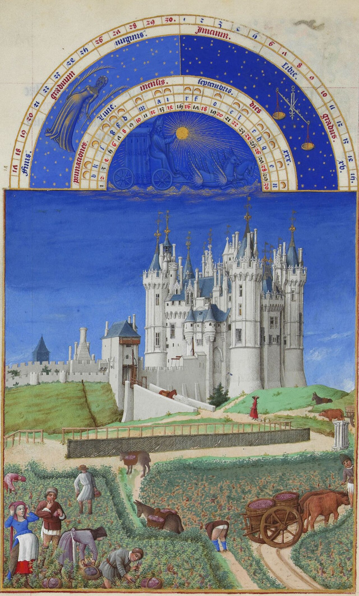

# 索米尔-尚皮尼

索米尔-尚皮尼是法国[卢瓦尔河谷](ref:loire)安茹-索米尔地区的红葡萄酒法定产区，位于卢瓦尔河左岸、索米尔东南。它只用[品丽珠](ref:cabernet-franc)酿造[红葡萄酒](ref:red-wine)，酒精度常见 12%–13.5% vol，是卢瓦尔河最"红"、也最容易被误认的产区之一。

图：索米尔-尚皮尼。图片：Limbourg brothers / Barthélemy d'Eyck / Jean Colombe，Public domain，via Wikimedia Commons（[原图页面](https://commons.wikimedia.org/wiki/File:Les_Tr%C3%A8s_Riches_Heures_du_duc_de_Berry_septembre.jpg)）。

## 一句话：卢瓦尔河右岸的品丽珠专色

先把层级摆清楚：[红葡萄酒](ref:red-wine)是类型，品丽珠是品种，索米尔-尚皮尼是 AOC，具体酒庄与酒款才是产品。产区名可以单独出现在酒标上，但它不是品牌，也不能用来概括所有卢瓦尔品丽珠。它与上游的[布尔格伊](ref:bourgueil)、[希农](ref:chinon)共享同一品种，却因为土壤与微气候走出完全不同的质地。

## 1957 年 12 月 31 日：一张迟到三十年的 AOC

索米尔一带从 1936 年起就有 Saumur 的产区框架，但"Champigny"这个红色专名直到 1957 年 12 月 31 日才由法令单独承认。现行文本是 2011 年 6 月 8 日第 2011-649 号法令。理解这个时间差很重要：它比[法国](ref:france)第一批 1936 年 AOC 晚了二十多年，原因是当地长期以散装酒和合作社酒为主，酒农直到战后才就"只做红酒、只用品丽珠"达成共识。2011 年修订又把种植密度、最低酒精度与降酸指标写得更细，今天酒标背后的规则主要来自这一版。

## Saumur 加 7 个村子：8 个市镇的地图

法令列出的市镇一共 8 个：Saumur 本身，加上 Chacé、Montsoreau、Parnay、Saint-Cyr-en-Bourg、Souzay-Champigny、Turquant、Varrains。也就是说，核心是"Saumur 加周边 7 个村子"。产区协会在宣传口径里常说"9 个村庄"，差别来自历史村落与行政市镇的统计方式，不影响法定边界。葡萄园不是一整片，而是散落在这些村子的台地与坡脚，像群岛一样分布；同一年份、相邻两村之间，成熟度可以差出一周。

## tuffeau：会呼吸的石灰岩与"火之田野"

这里的标志性母岩是 tuffeau——一种柔软的白色海相石灰岩，形成于 Turonian 期。葡萄藤扎在 tuffeau 之上的薄层壤土里，根系有时直接钻进岩层；台地顶部则覆盖着 Senonian 与 Eocene 的砂、黏土和砾石。tuffeau 白天吸热、夜间放热，排水又快，葡萄不容易积水肿胀。地名传说也与此有关：Champigny 可能来自拉丁语 campus igni，"火之田野"，指的就是这片异常温暖的向阳坡。酒农至今仍把酒藏在 tuffeau 采石场改成的酒窖里，常年约 12 °C。

## 40–110 米、4,000 株与 57 hl/ha

法规的技术细节相当具体。种植海拔被限定在 40–110 米；最小密度 4,000 株/公顷，行距与株距有下限；修剪以单一居由为主。基础产量上限 57 hl/ha，上限之上还有 69 hl/ha 的"butoir"（不可逾越线）；最低天然酒精度 10.5%，成品可发酵糖不得超过 3 g/L，苹果酸必须完成转化、残量不超过 0.4 g/L。灌溉被禁止，行间必须种草或覆盖。这些数字合在一起，解释了它为什么既能做出轻盈的日常酒，也能在好年份做出有骨架的酒。

## 99% 品丽珠，法规仍留 15% 的口子

协会给出的数字是 99% 品丽珠；2023 年采收时，品丽珠单独占地 1,412 公顷。但法规并没有把门完全关死：品丽珠是主品种，品丽珠之外的 Cabernet Sauvignon 与 Pineau d'Aunis 只能作为辅助品种，合计不超过 15%。这条"口子"在气候变暖的年份有实际意义——它可以用来补一点酸度或增加香气层次，但不足以改变产区的品种身份。看到酒标写 Saumur-Champigny，可以默认杯中主体就是品丽珠。

## 从覆盆子到铅笔芯：土壤怎样改写风味

索米尔-尚皮尼的典型香气是覆盆子、红醋栗、紫罗兰，年轻时偶尔有一丝青椒和石墨。整串[葡萄](ref:grape)经控温[发酵](ref:fermentation)后，部分酒款进入[橡木桶陈年](ref:oak-ageing)，最终[酒精度](ref:abv)多落在 12%–13.5%。和[布尔格伊](ref:bourgueil)相比，它的单宁更细、更早熟，酒体通常轻半档；和[希农](ref:chinon)相比，它少一点烟草与碎石感，多一点乳脂般的圆润。原因不神秘：tuffeau 上的薄土排水太快，葡萄粒小、皮厚，酚类成熟早；而台地顶部的砂砾土又会在热年给出更高的酒精。于是同一产区里，坡脚酒偏清爽，台地酒偏丰厚。

## 与 Bourgueil、Chinon 的三处分岔

第一是母岩：布尔格伊以砂砾与石灰岩混合为主，希农多黏土-燧石，索米尔-尚皮尼的核心是 tuffeau。第二是气候：这里受大西洋影响更深，降雨约 550–600 毫米，Mauges 丘陵的雨影还会带来焚风效应；布尔格伊更靠内陆，秋季更凉。第三是法律身份：索米尔-尚皮尼是一个独立 AOC，不是 Saumur 的"副牌"。三处差异叠加，才有"同品种、不同骨架"的结果。

## 酒庄与酒款：从 Clos Rougeard 到合作社

产区里有 120 家酒农，规模差异很大。Clos Rougeard 位于 Saumur 的 Le Bourg，以老藤品丽珠和长时间橡木桶陈年闻名，是价格金字塔的塔尖。Château de Parnay 的 Clos d'entre les Murs 是单园代表作；Domaine des Roches Neuves（Thierry Germain）走低产量与生物动力路线；Domaine Filliatreau 的 La Grande Vignolle 则是更易入口的经典；Château du Hureau 在 Parnay 也长期被视为标杆。合作社在产区产量中仍占不小份额，酒标上的"装瓶者"信息值得多看一眼。

## 价格带：€11 入门，€120 以上是另一个游戏

以法国零售市场 2026 年的常见挂牌价看（随年份、渠道与评分波动），入门级约 €11–18，村庄级或单一园多在 €20–35，Clos Rougeard 一类名庄则常在 €120 以上，个别老年份更高。这个价格断层不是品质的线性反映，而是土地、产量与二级市场共同作用的结果。日常饮用不必追高，€15 上下已经能喝到典型的覆盆子与紫罗兰。

## 一个常见误解：Champigny 不是香槟

最常见的误解，是看到"Champigny"就联想到 Champagne（香槟）。两者毫无关系：Champigny 是卢瓦尔河畔一个村名，和香槟区的 Châlons 也不沾边。第二个误解是把它当成 Saumur 的甜型或白型版本——它只产红葡萄酒，而且是干型。第三个误解是以为品丽珠一定"青椒味重"；在 tuffeau 上成熟良好的年份，青椒会退到背景，主导香气其实是红色浆果与花香。

## 配餐：冷肉、烤鸭与山羊奶酪

产区协会给出的经典搭配是干香肠、鸭胸（magret）、Livarot 奶酪和苹果派；侍酒温度建议 16–18 °C。逻辑很清楚：酒的单宁细、酸度不低，适合油脂丰富但不厚重的禽类与冷肉；Livarot 的洗皮香气能压住酒里的青椒，而苹果派的甜度又会被酒的酸度切开。若换成清蒸鱼或重辣菜，酒会显得单薄甚至发苦。较年轻的酒轻微冰镇到 15 °C 会更清爽，陈年 5 年以上的酒则建议回到 17 °C 左右。

买酒时，先看年份的成熟度，再看装瓶者，最后才看价格。索米尔-尚皮尼不是"便宜版希农"，它有自己的岩层、自己的法令，也有自己那条 57 hl/ha 的红线。
