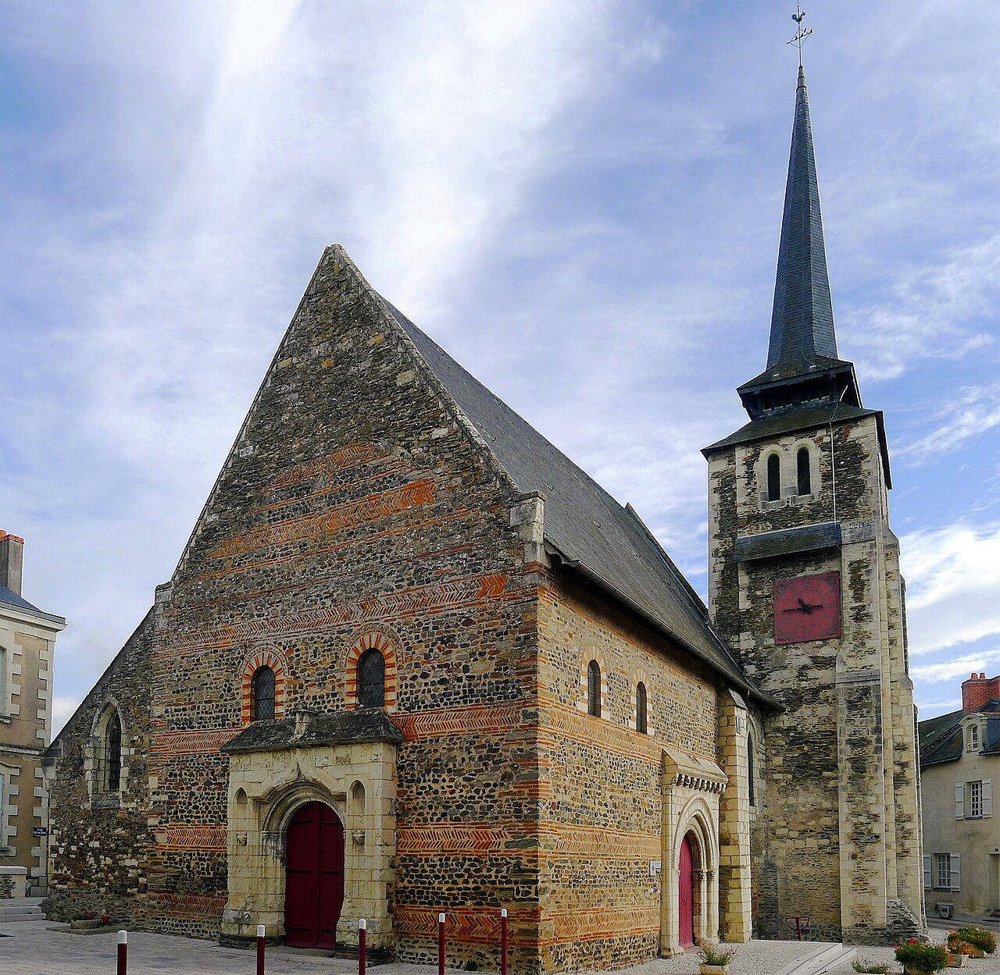

# 萨韦涅尔

萨韦涅尔是[法国](ref:france)[卢瓦尔河](ref:loire)安茹地区的[白诗南](ref:chenin-blanc)干型[白葡萄酒](ref:white-wine)法定产区，位于卢瓦尔河右岸、昂热西南约 15 公里。它以干型为主，酸度高、矿物感强，陈年后发展出蜂蜜、蜂蜡与坚果气息；常见 750 mL，[酒精度](ref:abv)约 12%–13.5% vol。

图：萨韦涅尔。图片：Mbzt，CC BY-SA 4.0，via Wikimedia Commons（[原图页面](https://commons.wikimedia.org/wiki/File:P1290021_Savenni%C3%A8res_eglise_St-Pierre-St-Romain_rwk2.jpg)）。

## 1952 年 12 月 8 日：从甜酒地图里切出来

萨韦涅尔的 AOC 由 1952 年 12 月 8 日法令确立。当时的安茹以甜酒为主，萨韦涅尔原本属于 Coteaux de la Loire 的甜酒体系；1952 年的法令第一次把它单独划出，并要求比周边更严：葡萄必须达到 212 g/L 的天然糖、最低 12 度酒精，产量压到 25 hl/ha。换句话说，它一开始并不是"干白产区"，而是"更浓缩的甜酒产区"。干型地位是后来争取来的。

## 140 公顷投产，37 家酒庄

今天萨韦涅尔的法定面积约 300 公顷，实际投产约 140 公顷；近五年平均产量 4,033 hl，约 537,000 瓶，37 家酒庄，平均单产只有 35 hl/ha。这个规模在卢瓦尔河属于"小而贵"：土地零散、坡地陡、机械难用，很多酒庄由庄主自己经营。三十年前，这里的葡萄园只剩 75 公顷；今天的恢复不是靠扩张，而是靠一批年轻酒农重新开垦坡地。

## 片岩、流纹岩与风成沙

萨韦涅尔位于"Anjou noir"（黑色安茹）的东端，是阿莫里坎地块的变质岩边缘。土壤以片岩为主，夹有石英、phtanite（黑燧石）与流纹岩、spilite 等火成岩脉；坡顶与谷底还覆盖着风成沙。片岩排水快、根系深，火成岩脉在阳光下升温快，给酒带来"硬"的矿物骨架；沙土则让酒更轻、更香。这种组合在卢瓦尔河很少见，也是它和[武弗雷](ref:vouvray)（以石灰岩为主）风格分岔的根源。

## coulées：垂直于卢瓦尔河的小谷

萨韦涅尔的葡萄园不在一条连续的山坡上，而是分布在一条条垂直于卢瓦尔河的 "coulées"（小谷）两侧。坡向多为南或西南，坡度陡，日照充足；卢瓦尔河负责调节温度，年降雨约 650 毫米，比安茹西部更干。风车是这里的地标，也说明坡顶风大、湿度低，葡萄不容易感染灰霉。coulées 的地形让同一产区内部形成多个微气候，Coulée de Serrant 与 Roche aux Moines 正好位于其中两条最著名的谷地。

## 干型白诗南：11.5% 与 4 g/L

现行规则把风格分成两档：干型与半干型的产量上限 50 hl/ha，最低天然酒精度 11.5%；其他类型 35 hl/ha，最低 12.5%。干型的可发酵糖不得超过 4 g/L，葡萄必须人工采收，种植密度至少 4,000 株/公顷，行距不低于 0.90 米（坡度大于 10% 时可放宽到 0.80 米）。[葡萄](ref:grape)经缓慢[发酵](ref:fermentation)后，多在旧[橡木桶](ref:oak-ageing)中带酒泥陈酿。这些数字解释了萨韦涅尔为什么"干而不瘦"：低产量保证了果味浓度，高酸度则来自片岩与偏北的位置。

## Coulée de Serrant 的 7 公顷

Coulée de Serrant 是萨韦涅尔内部最特殊的存在：整片 7 公顷的坡地本身就是独立 AOC，只属于 Joly 家族。葡萄由西多会修士于 1130 年种植，Nicolas Joly 从 1977 年起接手，1984 年把整个庄园转为生物动力。园内老藤平均 35–40 年，最老的超过 80 年。它同时生产三款酒——Coulée de Serrant、Savennières-Roche aux Moines 与 Savennières——但只有第一款来自这 7 公顷独占园。产量极低，年产量通常只有数千瓶。

## Roche aux Moines：30 hl/ha 与 10 个月

Roche aux Moines 是另一个独立 AOC，位于萨韦涅尔村内、俯瞰卢瓦尔河的陡坡上，土壤是含石英与 phtanite 的片岩。近五年平均约 20 公顷投产、7 家生产者、30 hl/ha、约 300 hl、4 万瓶。它的生产章程比萨韦涅尔主体更严：禁止合成除草剂与杀虫剂，最低陈酿 10 个月，必须人工采收并逐串筛选，且必须在酒庄内装瓶。酒通常比萨韦涅尔主体更厚、更咸，陈年潜力更长。

## 与 Vouvray、Pouilly-Fumé 的三角对比

同样来自卢瓦尔河，三者常被放在一起比较。[武弗雷](ref:vouvray)在都兰，白诗南可以做成干型、半干、甜型或起泡，风格更圆、更果味；[普伊-富美](ref:pouilly-fume)在中央-卢瓦尔，用长相思，酒更轻、更"火石"；萨韦涅尔则是"干型白诗南的极简版"：没有起泡，甜型很少，重点是片岩带来的咸、苦与长酸度。配餐上，武弗雷适合甜点与猪肉，普伊-富美适合海鲜，萨韦涅尔适合芦笋、孔泰与白肉。

## 酒庄与酒款：Joly、Closel 与 Boudignon

Nicolas Joly 的 Coulée de Serrant 是产区图腾；Château de Chamboureau 在 Coulée de Serrant 旁边，风格更宽；Domaine du Closel（Château des Vaults）由女性酒农经营，酒更细；Domaine aux Moines 是 Roche aux Moines 的核心地主之一；Thibaud Boudignon 以高酸、低产量的新派风格受到关注；Château d'Épiré 则是历史名庄。37 家酒庄里，大多数规模很小，酒标上的地块名往往比庄名更关键。

## 价格带：€22 到 €140

法国零售市场 2026 年的常见区间（随年份、渠道与评分波动）：萨韦涅尔主体约 €22–32，单一园或老年份 €35–60，Coulée de Serrant 多在 €90–140，Roche aux Moines 约 €45–80。价格高的原因很直接：35 hl/ha 的平均单产、陡坡的人工成本、以及 10 年以上的陈年潜力。入门款并不便宜，但在白葡萄酒世界里，它的性价比常被低估。

## 误解：白诗南不等于甜酒

最常见的误解，是看到"白诗南"就默认甜。萨韦涅尔以干型为主，残糖通常低于 4 g/L，喝起来甚至比很多霞多丽更"干"。第二个误解是把 Coulée de Serrant 当成萨韦涅尔的一个品牌；它是独立 AOC，法律地位与萨韦涅尔并列。第三个误解是"片岩一定给烟熏味"；萨韦涅尔的矿物感更偏咸、苦与湿石头，烟熏并不是它的主调。

## 配餐：芦笋、孔泰与苹果塔

萨韦涅尔的高酸与咸感，最适合芦笋（尤其是荷兰酱）、白芦笋、烤鱼、小牛肉与猪里脊。孔泰奶酪是经典搭配，奶酪的坚果与酒的蜂蜡、湿石头互相呼应；苹果塔（Tarte Tatin）则利用酒的酸度切开焦糖。避免过辣的菜与大量醋，它们会让酒显得尖刻。侍酒温度 11–13 °C，太冷会压住香气，太热则会让酒精感突出。

萨韦涅尔不是"安茹的甜酒"，也不是"白诗南的另一个武弗雷"。它是片岩坡地上一次极低产量的赌博，赌的是时间会把酸度变成蜂蜜。

**关键事实。**

| 项目 | 内容 |
| --- | --- |
| 一句话定位 | 法国卢瓦尔河谷安茹地区的白诗南干白法定产区，1952 年 12 月 8 日获 AOC，仅覆盖卢瓦尔河右岸 3 个市镇、约 140 公顷投产；以片岩坡地、低产量与高酸矿物感著称，并包含 Coulée de Serrant 与 Roche aux Moines 两个独立 AOC |
| 酒种/风格 | 白葡萄酒 |
| 产区 | 法国、卢瓦尔河谷 |
| 酒精度 | 12–13.5% vol |

**来源与边界。** 本页关于「萨韦涅尔」的关键事实，主要由以下来源交叉核对：InterLoire（7 公顷独占 AOC、Joly 家族、1984 年起生物动力与 35–40 年老藤；约 20 公顷、7 家生产者、30 hl/ha、最低 10 个月陈酿与酒庄内装瓶）、European Union（3 个市镇、干型 50 hl/ha、其他 35 hl/ha、11.5%/12.5% 最低天然酒精度、4 g/L 可发酵糖、4,000 株/公顷与人工采收）、Domaine de la Coulée de Serrant（1130 年西多会修士种植、7 公顷独立 AOC 与三款酒的关系）等 6 条来源。价格、批次与状态会变，涉及这些字段时以页面所列来源的最新版本为准。正文为项目自写，来源只作核验，不复制原文。
