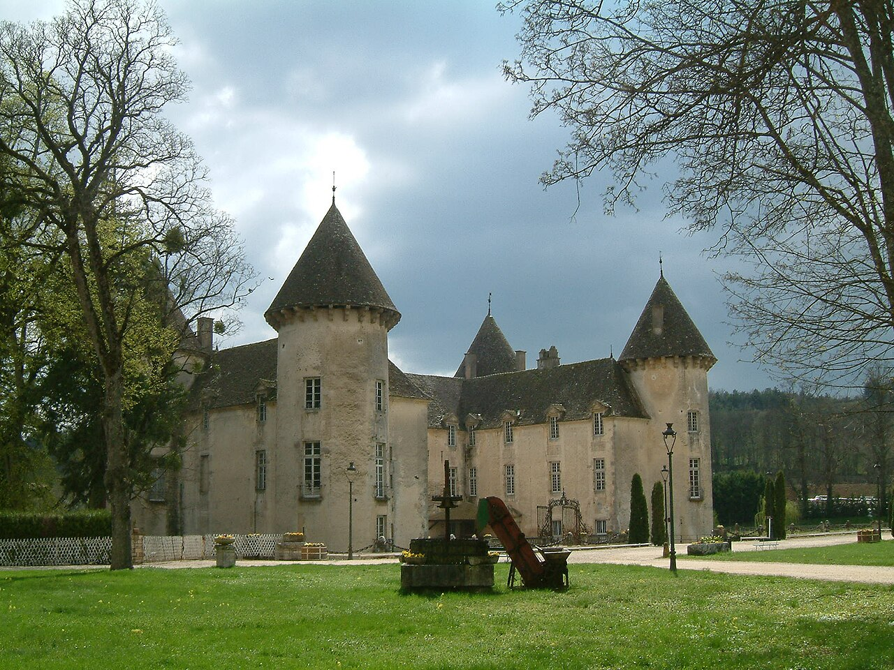

# 萨维尼-莱博讷

萨维尼-莱博讷（Savigny-lès-Beaune）从科尔通山南麓一直铺到博讷城北，中间被一条叫 Rhoin 的小河切开。它的葡萄园面积在伯恩丘排得上号，却始终没有特级园；它有一张 22 个一级园的长名单，却常被当成“博讷与科尔通之间的过路村”。这种反差，正是理解它的入口。萨维尼-莱博讷 AOC 自 1937 年 7 月 31 日起，至今没有特级园。村内以[黑皮诺](ref:pinot-noir)酿[红葡萄酒](ref:red-wine)，以[霞多丽](ref:chardonnay)与白皮诺酿[白葡萄酒](ref:white-wine)；常见 750 mL，[酒精度](ref:abv)约 12.5%–13.5% vol。

图：萨维尼-莱博讷。图片：Christophe.Finot，CC BY-SA 2.5，via Wikimedia Commons（[原图页面](https://commons.wikimedia.org/wiki/File:Ch%C3%A2teau-Savigny-l%C3%A8s-Beaune_01.jpg)）。

## Rhoin 河塑造的两面坡

Rhoin 从西向东流过，把产区切成两半。北侧靠近佩尔南的一面，坡向偏南，土壤是砾石夹杂铁质鲕粒（oolithe ferrugineux），排水好、升温快；南侧正对村庄的一面，坡向转东，土壤是带砂感的石灰岩，温度上升慢半拍。同一条河，两种成熟曲线：北面更圆、更早熟，南面更紧、更线形。

海拔从 250 米升到 400 米，坡面上还有一层 Rhoin 冲积锥，把河流带来的砾石与黏土混进山脚。于是“萨维尼”不是一个味道，而是至少两个：山脚与北坡的柔和果味，以及南坡中段的紧实与矿物。

## 22 个一级园：一张长名单

22 个一级园气候包括：Aux Clous、Aux Fourneaux、Aux Gravains、Aux Guettes、Aux Serpentières、Basses Vergelesses、Bataillère、Champ Chevrey、La Dominode、Les Charnières、Les Hauts Jarrons、Les Hauts Marconnets、Les Jarrons、Les Lavières、Les Marconnets、Les Narbantons、Les Peuillets、Les Rouvrettes、Les Talmettes、Les Vergelesses、Petits Godeaux、Redrescul。名单长，名气却不均：La Dominode、Les Lavières、Les Marconnets、Aux Guettes、Les Narbantons 是市场最常引用的几个。

长名单带来一个实际问题：酒标只写“Premier Cru”而不写气候，信息量很低。同一村的一级园，北坡与南坡、山脚与山腰，风格可能完全相反。买萨维尼，气候名比“一级园”三个字更值得看。

## 358 公顷：伯恩丘的“大村”

2022 年数据：红 300.08 公顷（一级园 125.31 公顷），白 47.79 公顷（一级园 11.87 公顷），合计约 358 公顷；年均产红 11,864 hl、白 1,979 hl。红占面积约 86%，产量约 86%。与佩尔南白占近一半、桑特奈白约 22% 相比，萨维尼是典型的“红村”，但白的绝对量并不小——1,979 hl 约合 26 万瓶。

面积大意味着内部差异大：22 个一级园加上数十个村庄级略地，土壤与朝向的组合几乎覆盖了伯恩丘的整个谱系。把它当成一个统一风格来讨论，本身就会失真。

## 土壤：铁质鲕粒与砂质石灰岩

北侧靠近佩尔南的坡面，BIVB 写得很明确：朝南、砾石土、夹杂铁质鲕粒；往下走，棕红色石灰岩变得更黏、更多砾石。南侧正对村庄的坡面则朝东，土壤是带砂感的石灰岩。山脚是 Rhoin 的冲积锥，砾石与黏土混合。

铁质鲕粒是理解北坡红的钥匙：它让土壤排水更快、白天升温更明显，黑皮诺容易达到较高成熟度，酒更圆、更肉。南坡的砂质石灰岩则保水差、升温慢，酒更紧、更香、更需要时间。两种土，不是“好与坏”，而是“早与晚、圆与紧”。

## 法规数字：50、57 与 22

村庄级产量上限：红 50 hl/ha、白 57 hl/ha；一级园红 48、白 55；butoir 分别为 58/64 与 56/62。最低天然酒精度：村庄级红 10.5%、白 11%；一级园红 11%、白 11.5%。最低糖度村庄级为 180 与 178 g/L，一级园为 189 与 187 g/L。种植密度不得低于 9,000 株/公顷。

白葡萄酒的允许品种里，除霞多丽外还有白皮诺（Pinot Blanc）——这是萨维尼与阿洛斯、佩尔南都不同的细节。白皮诺让白更圆、更少柑橘感，也解释了为什么萨维尼白常带黄油与 Brioche 气息。

## 村级与一级园的价差逻辑

2026 年欧洲零售的常见区间：村庄级红 20–30 欧元，一级园红 32–50 欧元；村庄级白 25–35 欧元，一级园白 35–50 欧元。价差通常不到一倍，远小于科尔通特级园与村庄级的差距。原因有三：没有特级园作为价格锚；22 个一级园稀释了“稀缺叙事”；村庄级产量大、供给充足。

对买家而言，这是机会也是陷阱。机会是：La Dominode、Les Marconnets 这类名气候的一级园，价格仍低于博讷或波玛的同级酒。陷阱是：只写“Premier Cru”的便宜酒，可能来自较弱的坡位，风格与名气候相差很远。

## Simon Bize 的 0.60 公顷 Marconnets

Domaine Simon Bize & Fils 的 Les Marconnets 只有 0.60 公顷，1973 年种植，位于 Rhoin 右岸，土壤深厚、带砂。酒庄对它的描述是“在湿润年份更能显出张力与能量”，这也点出了 Marconnets 的性格：不是靠厚重取胜，而是靠酸度与结构。0.60 公顷意味着产量很小，市场上并不常见，但它是理解“南坡/右岸”风格的样本。

## 香东-德-布里亚伊：从萨维尼起家

Chandon de Briailles 的基地就在萨维尼，12 个 cru 分布在萨维尼、佩尔南与阿洛斯三村，2005 年起转为生物动力。它在佩尔南的 Île des Vergelesses 更有名，但萨维尼的一级园同样是其体系的核心：整串、轻萃取、少硫，让酒在年轻时就显得柔软，陈年后才显出骨架。与 Simon Bize 的传统路线并置，可以看出萨维尼内部的两种酿酒哲学。

## 风格：与阿洛斯、佩尔南的三角关系

与[阿洛斯-科尔通](ref:aloxe-corton)相比，萨维尼红少一点单宁的“硬度”，多一点圆润与果味，适饮窗口更早；与[佩尔南-韦尔热莱斯](ref:pernand-vergelesses)相比，萨维尼红更肉、更宽，佩尔南更花香、更线形；萨维尼白则比佩尔南白更黄油、更圆，少了后者那种咸鲜矿物感。

三角关系的根源是地形：阿洛斯正东、成熟早、单宁实；佩尔南更高、更晚熟、酸度尖；萨维尼夹在中间，北坡朝南、南坡朝东，于是同时拥有“圆”和“紧”两种可能。

## 城堡里的飞机、Abarth 与摩托

村北的 Château de Savigny 建于 14 世纪，1979 年由 Michel Pont 接手后，陆续在庭院与附楼里塞进了飞机、Abarth 赛车、摩托车、拖拉机与消防车。今天它是正式开放的博物馆群：约百架战斗机与直升机、30 台 Abarth 原型车、200 余辆 1903–1960 年的摩托车，门票 14 欧元。它不是酒庄的营销噱头，而是真实存在的旅游点——也是萨维尼“酒村之外”的另一张名片。

## 误解纠正：不是“没有名园的便宜村”

“萨维尼没有特级园，所以只有便宜酒”是双重误解。第一，一级园有 22 个，La Dominode、Les Marconnets、Les Lavières 等在爱好者圈子里有稳定声誉；第二，没有特级园是历史分级的结果，不是品质判决。萨维尼的强项恰恰是“用一级园的价格买结构完整的红”，而不是“退而求其次”。

另一个误解是“萨维尼红都粗犷”。北坡的铁质鲕粒与南坡的砂质石灰岩给出两种质地，前者圆、后者紧；用“粗犷”一概而论，说明只喝过其中一面。

## 选购、年份与保存

村庄级红多数 4–8 年适饮，一级园 8–15 年；白村庄级 4–7 年，一级园 7–12 年。购买时优先看气候名与坡向（北/南），其次看年份与装瓶者。未开瓶避光平放，12–15 摄氏度；开瓶后冷藏，2–3 日内喝完。遇到只写“Premier Cru”的超低价酒，先查地块位置，再决定是否值得。

## 相关页面

- [红葡萄酒](ref:red-wine)、[白葡萄酒](ref:white-wine)：两个大类。
- [黑皮诺](ref:pinot-noir)、[霞多丽](ref:chardonnay)：主要品种（白另有白皮诺）。
- [葡萄](ref:grape)、[发酵](ref:fermentation)、[橡木桶陈年](ref:oak-ageing)：原料与工艺。
- [法国](ref:france)、[勃艮第](ref:burgundy)：产区框架。
- [酒精度](ref:abv)：标签标识。
- [阿洛斯-科尔通](ref:aloxe-corton)：北侧山丘的对照产区。
- [佩尔南-韦尔热莱斯](ref:pernand-vergelesses)：西北侧谷地的对照产区。
