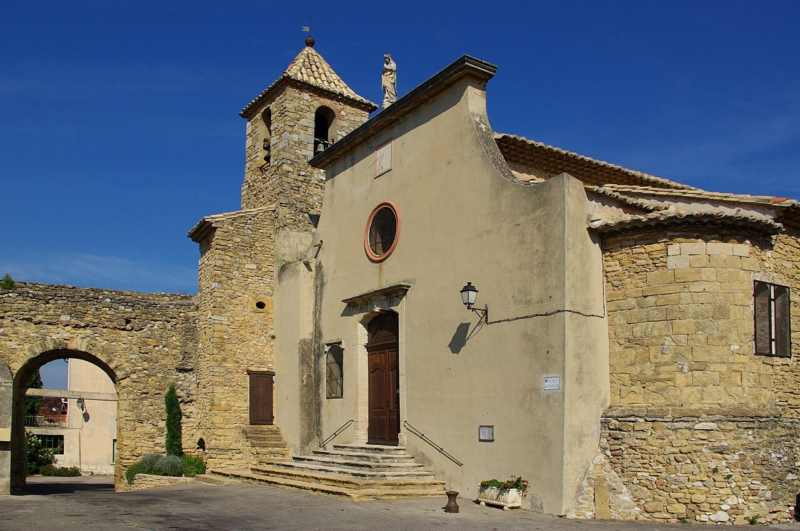

# 瓦给拉斯

瓦给拉斯（Vacqueyras）是[法国](ref:france)[罗讷河谷](ref:rhone)的法定产区，AOC 横跨沃克吕兹省的瓦给拉斯与萨里扬（Sarrians）两个市镇，葡萄园铺在乌韦兹河两岸的阶地上，背后就是旺度山。它同时生产[红葡萄酒](ref:red-wine)、桃红与少量白葡萄酒；红以[歌海娜](ref:grenache)为主体，常配[西拉](ref:syrah)与慕合怀特，常见 750 mL、[酒精度](ref:abv)约 13.5%–15%。

图：瓦给拉斯。图片：Pierrenoel，CC BY-SA 3.0，via Wikimedia Commons（[原图页面](https://commons.wikimedia.org/wiki/File:Eglise_de_Vacqueyras.JPG)）。

## “石头谷”：名字与 60–160 米的河成阶地

Vacqueyras 来自拉丁语 Vallea Quadreria，意思是“石头谷”。这个名字并不浪漫化：葡萄园主要分布在乌韦兹河冲积形成的宽阶地上，海拔约 60–160 米，地表多砾石（galets roulés），下层是砂质黏土与石灰岩。砾石白天吸热、夜间放热，帮助歌海娜成熟；砂质黏土则在干旱年份提供一点保水能力。原料是[葡萄](ref:grape)，[发酵](ref:fermentation)与[橡木桶](ref:oak-ageing)处理因酒庄而异。与把葡萄种到 500 米的[吉贡达斯](ref:gigondas)相比，这里的地势明显更低、更平。

## 1990 年 8 月：一次“迟到”的升级

瓦给拉斯的行政履历比吉贡达斯长：1937 年已进入罗讷河谷 AOC 范围，1955 年获得“Côtes du Rhône Vacqueyras”称谓，1967 年成为村庄级。直到 1990 年 8 月 9 日，它才获得独立 AOC，比吉贡达斯晚了十九年。升级较晚并不等于质量较次，而是说明产区面积更大、涉及两个市镇与更多经营者，需要更长时间完成地块划定与规则统一。两个市镇、数百个地块、不同的继承结构，边界与规则要逐一谈拢；吉贡达斯只有一个市镇，谈判对象少得多。

## Riss 阶地 vs 吉贡达斯的 Mindel 阶地

这是两页最容易被写混的地方。瓦给拉斯的阶地主要形成于 Riss 冰期，吉贡达斯则更多是更古老的 Mindel 冰期沉积。地质年龄差异带来实际口感差异：瓦给拉斯的土壤更年轻、砂质比例更高，酒体更圆、单宁更软；吉贡达斯的红色黏土与石灰岩碎屑更多，酒更紧、更咸。把两页都写成“南罗讷的砾石台地”会抹掉这个差别。

## 三色并举：红之外的两个少数派

瓦给拉斯不是单一红酒产区。红占绝大多数，桃红与白都只有个位数百分比，其中白略多于桃红。白葡萄酒可用克莱雷特、白歌海娜、布尔朗克、胡珊、玛珊与维欧尼，单一品种不得超过 80%。2025 年产区总面积 1,421 公顷，总产量 38,147 hl，平均单产 27 hl/ha，出口约占 26%。这些数字说明它是一个以红为主、但结构完整的三色产区。

## 歌海娜 50% + 西拉/慕合怀特 20%：比邻区更硬的下限

红葡萄酒的品种规则是：歌海娜最低 50%，慕合怀特与西拉合计最低 20%，其他允许品种不超过 10%，白品种不超过 5%。与吉贡达斯“神索、慕合怀特、西拉合计 15%”相比，瓦给拉斯对西拉与慕合怀特的要求更高，这也是它常带黑胡椒、皮革与深色果味的原因。最低天然酒精度为红 12.5%、桃红与白 12%；最大产量 36 hl/ha（上限 40 hl/ha）。

## Garrigues 高原与 Dentelles 的遮挡

产区内并不只有河成阶地。萨里扬一侧的 Garrigues 高原覆盖着黏土与砾石，旺度山在西侧形成遮挡，减轻了部分强风。Le Sang des Cailloux 把自家 17 公顷拆成三块风土来描述：Safres（砂质，适合白）、Garrigue argileuse（黏土高原，用于 Lopy）、以及覆盖在褐色黏土上的石灰质砾石（用于基础红）。这种“同一产区内部再分三层”的做法，比一句“南罗讷风土”有用得多。

## 两家酒庄：La Monardière 与 Sang des Cailloux

Domaine de la Monardière 由 Martine 与 Christian Vache 于 1987 年创立，现有约 22 公顷，儿子 Damien 在 2000 年代加入；酒款包括 Les Calades、Les 2 Monardes 与 Vieilles Vignes，风格偏果味清晰、单宁圆润。Le Sang des Cailloux 建于 1975 年，Serge Férigoule 于 1990 年成为庄主，儿子 Frédéri 于 2003 年加入；酒庄 2007 年获有机认证、2010 年转生物动力，老藤平均 50 年，部分超过 80 年，Lopy 常以 80% 歌海娜配 20% 西拉。第三家可关注 Château des Tours（Emmanuel Reynaud），它是产区里最常被引用的“膜拜级”名字，但产量极小、价格也远离日常带。

## 1998 年以来的阿维尼翁戏剧节官方用酒

自 1998 年起，瓦给拉斯成为阿维尼翁戏剧节的官方 Cru。这个身份对风格有解释力：戏剧节的观众与餐饮场景需要一款比吉贡达斯更开放、比教皇新堡更轻便的酒，能在演出后配简单烤肉与奶酪。产区也乐于把“稳定、可靠、不用醒太久”当作卖点，这与其阶地、低海拔、较高西拉比例的结构是一致的。

## 风格：为什么它比吉贡达斯更宽、更早适饮

把两杯酒放在一起：瓦给拉斯的果味更向前，黑莓、无花果干、甘草与“garrigue”香草更明显，单宁更圆，通常 3–8 年进入适饮；吉贡达斯的酸度更直，单宁更细，常要 5–10 年才打开。原因不在“谁更高级”，而在海拔、土壤年龄与石灰岩比例。与[教皇新堡](ref:chateauneuf)相比，瓦给拉斯少了油脂感与橡木存在感，多了河谷的宽阔感。

## 价格、配餐与两个误解

零售样本中，Le Sang des Cailloux 的基础红约 €20–35，白葡萄酒约 €29，名庄旗舰可到 €35–55；价格随年份、渠道与汇率波动。配餐上，烤羊排配橄榄酱、鸭胸配烤无花果、蓝纹奶酪都合适；酒体较重的年份可以配炖野味。两个误解值得纠正：第一，“瓦给拉斯是便宜的吉贡达斯”——它是 1990 年独立的 AOC，面积更大、海拔更低、品种下限不同，不是同一个东西的降级版。第二，“瓦给拉斯只有红酒”——它合法生产三色，白虽然只占约 2%，却是产区里很有趣的少数派。

## 资料核对与价格说明

本页数字取自 Inter Rhône 产区页、2020 年 12 月核准的 cahier des charges、欧盟官方公报中的 Vacqueyras 申请文件，以及 La Monardière、Le Sang des Cailloux 的官方资料；价格仅取 Cork & Curve 的在售样本，未把单一酒款当作产区均价。所有来源均在 2026 年 11 月 8 日实际打开核对。

**关键事实。**

| 项目 | 内容 |
| --- | --- |
| 一句话定位 | 法国南罗讷河谷的法定产区，横跨瓦给拉斯与萨里扬两个市镇，葡萄园位于乌韦兹河 60–160 米的河成阶地上；红葡萄酒以歌海娜至少 50%、西拉与慕合怀特合计至少 20% 为骨架，同时产桃红与少量白葡萄酒，风格比吉贡达斯更宽、更早适饮，常见 750 mL、酒精度约 13.5%–15% vol |
| 酒种/风格 | 红葡萄酒 |
| 产区 | 法国、罗讷河谷 |
| 酒精度 | 13.5–15% vol |

**来源与边界。** 本页关于「瓦给拉斯」的关键事实，主要由以下来源交叉核对：Inter Rhône（2025 年面积、产量、AOC 年份、三色与阿维尼翁戏剧节信息）、Syndicat des Côtes du Rhône / INAO（品种下限、最低天然酒精度与产量上限）、European Union（乌韦兹河阶地 60–160 米的海拔描述）等 6 条来源。价格、批次与状态会变，涉及这些字段时以页面所列来源的最新版本为准。正文为项目自写，来源只作核验，不复制原文。
