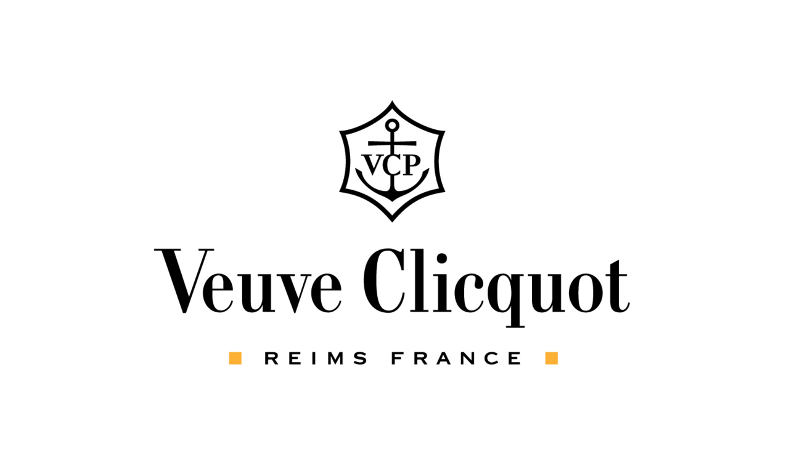

# 凯歌香槟

凯歌香槟（Veuve Clicquot）是法国香槟区兰斯的酒庄，1772 年由菲利普·凯歌创立，1805 年由遗孀芭布-妮可·蓬萨丹接手，现属[路威酩轩](ref:lvmh)旗下酩悦轩尼诗。“Veuve”在法语里就是“寡妇”；旗舰是无年份 Yellow Label（黄标），750 mL 装、酒精度约 12% vol。

图：凯歌香槟。图片：Julia Jeanselme，CC BY 3.0，via Wikimedia Commons（[原图页面](https://commons.wikimedia.org/wiki/File:Logo_Veuve_Clicquot.png)）。

## 1772：兰斯的一间葡萄酒商行

菲利普·凯歌出身银行与纺织家族，自己已有葡萄园，1772 年在[法国](ref:france)的[香槟](ref:champagne)区兰斯建立酒商行。1805 年，他的儿子弗朗索瓦去世，27 岁的遗孀芭布-妮可·蓬萨丹在几周内决定接手。她没有把酒庄卖掉，而是亲自管账、跑市场、改进工艺，成为现代意义上最早的女企业家之一。

## 1805：27 岁寡妇接手

“Veuve Clicquot”不是一个人的全名，而是“寡妇凯歌”的称呼。1805 年接手时，酒庄还只是区域性酒商；她把它推到俄罗斯、英国与欧洲宫廷。1810 年，她做出香槟区最早有记录的年份香槟；1811 年是“彗星年份”；1814 年，她把 10,550 瓶 1811 年份运往圣彼得堡，抢在封锁解除前进入俄国市场。1818 年，她又用布济（Bouzy）红葡萄酒与香槟调配，做出最早的“Rosé d'assemblage”，改变了当时用接骨木浆果调色的做法。

## 1816：转瓶台与 Anton Müller

酒泥陈酿后的酒液浑浊，需要把沉淀集中到瓶口再除渣。1816 年，凯歌夫人与酒窖主管 Anton Müller 把第一张转瓶台（table de remuage）做成可复制的工艺：酒瓶斜插在带孔的架上，逐日小角度旋转并逐渐倒立，让沉淀滑向瓶口。这套动作后来被整个香槟区采用，至今仍是传统工艺的基础。它不是“发现沉淀会下沉”，而是把手工动作标准化；旋转角度从四分之一圈逐步缩小到八分之一、十六分之一圈，节奏与倾斜角度都有讲究。

## Yellow Label：50% 黑皮诺的骨架

Yellow Label 的[调配](ref:blending)约为[黑皮诺](ref:pinot-noir) 50%、莫尼耶 20%、[霞多丽](ref:chardonnay) 30%，来自 50–60 个 cru；最多可加入 45% 的储备酒，酒庄的储备酒库约有 400 款、最老可到 30 年。补液 9 g/L，属 Brut；酒泥陈酿至少 15 个月，在法定底线之上。黑皮诺提供结构与红色果香，莫尼耶提供圆润，霞多丽提供柑橘与花香。

## 15 个月只是法定底线

法国 DGCCRF 说明，无年份香槟带酒泥陈酿至少 15 个月，年份香槟更长；瓶内[二次发酵](ref:fermentation)本身约 6–8 周。凯歌黄标在法定底线之上做更长陈年，具体月数随批次而变。[补液](ref:dosage)量决定甜度：Brut 通常不超过 12 g/L，9 g/L 是干型；Demi-Sec 才明显偏甜。[酒精度](ref:abv)约 12% vol，应与容量、产地一起核对。

## La Grande Dame：1972 年起的旗舰年份线

1972 年，酒庄成立 200 周年，推出旗舰年份香槟 La Grande Dame，名字来自凯歌夫人的昵称“香槟贵妇”。2018 年份是该系列第 25 个年份，调配为黑皮诺 90%、霞多丽 10%，补液 6 g/L，酒庄给出的陈年潜力超过 15 年。它把黄标的黑皮诺骨架推到极致，风格更集中、更咸鲜。

## 2011 与 2015：两个极端年份

2011 年香槟区采收期多雾、阴冷，是有记录以来最早的一批采收之一，葡萄成熟不足、稀释感明显；2015 年则温暖干燥，酸度与成熟度平衡，被许多评论视为十年一遇的年份。年份香槟只在酒庄认为够格的年份生产，因此同一条产品线在不同年份的表现会差很远。

## 482 个白垩酒窖与 UNESCO

1909 年，凯歌迁入兰斯郊外的 482 个白垩岩酒窖（crayères），这些旧采石场提供了稳定的温度与湿度。2015 年 7 月，圣尼凯斯山与包括凯歌在内的酒窖群被列入联合国教科文组织世界遗产“香槟山丘、酒庄与酒窖”。酒窖不是营销布景，而是陈酿条件的一部分。

## 为什么它比酩悦更有“骨架”

与[酩悦](ref:moet) Brut Impérial 相比，凯歌黄标的黑皮诺比例更高（50% 对 30%–40%），调配基数更小（50–60 个 cru 对 200 多个），补液量更高（9 g/L 对 7 g/L）。结果是它更有结构感、果味更集中，入口的“力度”更明显；酩悦则更柔和、更中性、更适合大规模宴会。

这不是说凯歌一定更好，而是风格任务不同：黄标要把黑皮诺的骨架做成品牌签名，酩悦要把稳定与易饮做成全球标准。9 g/L 的补液让黄标在年轻时就显得圆润，但香槟区的高酸度把甜感托住，所以喝起来并不腻。

## 价格带：黄标与 La Grande Dame

按 2026 年 11 月 Wine-Searcher 查询，Yellow Label 的平均零售价约 76 美元/750 mL；La Grande Dame 定位更高，常见价格约为黄标的数倍，具体随年份、渠道与汇率波动。礼盒、限量版与 Magnum 容量会进一步推高价格，但不应把包装当作等级。

## 误解：黄标不是甜香槟

“Yellow Label”的黄色标签容易让人以为它是甜型，但它的补液量是 9 g/L，属于 Brut 干型。真正的甜型是 Demi-Sec 或 Doux。另一个误解是把“Veuve”当成品牌名或人名；它的意思是“寡妇”，指 1805 年接手酒庄的芭布-妮可·蓬萨丹。

## 侍酒与搭配

充分冰镇到 8–10°C，用郁金香杯或白葡萄酒杯。黄标适合开胃酒、生蚝、炸物、白肉与软质奶酪；高酸度能切开油炸与奶油类菜肴的腻感。La Grande Dame 更适合搭配扇贝、龙虾、奶油禽类，温度可略高到 10–12°C。开瓶后气泡会逐渐损失，建议一次饮完。

## 延伸阅读

- [起泡酒](ref:sparkling-wine)：香槟所属的大类。
- [路威酩轩](ref:lvmh)：酒庄所属集团。
- [法国](ref:france)：香槟产区的国家背景。
- [香槟](ref:champagne)：香槟产区的法定范围与工艺。
- [黑皮诺](ref:pinot-noir)：黄标骨架的核心品种。
- [霞多丽](ref:chardonnay)：提供柑橘与花香。
- [发酵](ref:fermentation)：瓶内二次发酵的基本逻辑。
- [调配](ref:blending)：黄标稳定风格的手段。
- [补液](ref:dosage)：9 g/L 与 Brut 的关系。
- [酒精度](ref:abv)：约 12% vol 的指标含义。
- [酩悦](ref:moet)：最直接的同集团风格参照。

**关键事实。**

| 项目 | 内容 |
| --- | --- |
| 一句话定位 | 凯歌香槟是 1772 年创立于兰斯的香槟酒庄，1805 年由 27 岁遗孀芭布-妮可·蓬萨丹接手，1816 年完善转瓶台工艺；本文从“寡妇凯歌”、黄标调配、La Grande Dame 与年份差异解释其黑皮诺骨架 |
| 酒种/风格 | 起泡酒 |
| 产区 | 法国、香槟 |
| 生产商/品牌 | 路威酩轩 |

**来源与边界。** 本页关于「凯歌香槟」的关键事实，主要由以下来源交叉核对：Veuve Clicquot（黑皮诺 50%、莫尼耶 20%、霞多丽 30%；最多 45% 储备酒；约 400 款储备酒、最老 30 年；9 g/L 补液；50–60 个 cru；2018 为第 25 个年份，黑皮诺 90%、霞多丽 10%，补液 6 g/L，陈年潜力 15 年以上）、The Champagne Academy（2011 年采收期多雾阴冷、成熟不足（2/10）；2015 年温暖且保留酸度（9/10））、DGCCRF, Ministère de l'Économie（瓶内二次发酵 6–8 周、无年份香槟至少 15 个月酒泥陈酿、补液与甜度类型）等 6 条来源。价格、批次与状态会变，涉及这些字段时以页面所列来源的最新版本为准。正文为项目自写，来源只作核验，不复制原文。

**并读。** 把「凯歌香槟」与「起泡酒」、「路威酩轩」、「法国」放在一起读时，先确认它们是同一层级还是上下游关系：先确认酒种与产区，再比较年份、酒精度、价格与饮用场景。本页负责给出酒款的基本坐标，对照条目补上具体案例与差异；读完再回到本页，才能分清哪些差别属于酒款本身，哪些只是产地、批次或品牌选择。
