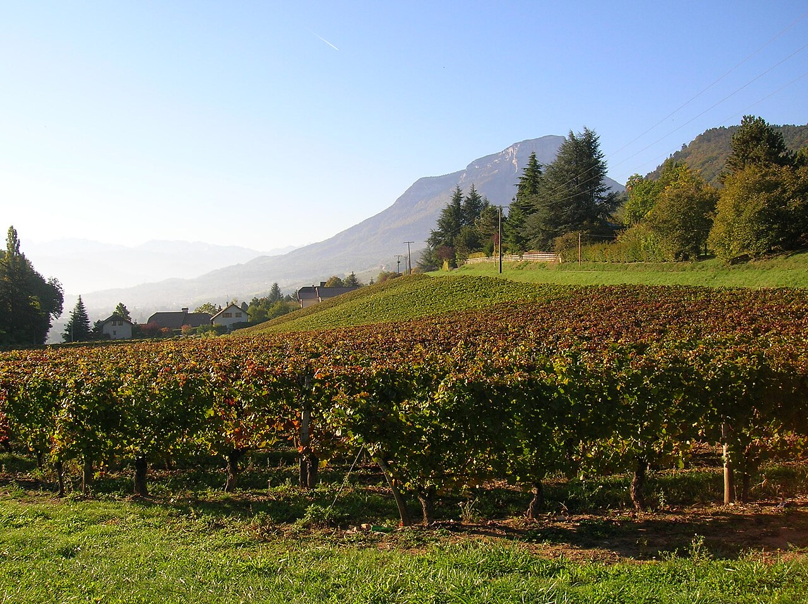

# 萨瓦葡萄酒

萨瓦葡萄酒（Vin de Savoie）是[法国](ref:france)[萨瓦](ref:savoie)产区的区域级法定产区，覆盖萨瓦与上萨瓦多片山谷坡地。白葡萄酒以雅克儿、阿尔泰斯与[霞多丽](ref:chardonnay)为主，红葡萄酒以梦杜斯为主。常见 750 mL，[酒精度](ref:abv)约 11.5%–13.5% vol。

图：萨瓦葡萄酒。图片：Semnoz，CC BY-SA 3.0，via Wikimedia Commons（[原图页面](https://commons.wikimedia.org/wiki/File:0509_Saint-Baldoph_Vignes_3.jpg)）。

## 定义与定位

先分层：[白葡萄酒](ref:white-wine)与[红葡萄酒](ref:red-wine)是类型，雅克儿、阿尔泰斯、霞多丽与梦杜斯是品种，萨瓦葡萄酒是区域级法定产区，具体地理命名与酒庄是更细的层级。酒标上可将产区写为“Vin de Savoie”或“Savoie”。

萨瓦葡萄酒不是一个单一风格，而是覆盖多片山谷的产区框架。旗下有阿普勒蒙、阿比姆、希尼安、蒙梅利安等地理命名；同一产区内的白葡萄酒可以清爽，也可以更饱满，红葡萄酒可以轻盈，也可以更有结构。

## 生产者与品牌

产区以家族酒庄与合作社为主，也有酒商。山地地块零散、面积小，不少酒庄同时生产白、红与起泡多条产品线，并保留本地品种。

生产者、产区与产品是三个层级：产区回答法规与地块范围，生产者回答谁种植、谁酿造、谁装瓶，产品回答年份、颜色与规格。同为萨瓦葡萄酒，不同山谷与酒庄的风格差别明显。

## 「萨瓦葡萄酒」的产地与原料
葡萄园分布在阿尔卑斯山前的山谷与坡地上，海拔从约 250 米延伸到 600 米以上。土壤以石灰岩、泥灰岩与冰川沉积物为主，坡向与海拔决定成熟度。

原料是[葡萄](ref:grape)。白葡萄以雅克儿、阿尔泰斯与霞多丽为主；雅克儿酸度高、香气清淡，阿尔泰斯更饱满，霞多丽带来柑橘与白花。红葡萄以梦杜斯为主，带红果、胡椒与泥土气息。

## 「萨瓦葡萄酒」怎么做出来
白葡萄酒多在低温下发酵，以保留香气与酸度；是否进行苹果酸乳酸发酵决定风格走向，阻断时更清爽，进行时更圆润。部分酒款使用旧桶或带酒泥搅拌，以增加质感。

红葡萄酒通常整串发酵，部分酒庄采用半二氧化碳浸渍，追求较轻的单宁与直接果香；浸渍时间与温度决定颜色与结构。部分酒款进入[橡木桶](ref:oak-ageing)陈年。发酵的基本逻辑可参见[发酵](ref:fermentation)。

## 「萨瓦葡萄酒」的瓶型与标签
常见容量为 750 mL，[酒精度](ref:abv)约 11.5%–13.5% vol，具体随年份、颜色与酒庄变化。标签应核对产区名、地理命名、颜色、年份与装瓶者。

地理命名通常写在产区名之后，例如阿普勒蒙或希尼安；只写“Vin de Savoie”或“Savoie”而不写地理命名的，是产区级常规酒款。以瓶身实际标注为准。

## 「萨瓦葡萄酒」的闻与喝
白葡萄酒以白花、柑橘、青苹果与矿物感为主，酸度高、酒体轻到中等。红葡萄酒以红樱桃、覆盆子、胡椒与泥土气息为主，单宁中等，酸度清晰。

品鉴白葡萄酒建议温度约 8–10 摄氏度，用郁金香形或勃艮第形酒杯；红葡萄酒建议温度约 14–16 摄氏度。注意区分雅克儿、阿尔泰斯与霞多丽带来的风格差异。

## 「萨瓦葡萄酒」的饮用与搭配
白葡萄酒适合海鲜、山地奶酪、禽肉与清淡菜肴；红葡萄酒适合禽肉、熟食、菌菇与烤肉。搭配时避免过辣或过甜的菜式，容易掩盖山地区产区的清爽感。

白葡萄酒开瓶后应冷藏并尽快喝完；红葡萄酒开瓶后可冷藏保存数日。本页关于萨瓦葡萄酒的内容涉及酒精饮料；过量饮酒有害健康，未成年人不应饮酒。

## 「萨瓦葡萄酒」的购买与保存
购买时核对产区名、地理命名、颜色、年份与装瓶者。萨瓦葡萄酒产量小，价格随地理命名、年份与酒庄差异明显，本页不给出具体数字。

未开瓶应避光、平放于阴凉处，理想温度为 12–15 摄氏度，避免高温与剧烈温差。开瓶后抽真空或充惰性气体并冷藏，不宜反复回温。

## 「萨瓦葡萄酒」容易被读错的地方
第一，把萨瓦葡萄酒当成瑞士产品。它是法国法定产区。
第二，认为萨瓦葡萄酒只有白葡萄酒。梦杜斯红葡萄酒也重要。
第三，把“Savoie”与“Vin de Savoie”当成两个产区。它们是同一法定产区的名称写法。
第四，认为山地酒一定酸涩。品种、海拔与成熟度差异很大。
第五，只用价格判断质量。地理命名、年份与装瓶者信息更具体。

萨瓦葡萄酒是一个区域级法定产区，不是单一风格：白葡萄酒以雅克儿、阿尔泰斯与霞多丽为主，红葡萄酒以梦杜斯为主，旗下还有阿普勒蒙、阿比姆、希尼安等具体地理命名。读酒标时先看是大区还是村庄级，再看品种与甜度；山地产区不等于所有酒都轻瘦高酸。

对照阅读：[法国](ref:france)、[白葡萄酒](ref:white-wine)。

**关键事实。**

| 项目 | 内容 |
| --- | --- |
| 一句话定位 | 法国东南部阿尔卑斯山区的区域级法定产区，覆盖萨瓦与上萨瓦多片山谷坡地；白葡萄酒以雅克儿、阿尔泰斯与霞多丽为主，红葡萄酒以梦杜斯为主，旗下有阿普勒蒙、阿比姆、希尼安等地理命名，风格清爽、酸度高，常见 750 mL、酒精度约 11.5%–13.5% vol |
| 酒种/风格 | 白葡萄酒、红葡萄酒 |
| 产区 | 法国、萨瓦 |
| 酒精度 | 11.5–13.5% vol |

**来源与边界。** 本页关于「萨瓦葡萄酒」的关键事实，主要由以下来源交叉核对：INAO（萨瓦葡萄酒法定产区的范围、允许品种与地理命名；由原条目末尾参考资料迁移，未逐条复核访问日期）、European Union（欧盟葡萄酒类别、地理标志与标签规则）、Oxford University Press（提供关于萨瓦、雅克儿与梦杜斯的条目；由原条目末尾参考资料迁移，未逐条复核访问日期）。价格、批次与状态会变，涉及这些字段时以页面所列来源的最新版本为准。正文为项目自写，来源只作核验，不复制原文。

## 参考资料
- [萨瓦](ref:savoie)：萨瓦葡萄酒所属产区的整体框架。
- [白葡萄酒](ref:white-wine)与[红葡萄酒](ref:red-wine)：萨瓦葡萄酒的两个基本类型。
- [霞多丽](ref:chardonnay)：白葡萄酒使用的品种之一。
- [希尼安-贝热龙](ref:chignin-bergeron)：以胡珊酿造的萨瓦白葡萄酒地理命名。
- [萨瓦胡塞特](ref:roussette)：以阿尔泰斯酿造的萨瓦白葡萄酒产区。
- [葡萄](ref:grape)：萨瓦葡萄酒所用葡萄的成熟度、酸度与单宁判断。
- [发酵](ref:fermentation)与[橡木桶陈年](ref:oak-ageing)：红白葡萄酒的基础工艺环节。
- [酒精度](ref:abv)：11.5%–13.5% vol 在标签上的含义。
