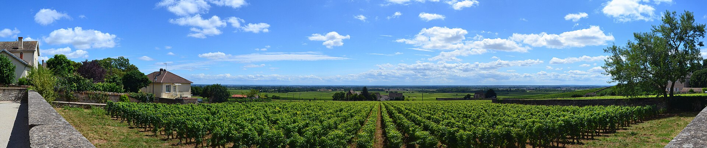

# 沃尔奈

从博讷向西南走，坡地逐渐收窄，葡萄园贴着石灰岩坡脚向上铺开，沃尔奈就长在这条坡上。它是伯恩丘的村庄级[红葡萄酒](ref:red-wine)法定产区，全部以[黑皮诺](ref:pinot-noir)酿造，村内有多处一级园，却没有特级园。常见容量 750 mL，[酒精度](ref:abv)约 12.5%–13.5% vol。

图：沃尔奈相关实景照片。图片：MartinD，CC BY-SA 4.0，via Wikimedia Commons（[原图页面](https://commons.wikimedia.org/wiki/File:Volnay_vinyards_panorama.jpg)）。

## 卡耶雷与公爵园：沃尔奈的一级园名单

在[勃艮第](ref:burgundy)的分级里，沃尔奈代表一级园包括卡耶雷（Les Caillerets）、公爵园（Clos des Ducs）与尚庞（Champans）。卡耶雷坡位高、土层薄，酒风细而紧，矿物感清楚；公爵园是单一所有园，形状狭长、坡度明显，常被当作沃尔奈结构的代表；尚庞面积更大、位置更靠下，酒体更圆，果味更外放。

这份名单说明：沃尔奈的“轻”是带骨架的轻。坡位高的地块给出更紧的单宁与更清楚的酸度，坡下地块给出更讨喜的果味。选酒时看地块，比看村名更能预测风格。

## 坡地、石灰岩与“女性化”说法的来处

沃尔奈的葡萄园多在中等海拔的坡面上，朝向东或东南，表土薄，底层是石灰岩与泥灰岩，排水快，根系扎得深。这样的[法国](ref:france)坡地让[葡萄](ref:grape)成熟偏慢，酸度保留，单宁细，香气偏花香与红果。坡顶与坡脚的区别在沃尔奈尤其明显：高处给的酒更瘦、更咸鲜，低处给的酒更圆、更讨喜；同一酒庄在不同地块也可能呈现两种面貌。

“伯恩丘最女性化的红酒村”是一个流传很久的说法，指的是香气细、单宁柔、酒体轻。但它是一种印象，不是等级，也不代表酒薄。把这句话当成风格提示可以，当成品质结论就会误判。

## 与波玛的一墙之隔：轻盈与坚实的对照

沃尔奈与[波玛](ref:pommard)接壤，风格却常被放在光谱的两端：沃尔奈更轻、更香、单宁更细，红果与紫罗兰更突出；波玛更厚、更硬、泥土感更重，年轻时更需要时间。同一年份、相近等级对比，差别最清楚。

这种差异来自坡位、土层与萃取传统，不是“品种不同”。两边都是黑皮诺，差别在于酒想要表达什么：沃尔奈追求香气的清晰与质地的细，波玛追求结构与力量。

## 桑特诺与边界：被误读的地块归属

桑特诺（Santenots）是沃尔奈一级园中容易被误读的一块：它的多数地块位于默尔索市镇范围内，却可以按沃尔奈一级园标注红酒；同一片坡地上的白酒则归默尔索。行政边界与产区边界在这里并不重合。

类似的边界情况提醒饮者：酒标上的村名是法规结果，不一定等于葡萄园所在的市镇。买一级园时，看清完整地块名与产区写法，比记住村庄位置更可靠。默尔索以白酒闻名，沃尔奈以红酒闻名，这条边界正好把两种酒分开。

## 轻柔萃取与整串的取舍

沃尔奈红酒以[发酵](ref:fermentation)为基础，多数酒庄采用较温和的浸渍，以保留果味、花香与细单宁；部分酒庄使用一定比例的整串，增加香料与骨架。之后是[橡木桶陈年](ref:oak-ageing)，新桶比例不宜过高，否则会盖住花香。

具体参数属于酒庄，本页不给统一数值。判断萃取是否克制，可以看中段是否有清楚的果味与花香，而不是只剩桶味与干涩的单宁。轻不等于淡，萃取不足同样会让酒在中段塌陷。过早采收会放大酸度与草本气息，过晚采收则会让花香变熟、质地变厚，采摘窗口比其他村更窄。

## 酒标与一级园名称

常规容量 750 mL，[酒精度](ref:abv)约 12.5%–13.5% vol。村庄级写 Volnay；一级园写 Volnay Premier Cru 加地块名；村内没有特级园，所以不会出现 Grand Cru。公爵园、卡耶雷这类名称会直接印在酒标上，拼写与地块归属要核对。

还要看装瓶者与进口商。酒庄自装与酒商装瓶是两条不同的责任链；同一地块在不同装瓶者手里，风格可能差别很大。背标只说明流通，不说明酒质。

## 沃尔奈的年份：香气与酸度的平衡

暖年通常带来更熟的果味、更低的酸度与更饱满的酒体，沃尔奈会显得更“肉”，花香可能被熟果盖住；冷年保留更高的酸度与更清楚的花香，单宁更明显，酒更瘦也更需要时间。多雨或冰雹年份产量下降、成熟不均，酒可能偏薄偏紧。

同一村内，坡位高的卡耶雷一带在冷年更容易紧，坡下的尚庞一带在暖年更容易丰满。这里只谈方向，不列年份评分。

## 沃尔奈的档位与瓶况判断

按相对档位看：村庄级是入口，一级园最高，村内没有特级园这一层。一级园内部，卡耶雷、公爵园与尚庞通常站在名声前列，单一所有园又有额外溢价。本页不写具体价格。

判断方法：确认酒标写的是 Volnay 还是 Volnay Premier Cru，再看地块名、装瓶者、年份与瓶况。村庄级也能给出典型的沃尔奈香气，不必只盯一级园；反过来，一级园若年份或瓶况不佳，也可能不如一瓶状态好的村庄级。

## 沃尔奈常见的误读

第一，认为没有特级园就等于品质低。沃尔奈的一级园可以给出很高的精细度，等级不等于品质。
第二，把“女性化”当成“单薄”。沃尔奈轻，但坡位高的地块有清楚的骨架与陈年能力。
第三，以为桑特诺全部在沃尔奈村内。它的多数地块位于默尔索市镇，却可按沃尔奈一级园标注红酒。
第四，以为公爵园是特级园。它是一级园中的单一所有园，不是特级园。
第五，认为沃尔奈只能年轻时喝。村庄级适合中短期，一级园可以陈年，只是节奏与波玛不同。

对照阅读：[红葡萄酒](ref:red-wine)、[勃艮第](ref:burgundy)。

**关键事实。**

| 项目 | 内容 |
| --- | --- |
| 一句话定位 | 法国勃艮第伯恩丘沃尔奈村的村庄级法定产区，位于博讷西南；村内有多处一级园但没有特级园，风格以细腻香气、红果与花香著称，通常比波玛更轻盈，常见 750 mL、酒精度约 12.5%–13.5% vol |
| 酒种/风格 | 红葡萄酒 |
| 产区 | 法国、勃艮第 |
| 酒精度 | 12.5–13.5% vol |

**来源与边界。** 本页关于「沃尔奈」的关键事实，主要由以下来源交叉核对：INAO（沃尔奈法定产区的范围、等级与品种规则；由原条目末尾参考资料迁移，未逐条复核访问日期）、BIVB（沃尔奈的一级园、土壤与风格特征；由原条目末尾参考资料迁移，未逐条复核访问日期）、Oxford University Press（提供关于沃尔奈与黑皮诺的条目；由原条目末尾参考资料迁移，未逐条复核访问日期）。价格、批次与状态会变，涉及这些字段时以页面所列来源的最新版本为准。正文为项目自写，来源只作核验，不复制原文。
