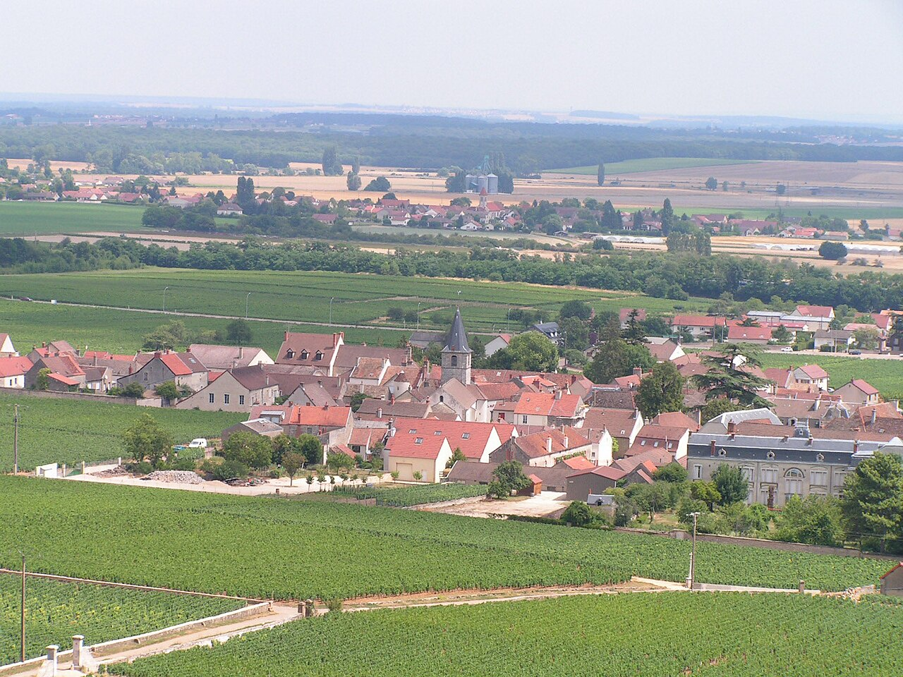

# 沃恩-罗曼尼

提到沃恩-罗曼尼，很多人先想到拍卖槌和价格，然后才是土壤。这个顺序值得纠正：它是勃艮第夜丘的村庄级[红葡萄酒](ref:red-wine)法定产区，全部以[黑皮诺](ref:pinot-noir)酿造；真正让它区别于其他村庄的，是密集的特级园与坡地结构。村内及产区周边共有 8 个特级园。常见容量 750 mL，[酒精度](ref:abv)约 12.5%–13.5% vol。

图：沃恩-罗曼尼。图片：Olivier Vanpé，CC BY-SA 2.5，via Wikimedia Commons（[原图页面](https://commons.wikimedia.org/wiki/File:Vosne-Romanee.jpg)）。

## 八座特级园在地图上的排列

这 8 个特级园是罗曼尼·康帝（Romanée-Conti）、拉罗曼尼（La Romanée）、拉塔希（La Tâche）、里奇堡（Richebourg）、罗曼尼-圣维旺（Romanée-Saint-Vivant）、埃舍索（Échezeaux）、大埃舍索（Grands-Échezeaux）与大街（La Grande Rue）。它们并不都落在村界以内：埃舍索与大埃舍索位于弗拉热-埃舍索市镇，却属于沃恩-罗曼尼产区的法定范围；大街在 1992 年才晋升为特级园。读[勃艮第](ref:burgundy)的地块图时，要把行政边界与产区边界分开看。

## 罗曼尼·康帝与“约 1.81 公顷”

罗曼尼·康帝是一块约 1.81 公顷的单一所有园，也是酒庄与酒款的名字，不是产区名。它的法定产区仍然写作沃恩-罗曼尼。面积小、产量低、需求集中，三者叠加，形成了市场上近乎符号化的地位。类似的情形还有拉罗曼尼，约 0.85 公顷，同样为单一所有者持有。

把[罗曼尼·康帝](ref:romaneeconti)当成一个“产区”是常见误会。酒标上写的是酒庄与地块，产区的法规框架在背后。对饮者来说，理解这一层比记住价格更重要：它首先是一款黑皮诺，其次才是一个符号。

## 香料、红果与丝绒质地

年轻酒款以红樱桃、覆盆子、紫罗兰与香料气息为主，香料里常见肉桂、丁香与甘草的影子；酸度中等偏高，单宁细，酒体中等，质地是它的标识——入口柔，收尾却有支撑。随着陈年，会发展出干花、皮革、松露与林地气息；特级园通常层次更深，余味更长。

这种质地不等于轻。它的结构藏在后面，前段柔顺，中后段才显出力量。判断一款沃恩是否做得好，可以看香料与红果是否清楚、单宁是否细而不薄，而不是只看入口的顺滑。

## 与夜圣乔治、香波-米西尼的差异

与[夜圣乔治](ref:nuits)相比，沃恩-罗曼尼更细、更香，单宁更收敛，黑果与泥土感更少；夜圣乔治更硬、更外显，咀嚼感更强。与香波-米西尼相比，沃恩多一分香料与重量，少一分纯粹的花香与轻盈。三者排在一起，沃恩的位置在中间偏“香与滑”。

这个坐标对选购有用：想要更硬的骨架，往北看夜圣乔治；想要更飘的花香，往南看香波；想要香料、丝绒与陈年潜力兼得，才是沃恩的理由。

## 沃恩的坡面、泥灰岩与排水

葡萄园主要落在东坡与东南坡的中段，坡面提供排水与日照，表土薄，底层是石灰岩与泥灰岩，部分地块黏土比例更高。土层厚薄与排水快慢，直接造成同一村内的风格差。一级园中的 Cros Parantoux 因亨利·贾伊的耕耘而广为人知，它的坡位与薄土，正是这种差异的缩影。

[法国](ref:france)的这块坡地让[葡萄](ref:grape)在偏凉的年份也能保持成熟度，在偏热的年份则需要控制产量与采收时机。土壤不是背景板，它决定了酒体是偏细还是偏厚。

## 酿造与装瓶：谁在决定风格

红葡萄酒以[发酵](ref:fermentation)为基础，浸渍温度、时长与萃取强度决定颜色、单宁与香气走向。部分酒庄使用较高比例的整串发酵，增加香料与清凉感；之后是[橡木桶陈年](ref:oak-ageing)，新桶比例因酒庄与等级而异。特级园与村庄级的差异，更多来自地块与产量，而不是某一种固定工艺。

装瓶结构也影响风格。单一所有的特级园由一家酒庄完整掌控；持有人分散的特级园则由多家分别装瓶，酒款之间的差别可能比村庄级与一级园之间还大。具体参数属于酒庄，本页不给统一数值。

## 沃恩的年份：厚度与细节的拉扯

暖年通常带来更熟的果味、更低的酸度与更饱满的酒体，香料往甜香方向偏，丝绒感更明显，但细节可能被厚度盖住。冷年保留更高的酸度与更清楚的花香，单宁更明显，酒需要更长时间打开。多雨或冰雹年份产量下降、成熟不均，酒可能更紧更薄。

同一村内，坡位与土层会放大或缓冲年份的影响：薄土、排水快的地块在冷年更容易紧，厚土地块在暖年更容易重。这里只谈方向，不列年份评分。

## 沃恩的档位与渠道判断

按相对档位看：村庄级是入口，一级园居中，特级园最高。特级园内部也不能一概而论：罗曼尼·康帝与拉塔希的需求最集中，大街、埃舍索与大埃舍索在特级园里相对更可及，但仍属高价档。本页不写具体价格。

判断方法：先确认酒标写的是村庄级、一级园还是特级园，再核对地块名、酒庄与装瓶者，最后看瓶况与来源。二级市场与拍卖的低价酒要特别留意储存史；同一款酒的价差，多数来自渠道、年份与瓶况，而不是酒质本身。

## 沃恩最容易被误读的几件事

第一，把罗曼尼·康帝当成产区名。它是酒庄与酒款名，产区名是沃恩-罗曼尼。
第二，以为 8 个特级园都在村界内。埃舍索与大埃舍索位于弗拉热-埃舍索市镇，但属于沃恩-罗曼尼产区。
第三，以为大街一直是特级园。它在 1992 年才晋升。
第四，以为沃恩的酒都贵得离谱。村庄级与部分一级园仍有相对可及的档位。
第五，认为香料味一定来自橡木桶。香料也可能来自整串发酵与果皮，不能只凭香气判断工艺。

**关键事实。**

| 项目 | 内容 |
| --- | --- |
| 一句话定位 | 法国勃艮第夜丘沃恩-罗曼尼的村庄级法定产区，以黑皮诺酿造红葡萄酒；村内及产区周边共有八个特级园，包括罗曼尼·康帝 1.81 公顷的单一所有园，风格以香料、红果、丝绒质地与长陈年潜力著称，常见 750 mL、酒精度约 12.5%–13.5% vol |
| 酒种/风格 | 红葡萄酒 |
| 产区 | 法国、勃艮第 |
| 酒精度 | 12.5–13.5% vol |

**来源与边界。** 本页关于「沃恩-罗曼尼」的关键事实，主要由以下来源交叉核对：INAO（沃恩-罗曼尼法定产区的范围、品种与特级园名单；由原条目末尾参考资料迁移，未逐条复核访问日期）、BIVB（夜丘村庄体系、地块与风格；由原条目末尾参考资料迁移，未逐条复核访问日期）、Oxford University Press（提供关于沃恩-罗曼尼与黑皮诺的条目；由原条目末尾参考资料迁移，未逐条复核访问日期）。价格、批次与状态会变，涉及这些字段时以页面所列来源的最新版本为准。正文为项目自写，来源只作核验，不复制原文。
