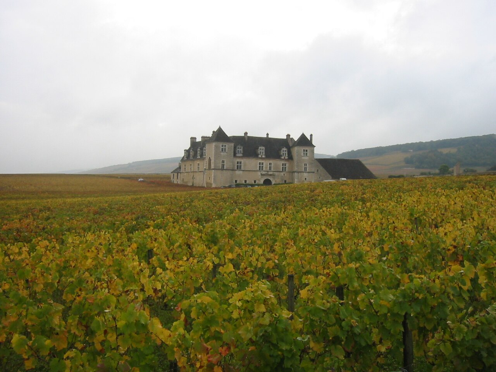

# 武若

武若（Vougeot）在今天的地图上只是夜丘中段一个人口很少的小村，但它的名字几乎等同于一片被石墙围起来的葡萄园。村域内只有一座特级园——武若园（Clos de Vougeot），约 50 公顷，四周由石墙圈定；村内没有一级园，村庄级的酒则来自墙外零散的小地块。于是这里的酒标呈现出少见的结构：村名与园名指向同一片山坡，却分属两个法规层级。常见 750 mL，[酒精度](ref:abv)约 12.5%–13.5% vol，[红葡萄酒](ref:red-wine)以[黑皮诺](ref:pinot-noir)酿造，[白葡萄酒](ref:white-wine)以[霞多丽](ref:chardonnay)酿造且产量很小。

图：武若。图片：Wikimedia Commons contributor，CC BY-SA 3.0，via Wikimedia Commons（[原图页面](https://commons.wikimedia.org/wiki/File:Chateau_du_clos_de_Vougeot_2.JPG)）。

> **先给结论**
> **一句话：** 这页判断武若适不适合你，以及怎么喝、怎么搭。
>
> - **适合谁：** 想弄懂武若是什么、怎么喝、适合什么场景的人。
> - **不适合谁：** 只找最低价购买链接、不关心风味和使用场景的人。
> - **先看这两点：**
>   - 暖年通常带来更深的颜色、更成熟的黑色果味与更饱满的酒体，酸度偏低，单宁更容易显得圆润；冷年则保留更高的酸度，红果与花香更突出，酒体偏瘦，单宁线条更硬。
>   - 村庄级武若数量少，通常定价接近邻村的一级园；武若园的价格带宽很大，明星酒庄与坡位较好的地块在高位，知名度较低的小业主可能在相对低位。

## 一堵石墙与一个村庄的错位

把武若拆成三层来看会清楚一些：[红葡萄酒](ref:red-wine)与[白葡萄酒](ref:white-wine)是酒的类型，黑皮诺与霞多丽是品种，武若是法定产区（AOC），而具体酒庄与酒款属于生产者层面。武若既是一个村名，也是酒标上可以单独出现的村庄级产区名。墙内的武若园是特级园，墙外的零散地块只能标村庄级；两者共享同一个村名，却不是同一件事。

这种错位在勃艮第并不常见。多数村庄先有村庄级声誉，再从中划出特级园；武若的顺序几乎相反，是特级园的名声覆盖了整个村庄。于是消费者容易把「武若」直接理解为那座园，而忽略了村庄级的存在。买酒时先看层级，再看园名与装瓶者，能避免把两种身份混为一谈。

## 武若园内部的坡位、土层与朝向

武若位于[法国](ref:france)[勃艮第](ref:burgundy)夜丘中段最窄的一段谷地，葡萄园集中在村南，坡面大致朝东与东南。土壤以石灰岩与泥灰岩为底，坡上土层薄、碎石多、排水快；坡脚黏土比例上升，保水能力更强。约 50 公顷的武若园从坡顶延伸到坡脚，海拔落差不算悬殊，但土层厚度与排水条件的差别足以让同一园名下的酒出现明显分化：靠近坡顶与城堡一侧通常更轻盈、更偏花香；靠近坡脚与公路一侧更饱满、骨架更明显。坡向、行距与地块形状也会影响成熟节奏。具体边界以产区官方划界为准。

这也解释了为什么同一款 Clos de Vougeot 在不同酒庄手里会像两个村子。园地面积大、业主多、地块碎，任何关于「武若园风格」的概括都只能落在中间值上；真正决定一瓶酒走向的，往往是那一小块地的位置与那年采收时的状态。

## 西多会修士、围墙与今天的边界

武若园由西多会（Cîteaux）修士在 12 世纪开创，石墙与城堡的主体通常追溯到 16 世纪。围墙最初是管理与劳作的边界，后来成为这片园地的象征。法国大革命之后，教产被拆分出售，园地逐渐分散到众多业主手中；今天墙内由数十家酒庄分块持有，单一所有者只占很小一部分。因此，围墙告诉我们历史，不告诉我们某一瓶酒的质量。

葡萄的原料本身是[葡萄](ref:grape)，红白两类都来自同一套品种框架。理解这段历史的意义在于：武若园的边界是人为划定的，墙内并不存在均匀一致的「特级园土壤」。把围墙、城堡或园名当作质量保证，往往会在开瓶后失望。

## 数十位业主共有的特级园

同一个 Clos de Vougeot 名称下，装瓶者才是关键信息。大酒商、家族酒庄与小型经营者都可能持有地块；有的酒庄只拥有一两行葡萄，有的持有连续几块。坡位、树龄、耕作方式与酿造取向叠加，使同名酒款的风格跨度很大。村庄级武若产量很小，常见于酒庄的入门酒款，市场上并不常见，白葡萄酒更是如此。

生产者、产区与产品是三个层级：产区回答法规与地块范围，生产者回答谁种植、谁酿造、谁装瓶，产品回答年份、层级与红白类型。看到 Clos de Vougeot 时，先确认装瓶者与地块信息，再谈风格，比只看园名可靠得多。酒标上的装瓶者、进口商与背标信息，是判断身份的第一道线索。

## 酿造：整串比例与新桶的克制

红葡萄采收后通常经过分拣，部分生产者保留一定比例的整串，以增加香气层次与结构；发酵在控温容器中进行，浸渍时间与温度决定颜色、单宁与香气的走向。[发酵](ref:fermentation)完成后进入[橡木桶陈年](ref:oak-ageing)，特级园的新桶比例通常高于村庄级，但并非越高越好：武若的果味偏细，过重的新桶会掩盖花香与矿物感。白葡萄酒经压榨后发酵，部分酒款进行酒泥搅拌以增加质地。装瓶前是否澄清过滤，取决于生产者。

值得一提的是，武若园面积大，不同业主的采收成熟度差异也大，这使「整串比例」与「新桶比例」在同一园名下呈现出很宽的区间。与其记某个固定配方，不如把酿造信息当作判断装瓶者取向的线索。

## 与香波-米西尼、沃恩-罗曼尼的风味分野

武若红酒的典型香气是红樱桃、黑樱桃、紫罗兰与湿润泥土，陈年后出现菌菇、落叶与淡淡香料；入口酸度清晰，单宁中等偏上，酒体中等。与北侧的[香波-米西尼](ref:chambolle)相比，武若更厚、更接地气，香波则更纤细、更偏花香与丝滑质地；与南侧的[沃恩-罗曼尼](ref:vosne)相比，武若的香料感与浓郁度都更收敛，沃恩通常更华丽、更甜润。用一句话概括：香波更香，沃恩更浓，武若更硬一些、更有泥土气。

白葡萄酒常见柑橘、白花与燧石矿物感，产量小，风格不如红酒那样具有代表性。品鉴温度红葡萄酒约 15–17 摄氏度，白葡萄酒约 10–12 摄氏度。温度过高会让武若的单宁显得粗糙，过低则把花香压住。

## 暖年与冷年：武若园如何变化

暖年通常带来更深的颜色、更成熟的黑色果味与更饱满的酒体，酸度偏低，单宁更容易显得圆润；冷年则保留更高的酸度，红果与花香更突出，酒体偏瘦，单宁线条更硬。武若园坡脚的黏土在雨水多的年份保水更多，成熟节奏可能不齐；坡上排水快，反而更容易在湿年保持较好的果实状态。采收期的降雨会影响稀释程度，分拣与地块选择因此格外重要。

对买家来说，暖年的武若更容易在年轻时讨喜，冷年则需要更多耐心；同一酒庄的暖年与冷年放在一起比较，比跨酒庄比较更能看出年份的作用。这里只谈方向，不给年份打分。

## 从装瓶者与坡位判断价格档

村庄级武若数量少，通常定价接近邻村的一级园；武若园的价格带宽很大，明星酒庄与坡位较好的地块在高位，知名度较低的小业主可能在相对低位。同一酒庄不同年份、同一村不同装瓶者之间比较，比跨村比较更有意义。判断时应看装瓶者、地块位置、年份与背标信息，而不是只看「Clos de Vougeot」这几个字。

价格并不是质量的直接刻度：同一个园名可以覆盖从入门到高价的多档产品。若预算有限，村庄级或知名度较低业主的武若园，往往比追明星酒庄更能体现这片园地的本来面貌。本页不给出具体价格。

## 围墙、村名与园名的五个误区

第一，把围墙或城堡当成质量保证。围墙是历史边界，不保证每一块地块的质量。
第二，把村名与武若园当成同义词。村庄级与特级园是两个法规层级。
第三，以为武若有一级园。本村只有村庄级与特级园两个层级。
第四，以为武若园由一家酒庄独占。它由数十家所有者分块持有，装瓶者才是关键。
第五，以为武若只产红酒。村庄级也产少量白葡萄酒，只是市场上不常见。

## 延伸阅读

- [红葡萄酒](ref:red-wine)：本页红酒所属的葡萄酒大类。
- [红葡萄酒](ref:red-wine)：武若所属的静止红葡萄酒大类。
- [黑皮诺](ref:pinot-noir)：红葡萄酒使用的葡萄品种。
- [霞多丽](ref:chardonnay)：白葡萄酒使用的葡萄品种。
- [法国](ref:france)：法国葡萄酒法规与产区体系。
- [勃艮第](ref:burgundy)：本页所属产区的分级框架。
- [葡萄](ref:grape)：武若所用葡萄的成熟度、酸度与单宁判断。
- [发酵](ref:fermentation)：浸渍与发酵的基本逻辑。
- [橡木桶陈年](ref:oak-ageing)：武若的桶陈时长、香气整合与结构变化。
- [酒精度](ref:abv)：12.5%–13.5% vol 在标签上的含义。
- [香波-米西尼](ref:chambolle)：北侧相邻的村庄级产区。
- [沃恩-罗曼尼](ref:vosne)：南侧相邻的村庄级产区。
