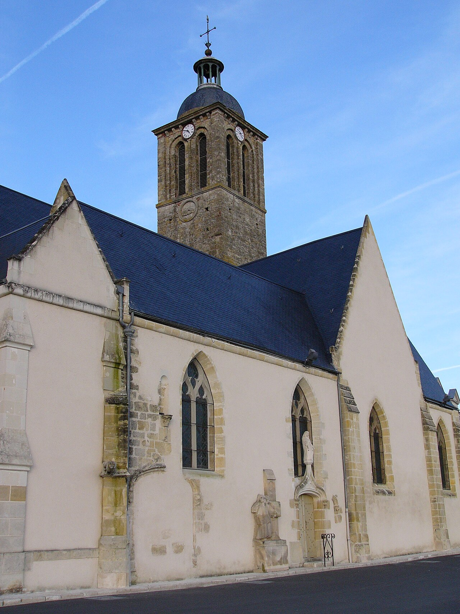

# 武弗雷

武弗雷是法国[卢瓦尔河谷](ref:france)都兰地区的白诗南法定产区，位于卢瓦尔河右岸、图尔以东。同一产区内可以产出干型、半干、甜型与起泡酒，风格跨度很大，但品种只有[白诗南](ref:chenin-blanc)。酒以榅桲、苹果、蜂蜜与燧石矿物感著称，常见 750 mL，[酒精度](ref:abv)约 11%–13.5% vol。

图：武弗雷。图片：Croquant，CC BY-SA 4.0，via Wikimedia Commons（[原图页面](https://commons.wikimedia.org/wiki/File:Vouvray_%C3%A9glise.jpg)）。

## 定义与定位

先分层：[白葡萄酒](ref:white-wine)是大类，白诗南是品种，武弗雷是法定产区（AOC），具体酒庄与酒款是生产者层面。武弗雷既是地名，也是可以标注在酒标上的产区名，不能与某个品牌混同。

武弗雷的特殊之处在于，同一产区名称下并存多种甜度与形态：干型、半干、甜型，以及传统法起泡酒。看到“Vouvray”时，必须同时看甜度标注与是否起泡，不能只凭产区名判断风格。

## 生产者与品牌

武弗雷的生产者包括家族酒庄、合作社与酒商，白诗南的甜度与年份差异大。酒庄自有地块并自行装瓶，风格更贴近园地；酒商酒可能收购多个地块。看酒标上的装瓶者与甜度标注，比只看产区名更可靠。

生产者、产区与产品是三个层级：产区回答法规与地理范围，生产者回答谁种植、谁酿造、谁装瓶，产品回答年份、甜度与规格。同一产区内不同酒庄的风格差异明显，不能用一款酒概括整个产区。

## 「武弗雷」的产地与原料
武弗雷位于[法国](ref:france)卢瓦尔河谷的都兰地区，卢瓦尔河右岸。气候受海洋与大陆性影响，秋季较为稳定，利于晚收与贵腐菌发展。土壤以凝灰岩（tuffeau）与黏土为主，部分地块含燧石，排水性与蓄热能力影响成熟节奏。

凝灰岩是当地建筑与酒窖的常见材料，许多酒庄在岩层中开凿酒窖，恒温恒湿的条件有利于陈年。原料是[葡萄](ref:grape)，品种为[白诗南](ref:chenin-blanc)，产区规则规定白葡萄酒以白诗南酿造。

## 「武弗雷」怎么做出来
干型武弗雷通常在不锈钢罐或旧橡木桶中完成[发酵](ref:fermentation)，保留酸度与果味；部分酒庄使用[橡木桶陈年](ref:oak-ageing)增加质地与坚果气息。半干与甜型则通过中止发酵或让残糖保留，甜度高低取决于采收成熟度与发酵终止点。

起泡武弗雷采用传统法，在瓶中进行二次发酵，气泡细腻、酸度高，风格从清爽到饱满都有。武弗雷的甜度由采收成熟度与发酵终止点决定，起泡版还要经过瓶中二次发酵；这些参数酒庄之间差异很大，具体以酒庄资料与瓶标为准。

## 「武弗雷」的瓶型与标签
常见容量为 750 mL，[酒精度](ref:abv)约 11%–13.5% vol，甜型与晚收酒款可能更高。标签应核对产区名、年份、甜度标注（sec、demi-sec、moelleux 等）、是否起泡、装瓶者与进口商信息。

武弗雷在不同市场的标签语言不同，以瓶身实际标注为准。甜度词的含义有法规约束，但不同酒庄的实际口感仍有差异，购买时最好结合酒精度与年份判断。

## 「武弗雷」的闻与喝
干型武弗雷以榅桲、苹果、梨、洋甘菊与燧石矿物感为主，酸度高、酒体中等；半干与甜型会增加蜂蜜、杏子与橙皮香气，口感更浓稠。陈年后会出现蜂蜜、干果与烤面包气息，优质甜型可以陈年很久。

品鉴时建议温度约 10–12 摄氏度，甜型可更低。闻香时注意果味与矿物感的清晰度，过度橡木或过熟果味会让酒显得厚重。甜型要注意酸度是否足以平衡残糖。

## 「武弗雷」的饮用与搭配
干型适合搭配山羊奶酪、海鲜、白肉与清淡酱汁；半干与甜型适合搭配水果塔、蓝纹奶酪与鹅肝。起泡武弗雷可作为开胃酒，搭配咸味小食与油炸食物。

多数干型适合在 3–8 年内饮用，优质甜型与起泡酒可以更久；具体适饮窗口因年份与酒庄而异。开瓶后应冷藏并尽快饮用。本页关于武弗雷的内容涉及酒精饮料；过量饮酒有害健康，未成年人不应饮酒。

## 「武弗雷」的购买与保存
购买时优先选择正规渠道，核对产区名、甜度标注、年份与装瓶者信息。价格随甜度、年份与酒庄声誉差异明显，本页不给出具体数字。甜度标注不等于质量等级，风格适配更重要。

就「武弗雷」而言，未开瓶应避光、平放于阴凉处，理想温度为 10–13 摄氏度，避免高温与剧烈温差。软木塞封瓶需保持湿度；长期存放可平放。开瓶后冷藏并尽快饮用，甜酒氧化较慢，但香气仍会下降。

## 「武弗雷」容易被读错的地方
第一，把武弗雷当成甜酒产区。干型与起泡酒同样重要。
第二，认为武弗雷可以混酿其他品种。白葡萄酒以白诗南酿造。
第三，把甜度标注当成质量等级。它描述残糖水平，不是品质排序。
第四，认为陈年只适用于红葡萄酒。优质武弗雷干白与甜白都能陈年。
第五，用价格或包装判断真伪。渠道、背标与装瓶者信息更可靠。

**关键事实。**

| 项目 | 内容 |
| --- | --- |
| 一句话定位 | 法国卢瓦尔河谷都兰地区的白诗南法定产区，位于卢瓦尔河右岸图尔以东；同一产区内可产干型、半干、甜型与起泡酒，以榅桲、苹果、蜂蜜与燧石矿物感著称，常见 750 mL、酒精度约 11%–13.5% vol |
| 酒种/风格 | 白葡萄酒 |
| 产区 | 法国、卢瓦尔河谷 |
| 酒精度 | 11–13.5% vol |

**来源与边界。** 本页关于「武弗雷」的关键事实，主要由以下来源交叉核对：INAO（武弗雷法定产区的范围、品种与甜度标注规则；由原条目末尾参考资料迁移，未逐条复核访问日期）、InterLoire（武弗雷的土壤、风格类型与起泡酒传统；由原条目末尾参考资料迁移，未逐条复核访问日期）、Oxford University Press（提供关于武弗雷与白诗南的条目；由原条目末尾参考资料迁移，未逐条复核访问日期）。价格、批次与状态会变，涉及这些字段时以页面所列来源的最新版本为准。正文为项目自写，来源只作核验，不复制原文。

## 参考资料
- [白葡萄酒](ref:white-wine)：武弗雷所属的葡萄酒大类。
- [白诗南](ref:chenin-blanc)：武弗雷白葡萄酒的唯一品种。
- [法国](ref:france)：法国葡萄酒法规与产区体系。
- [卢瓦尔河谷](ref:loire)：武弗雷所在的产区带与子产区框架。
- [葡萄](ref:grape)：武弗雷所用葡萄的成熟度、酸度与单宁判断。
- [发酵](ref:fermentation)：残糖控制与甜度形成的基本逻辑。
- [橡木桶陈年](ref:oak-ageing)：质地与坚果气息的来源之一。
- [酒精度](ref:abv)：11%–13.5% vol 在标签上的含义。
