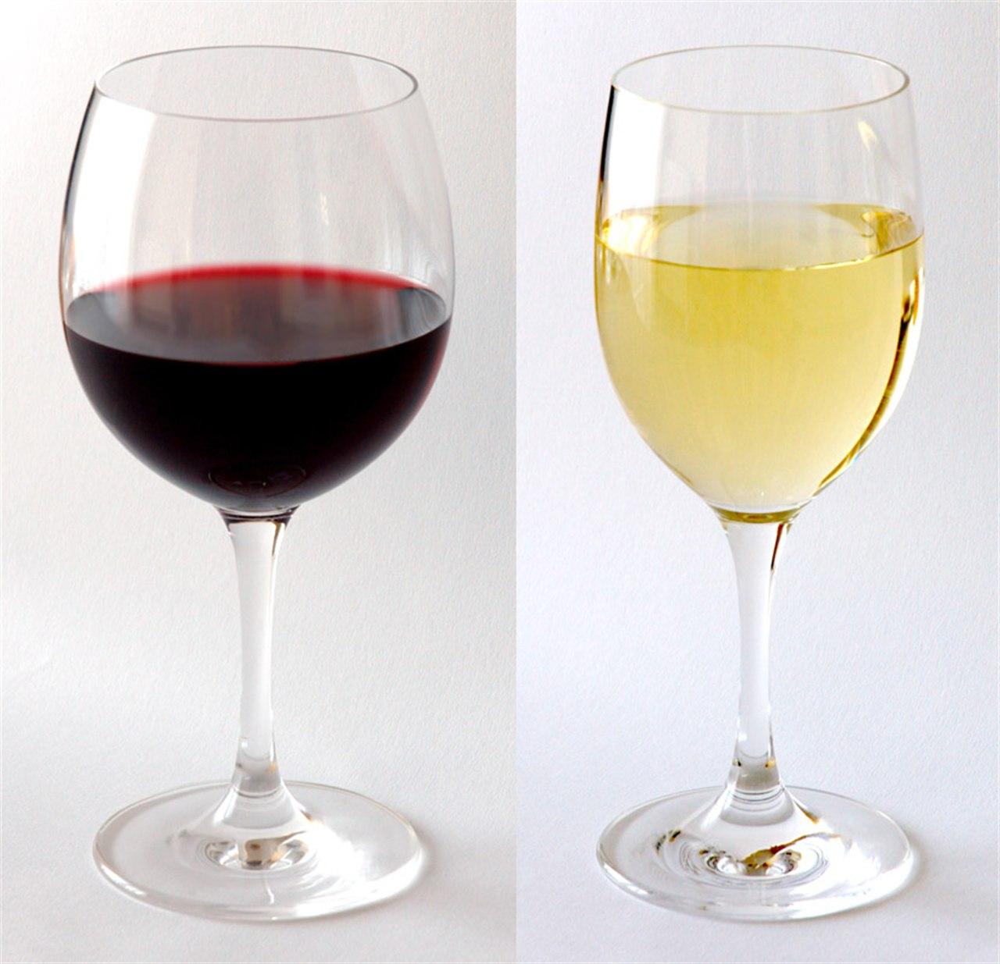

# 伊慕沙尔霍夫贝格雷司令

伊慕沙尔霍夫贝格雷司令是德国摩泽尔萨尔河谷伊慕家族酒庄的代表酒款，产自沙尔霍夫贝格园，以板岩土壤、高酸度与相对低的酒精度著称。常见 750 mL，酒精度多在 7.5%–10% vol，具体数值随年份与等级变化。

图：伊慕沙尔霍夫贝格雷司令所属的葡萄酒类别配图。图片：André Karwath，CC BY-SA 2.5，via Wikimedia Commons（[原图页面](https://commons.wikimedia.org/wiki/File:Red_and_white_wine_in_glass.jpg)）。这张图片用于标识品类，不是伊慕沙尔霍夫贝格雷司令的产品、包装或门店实拍。

## 定义与定位

先分层：白葡萄酒是大类，雷司令是品种，摩泽尔是产区，伊慕是酒庄与品牌，沙尔霍夫贝格雷司令是具体产品。四层分开看，才能区分品种特性、园地风土与酒庄工艺。

它不是甜酒或起泡酒，也不是单一“干型”产品：德国雷司令按采收成熟度分级，从 Kabinett 到 Trockenbeerenauslese 都可能出自同一酒庄，甜度与酒精度随之变化。购买时应把等级、年份与瓶标上的酒精度一起读。

## 生产者与品牌

伊慕家族酒庄位于德国摩泽尔产区的萨尔河谷，公开资料把家族经营的历史追溯到 18 世纪末。酒庄以沙尔霍夫贝格园的雷司令为核心，产品覆盖多个成熟度等级，是德国雷司令的代表性生产者之一。

Egon Müller 的酒庄与品牌同名，核心产品来自 Saar 的 Scharzhof 与 Scharzhofberger 园；酒标上的 AP 编号、年份与 Prädikat 等级才是具体身份。家族历史可以解释风格传承，但不能替代这些可核对的信息。

## 「伊慕沙尔霍夫贝格雷司令」的产地与原料
产品产自[德国](ref:germany)摩泽尔产区的萨尔河谷。这一带气候偏凉，葡萄成熟期长，板岩土壤排水性好、蓄热能力强，帮助葡萄在凉爽环境中达到成熟；陡坡园地需要人工耕作，产量控制较严。

原料是[葡萄](ref:grape)，品种为[雷司令](ref:riesling)。雷司令属于晚熟品种，酸度高、香气以柑橘、青苹果与矿物感为主，适合在凉爽产区种植。具体园地边界与土壤类型以产区官方资料为准，本页不把“板岩”当成所有摩泽尔酒的统一解释。

## 「伊慕沙尔霍夫贝格雷司令」怎么做出来
采收后的葡萄经压榨取汁，由酵母进行[发酵](ref:fermentation)。酒庄通常采用低温缓慢发酵，以保留品种香气与酸度；部分批次在大木桶中发酵或带渣接触，增加质地与复杂度。

德国雷司令的等级由采收时的成熟度决定，而不是发酵后的加糖或调配。是否进行苹果酸乳酸发酵、是否带残糖，都会改变最终风格；这些选择属于酒庄工艺信息，本页不给出统一参数，具体以酒庄资料与瓶标为准。

## 「伊慕沙尔霍夫贝格雷司令」的瓶型与标签
常见容量为 750 mL，[酒精度](ref:abv)多在 7.5%–10% vol 之间，具体数值随年份、等级与残糖量变化。标签应核对酒庄名、园地名、品种、年份、等级（如 Kabinett、Spätlese）、酒精度、净含量与产区信息。

德国酒标信息密集，园地名与等级词都有明确含义；AP 编号（Amtliche Prüfungsnummer）可用于追溯批次。中文背标、进口商与防伪信息是核对身份的依据，不同市场的标签语言可能不同，以瓶身实际标注为准。

## 「伊慕沙尔霍夫贝格雷司令」的闻与喝
典型香气是青柠、青苹果、白桃与湿板岩矿物感，部分等级带蜂蜜与花香；入口酸度清晰，酒体偏轻，甜度随等级变化，余味长且带矿物与柑橘皮。低酒精度让香气显得轻盈，但不等于味道寡淡。

品鉴时建议冷藏至约 8–10 摄氏度，用郁金香形或专用雷司令杯；温度过低会压抑香气，过高则酒精感与甜感突出。高等级甜酒适合更低温、更小杯，以免甜腻。开瓶后冷藏并在数日内饮用完毕。

## 「伊慕沙尔霍夫贝格雷司令」的饮用与搭配
适合搭配清蒸鱼、白肉、沙拉、亚洲酸辣菜与软质干酪；高酸度能切开油脂，也能与辛辣形成平衡。甜型等级适合搭配水果甜点与蓝纹奶酪，但应避免与过甜的食物叠加。

开瓶后应冷藏并尽快饮用，接触空气后香气会逐渐减弱。多数雷司令适合在数年内饮用，高等级甜酒可长期存放；具体适饮窗口因年份、等级与酒庄工艺而异。本页关于伊慕沙尔霍夫贝格雷司令的内容涉及酒精饮料；过量饮酒有害健康，未成年人不应饮酒。

## 「伊慕沙尔霍夫贝格雷司令」的购买与保存
购买时优先选择正规渠道，核对年份、等级、园地名、进口商与防伪信息。价格随年份、等级与渠道波动，本页不给出具体数字；同一酒庄不同等级的产品应分别看待，不能用一款概括整个酒庄。

未开瓶应避光、平放或直立存放于阴凉处，理想温度为 10–13 摄氏度，避免高温与剧烈温差。软木塞封瓶需保持湿度，长期存放可平放；开瓶后冷藏并尽快饮用。

## 「伊慕沙尔霍夫贝格雷司令」容易被读错的地方
第一，把德国雷司令都当成甜酒。等级与残糖量决定甜度，不少产品是干型。
第二，把低酒精度当成寡淡。凉爽产区的雷司令可以在低酒精度下保持香气与结构。
第三，把“板岩”当成所有摩泽尔酒的统一风味。园地与土壤差异很大。
第四，把园地名当成品牌名。园地是地理单元，酒庄才是生产者。
第五，用价格或包装判断真伪。渠道、标签与防伪信息更可靠。

对照阅读：[白葡萄酒](ref:white-wine)、[葡萄](ref:grape)。

**关键事实。**

| 项目 | 内容 |
| --- | --- |
| 一句话定位 | 德国摩泽尔萨尔河谷伊慕家族的雷司令，产自沙尔霍夫贝格园，以板岩土壤、高酸度与低酒精度著称；常见 750 mL，酒精度多在 7.5%–10% vol，具体以瓶标与年份为准 |
| 酒种/风格 | 白葡萄酒 |
| 产区 | 德国 |
| 酒精度 | 7.5–10% vol |

**来源与边界。** 本页关于「伊慕沙尔霍夫贝格雷司令」的关键事实，主要由以下来源交叉核对：Egon Müller-Scharzhof（酒庄所在的萨尔河谷、沙尔霍夫贝格园与雷司令产品线；由原条目末尾参考资料迁移，未逐条复核访问日期）、Deutsches Weininstitut（摩泽尔产区、板岩土壤与雷司令风格的公开信息；由原条目末尾参考资料迁移，未逐条复核访问日期）、Oxford University Press（提供关于摩泽尔、沙尔霍夫贝格与雷司令的条目；由原条目末尾参考资料迁移，未逐条复核访问日期）。价格、批次与状态会变，涉及这些字段时以页面所列来源的最新版本为准。正文为项目自写，来源只作核验，不复制原文。

## 参考资料
- [白葡萄酒](ref:white-wine)：伊慕沙尔霍夫贝格雷司令的品种、酸度与酿造工艺。
- [雷司令](ref:riesling)：品种特性与香气来源。
- [德国](ref:germany)：德国葡萄酒产区与分级背景。
- [葡萄](ref:grape)：伊慕沙尔霍夫贝格雷司令所用葡萄的成熟度、酸度与单宁判断。
- [发酵](ref:fermentation)：低温发酵如何保留香气。
- [酒精度](ref:abv)：7.5%–10% vol 的标签差异。
