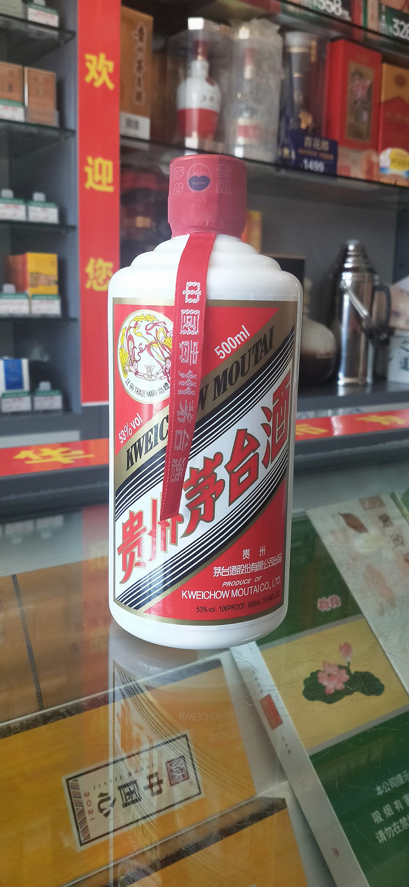

# 茅台酒

茅台酒产自贵州省仁怀市茅台镇，是酱香型白酒的代表。它以高粱为原料，用小麦制作高温大曲，经多轮蒸煮、发酵、取酒，基酒再经贮存和勾调。常见飞天茅台酒精度为 53% vol。

图：茅台酒。图片：毕明明，CC BY-SA 4.0，via Wikimedia Commons（[原图页面](https://commons.wikimedia.org/wiki/File:Kweichow_Moutai_2023_Part_1.jpg)）。

## 定义与定位

茅台酒是[白酒](ref:baijiu)中的一个品牌产品，也是“酱香型”这一风格的代表。品牌、产地与风格是三个不同层次：茅台镇是地理产地，茅台酒是具体品牌，酱香型是工艺与风味类别。把三者混为一谈，是选购与讨论中最常见的误差来源。

茅台酒属于蒸馏酒，酒精度以[体积分数](ref:abv)标示。常见产品为 53% vol，也有 43% vol 等低度版本。不同度数的酒体设计、勾调比例与口感目标并不相同，不能简单用“度数越高越好”来判断。

## 产区与风土

茅台镇位于赤水河谷，河谷地形带来较为稳定的温度与湿度，夏季高温、冬季温和，利于开放式制曲与堆积发酵中的微生物活动。当地水源、土壤与长期酿造形成的环境微生物，被视为酱香风格的条件之一。

“离开茅台镇酿不出茅台”是行业内的说法，强调产地环境与传统工艺的整体性。它不应被理解为严格意义上的科学结论，也不意味着其他产区无法酿出优质酱香酒。产区价值来自气候、原料、工艺与长期积累的共同作用。

## 原料与制曲

主要原料是当地糯高粱与小麦。糯高粱支链淀粉比例高，耐得住多轮蒸煮，能在反复发酵中持续提供糖分。小麦用于制作高温大曲，制曲温度较高，曲块经过堆积与翻曲，形成以细菌、霉菌和酵母为主的复杂群落。

[制曲](ref:qu-making)是酱香风格的基础。高温大曲的香气前体在后续发酵与蒸馏中转化，形成酱香、焦香与焙烤香的复合结构。曲的质量依赖季节、温度与操作经验，因此同一酒厂不同批次的基酒也会存在差异。

## 「茅台酒」怎么做出来
酱香型白酒的公开工艺常被概括为“一年一个生产周期、两次投料、九次蒸煮、八次发酵、七次取酒”。粮食与曲按比例混合，经过多轮循环，每次蒸煮后摊凉、加曲、堆积、入窖发酵，再取酒。不同轮次的基酒风格差异明显，需要分别贮存。

取酒之后进入陈贮与勾调。基酒在陶坛中贮存数年，让刺激性成分挥发、香气融合，再由勾调师按轮次、年份与风格组合。勾调不是简单混合，而是用不同基酒补齐结构。装瓶前通常不再加水降度，或按产品设计调整。

## 「茅台酒」的闻与喝
茅台酒的香气常被描述为酱香突出，兼具焦香、花果香、焙烤香与曲香，空杯留香持久。入口酒体较厚，甜感与酸感并存，苦味与鲜味在中段出现，回味较长。不同年份与轮次会带来细节差异，不能只凭“酱香”二字判断。

品鉴时用小杯，先静置闻香，再小口品尝，让酒液覆盖舌面。注意酒精刺激是否被酒体托住，以及收口是否干净。加水会改变香气结构，若要尝试，应逐滴加入并对比。温度过高会放大酒精感，室温饮用更能体现层次。

## 产品体系与标签

茅台酒有飞天、五星、年份酒与系列酒等不同产品线，价格、定位与酒体设计各不相同。“茅台镇”其他酒厂的产物与“茅台酒”不是同一概念，前者可以使用产地描述，后者受商标与地理标志保护。购买时应核对生产商、商标、执行标准与防伪信息。

酒标上的年份、批次与酒精度是判断产品身份的关键。年份酒的具体规则由企业标准与标签说明，不能仅凭包装颜色或“陈酿”字样推断。价格波动属于市场行为，本页不提供收藏或投资建议。

## 「茅台酒」的饮用与搭配
传统喝法是小杯纯饮，常温即可。佐餐时适合搭配酱香浓郁、咸鲜为主的中式菜肴，如酱牛肉、烧鹅、红烧类菜式与菌菇；辛辣与重酸会放大酒精刺激，也会压住细腻香气。餐前少量饮用即可，不宜大口干杯。

茅台酒也可以用于调制，但高酒精度会显著改变成品平衡。加冰或大量兑水并非传统方式，会稀释香气并改变口感结构。若用于烹饪，少量即可提香，过量会带来苦味。

## 「茅台酒」容易被读错的地方
第一，把“茅台镇”等同于“茅台酒”。产地与品牌不是同一个概念。
第二，认为酒精度越高越好。度数服务于酒体设计，低度版本同样有完整的风格目标。
第三，认为颜色发黄就是老酒。颜色可能来自贮存、容器或添加物，不能单独判断年份。
第四，用挂杯或酒花判断质量。这些现象与酒精度、表面张力有关，不是质量指标。
第五，把瓶贮时间等同于坛贮陈化。装瓶后变化速度远慢于陶坛贮存，存放条件也更难控制。

相关条目：[蒸馏](ref:distillation)。

**关键事实。**

| 项目 | 内容 |
| --- | --- |
| 一句话定位 | 产自贵州仁怀茅台镇的酱香型白酒代表，以高粱和小麦高温大曲酿造，常见酒精度 53% vol |
| 酒种/风格 | 白酒 |
| 酒精度 | 53–53% vol |

**来源与边界。** 本页关于「茅台酒」的关键事实，主要由以下来源交叉核对：贵州茅台酒股份有限公司（产品系列、产地与公开的企业信息）、国家市场监督管理总局、国家标准化管理委员会（酱香型白酒、高温大曲与相关工艺术语；白酒在饮料酒分类中的位置）、Oxford University Press（提供关于中国白酒、酱香风格与消费文化的条目；由原条目末尾参考资料迁移，未逐条复核访问日期）。价格、批次与状态会变，涉及这些字段时以页面所列来源的最新版本为准。正文为项目自写，来源只作核验，不复制原文。

**并读。** 把「茅台酒」与「白酒」、「制曲」、「蒸馏」放在一起读时，先确认它们是同一层级还是上下游关系：先确认酒种与产区，再比较年份、酒精度、价格与饮用场景。本页负责给出酒款的基本坐标，对照条目补上具体案例与差异；读完再回到本页，才能分清哪些差别属于酒款本身，哪些只是产地、批次或品牌选择。

## 参考资料
- [白酒](ref:baijiu)：茅台酒所属的大类与工艺背景。
- [制曲](ref:qu-making)：高温大曲如何塑造酱香风格。
- [蒸馏](ref:distillation)：白酒取酒与分级的基础工序。
- [酒精度](ref:abv)：理解 53% vol 与低度版本差异的指标。
