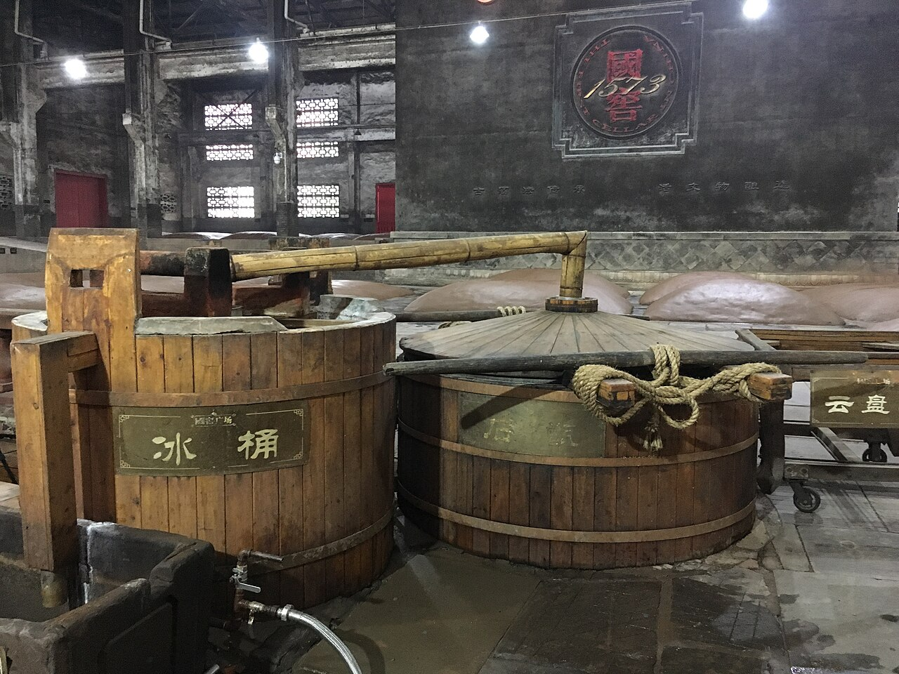

# 国窖1573

国窖1573是[泸州老窖](ref:brand)的高端[浓香型白酒](ref:strong-aroma)单品，名称直接取自始建于 1573 年的窖池群。常见规格为 52% vol、500 mL，产自四川泸州。名称、品牌、窖池与企业是四个概念，不能混为一谈。

图：国窖1573。图片：Xiaomage de，CC BY-SA 4.0，via Wikimedia Commons（[原图页面](https://commons.wikimedia.org/wiki/File:Traditioneller_chinesischer_Destillationsapparat_in_der_Brennerei_Luzhou_Laojiao.jpg)）。

## 定义与定位

国窖1573是产品名，不是企业名。“1573”指窖池群的始建年代，不是每一瓶酒的酒龄。它属于[白酒](ref:baijiu)中的浓香型路线，定位是品牌的高端核心单品，与特曲、头曲等系列拉开价格与酒体设计。

产品名借用窖池的历史符号，这在白酒行业很常见。但符号的历史不等于瓶中酒的历史，判断酒龄仍要看标签说明与企业公开口径。

## 生产者与品牌

酒款由[集团](ref:producer)体系生产，品牌由[泸州老窖](ref:brand)承载，上市公司负责生产经营与信息披露。集团、股份公司、品牌、产品四层不同，数据口径也不同。

因此，看到“国窖1573营收”时，应确认是上市公司披露的产品口径，还是渠道估算；看到“新品”时，也要确认是同一产品的版本更新，还是新增产品线。

## 「国窖1573」的产地与原料
泸州位于四川东南，长江与沱江在此交汇，气候温暖湿润，适合泥窖固态发酵。放到[中国](ref:china)白酒产区的格局里，泸州是浓香型的重要节点。

原料以[高粱](ref:sorghum)为主，小麦制曲，部分产品使用多粮配比。高粱的淀粉与颗粒结构影响发酵启动，曲的微生物组成影响窖香与粮香。原料表与执行标准是消费者能直接核对的信息。

## 「国窖1573」怎么做出来
浓香型采用泥窖固态发酵、续糟配料与混蒸混烧。[制曲](ref:qu-making)与窖池养护共同决定香气厚度与干净度；窖池连续使用越久，窖泥微生物生态越稳定。

出窖后经[蒸馏](ref:distillation)分段摘酒，新酒按等级与轮次贮存，再勾调成型。贮存容器与时间影响辛辣感的消退速度，勾调则解决香气、酒体与收口的平衡。

## 「国窖1573」的瓶型与标签
常见规格为 52% vol、500 mL；也有不同度数、容量与礼盒版本。国窖1573所属浓香型白酒常见 GB/T 10781.1，具体以瓶身标注为准。

酒标上的生产商、品名、香型、酒精度、容量、执行标准与防伪信息，是核对身份的基本项。购买时应走正规渠道，核对防伪与批次，不要仅凭“1573”这个数字或包装风格判断。

## 「国窖1573」的闻与喝
香气以窖香、粮香为主，常伴甜香；入口绵甜，酒体较饱满，中段香气展开，尾味干净。不同窖池、不同酒龄与不同勾调会带来明显差异，不能用一个描述覆盖全部批次。

国窖1573 的窖香来自持续使用的老窖池，品鉴时可先对比 52% vol 与低度版的香气释放。用小杯、常温、少量，入口后让酒液在舌面停留，感受窖香、粮香与甜味的次序；不要加冰，加水只用于对比香气层次。

## 历史与市场

就「国窖1573」而言，公开资料显示，始建于 1573 年的窖池群于 1996 年被列为全国重点文物保护单位；上市公司 1994 年上市，集团 2000 年成立。这些节点有文物与公开登记依据，可以核对。

国窖1573 是品牌高端化的代表产品，长期处于高端价格带。国窖1573 的价格受度数、容量、批次与礼盒版本影响，高端餐饮与流通渠道的标价常有差距；1573 指窖池始建年代，不是瓶中酒龄。把“1573”当作酒龄，是这一产品最常见的误读。

## 「国窖1573」的购买与保存
购买时优先选择正规渠道，核对防伪、生产商与批次。国窖1573 的礼盒常有双瓶、不同度数与赠品组合，购买时要核对盒内瓶数与批次，不能把盒子大小当成酒体等级。整箱购买还应检查封条与储存条件。

国窖1573 未开瓶应避光、阴凉、直立存放，避免高温与强烈气味；开瓶后香气会随空气接触逐渐散失，应拧紧瓶盖并尽快饮用。家中的“存放几年”不会复制酒厂窖池与勾调条件，不能简单当成年份增值。

## 「国窖1573」容易被读错的地方
第一，把“1573”当作瓶中酒龄。它首先是窖池与产品名称。
第二，把国窖1573当作企业名。它是产品名。
第三，认为度数越高越正宗。度数服务于产品设计。
第四，把包装版本当作酒体升级。版本差异需看官方说明。
第五，用价格或包装判断真伪。防伪、渠道与标签更可靠。

国窖1573的名字来自始建于明代的窖池群，而不是每瓶酒都陈放了数百年。它属于浓香型高端单品，常见高度、五百毫升规格；窖池的连续使用与老窖泥对风味有影响，但“1573”仍是品牌与窖池叙事，不是瓶中酒龄或质量等级的直接证明。国窖1573的窖池群属于连续使用的老窖资源，窖泥微生物会影响风味，但这不是瓶中酒龄的证明；产品等级还取决于基酒组合与贮存。读标签时把品牌叙事、窖池历史与产品标准分开。

对照阅读：[泸州老窖](ref:brand)、[白酒](ref:baijiu)。

**关键事实。**

| 项目 | 内容 |
| --- | --- |
| 一句话定位 | 泸州老窖的高端浓香型单品，名称取自始建于 1573 年的窖池群，常见 52% vol、500 mL；名称不等于瓶中酒龄 |
| 酒种/风格 | 白酒、浓香型白酒 |
| 产区 | 中国 |
| 酒精度 | 52–52% vol |
| 生产商/品牌 | 泸州老窖集团有限责任公司、泸州老窖 |

**来源与边界。** 本页关于「国窖1573」的关键事实，主要由以下来源交叉核对：泸州老窖集团有限责任公司（品牌、产品系列与公开信息）、国家市场监督管理总局、国家标准化管理委员会（浓香型白酒的产品标准口径；泥窖发酵、续糟配料等术语）、Oxford University Press（提供关于中国白酒的条目；由原条目末尾参考资料迁移，未逐条复核访问日期）。价格、批次与状态会变，涉及这些字段时以页面所列来源的最新版本为准。正文为项目自写，来源只作核验，不复制原文。

## 参考资料
- [泸州老窖](ref:brand)：品牌结构与产品体系。
- [泸州老窖集团有限责任公司](ref:producer)：集团与上市公司层级。
- [白酒](ref:baijiu)：大类与香型体系。
- [浓香型白酒](ref:strong-aroma)：国窖1573的泥窖、续糟与香气框架。
- [高粱](ref:sorghum)：浓香型的主要原料之一。
- [制曲](ref:qu-making)：曲对香气的作用。
- [蒸馏](ref:distillation)：摘酒与酒精度的基础。
- [中国](ref:china)：国窖1573所在的香型与产区制度背景。
