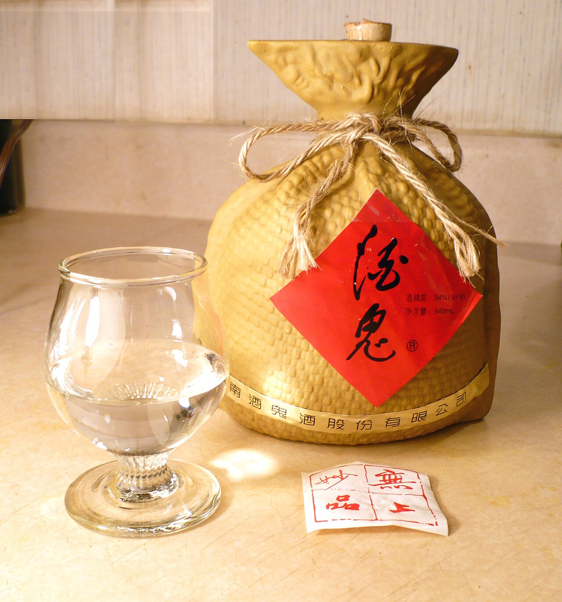

# 酒鬼酒

酒鬼酒产自湖南吉首，属馥郁香型白酒。该香型融合浓香、清香和酱香工艺特点，以高粱、大米、糯米、小麦、玉米为原料，常见酒精度为 52% vol。

图：酒鬼酒。图片：Badagnani，CC BY 3.0，via Wikimedia Commons（[原图页面](https://commons.wikimedia.org/wiki/File:Jiugui.jpg)）。

## 定义与定位

酒鬼酒是[白酒](ref:baijiu)中的一个品牌，也是馥郁香型的主要代表。馥郁香型不是“把三种香型混在一起”，而是在制曲、发酵、蒸馏与贮存各环节形成一套独立工艺，使成品同时具备浓香的甜绵、清香的爽净与酱香的回味。

产品属于蒸馏酒，酒精度以[体积分数](ref:abv)标示，常见为 52% vol。香型是类别概念，风格是产品概念；同一香型下的不同系列，香气重心与酒体厚度仍会不同。

## 产区与环境

吉首位于湘西，属亚热带季风气候，湿度较高、四季分明，山地地形让局部小气候更加多样。温暖湿润的环境有利于制曲与开放式发酵，也对车间的卫生管理提出更高要求。当地水源与粮食，是风格形成的基础条件。

湘西的酿酒传统与多民族饮食文化相连。酒鬼酒的产地叙事常强调山谷、泉水与洞穴，这些要素可以作为理解贮存与微生物环境的线索，但不能替代对具体工艺和标签的核对。

## 原料与制曲

五种粮食分别提供淀粉、蛋白质与结构感：高粱是骨架，大米与糯米增加甜润，小麦利于制曲与发酵，玉米带来厚度。多粮配方让香气更复合，也提高了原料管理与配比控制的难度。

馥郁香型通常结合小曲与大曲：小曲糖化能力强，大曲提供更复杂的香气前体。[制曲](ref:qu-making)温度与曲种比例，会影响发酵启动速度与最终香气的走向。曲香过重会压住粮香，曲香不足则酒体显得单薄。

## 「酒鬼酒」怎么做出来
公开流程包括：原料处理、蒸煮、摊凉、加曲、入窖发酵、蒸馏取酒、分级贮存、勾调、装瓶。发酵容器与窖池管理决定微生物环境；蒸馏时的分段摘酒，决定基酒的干净度与香气厚度。

新酒按轮次与等级分别贮存，再通过勾调形成成品。馥郁香型的难点在于“复合”而不“杂乱”：浓、清、酱三方面的特征需要在一个酒体中协调，不能彼此冲突。贮存与勾调正是解决这一问题的环节。

发酵周期与轮次安排会随季节调整：夏季需要控温，防止酸度过高；冬季需要保温，保证发酵启动。车间卫生与曲房湿度同样重要，任何一环失控都会让复合香气变得杂乱。

## 「酒鬼酒」的闻与喝
馥郁香型的典型描述是“前浓、中清、后酱”：入口有浓香的甜绵，中段清爽，回味带酱香。它是行业标准中的香型分类，不是营销形容词；不同产品和年份仍会有差异。

品鉴时用小杯，先闻静止香气，判断是否有明显的单一香型压过其他层次；再小口品尝，感受香气从入口到回味的转换。评价重点在协调性，而不是某一种香气有多强。加水会改变层次，若要尝试应逐滴加入。

## 产品体系与标签

酒鬼酒有内参、酒鬼等系列，定位与酒体设计不同。包装与命名带有强烈的湘西文化符号，这属于品牌叙事；讨论品质时，仍应回到原料、工艺与酒体本身。核对酒鬼酒时，应把生产商、香型、酒精度、执行标准与净含量五项对齐，再查批次。酒鬼酒的仿冒风险多集中在近似商标、同名系列与礼盒改包，购买时应通过正规渠道并核对防伪。

“年份”“洞藏”等表述需要结合企业标准与标签说明理解。洞藏描述贮存环境，不等于瓶中酒液的准确年龄；具体酒龄与勾调比例，应以官方信息为准。

## 「酒鬼酒」的饮用与搭配
小杯纯饮，适合搭配湘菜等味道鲜明的菜肴。湘菜的辣味与腊味会放大酒精刺激，也会改变对甜感的判断；初次尝试可以少量入口，先感受香气层次，再决定是否搭配重口味菜式。

酒鬼酒也可以用于调制，但高酒精度会显著改变成品平衡。加冰或大量兑水并非传统方式，会稀释复合香气。开瓶后应避光、阴凉存放，并尽量在合理时间内喝完；饮用时应控制节奏，避免空腹快饮。

## 「酒鬼酒」容易被读错的地方
第一，把馥郁香型理解为“三种酒勾兑”。它是完整工艺形成的香型，不是简单混合。
第二，认为香型越复合越好。复合需要协调，杂乱不是复杂度。
第三，用浓香或酱香的标准单独评判。评价框架应与香型匹配。
第四，把洞藏等同于年份保证。洞藏是贮存条件，不是具体酒龄。
第五，用包装或价格判断真伪。防伪、渠道与标签核对才可靠。

对照阅读：[白酒](ref:baijiu)、[制曲](ref:qu-making)。

**关键事实。**

| 项目 | 内容 |
| --- | --- |
| 一句话定位 | 产自湖南吉首的馥郁香型白酒，融合浓香、清香和酱香工艺特点，常见酒精度 52% vol |
| 酒种/风格 | 白酒 |
| 酒精度 | 52–52% vol |

**来源与边界。** 本页关于「酒鬼酒」的关键事实，主要由以下来源交叉核对：酒鬼酒股份有限公司（产地、香型与产品系列）、国家市场监督管理总局、国家标准化管理委员会（馥郁香型白酒与相关工艺术语；白酒在饮料酒分类中的位置）、Oxford University Press（提供关于中国白酒香型与消费文化的条目；由原条目末尾参考资料迁移，未逐条复核访问日期）。价格、批次与状态会变，涉及这些字段时以页面所列来源的最新版本为准。正文为项目自写，来源只作核验，不复制原文。

**并读。** 把「酒鬼酒」与「白酒」、「浓香型白酒」、「制曲」放在一起读时，先确认它们是同一层级还是上下游关系：先确认酒种与产区，再比较年份、酒精度、价格与饮用场景。本页负责给出酒款的基本坐标，对照条目补上具体案例与差异；读完再回到本页，才能分清哪些差别属于酒款本身，哪些只是产地、批次或品牌选择。

**适用边界。** 对「酒鬼酒」而言，年份、批次、酒精度与包装会变；酒种定义与产区法规较稳定。购买时先看背标，再看品牌页面。

## 参考资料
- [白酒](ref:baijiu)：酒鬼酒所属的大类与香型体系。
- [浓香型白酒](ref:strong-aroma)：理解“前浓”特征的参照。
- [制曲](ref:qu-making)：大小曲结合如何影响复合香气。
- [酒精度](ref:abv)：比较不同产品强度的指标。
