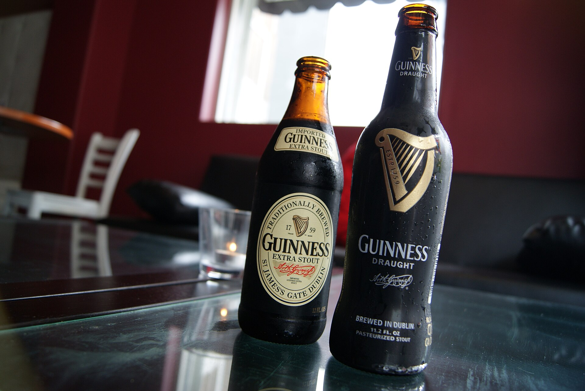

# 健力士世涛啤酒

健力士是爱尔兰都柏林圣詹姆斯门啤酒厂生产的干世涛，代表产品 Guinness Draught 酒精度约 4.2% vol。它以烘焙大麦带来咖啡、可可般的深色与苦味，氮气版本口感更绵密。

图：健力士世涛啤酒相关实景照片。图片：Aneil Lutchman，CC BY-SA 2.0，via Wikimedia Commons（[原图页面](https://commons.wikimedia.org/wiki/File:Guinness_Extra_Stout_and_Guinness_Draught.jpg)）。

## 定义与定位

健力士是品牌，世涛是[啤酒](ref:beer)风格。世涛源于英国的波特啤酒传统，后来在爱尔兰发展出干型路线。干世涛强调烘焙风味与干净的收口，而不是甜腻的糖浆感；它与“黑啤”这一笼统说法并不等同。

需要区分包装与产品：Guinness Draught 是具体产品，罐装、瓶装与生啤的氮气处理方式不同，口感也有差异。品牌下还有其它世涛与特色产品，酒精度与风味目标各不相同。

## 产地与历史

健力士的历史可追溯到 1759 年，阿瑟·健力士在都柏林圣詹姆斯门取得酒厂租约并开始酿造。18 至 19 世纪，波特与世涛在伦敦与爱尔兰流行，健力士逐步成为最具代表性的爱尔兰世涛品牌。

都柏林的软水与原料供应影响了早期风格。品牌后来扩展到多国生产，但圣詹姆斯门仍是标志性厂址。产地与品牌历史是理解健力士的背景，但具体产品的产地应看标签。

波特与世涛在 18 至 19 世纪的伦敦啤酒市场逐步分化。世涛原指“烈性”啤酒，后来演变为风格名；爱尔兰的健力士把这一风格工业化，并借助铁路与航运扩展到海外市场。这段历史解释了为什么世涛与波特在风味上既有亲缘、又有区别。

## 原料

主要原料包括大麦芽、烘焙大麦、水、酒花与酵母。烘焙大麦是深色与咖啡、可可风味的主要来源，也是苦味的一部分；未发芽的烘焙大麦还能带来干爽的收口。酒花用量通常不高，主要提供苦味平衡。

水质对世涛有影响。都柏林的软水适合深色麦芽的糖化与发酵；现代工厂会调整水化学以稳定生产。原料比例与烘焙程度决定颜色、苦味与酒体，具体配方属于生产者信息。

## 「健力士世涛啤酒」怎么做出来
典型流程是：麦芽粉碎、糖化、过滤、煮沸、冷却、接种酵母、主发酵、后发酵与熟成。部分产品使用氮气充填或氮气混合气体，以形成细密泡沫与顺滑口感；氮气本身不溶于酒液，主要改变泡沫与口感。

罐装产品常内置氮气气囊，开罐时释放气体形成泡沫层；生啤则通过氮气酒头分配。不同包装的工艺与口感差异，是健力士产品线的重要特点，也是消费者容易忽略的部分。

烘焙大麦在糖化中提供颜色与风味，但过多会带来焦苦；酒花用量需与麦芽甜感平衡。发酵温度与酵母菌株影响酯香，干世涛通常控制得较干净，以突出烘焙风味而不是果香。

## 「健力士世涛啤酒」的闻与喝
健力士 Draught 通常酒体中等偏轻，带有咖啡、可可、烤面包与轻微酒花苦味，收口干爽。颜色深不代表酒体厚重；它的苦味来自烘焙大麦，而不是大量酒花，因此与 IPA 的苦味性质不同。

品鉴时先看泡沫的细密度与持久性，再闻烘焙香气；入口感受苦味与甜感的平衡，以及氮气带来的顺滑质地。温度过低会压抑香气，过高则显得松散。与其它世涛比较时，应区分干型与甜型。

氮气啤酒的泡沫更细密、口感更顺滑，但香气释放相对缓慢。评价时应把泡沫质地与香气分开判断：泡沫好不代表香气强，反之亦然。

## 产品体系与标签

健力士的产品包括 Draught、Extra Stout 与特色系列，酒精度与原麦汁浓度不同。酒标上的产品名称、酒精度、容量与产地，是核对身份的基本信息。[饮料酒分类](ref:gbt-17204)把啤酒归入发酵酒，理解分类有助于避免与蒸馏酒混淆。

“氮气”“生啤”“原装进口”等表述需要结合包装与标签理解。不同市场的配方可能调整，酒精度与风味会有差异；购买时应查看标签，而不是只凭品牌名判断。

## 「健力士世涛啤酒」的饮用与搭配
适合在约 6–8°C 饮用，使用直身品脱杯；氮气版本倒酒后有明显的泡沫沉降过程，应等待泡沫稳定再饮用。泡沫沉降需要一点耐心，急于倒满会破坏口感层次。搭配牡蛎、炖肉、爱尔兰面包与硬质奶酪较合适；清淡沙拉会显得酒体过重。

开瓶或开罐后应尽快喝完，避免反复升温与氧化。啤酒应适量饮用，避免空腹快速饮用。氮气版本不宜剧烈摇晃，否则泡沫会失控。

## 「健力士世涛啤酒」容易被读错的地方
第一，把世涛等同于“黑啤”。颜色深不等于酒体厚重，世涛有干型与甜型之分。
第二，认为苦味都来自酒花。健力士的苦味很大部分来自烘焙大麦。
第三，认为氮气会改变酒精度。氮气主要影响泡沫与口感。
第四，把罐装与生啤当作同一体验。包装与分配方式不同，口感有差异。
第五，认为颜色越深越有营养。颜色来自烘焙，不等于营养高低。

对照阅读：[啤酒](ref:beer)、[酒精度（ABV）](ref:abv)。

相关条目：[GB/T 17204-2021《饮料酒术语和分类》](ref:gbt-17204)。

**关键事实。**

| 项目 | 内容 |
| --- | --- |
| 一句话定位 | 爱尔兰都柏林圣詹姆斯门啤酒厂生产的干世涛，代表产品酒精度约 4.2% vol，以烘焙大麦和氮气充填形成的绵密口感著称 |
| 酒种/风格 | 啤酒 |
| 酒精度 | 4.2–4.2% vol |

**来源与边界。** 本页关于「健力士世涛啤酒」的关键事实，主要由以下来源交叉核对：Guinness（品牌历史、产品与酒精度信息）、Beer Judge Certification Program（世涛的风格描述）、Oxford University Press（提供关于世涛、爱尔兰啤酒与氮气啤酒的条目；由原条目末尾参考资料迁移，未逐条复核访问日期）。价格、批次与状态会变，涉及这些字段时以页面所列来源的最新版本为准。正文为项目自写，来源只作核验，不复制原文。

**并读。** 把「健力士世涛啤酒」与「啤酒」、「GB/T 17204-2021《饮料酒术语和分类》」、「酒精度（ABV）」放在一起读时，先确认它们是同一层级还是上下游关系：先确认酒种与产区，再比较年份、酒精度、价格与饮用场景。本页负责给出酒款的基本坐标，对照条目补上具体案例与差异；读完再回到本页，才能分清哪些差别属于酒款本身，哪些只是产地、批次或品牌选择。

## 参考资料
- [啤酒](ref:beer)：啤酒的大类、原料与基本工艺。
- [饮料酒分类](ref:gbt-17204)：啤酒在饮料酒体系中的位置。
- [酒精度](ref:abv)：理解 4.2% vol 与低度发酵酒。
