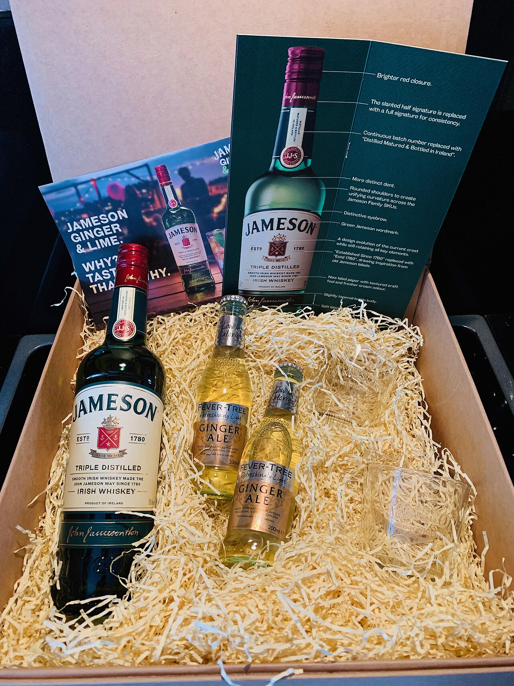

# 尊美醇爱尔兰威士忌

尊美醇（Jameson）是爱尔兰调和[威士忌](ref:whisky)品牌，1780 年由 John Jameson 在都柏林创立，现由科克郡的 Midleton 蒸馏厂生产。它采用三次[蒸馏](ref:distillation)，由壶式蒸馏威士忌与谷物威士忌调和而成，常见酒精度为 40% vol。风味以谷物甜香、青苹果、香草与柔和香料为主。

图：尊美醇爱尔兰威士忌。图片：That's Dram Good，CC BY-SA 4.0，via Wikimedia Commons（[原图页面](https://commons.wikimedia.org/wiki/File:Jameson_Original.jpg)）。

## 定义与身份

爱尔兰威士忌是爱尔兰的地理标志产品，必须在爱尔兰境内（包括北爱尔兰）的蒸馏厂生产与陈年，使用谷物原料，并在橡木桶中陈年至少 3 年。除水与焦糖色外，通常不允许添加其他物质；装瓶酒精度不得低于 40% vol。尊美醇是这一类别中的调和威士忌，不是单一麦芽，也不是单一壶式。

“调和”在这里指把不同类型的威士忌组合：壶式蒸馏威士忌提供香料、油脂感与厚度，谷物威士忌提供甜感与轻盈酒体。品牌不公开具体比例，因此不能从风味反推某一种基酒占了多少。理解调和，比记住“三次蒸馏”更能解释它的顺滑风格。

## 「尊美醇爱尔兰威士忌」的时间线
1780 年，John Jameson 在都柏林建立蒸馏事业，随后在 Bow Street 设立蒸馏厂，逐渐成为爱尔兰威士忌的重要品牌。19 世纪，爱尔兰威士忌在全球市场占有重要地位；20 世纪则经历战争、禁酒令、贸易壁垒与产业收缩，许多蒸馏厂关闭或合并。

1975 年，生产集中到科克郡的 Midleton 蒸馏厂，品牌延续至今。尊美醇的现代形象强调顺滑、易饮与调酒友好，这与三次蒸馏和调和结构有关，也与品牌长期的市场定位有关。历史年份与某一瓶酒的实际陈年不是同一件事；标准版通常不标年龄。品牌通过稳定的调和结构降低批次差异，使风味在不同市场保持一致。

## 「尊美醇爱尔兰威士忌」的产地与原料
爱尔兰的气候温和湿润，适合大麦生长；威士忌原料包括大麦，也可能使用玉米或其他谷物。壶式蒸馏威士忌通常使用发芽与未发芽大麦混合，谷物威士忌则以玉米等为主要淀粉来源。原料比例与糖化、发酵条件会影响酒体的甜感、谷物味与油脂感。

水、酵母与蒸馏设备同样重要。铜制壶式蒸馏器的形状会影响回流与香气保留；三次蒸馏通常得到更轻、更纯净的酒体，但也可能减少某些厚重风味。不能简单地说“蒸馏次数越多越好”，因为风格目标不同：苏格兰单一麦芽常用两次蒸馏以保留更多油脂与复杂香气，爱尔兰调和则可能追求顺滑。

## 工艺与陈年

威士忌的法定陈年必须在橡木桶中进行，常用桶包括波本桶与雪莉桶。[橡木桶陈年](ref:oak-ageing)带来香草、椰子、干果与香料，也通过缓慢氧化柔化刺激感。尊美醇的具体桶型与比例不公开，标准版通常以波本桶为主，以获得香草与谷物甜香。

调和发生在陈年之后或装瓶之前：不同桶、不同年份、不同类型的威士忌被组合，以稳定风格。装瓶时可能加水降低酒精度，也可能加入少量焦糖色调色。标签上的“三次蒸馏”描述工艺，不等于“陈年更久”或“质量更高”；评价仍需回到具体酒款与批次。

## 「尊美醇爱尔兰威士忌」的闻与喝
尊美醇的典型香气是谷物甜香、青苹果、梨、香草与淡淡的花香，入口柔顺，甜感明显，中段出现香料与木质，余味中等。它通常没有明显的泥煤烟熏，这与部分苏格兰威士忌形成对比。不同版本（如桶强度、特殊桶陈）会有更强烈的香气与酒精度。

品鉴时可以纯饮，室温即可；加少量室温水能打开香气并降低刺激；加冰会降温与稀释，适合炎热天气或较高酒精度的版本。不要用大量苏打水掩盖风味，否则谷物甜香与香料层次会被冲淡。

## 「尊美醇爱尔兰威士忌」的饮用与搭配
纯饮、加冰、加苏打水都是常见喝法；尊美醇也广泛用于爱尔兰咖啡与威士忌调酒。作为调和威士忌，它的顺滑结构适合入门，但不应因此把它当成“没有个性”的酒。餐食方面，适合搭配烤鸡、猪肉、奶油类菜肴与中等强度的奶酪；与重辣或重酸菜肴搭配时，酒精与甜感可能冲突。

保存时应避免阳光直射与高温，瓶口密封、尽量满瓶。开瓶后香气会缓慢衰减，但通常比葡萄酒耐放；长期存放后重新饮用前，先小杯试味。

## 「尊美醇爱尔兰威士忌」容易被读错的地方
第一，把爱尔兰威士忌都当成单一麦芽。爱尔兰有调和、单一麦芽与单一壶式等多种类型。
第二，认为三次蒸馏是尊美醇独有。多家爱尔兰酒厂也采用三次蒸馏，且并非所有爱尔兰威士忌都如此。
第三，把“顺滑”当成“低质量”。顺滑来自蒸馏与调和选择，是风格，不是缺陷。
第四，把尊美醇当成苏格兰威士忌。它属于爱尔兰地理标志，产区与法规不同。
第五，认为标准版有明确年份。无年龄标示的调和威士忌不等于“没有陈年”，只是未标最低年份。

**关键事实。**

| 项目 | 内容 |
| --- | --- |
| 一句话定位 | 爱尔兰调和威士忌品牌，1780 年创立于都柏林，现由科克的 Midleton 蒸馏厂生产；三次蒸馏，常见酒精度 40% vol |
| 酒种/风格 | 威士忌 |
| 酒精度 | 40–40% vol |

**来源与边界。** 本页关于「尊美醇爱尔兰威士忌」的关键事实，主要由以下来源交叉核对：Jameson（品牌历史、三次蒸馏与产品信息）、Irish Whiskey Association（爱尔兰威士忌地理标志、最低陈年与标签要求）、Oxford University Press（提供关于爱尔兰威士忌、三次蒸馏与调和工艺的条目）等 4 条来源。价格、批次与状态会变，涉及这些字段时以页面所列来源的最新版本为准。正文为项目自写，来源只作核验，不复制原文。

**并读。** 把「尊美醇爱尔兰威士忌」与「威士忌」、「蒸馏」、「橡木桶陈酿」放在一起读时，先确认它们是同一层级还是上下游关系：先确认酒种与产区，再比较年份、酒精度、价格与饮用场景。本页负责给出酒款的基本坐标，对照条目补上具体案例与差异；读完再回到本页，才能分清哪些差别属于酒款本身，哪些只是产地、批次或品牌选择。

## 参考资料
- [威士忌](ref:whisky)：尊美醇所属的蒸馏酒大类。
- [蒸馏](ref:distillation)：三次蒸馏与酒体风格的关系。
- [橡木桶陈年](ref:oak-ageing)：香草、干果与结构形成的主要环节。

把尊美醇放回爱尔兰的三次蒸馏传统，可对照[威士忌](ref:whisky)与[蒸馏](ref:distillation)。
